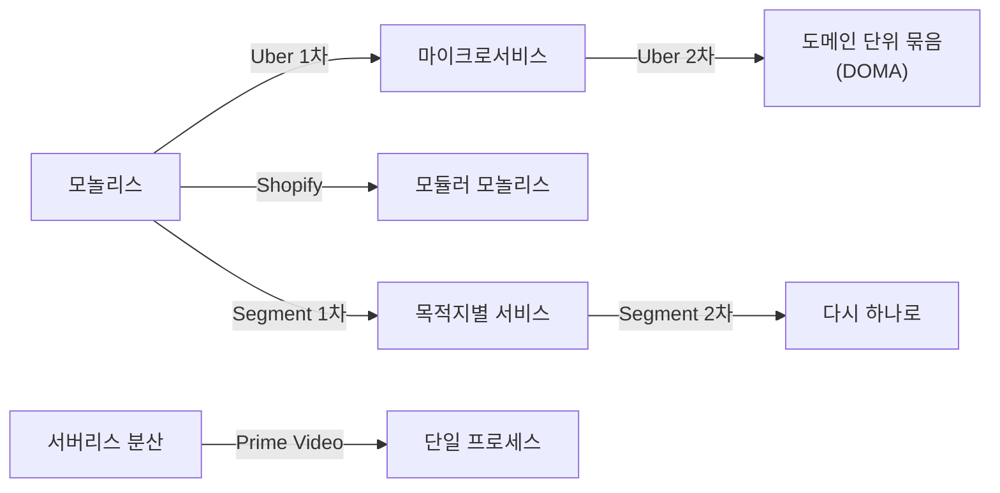
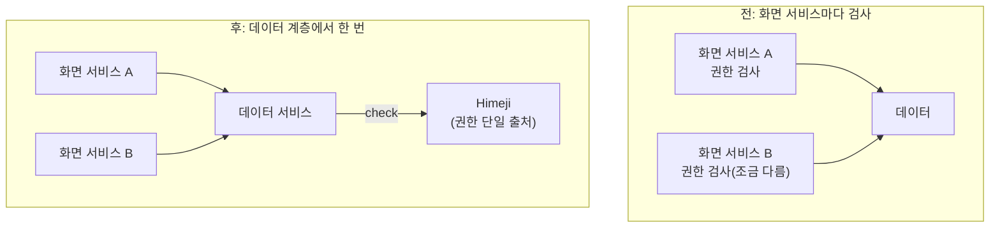
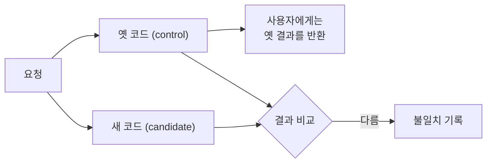

# 운영 중인 구조 바꾸기 — 전환 사례와 판단 기준

> 용도: **이미 돌아가는 시스템의 구조를 어떻게 바꾸는가.** [개념 노트](concept.md)가 "새로 만들 때"라면, 이 문서는 "이미 있는 것을 고칠 때"다.
> 기반: Uber·Shopify·Segment·Amazon Prime Video·Airbnb·Discord 공개 엔지니어링 글, GitHub Scientist(2016).
> 관련: 결정 기록 형식은 [개념 노트 1-5 ADR](concept.md), 점진 대체(Strangler Fig)와 모듈러 모놀리스→분리 단계는 [AI 시대 검증·구조 유지 4장](deep-ai-era-verification.md), 경계의 이론은 [모듈성 이론](deep-modularity-theory.md).

---

## 0. 30초 직관 — 달리는 버스의 바퀴 갈기

새로 짓는 건 빈 땅에 집을 짓는 일이다. 운영 중인 구조를 바꾸는 건 **승객을 태운 채 달리는 버스의 바퀴를 가는 일**이다. 버스를 세울 수 없으니, 바퀴 하나씩, 승객이 모르게 바꿔야 한다.

그래서 질문이 달라진다.

> 새로 지을 때: **"어떤 구조가 맞나?"**
> 바꿀 때: **"어디까지 바꾸고, 무엇은 그대로 둘까? 그리고 중간에 뭔가 틀어지면 어떻게 알아챌까?"**

이 문서의 결론을 먼저 말하면 세 줄이다.

1. 기본값은 **바깥 모양(인터페이스·배포 단위)은 그대로, 안만 바꾸기**다.
2. 바깥 모양을 바꾸는 건 **팀 독립·장애 격리 같은 운영상 이득이 실제로 필요할 때만**이다.
3. 옮기는 동안에는 **버그까지 그대로 옮기고**, 버그 수정은 **따로** 한다.

---

## 1. 여섯 회사, 여섯 방향

이상하게 들리지만 사례들은 **한 방향으로 흐르지 않는다.** 모놀리스에서 MSA로 간 회사도 있고, MSA에서 모놀리스로 돌아온 회사도 있다.



*(도식 설명: Uber는 모놀리스에서 마이크로서비스로 갔다가 다시 서비스들을 도메인 단위로 묶었다. Shopify는 배포는 하나로 두고 내부 경계만 강제하는 모듈러 모놀리스로 갔다. Segment는 서비스를 쪼갰다가 특정 파이프라인을 다시 하나로 합쳤다. Prime Video는 서버리스로 분산된 모니터링 서비스 하나를 단일 프로세스로 합쳤다. 방향이 제각각이라는 점이 핵심이다.)*

방향이 제각각인 이유는 하나다. **각자 아픈 곳이 달랐다.** 그래서 사례는 "어디로 갔나"보다 **"무엇이 아팠나"** 로 읽어야 한다.

| 회사 | 아팠던 곳 | 한 처방 | 바꾼 범위 |
|---|---|---|---|
| Uber | 팀끼리 배포가 묶임 → 이후 서비스 수천 개의 복잡도 | 분리 → 도메인 단위로 다시 묶기 | 구조 |
| Shopify | 코드 결합, 느린 테스트 | 배포는 하나, 내부 경계 강제 | 내부 |
| Segment | 서비스 수에 비례한 운영 부담 | 특정 파이프라인만 다시 합침 | 구조 (일부) |
| Prime Video | 분산 비용, 컴포넌트 간 데이터 전송 | 서비스 하나를 한 프로세스로 | 서비스 하나의 내부 |
| Airbnb | 권한 검사 중복·불일치 | 권한을 데이터 계층 + 중앙 시스템으로 | 횡단 관심사 |
| Discord | GC 스파이크, 불변 자료구조 한계 | 병목만 Rust로 | 컴포넌트 내부 |

---

## 2. 사례별 — "무엇이 아팠고, 무엇을 지켰나"

### 2-1. Uber — 쪼갰다가, 다시 묶다

**그런데**(문제): 2012~13년 Uber는 모놀리스 2개로 돌아갔다. 한 번의 회귀가 전체 장애로 번졌고, 배포는 위험하고 느렸다. 엔지니어가 수십 명에서 수백 명으로 늘자 팀들의 운명이 하나로 묶였다.

**그래서**(처방 1): 마이크로서비스로 쪼갰다. 팀이 독립적으로 배포하고, 소유권이 분명해졌다.

**근데 이것도**(다음 한계): 서비스가 약 2,200개가 되자, 장애 원인 하나를 찾으려 수십 개 서비스와 여러 팀을 거쳐야 했다. 서로의 서비스를 고치고 함께 배포해야 하는 **"네트워크로 이어진 모놀리스"** 가 생겼다.

**그래서**(처방 2, DOMA): 서비스를 버리지 않고 **도메인 단위로 묶었다.**

| 개념 | 뜻 |
|---|---|
| Domain | 관련 서비스들의 묶음 |
| Layer | 도메인이 어느 쪽에만 의존할 수 있는지 제한 |
| Gateway | 도메인의 단일 진입점 |
| Extension | 다른 팀 로직은 정해진 확장 지점으로만 |

> **배울 점**: Uber 스스로 마이크로서비스를 **"네트워크 비용을 치르는 라이브러리"** 처럼 볼 수 있다고 말한다. 얻는 건 독립 배포·확장이라는 **운영상 이득**이다. 그 이득이 필요 없으면 조기 도입은 손해다.

### 2-2. Shopify — 배포는 그대로, 안에 벽만 세우다

**그런데**: 10년 넘게 천 명 넘는 개발자가 만진 Rails 코드베이스. 경계가 없어서 배송비 계산 코드와 결제 코드가 아무렇게나 서로를 호출했다. 테스트는 쓰기 어렵고 CI는 느렸다.

**그래서**: 유행하던 마이크로서비스 대신, **배포 단위를 늘리지 않고 모듈성만 높이는 길**을 골랐다. 코드는 한 저장소·한 배포에 두되 컴포넌트 사이 경계를 강제했다. 경계 위반은 정적 분석 도구(Packwerk)로 잡았다.

> **배울 점**: "구조는 유지, 내부만 변경"의 대표 사례다. 컴포넌트마다 팀 소유가 생기자 Rails 업그레이드 같은 전체 작업도 팀별로 나눠 처리할 수 있게 됐다.
> 🔎 이 경로가 나중에 "일부 서비스 분리"로 이어지는 단계적 그림은 [AI 시대 검증 4.2](deep-ai-era-verification.md)에 있다.

### 2-3. Segment — 쪼갰다가, 돌아오다

**그런데**(모놀리스 시절): Segment는 받은 이벤트를 Google Analytics 같은 외부 목적지 백여 곳으로 보낸다. 목적지 하나가 고장 나면 공용 큐가 막혀 **모든 목적지가 같이 밀렸다.**

**그래서**: 목적지마다 서비스와 큐를 따로 만들었다. 이제 한 곳이 막혀도 그 큐만 밀린다. 장애 격리 성공.

**근데 이것도**: 급성장기에 목적지가 월 3개꼴로 늘었다. 저장소·큐·서비스가 같이 늘고, 공유 라이브러리 버전이 서비스마다 제각각이 됐다. **운영 부담이 목적지 수에 비례해 커졌고** 개발 생산성이 떨어졌다.

**그래서**: 그 파이프라인만 다시 하나의 서비스로 합치고, 큐는 Centrifuge라는 시스템으로 통합했다.

> **배울 점**: 포기한 것(장애 격리, 기본으로 따라오던 가시성)을 알고 골랐다. 그리고 **다른 영역의 마이크로서비스는 그대로 뒀다.** 아키텍처는 회사 단위가 아니라 **컴포넌트 단위로** 정한다.

### 2-4. Amazon Prime Video — 서비스 하나만 합치다

**그런데**: 라이브 스트림 수천 개의 화질 문제를 자동으로 찾는 모니터링 도구가 서버리스로 잘게 나뉘어 있었다. 컴포넌트 사이로 영상 프레임을 주고받는 비용과 오케스트레이션 비용이 너무 컸고, 확장도 어려웠다.

**그래서**: 컴포넌트를 한 프로세스에 넣어 프레임을 메모리로 공유했다. 인프라 비용이 90% 넘게 줄었다.

> **배울 점**: 이 사례는 "Amazon이 모놀리스로 돌아갔다"로 자주 오해된다. 실제로는 **수많은 서비스 중 하나의 내부 구조만 바꾼 것**이다. 바깥에서 보면 그 서비스는 여전히 서비스 하나다.

### 2-5. Airbnb — 권한을 어디서 검사할 것인가

이 사례는 MSA로 쪼갤 때 **가장 놓치기 쉬운 것**을 보여준다.

**그런데**: Rails 모놀리스 시절엔 리소스마다 API가 하나라 권한 검사도 한 곳에 있었다. SOA로 쪼개면서 권한 검사를 화면용(presentation) 서비스로 옮겼더니 두 가지가 터졌다.
- 같은 데이터를 여러 서비스가 각자 검사 → **규칙이 서로 어긋남**
- 검사할 때마다 다른 서비스를 호출 → **느리고 불안정**

**그래서**:
1. 권한 검사를 **데이터 서비스 계층**으로 내렸다.
2. Google Zanzibar를 본뜬 중앙 권한 시스템 **Himeji**를 만들었다. 질문은 하나의 모양으로 통일된다: `check(entity, relation, principal)` — "이 사람이 이 대상에 이 관계(읽기·쓰기 등)를 가지는가?"



*(도식 설명: 전에는 화면 서비스 A와 B가 같은 데이터에 대해 각자 권한을 검사해서 규칙이 서로 달라질 수 있었다. 후에는 화면 서비스들은 검사하지 않고, 데이터 서비스가 데이터를 내주기 전에 Himeji라는 중앙 권한 시스템에 한 번 물어본다. 권한 규칙이 한 곳에만 있으니 어긋날 수 없다.)*

> **배울 점**: 권한은 **데이터에 접근하는 지점에서** 강제해야 화면 버그나 새로 생긴 서비스가 우회하지 못한다. 모놀리스를 쪼갤 때는 **"권한 검사가 어느 계층으로 가는가"를 먼저** 정해야 한다.

### 2-6. Discord — 아픈 이 하나만 뽑다

Discord의 Rust 도입은 "전부 다시 짜기"가 아니라 **병목만 골라 바꾸기**였다.

| 대상 | 아팠던 곳 | 바꾼 범위 | 결과 |
|---|---|---|---|
| Read States (읽음 표시) | Go GC가 약 2분마다 거대한 캐시를 훑으며 지연 스파이크 | 서비스 하나를 Rust로 재작성, API는 그대로 | 스파이크 제거 |
| Member List | Elixir의 불변 자료구조로는 큰 목록 갱신이 느림 | Elixir는 유지, 자료구조 하나만 Rust(NIF)로 | 최악 경우 약 160배 개선 |
| 메시지 저장소 | DB의 핫 파티션 | DB 앞에 Rust 데이터 서비스 추가, 같은 행 요청은 한 번만 조회 | DB 트래픽 스파이크 완화 |

> **배울 점**: Read States에서 Discord는 먼저 **기존 언어 안에서 고쳐 보려** 했다(캐시를 줄여 GC 부담을 낮춤). 그랬더니 캐시 적중률이 떨어져 p99가 나빠졌다. **기존 구조로 안 되는 이유를 확인한 뒤에** 바꿨다는 순서가 중요하다.
> Member List는 호출하는 쪽에서 보면 평범한 Elixir 모듈이다. **인터페이스를 지키고 안만 바꾼** 전형이다.

<details><summary>참고: 공개되지 않은 전환은 어떻게 다룰까 (예: Grok 4.7 → 4.8)</summary>

2026년 9월 기준 xAI는 Grok 4.8을 새 C++ 학습 스택으로 만들었다고 밝혔지만, 모델 카드나 기술 보고서는 없다. 이전 세대는 JAX·Rust·Kubernetes 기반 스택으로 알려져 있었다. 이렇게 **결과만 발표되고 과정이 공개되지 않은 전환**은 판단 기준을 배울 재료가 없다. 사례 공부는 **문제·대안·포기한 것까지 공개한 글**(이 문서의 여섯 회사처럼)로 하는 게 효율적이다.

</details>

---

## 3. ⭐ 판단 기준 1 — 바깥을 바꿀까, 안만 바꿀까

사례들을 겹쳐 보면 **"어떤 신호가 보이면 어떤 처방을 했나"** 가 패턴으로 나온다.

| 보이는 신호 | 처방 | 사례 |
|---|---|---|
| 팀끼리 배포가 묶여 서로를 막는다 | 배포 단위 분리 | Uber 1차 |
| 코드가 엉켜 있지만 배포 자체는 괜찮다 | 배포는 그대로, 내부 경계만 강제 | Shopify |
| 서비스 수에 비례해 운영 부담이 커진다 | 합치기, 또는 도메인 단위로 묶기 | Segment, Uber 2차 |
| 컴포넌트 하나가 성능·비용 한계에 부딪힌다 | 그 컴포넌트 내부만 교체 | Discord, Prime Video |
| 같은 규칙이 여러 곳에 흩어져 어긋난다 | 횡단 관심사를 한 곳으로 | Airbnb |

**핵심 요약**: 기본값은 **안만 바꾸기**다. 바깥(배포 단위·서비스 경계·API)을 바꾸는 순간 네트워크·정합성·운영 비용이 새로 생긴다. 그래서 바깥을 바꾸자는 쪽이 근거를 대야 한다. [개념 노트 3-2](concept.md)의 "기본값은 합쳐두는 것"과 같은 원리다.

---

## 4. ⭐ 판단 기준 2 — 옮기면서 버그도 고칠까

이사할 때를 떠올려 보자. 짐을 옮기면서 동시에 가구 배치까지 바꾸면, 나중에 뭔가 없어졌을 때 **"옮기다 잃어버린 건지, 일부러 버린 건지"** 알 수 없다.

코드도 똑같다.

> **원칙: 옮기는 동안은 동작을 그대로 옮긴다(버그까지). 버그 수정은 옮긴 뒤 따로 한다.**

이유는 검증이다. 새 구현의 결과가 옛 구현과 다를 때, 그 차이가 **"옮기다 생긴 실수"인지 "일부러 고친 것"인지** 구분할 수 없으면 아무것도 검증할 수 없다.

### 4-1. 어떻게 — 옛것과 새것을 나란히 돌려 비교

GitHub이 공개한 **Scientist**가 이 방법의 대표다.



*(도식 설명: 같은 요청을 옛 코드와 새 코드에 모두 넣는다. 사용자에게는 언제나 옛 코드의 결과만 돌려주므로 위험이 없다. 두 결과를 비교해서 다르면 기록만 남긴다. 불일치가 0에 가까워지면 그때 새 코드로 전환한다.)*

순서는 이렇다.
1. 옛것과 새것을 나란히 실행, 사용자에겐 옛 결과만 반환
2. 불일치를 기록하고 원인을 하나씩 없앤다
3. 불일치가 0에 수렴하면 전환
4. 그동안 발견한 옛 버그는 **목록으로 쌓아 두고**, 전환이 끝난 뒤 별도 변경으로 고친다

> 이 방식은 [Strangler Fig](deep-ai-era-verification.md)(옆에서 새 것을 키우며 기능을 하나씩 옮기기)와 잘 맞는다. Strangler Fig가 **"어디로 보낼지"** 를 정한다면, Scientist 방식은 **"보내도 되는지"** 를 확인한다.

### 4-2. 예외 — 같이 고쳐도 되는 경우

| 경우 | 예 | 조건 |
|---|---|---|
| 그 버그가 곧 전환의 이유일 때 | Discord의 GC 스파이크 | 고칠 대상이 명확하고 측정 가능 |
| 기다릴 수 없는 보안 문제 | 권한 우회 취약점 | ADR에 **"의도된 동작 변경"** 으로 적고, 비교 대상에서 그 항목만 제외 |

**핵심 요약**: 동작 변경은 **섞지 말고, 섞어야 하면 이름표를 붙여라.** 이름표가 없는 동작 변경은 검증을 망친다.

---

## 5. 진행 체크리스트

- [ ] 아픈 곳을 **숫자로** 쟀나 (지연, 비용, 배포 빈도, 장애가 번지는 범위)
- [ ] **기존 구조 안에서** 먼저 고쳐 봤나, 왜 안 됐나
- [ ] 바꾸는 범위가 **최소**인가 (서비스 전체? 자료구조 하나?)
- [ ] 호출하는 쪽의 **인터페이스가 그대로**인가
- [ ] **조금씩** 옮길 수 있나 (Strangler Fig, 이중 쓰기, 트래픽 비율 조절)
- [ ] 옛것과 새것을 **비교할 수단**이 있나
- [ ] **되돌리는 방법**이 있나
- [ ] **포기하는 것**을 적었나
- [ ] 결정을 **ADR**로 남겼나 (아래 템플릿)

---

## 6. 전환용 ADR 템플릿

[개념 노트 1-5의 ADR](concept.md)은 새로 만들 때의 결정 기록이다. 구조를 **바꿀** 때는 세 칸이 더 필요하다: **변경 유형**, **동작 변경 정책**, **이관·롤백 계획**.

```markdown
# ADR-NNNN: <결정 제목>

- 상태: 제안 | 승인 | 폐기 | ADR-XXXX로 대체
- 날짜: YYYY-MM-DD

## 1. 배경
무엇이 아픈가. 어디서 쓰이는가(핫 패스인가). 측정 수치.

## 2. 결정 동인
반드시 만족할 기준. 예: p99 50ms 이내, 무중단, API 계약 유지

## 3. 검토한 선택지
| 선택지 | 장점 | 단점 |
|---|---|---|
| A. 현행 유지 + 튜닝 | | |
| B. 내부 구현만 교체 | | |
| C. 구조 변경 (분리/통합) | | |

## 4. 결정
고른 선택지와 이유. 바꾸는 범위를 명확히.

## 5. 변경 유형
- [ ] 구조 유지, 내부만 변경 (인터페이스 동일)
- [ ] 구조 변경 (배포 단위·서비스 경계 변경)

동작 변경 정책
- [ ] 동작 그대로 이관 (발견한 버그는 별도 이슈)
- [ ] 의도된 동작 변경 포함 → 목록: ...

## 6. 이관 계획
1. 단계 → 검증 방법
2. 단계 → 검증 방법
3. 롤백 방법

## 7. 결과와 트레이드오프
- 얻는 것:
- 포기하는 것:
- 새로 생기는 위험:

## 8. 사후 검토 (전환 후 작성)
- 실제 수치:
- 예상과 달랐던 점:
```

### 6-1. 작성 예시 — 공개 글을 ADR로 다시 써 보기

> 공개된 엔지니어링 글을 이 양식으로 **재구성한 학습용 예시**다. 실제 회사 내부 문서가 아니다.

<details><summary>예시 1 · 구조 유지, 내부만 변경 — Discord Read States (Go → Rust)</summary>

- **배경**: 접속·전송·읽음마다 호출되는 핫 패스. Go 구현에서 약 2분마다 지연 스파이크. 원인은 GC가 수백만 객체의 LRU 캐시 전체를 훑는 것.
- **결정 동인**: 스파이크 제거, API 계약 유지.
- **선택지**: A. Go 튜닝(캐시 축소) → 적중률이 떨어져 p99 악화, 기각. B. Rust로 서비스 재작성 → GC가 없어 메모리를 즉시 해제, 채택.
- **변경 유형**: 구조 유지, 내부만 변경. 성능 개선이 전환 이유 자체라 의도된 변경.
- **결과**: 기본 최적화만으로 정밀 튜닝된 Go 버전보다 빨랐다. 대가는 당시 Rust 비동기가 아직 nightly였던 생태계 위험.

</details>

<details><summary>예시 2 · 구조 변경 — Airbnb 권한 중앙화 (Himeji)</summary>

- **배경**: SOA 전환 중 권한 검사를 화면 서비스로 옮겼더니 중복·불일치, 다른 서비스 호출로 인한 지연이 생김.
- **결정 동인**: 권한 규칙 단일 출처, 새 서비스·화면 버그가 우회 불가, 대량 조회 성능.
- **선택지**: A. 화면 계층 유지 + 공용 라이브러리 → 변경은 적지만 서비스마다 버전·적용 누락 위험이 남음. B. 데이터 계층에서 검사 + 중앙 권한 시스템 → 단일 출처·우회 불가, 대신 신규 시스템 비용.
- **결정**: B.
- **변경 유형**: 구조 변경. 권한 결과는 기존과 같아야 하므로 신·구 결과를 비교한 뒤 전환.
- **결과**: 권한 로직 일원화. 대가는 중앙 시스템이 핵심 의존성이 되어 캐시·가용성 설계가 필요해진 것.

</details>

<details><summary>예시 3 · 구조 변경(되돌림) — Segment 목적지 파이프라인 통합</summary>

- **상태**: 승인 (이전 결정 "목적지별 서비스 분리"를 대체)
- **배경**: 목적지가 월 3개꼴로 늘며 저장소·큐·서비스·공유 라이브러리 버전 관리 부담이 목적지 수에 비례해 증가, 생산성 하락.
- **결정**: 그 파이프라인만 단일 서비스로 통합, 큐는 Centrifuge로 일원화. 다른 영역의 서비스 분리는 유지.
- **포기하는 것**: 서비스 단위 장애 격리, 기본 가시성 → 테스트·모니터링 보강으로 대응.

</details>

---

## 7. 3단 요약 (암기용)

### Q1. 운영 중인 구조를 바꿀 때 무엇부터 정하나?

- **① 결론 · WHAT** **바깥(인터페이스·배포 단위)을 바꿀지, 안만 바꿀지**부터 정한다. 기본값은 안만 바꾸기다.
- **② 원리 · HOW** 바깥을 바꾸면 네트워크·정합성·운영 비용이 새로 생긴다. Shopify는 배포를 하나로 둔 채 내부 경계만 강제했고, Discord와 Prime Video는 컴포넌트 하나의 내부만 바꿨다. 바깥을 바꾼 Uber 1차 분리는 **팀끼리 배포가 묶인다**는, 내부 정리로는 풀 수 없는 문제가 있었다.
- **③ 확장 · TRADE-OFF** 바깥을 바꾼 결정도 되돌려질 수 있다. Segment는 쪼갠 서비스를 다시 합쳤고, Uber는 서비스를 도메인 단위로 다시 묶었다. 그래서 ADR에 **포기한 것**을 적어 둬야 나중에 되돌릴지 판단할 수 있다.

### Q2. 마이그레이션하면서 발견한 버그는 같이 고치나?

- **① 결론 · WHAT** **같이 고치지 않는다.** 옮길 때는 동작을 그대로 옮기고, 버그는 목록으로 모아 전환 후 따로 고친다.
- **② 원리 · HOW** 새 결과가 옛 결과와 다를 때 "옮기다 생긴 실수"와 "의도한 수정"을 구분할 수 없으면 검증이 불가능해진다. 그래서 옛 코드와 새 코드를 나란히 돌려 사용자에겐 옛 결과를 주고, 불일치만 기록해 0으로 만든 뒤 전환한다(GitHub Scientist 방식).
- **③ 확장 · TRADE-OFF** 예외는 **그 버그가 곧 전환 이유일 때**(Discord GC 스파이크)와 **기다릴 수 없는 보안 문제**다. 이때도 ADR에 "의도된 동작 변경"으로 이름표를 붙이고 비교 대상에서 그 항목만 뺀다. 나란히 돌리는 동안 연산이 두 배가 드니 트래픽 일부부터 늘려 간다.

### Q3. 모놀리스를 쪼갤 때 가장 놓치기 쉬운 건?

- **① 결론 · WHAT** **권한 검사가 어느 계층으로 가는지**다.
- **② 원리 · HOW** 모놀리스에서는 데이터에 가는 길이 하나라 검사도 한 곳이면 됐다. 쪼개면 같은 데이터에 여러 서비스가 접근하고, 각자 검사하면 규칙이 어긋난다. Airbnb는 검사를 데이터 계층으로 내리고 중앙 권한 시스템(Himeji)에 `check(entity, relation, principal)` 로 묻게 했다.
- **③ 확장 · TRADE-OFF** 단일 출처를 얻는 대신 권한 시스템이 모든 요청의 핵심 의존성이 된다. 캐시와 가용성 설계가 같이 따라와야 한다. 작은 규모라면 공용 라이브러리로 시작하고, 서비스·데이터가 늘어 불일치가 실제로 보일 때 중앙화해도 늦지 않다.

---

## 용어 사전

| 용어 | 뜻 |
|------|-----|
| 마이그레이션 | 운영 중인 시스템의 구조·저장소·언어를 바꾸는 일 |
| DOMA | Uber의 도메인 지향 마이크로서비스 구조. 서비스를 도메인 단위로 묶음 |
| 모듈러 모놀리스 | 배포는 하나, 내부 모듈 경계는 엄격 |
| Packwerk | Shopify의 Rails 컴포넌트 경계 위반 정적 검사 도구 |
| 핫 파티션 | 요청이 한 파티션에 몰려 DB가 버거워지는 현상 |
| NIF | Native Implemented Function. Erlang/Elixir VM에서 네이티브 코드를 부르는 방식 |
| Zanzibar | Google의 전사 권한 시스템. 관계 튜플로 권한 표현 |
| bug-for-bug 호환 | 옛 동작을 버그까지 그대로 재현하는 이관 방식 |
| control / candidate | Scientist에서 옛 코드 / 새 코드 |
| Strangler Fig | 새 것을 옆에서 키우며 기능을 하나씩 옮기는 점진 대체 |

## 연결 지도
- **새로 만들 때의 설계·ADR**: → [concept.md](concept.md)
- **점진 대체, 모듈러 모놀리스 → 일부 분리 단계**: → [deep-ai-era-verification.md](deep-ai-era-verification.md)
- **경계의 이론**: → [deep-modularity-theory.md](deep-modularity-theory.md)
- **조직이 구조를 만든다(분리 이유가 팀일 때)**: → [deep-conway-and-ai-agents.md](deep-conway-and-ai-agents.md)
- **쪼갠 뒤의 정합성 비용**: → [../cs/deep-distributed-consistency.md](../cs/deep-distributed-consistency.md)

## 출처
- Gluck, A. *Introducing Domain-Oriented Microservice Architecture.* Uber Engineering, 2020 — https://www.uber.com/blog/microservice-architecture/
- Westeinde, K. *Deconstructing the Monolith.* Shopify Engineering, 2019 — https://shopify.engineering/deconstructing-monolith-designing-software-maximizes-developer-productivity
- Müller, P. *Under Deconstruction: The State of Shopify's Monolith.* Shopify Engineering — https://shopify.engineering/shopify-monolith
- Noonan, A. *Goodbye Microservices: From 100s of problem children to 1 superstar.* Segment, 2018 — https://segment.com/blog/goodbye-microservices/
- InfoQ. *Microservices to Monolith and Back Again* (Segment, QCon London 2020) — https://www.infoq.com/news/2020/04/microservices-back-again
- Kolny, M. *Scaling up the Prime Video audio/video monitoring service and reducing costs by 90%.* Prime Video Tech, 2023 — [아카이브](https://web.archive.org/web/20230504060528/https://www.primevideotech.com/video-streaming/scaling-up-the-prime-video-audio-video-monitoring-service-and-reducing-costs-by-90)
- Yao, A. et al. *Himeji: A Scalable Centralized System for Authorization at Airbnb.* 2021 — https://medium.com/airbnb-engineering/himeji-a-scalable-centralized-system-for-authorization-at-airbnb-341664924574
- Howarth, J. *Why Discord is switching from Go to Rust.* 2020 — https://discord.com/blog/why-discord-is-switching-from-go-to-rust
- Discord. *Using Rust to Scale Elixir for 11 Million Concurrent Users.* 2019 — https://discord.com/blog/using-rust-to-scale-elixir-for-11-million-concurrent-users
- Discord. *How Discord Stores Trillions of Messages.* 2023 — https://discord.com/blog/how-discord-stores-trillions-of-messages
- Toth, J. GitHub Scientist (InfoQ 인터뷰, 2016) — https://www.infoq.com/news/2016/02/github-scientist-refactoring

_원문 문장은 옮기지 않고 내 말로 재정리했다. 수치는 각 출처 기준._
