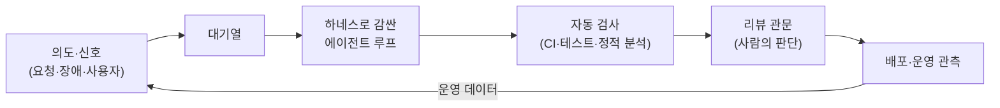

# 딥다이브 — 검증의 시대: pstack, 하루 3만 건 머지, 그리고 소프트웨어 팩토리

> 기반: **Anthropic, *Redesigning source control at Anthropic* (2026-10)** · **Addy Osmani, *Software Factories, Light and Dark* (2026-07)** · **pstack(Lauren Tan) 공개 문서** · **Uber, *Keeping Master Green at Scale* (EuroSys 2019)** · **GitLab merge trains / GitHub merge queue 공식·비교 자료** · **Harvard 워킹페이퍼 보도(2026-10)** · 영상 「요즘 자꾸 뜨는 pstack 어설프게 말고 제대로 파헤쳐 보기」(김플립, 2026-10-22).
> 형식: 30초 직관 → 근거 → 원리 → 트레이드오프.
> **선행**: [콘웨이 법칙은 AI 에이전트 시대에 죽었나](deep-conway-and-ai-agents.md) · [AI 시대 엔지니어링 — 검증·내재화·구조 유지](deep-ai-era-verification.md)

> ⚠️ **출처 고지 (먼저 읽기)**
> - 영상은 **자막(대본)을 가져오지 못했다** (YouTube가 자막 조회를 차단). 그래서 이 노트에 **영상 발화 내용은 반영되지 않았다.** 영상 제목·게시일·게시자만 확인했고, pstack 내용은 **공개 문서와 2차 요약**에 근거한다. 대본을 붙여 주면 영상 고유의 주장을 별도 절로 보강한다.
> - 이 노트는 **업계 사례를 공부한 학습 노트**다. 여기 나오는 규모(하루 3만 건 머지)는 **내 경험이 아니다.** 이력서·면접에서 내 경력처럼 말하지 않는다.

---

## 0. 30초 직관 — 병목이 네 번 옮겨왔다

```
과거     : 코드를 쓰는 속도가 병목          → 개발자를 늘리고 도구를 산다
2023~24  : 에이전트 사이의 소통이 병목        → 토폴로지를 설계한다 (콘웨이 법칙의 역전)
2025~26  : 만들어진 것을 '믿는 비용'이 병목   → 검증과 머지 처리량을 설계한다
2026 하반기: 사람 속도로 만든 인프라가 병목   → 소스 컨트롤·CI를 다시 설계한다  ← 지금 여기
```

콘웨이 법칙은 여전히 맞다. 다만 **"소통 경로"의 정체가 바뀌었다** — 회의·메신저에서 **문서·스킬·규칙 파일**로. 그리고 소통 경로 다음에 막히는 곳이 **검증**이다. pstack은 그 검증을 "개인 요령"이 아니라 **재사용 가능한 절차**로 만들려는 시도다.

그런데 검증 절차를 갖춰도 끝이 아니었다. 2026년 Anthropic은 하루 머지가 **약 2,500건(5월)에서 3만 건 이상(9월)** 으로 늘자, 이번엔 **git과 CI라는 바닥 인프라**가 버티지 못했다. 사람이 하루 몇 번 커밋하던 시절에 맞춰 만든 도구가 에이전트의 속도를 못 따라간 것이다. 그리고 Addy Osmani는 이 전체 흐름을 **소프트웨어 팩토리**라는 그림으로 묶는다: 에이전트 루프 여러 개가 대기열에서 일을 받아 만들고, 검증 관문을 거쳐 배포되는 공장. 그 공장에서 **유일하게 비싼 공정은 사람의 판단**이다.

---

## 1. 콘웨이 법칙은 아직 맞나 — 판정

| 질문 | 판정 | 근거 |
|---|---|---|
| 시스템 구조가 소통 구조를 닮는가 | **맞다** | 에이전트 팀도 주어진 파이프라인의 모양을 산출물에 복제한다 ([앞 노트 1장](deep-conway-and-ai-agents.md)) |
| 소통 구조가 고정 제약인가 | **아니다** | 에이전트 토폴로지는 설정 파일이라 바꾸는 비용이 거의 0 |
| 소통 경로의 실체는 | **문서·스킬·규칙 파일** | 사람-에이전트 하이브리드 팀의 소통은 회의가 아니라 `CLAUDE.md`·스펙·ADR |
| 그럼 새 병목은 | **검증** | 만드는 쪽의 비용만 급락하고, 믿는 쪽(리뷰·테스트·운영 확신)의 비용은 그대로 |

**pstack을 콘웨이 법칙으로 읽으면**: router는 팀장, playbook은 표준 절차(MetaGPT가 이식했던 SOP의 후손), verification skill은 QA 관문이다. 1세대 멀티에이전트가 "회사 조직도"를 복사했다면, pstack은 **"좋은 엔지니어의 일하는 순서"를 복사**한다 — 그리고 조직도에 없던 **"증거 없이는 끝났다고 말하지 않는다"**는 규칙을 추가했다.

---

## 2. pstack은 왜 만들어졌나

### 2-1. 문제 — 에이전트는 같은 실수를 계속 반복한다

만든 사람은 Lauren Tan(@poteto)이다. 공개 문서 기준으로 그는 Cursor에 합류하기 전 Claude Code 위에 자기만의 오케스트레이션 층을 만들었지만, **결국 모든 에이전트를 손으로 조율하고 있었다.** 에이전트를 팀원처럼 대하면 "어떻게 조사하고, 설계하고, 테스트하고, 소통하는가"를 가르쳐야 하는데, **에이전트는 그걸 계속 잊는다.** — 이게 출발점이다.

### 2-2. 해법 — 반복되는 실패를 명시적 절차로 굳힌다

| 구성 | 역할 | 콘웨이식 번역 |
|---|---|---|
| **router** (`poteto-mode`) | 요청을 읽고 알맞은 playbook을 고른다 | 팀장·접수 창구 |
| **playbook** (약 20여 개: 버그 수정·기능·리팩토링·성능 조사 등) | 작업 유형별 고정 순서 (계획 → 위임 → 검증) | 표준 운영 절차(SOP) |
| **verification skill** | 프로젝트 전용으로 앱을 실제로 띄워 동작을 구동하고 증거를 남긴다 | QA 관문 |
| **delegation** | 서브에이전트에 역할 분담, 역할마다 다른 모델 지정 가능 | 부서 간 업무 분장 |

핵심 원칙(공개 문서 요약):

- **증거가 주장보다 앞선다** — "빌드가 통과했다"는 완료 증거로 인정하지 않는다. 변경에 맞는 실제 실행(CLI면 명령 실행, 마이그레이션이면 실제 입력 재생)이 증거다.
- **깊이가 넓이보다 먼저** — 에이전트 하나가 문제 전체에서 믿을 만해진 뒤에야 병렬로 늘린다.
- **호출자에서 출발** — 인터페이스는 "쓰는 쪽"에서 설계한다.
- **끝나는 조건을 명시** — 자율 실행에는 시간 제한이 아니라 **검사 가능한 완료 조건**이 필요하다.
- **결정을 감사 가능하게** — 긴 실행은 결정 로그를 남기고, 기각된 지적과 그 이유도 보이게 한다.
- **비례성** — 문서 스스로 작은 변경에는 전체 장치가 과하다고 말한다.

### 2-3. 영상의 관점 (2차 요약 기준 — 영상 원문 미확인)

영상을 요약해 둔 한 큐레이션 PR의 기록에 따르면, 이 영상은 pstack을 **"무엇을 강제하는가"로 평가**한다: 라우터와 플레이북이 있는가, **건너뛰는 단계에 정당한 이유**가 있는가, 주장이 **측정/추론/추측으로 라벨**되어 있는가, 증거로 뒷받침하는 **검증 스킬**이 있는가, 그리고 **반복되는 교정을 어느 층(프롬프트·스킬·하네스)에 둘지**를 비용과 모델 발전 속도에 비춰 따지는가. 이 기준은 [앞 노트 2.3의 "확인한 것/못 한 것 구분"](deep-ai-era-verification.md)과 같은 정신이다. *(이 단락은 영상을 직접 본 것이 아니라 2차 요약이므로, 대본 확보 후 교체한다.)*

### 2-4. 한계 — 냉정하게

- **측정된 성능 비교가 없다.** pstack-claude를 소개한 글도 맨 에이전트와의 벤치마크는 하지 않았고, GitHub 별 수는 품질의 증거가 아니라고 못 박는다.
- **남의 의견을 상속한다.** 손으로 쓴 규칙 파일은 유지 비용이 들지만 내 맥락에 맞고, 가져온 스킬 묶음은 일관되지만 **그 사람의 작업 철학이 따라온다.**
- 결론: **스킬 묶음을 쓸지 말지보다, "무엇을 강제하는가"를 평가하는 눈**을 가져가는 게 이득이다. (이 저장소에서 도구를 도입하지 않기로 한 판단 — [개발 도구 전략](../lang/ide-and-agent-tooling.md) — 과도 충돌하지 않는다: 설치하지 않고도 원리는 가져올 수 있다.)

---

## 3. 시대의 흐름 — 데이터가 말하는 것

| 관찰 | 출처 성격 | 해석 |
|---|---|---|
| AI 코딩 에이전트를 도입한 기업에서 코드량은 약 30% 늘었지만, **완료된 작업은 뚜렷하게 늘지 않았고 리뷰 통과에는 약 49% 더 걸렸다** | Harvard 워킹페이퍼(2026-10) 보도. **동료 검토 전**, 2차 보도 기준 | 생산량이 아니라 **검증 용량**이 처리량을 결정한다 |
| 리뷰 코멘트가 PR당 약 35% 늘었다 | 위와 동일 | 리뷰어가 더 많이 일하는데도 따라가지 못한다 |
| 리뷰 없이 머지되는 PR이 늘었다는 업계 텔레메트리 | 벤더 계열 블로그, **방법론 불명** | 방향성 참고용, 수치는 신뢰하지 않는다 |

> 세 행 모두 **확정 사실이 아니라 방향성 증거**다. 공통 메시지만 취한다: **쓰기는 싸졌고, 믿기는 비싸졌다.** (표의 수치를 인용할 때는 반드시 "워킹페이퍼 보도 기준"이라고 붙인다.)

---

## 4. 하루 3만 건이 쏟아질 때 — 머지 처리량의 산수

> "MR"은 GitLab 용어(merge request), GitHub의 PR과 같다. 이 장의 4-1~4-4는 **개념 실험**이고, 4-6이 **실제로 그 규모에 도달한 회사의 선택**이다. 둘을 비교해서 읽는 게 핵심이다.

### 4-1. 직렬 큐는 즉시 무너진다

하루 MR이 30,000건이면 분당 약 21건이다. 변경마다 "최신 main 위에서 CI를 돌려 통과하면 머지"를 **직렬로** 하면, CI가 10분일 때 하루(1,440분)에 머지할 수 있는 건 **144건**이다. 필요한 처리량의 **약 1/208.** 대기열은 영원히 줄지 않는다. 해법은 CI를 빠르게 하는 정도가 아니라 **구조적 병렬화**다.

### 4-2. 실패 확률은 복리로 쌓인다

한 변경이 main을 깨뜨릴 확률을 2%로 가정하자. 변경 n개를 묶어 한 번에 테스트하면 **전부 통과할 확률**은 0.98의 n제곱이다.

| 묶음 크기 n | 전부 통과할 확률 |
|---|---|
| 1 | 98% |
| 10 | 약 82% |
| 50 | 약 36% |

크게 묶을수록 CI 횟수는 줄지만 **한 번 실패하면 범인 찾기와 재실행 비용**이 커진다. (각 변경이 독립이라는 가정이다 — [확률통계 노트](../math/probability-statistics-essentials.md)의 "독립성이 깨지면 계산이 틀린다"가 여기서 그대로 적용된다. 같은 파일을 건드린 변경끼리는 독립이 아니다.)

### 4-3. 해법의 사다리

| 단계 | 기법 | 핵심 |
|---|---|---|
| ① | **영향 범위만 테스트** | 변경이 닿는 모듈·타깃만 빌드·테스트 (모듈 경계가 있어야 가능) |
| ② | **충돌 그래프로 독립 변경 병렬 머지** | 서로 안 겹치는 변경은 동시에 랜딩. Uber SubmitQueue의 conflict analyzer가 이 일을 한다 |
| ③ | **투기적(speculative) 빌드** | "앞 변경이 통과한다"고 가정하고 뒤 변경을 미리 병렬로 검증, 틀리면 폐기. Uber는 성공 확률을 모델로 점수화해 가능성 높은 빌드를 우선 실행 |
| ④ | **배치 + 실패 시 이분 탐색** | 묶어서 한 번에 돌리고, 실패하면 반으로 나눠 범인 추적 |
| ⑤ | **위험도 등급별 리뷰** | 문서·설정·소규모 변경은 가볍게, 결제·보안 경로는 무겁게. 사람의 리뷰 용량을 위험이 큰 곳에 집중 |

### 4-4. 실제 도구가 하는 일

- **GitLab merge trains**: 각 MR을 "대상 브랜치 + 앞선 모든 MR"을 합친 상태에서 병렬로 테스트한다. 내 MR의 파이프라인이 통과하고 앞선 MR이 모두 머지된 뒤에만 머지. 실패한 MR은 열차에서 빠지고 뒤 MR들의 파이프라인이 다시 시작된다. 기본 병렬 파이프라인 상한은 20개.
- **GitHub merge queue**: 같은 목표. 큐 스냅샷마다 임시 브랜치를 만들고 배치 크기를 설정할 수 있다 (세부는 2차 자료 — 사용 전 공식 문서로 확인).
- **Uber SubmitQueue**: 위 ②③을 대규모 모노레포에서 구현한 사례. 논문과 오픈소스가 공개돼 있다.
- 공통 비용: **CI가 중복 실행된다.** 병렬화는 시간을 CI 비용과 맞바꾼다.

### 4-5. 구조가 처리량을 결정한다 — 콘웨이 법칙이 돌아오는 자리

②의 핵심은 "독립 변경은 동시에 랜딩할 수 있다"인데, **무엇이 독립인가는 코드의 모듈 경계가 결정한다.** 경계가 흐린 코드에서는 모든 변경이 서로 충돌해 사실상 직렬 큐가 된다. 즉:

> **도메인 분리·모듈 경계 = 머지 처리량의 상한.**
> 조직 구조가 시스템 구조를 낳고(콘웨이), 시스템 구조가 머지 병렬도를 낳는다. 에이전트가 MR을 쏟아내는 시대에 아키텍처 경계는 설계 취향이 아니라 **처리량 자원**이다. ([모듈성 이론](deep-modularity-theory.md): 변경 이유가 같은 것끼리 묶는다.)

### 4-6. 실제로 3만 건에 도달한 회사는 다르게 했다 — 머지 전 관문 vs 머지 후 검증

여기서 반전이 있다. 위 4-3~4-4는 모두 **"머지하기 전에 검증한다"** 는 전제 위에 있다. 그런데 Anthropic은 하루 3만 건 규모에서 **전역 락을 거는 전통적 머지 큐는 맞지 않는다**고 보고, 대신 **머지 후·배포 전 자동 테스트**에 기댔다. 동시에 들어온 변경끼리 충돌할 수는 있지만, Claude가 그 충돌을 사람이 알아채는 것보다 빨리 고친다는 판단이다.

비유하면 이렇다. 머지 큐는 **공항 보안 검색대**다. 한 줄로 세워 한 명씩 다 검사한 뒤 들여보낸다. 안전하지만 줄이 길어진다. Anthropic 방식은 **일단 대합실로 들여보내고, 비행기에 타기 직전(배포 전)에 다시 검사**하는 것이다. 대합실에서 문제가 생겨도 탑승 전에 잡고, 대합실 안의 정리 요원(에이전트)이 아주 빠르다는 전제가 있다.

| | 머지 전 관문 (머지 큐·트레인) | 머지 후·배포 전 검증 (Anthropic) |
|---|---|---|
| main 상태 | 항상 통과 상태 유지 | 잠깐 깨질 수 있음 |
| 처리량 상한 | 큐 병렬도·CI 시간 | 거의 없음 (락이 없음) |
| 충돌 처리 | 사전에 막음 | 사후에 에이전트가 빠르게 수정 |
| 전제 조건 | 사람 속도 정도의 변경량 | **빠른 자동 수정 + 배포 전 강한 검증 + 쉬운 되돌리기** |

> **판단 기준**: 변경량이 사람 속도 수준이면 머지 큐가 여전히 정답이다(4-7 참고). 머지 후 검증은 **충돌을 사람보다 빨리 고치는 자동화**와 **배포 전 관문**이 둘 다 있을 때만 성립한다. 둘 중 하나라도 없으면 main이 깨진 채로 방치된다.

### 4-7. 그리고 더 아래 — 소스 컨트롤 자체가 병목이 됐다 (Anthropic Scion)

머지 방식만 바꾸면 끝났을까? 아니었다. Anthropic이 공개한 숫자를 보면 문제는 **git이 설계된 방식** 자체였다.

- 모노레포 main 이력이 거의 100GB, 압축한 작업 사본만 25GB가 넘는다.
- CI만으로 하루 약 2,500만 번 체크아웃이 일어난다. 단순하게 받으면 하루 600PB가 넘는 git 트래픽이 된다.
- git은 **분산형**이라 모든 클론이 전체 사본이다. 비행기 안에서도 일할 수 있게 만든 설계다. 그런데 Anthropic의 클라이언트는 거의 전부 **항상 온라인인 에이전트와 작업**이었다. 오프라인을 위한 설계가 오히려 짐이 된 것이다.
- 미러 수백 개, 얕은 클론, 부분 체크아웃 같은 우회책을 썼지만, 머지 속도가 오를수록 미러 운영이 더 어려워졌다.

그래서 7명이 5개월 만에 사내 버전 관리 시스템 **Scion**을 만들어 git에서 옮겼다(코드 리뷰 도구·코드 검색·권한 시스템도 같이). 설계 원칙은 git과 정반대다.

| git의 전제 | Scion의 전제 |
|---|---|
| 클라이언트가 오프라인일 수 있다 | 클라이언트는 **항상 온라인** |
| 모든 클론이 전체 사본 | 어디에도 전체 사본이 없다. 필요한 파일만 그때그때 받는다 |
| 커밋·머지는 내 컴퓨터에서 | 커밋·머지·리베이스·blame은 **서버에서**, 비용은 저장소 크기가 아니라 **변경 크기**에 비례 |
| 저장소를 받아야 질문할 수 있다 | 소스 컨트롤이 **API** — 체크아웃 없이 이력·bisect·revert를 질의 |

결과는 극적이다. 이전 git 미러 인프라보다 CPU·메모리 사용이 약 200배 줄었고, CI·연구 작업의 체크아웃이 몇 분에서 몇 초로 줄었으며, CI만 약 25%의 CPU 여유가 생겼다.

> **냉정하게 (Anthropic 스스로 한 말)**: Scion은 **git의 일반 대체품이 아니다.** 아주 큰 모노레포나 에이전트 중심 작업에서만 의미가 있고, 도입하면 코드 리뷰·검색·CI까지 같이 갈아야 한다. 그래서 그들도 git 생태계가 서버 측 연산이나 조합 가능한 부분 체크아웃 같은 아이디어를 **git 모델을 버리지 않고** 받아들이는 방향을 제안한다.
> 이 저장소의 [전환 사례 노트](deep-migration-case-studies.md) 관점으로 보면 **"바깥을 바꾼" 큰 전환**이다 — git이라는 바깥 모양을 지킬 수 없을 만큼 아팠기 때문에 감수한 것이다.

### 4-8. 사람은 무엇을 리뷰하나 — 줄 단위에서 의도 단위로

Anthropic에서도 사람은 **모든 변경 요청을 여전히 리뷰한다.** 달라진 건 리뷰의 단위다.

- **줄을 읽지 않고 의도를 본다** — "이 변경이 하려는 게 맞는가"를 판단한다.
- **엔지니어의 일이 판단으로 옮겨갔다** — 아키텍처를 정하고, 설계 트레이드오프를 고르고, 시스템 제약을 어기는 제안에 **"아니"라고 말하는 것.** 예로 커밋 로그를 통째로 훑어 머지 정보를 찾는 무식한 방법이나, 적대적 리뷰 뒤에 과하게 덧붙인 방어 코드를 거절한 일을 든다.
- **위험에 따라 승인 규칙을 다르게** — 주석만 바꾼 변경과 민감한 로직 변경을 구분하는 의미 기반 승인 규칙, 디렉터리 단위 권한을 둔다. (4-3의 ⑤ "위험도 등급별 리뷰"가 실제로 구현된 모습이다.)
- **운영도 에이전트가 지켜본다** — 컴포넌트마다 붙은 Claude 인스턴스가 지표·로그를 보며 일반 알림이 놓치는 미묘한 이상을 잡는다.

---

## 4.5 소프트웨어 팩토리 — 전체를 공장으로 보기 (Osmani)

지금까지 본 조각들(검증 절차, 머지 처리량, 인프라)을 한 장의 그림으로 묶은 게 Addy Osmani의 **소프트웨어 팩토리**다. 이 발상 자체는 오래됐다. 1968년 Bob Bemer가 프로그램 생산의 경제성을 다루며 "소프트웨어 공장"을 말했다. Osmani는 그 오래된 꿈이 이제 다시 볼 만해졌지만, 새롭다고 여겨지는 것 중 일부는 **익숙한 함정**이라고 경고한다.

### 4.5-1. 세 단어 — 루프, 하네스, 팩토리

- **루프**: 에이전트 하나가 한 가지 일을 반복한다. 맥락을 모으고, 행동하고, 결과를 확인하고, 조건이 맞을 때까지 계속한다.
- **하네스**: 그 루프를 감싸는 환경이다. 샌드박스, 쓸 수 있는 도구, 실행 사이의 기억, 그리고 **"끝났다"를 판정하는 관문**. 하네스가 없으면 모델은 끝없이 돈다. (2장 pstack의 "끝나는 조건을 명시"가 바로 하네스의 일이다.)
- **팩토리**: 하네스로 감싼 루프를 대규모로 돌리는 것. 대기열에서 일을 받고, 리뷰를 거쳐 내보낸다. Osmani는 이것을 **"루프로 만든 조직도"** 라고 부른다. ([콘웨이 노트](deep-conway-and-ai-agents.md)와 정확히 이어지는 표현이다.)



*(도식 설명: 사람의 의도와 장애·사용자 요청 같은 신호가 대기열에 쌓인다. 하네스로 감싼 에이전트 루프가 일을 꺼내 변경을 만들고, CI·테스트·정적 분석 같은 자동 검사를 거친다. 그다음 사람이 판단하는 리뷰 관문을 지나 배포되고, 운영에서 나온 데이터가 다시 신호가 되어 대기열로 돌아간다. 이 중 규모가 커져도 거의 공짜인 단계는 리뷰 관문을 뺀 전부이고, 리뷰 관문의 판단만이 비싸고 늘리기 어렵다.)*

### 4.5-2. 불 꺼진 공장과 불 켜진 공장

제조업에는 사람 없이 불을 끄고 돌리는 **"불 꺼진 공장"** 이 있다. FANUC은 2001년부터 그렇게 돌렸다. 소프트웨어에서도 같은 질문이 생긴다. **이 루프는 사람 없이(어둡게) 돌려도 되나, 사람이 지켜봐야(밝게) 하나?**

Osmani의 답은 **공장 전체가 아니라 루프마다 따로 정하라**는 것이다. 기준은 두 가지다.

1. **검증이 얼마나 싸고 믿을 만한가** — 검사가 빠르고, 자주 돌고, **속이기 어려워야** 완전 자동화를 허락한다. 타입 검사, 속성 기반 테스트, 채점 기준이 있는 리뷰 에이전트 같은 것.
2. **틀렸을 때 얼마나 비싼가** — 인증, 결제, 공개 API 계약처럼 틀리면 큰일 나는 곳은 사람을 남긴다.

> 핵심 원칙 한 줄: **자율성은 싸고 확실하게 검증할 수 있는 만큼까지만 준다.**

전부 어둡게 가면 나중에 비싸게 뜯어고치게 되고, 전부 밝게 가면 사람이 병목이 된다. 4-8의 Anthropic이 주석 변경과 민감 로직 변경을 다르게 승인하는 것이 이 원칙의 실제 예다.

### 4.5-3. 루프를 짧게, 흐름은 그래프로

- **짧은 루프가 검증하기 쉽다.** Dex Horthy(HumanLayer)의 경험칙으로는 에이전트가 대략 3~10단계까지는 버티고, 20단계를 넘으면 무너지기 시작한다.
- **흐름은 미리 정한 그래프로 묶는다.** 각 단계 안에서는 에이전트가 자유롭게 움직이되, 단계 사이의 이동은 정해 둔다. 예: 버그 수정 → 테스트 실패면 다시 수정으로, 통과면 리뷰로. (pstack의 playbook이 "계획 → 위임 → 검증" 순서를 강제하는 것과 같은 생각이다.)
- **코드보다 계획을 먼저 리뷰한다.** 구현 전에 사람이 짧은 계획을 보면, 나중에 코드를 리뷰하는 비용이 줄어든다.

### 4.5-4. 아키텍처가 안전망이 된다

Osmani가 강조하는 대목이 이 저장소의 주제와 바로 맞닿는다. **좋은 타입, 테스트하기 좋은 이음매, 분명한 경계, 의존성 주입** 같은 아키텍처는 에이전트의 실수를 **싸게** 잡아 준다. 즉 [개념 노트](concept.md)의 헥사고날·경계 긋기·피트니스 함수는 이제 "깔끔한 코드를 위한 취향"이 아니라 **자동화를 얼마나 허락할 수 있는지를 정하는 상한**이다. 4-5의 "모듈 경계 = 머지 처리량의 상한"과 같은 이야기를 다른 쪽에서 한 것이다.

### 4.5-5. 위험 — 이해 부채

- **이해 부채(comprehension debt)**: 코드가 사람이 이해하는 속도보다 빨리 쌓인다. 불 꺼진 공장은 이 부채를 조용히 쌓고, 청구서는 늦게 온다.
- **나쁜 변경의 홍수**: 믿을 만한 관문 없이 생산량만 늘리면 결함이 쏟아진다. (3장의 "쓰기는 싸졌고, 믿기는 비싸졌다"와 같은 말.)
- **아키텍처 품질은 빨리 측정하기 어렵다**: 그래서 모델이 학습하기도 어렵다. 사람이 아키텍처를 지켜야 하는 이유다.
- **사람이 시스템이 하는 일을 볼 수 있어야 한다**: 관측 가능성을 잃으면 밝게 돌리려 해도 볼 게 없다.

---

## 5. 머지 다음 — 배포하고 쓰이기까지

머지는 끝이 아니라 **검증의 두 번째 단계**다. 일반적으로 통용되는 실무 원칙을 순서대로 적는다 (이 절은 개별 출처가 없는 일반 원칙이며, 수치 주장은 하지 않는다):

```
main 항상 green ─▶ 작은 단위로 자주 배포 ─▶ 배포 ≠ 릴리스(기능 플래그) ─▶ 점진 노출(카나리) ─▶ 관측 ─▶ 자동 롤백
```

- **배포와 릴리스를 분리**: 코드는 꺼진 채로 먼저 배포하고, 플래그로 켠다. 문제가 생기면 롤백이 아니라 **끄기**가 된다.
- **관측이 검증의 마지막 층**: 사전 테스트가 못 잡은 것은 운영 지표(p99·에러율)가 잡는다 ([성능 공학](../cs/deep-performance-engineering.md), [확률통계](../math/probability-statistics-essentials.md)의 분위수 관점).
- **피트니스 함수**: 롤백 기준을 사람이 판단이 아니라 **수치 조건**으로 미리 정해 둔다 ([concept.md 3-5장](concept.md)).
- **머지 후 검증을 택했다면 배포 전 관문이 마지막 방어선이다**: 4-6의 Anthropic 방식은 main이 잠깐 깨질 수 있는 대신, 배포 직전에 강하게 검사하고 자동 bisect·revert로 빨리 되돌린다.

---

## 6. 나아가야 할 방향 — 일곱 문장

1. **검증을 일급 시민으로 설계한다** — 오라클(정답), 특성화 테스트, 증거 기반 완료 조건을 구현보다 먼저 정한다.
2. **소통 경로(문서·스킬·규칙 파일)가 곧 조직도다** — 에이전트와 사람이 같은 파일을 읽게 하고, 반복 교정은 가장 싼 층에 굳힌다.
3. **처리량은 리뷰 용량이 정한다** — 사람의 판단은 공장에서 유일하게 비싼 공정이다. 위험 등급별 승인으로 위험이 큰 곳에만 쓴다.
4. **자율성은 검증 비용만큼만** — 루프마다 "어둡게 돌릴지 밝게 돌릴지"를 검증의 값싸고 확실함과 틀렸을 때의 비용으로 정한다. 인증·결제·공개 API는 사람을 남긴다.
5. **경계를 그어 병렬도와 안전망을 번다** — 도메인·모듈 분리는 머지 처리량 투자이면서, 에이전트 실수를 싸게 잡는 안전망이다.
6. **인프라의 전제를 의심한다** — 사람 속도에 맞춘 도구(머지 큐, 전체 클론)가 병목이 되면, 머지 전 관문을 머지 후 검증으로 바꾸거나 도구 자체를 바꾸는 선택지도 있다. 단, 빠른 자동 수정과 배포 전 관문이 갖춰졌을 때만.
7. **비례성을 지킨다** — 작은 팀의 작은 변경에 대기업 장치를 얹으면 오히려 손해다. pstack도 Uber도 Anthropic도 자기 규모에 맞춘 해법이고, Anthropic 스스로 Scion은 일반 git 대체품이 아니라고 말한다.

---

## 7. 내 규모로 번역하면 (스케일 다운)

3만 건은 내 환경이 아니다. 같은 원리를 **작게** 쓰면:

| 큰 규모 해법 | 작은 규모 버전 |
|---|---|
| SubmitQueue·투기적 빌드 | 사내 GitLab의 **merge trains / "파이프라인 성공 시 머지"** 설정 하나 |
| 영향 범위 테스트 | 모듈별 테스트 태깅, 변경 파일 기준 선택 실행 |
| 위험 등급 리뷰 | 결제·정산 경로만 필수 리뷰, 나머지는 CI 게이트 중심 |
| 검증 스킬(pstack) | 변경마다 **실제 실행 증거를 남기는 체크리스트**를 규칙 파일에 고정 |
| 관측·롤백 | 배포 후 p99·에러율 기준선을 먼저 기록 |
| 머지 후 검증 (Anthropic) | **도입하지 않는다.** 변경량이 사람 속도면 머지 큐가 더 안전하다 |
| Scion (소스 컨트롤 교체) | **도입하지 않는다.** 부분 체크아웃·얕은 클론으로 충분 |
| 루프별 어둡게/밝게 (Osmani) | 의존성 버전 올리기·린트 수정 같은 작은 일만 자동 PR, 결제·인증은 사람 리뷰 |
| 계획 먼저 리뷰 | 에이전트에 큰 작업을 맡길 때 구현 전 계획을 한 번 확인 |

> 판단 질문: **"지금 내 병목은 쓰기인가, 믿기인가?"** 믿기라면 위 표의 아랫줄부터, 쓰기라면 아직 이 장치들은 과하다.

---

## 8. 3단 요약 (암기)

### Q1. AI 시대에 콘웨이 법칙은 아직 맞나?
- **① 결론 · WHAT** 맞다. 다만 소통 경로가 회의·메신저에서 **문서·스킬·규칙 파일**로 바뀌었고, 소통 다음 병목은 **검증**이다.
- **② 원리 · HOW** 에이전트도 주어진 소통 구조를 산출물에 복제한다. 구조를 마음대로 바꿀 수 있게 되자, 남는 질문은 "어떤 구조가 좋은가"를 **증거로 검증**하는 일이다.
- **③ 확장 · TRADE-OFF** 구조 변경이 공짜라 검증이 상대적으로 비싸진다. 최적 구조가 모델마다 달라 재검증이 필요하다.

### Q2. pstack은 왜 만들어졌나?
- **① 결론 · WHAT** 에이전트가 같은 실수를 반복하고 사람이 일일이 조율해야 하는 문제를 **반복 실패를 절차(router·playbook·verification skill)로 굳혀** 해결하려고.
- **② 원리 · HOW** 요청을 playbook으로 라우팅하고, 계획→위임→검증 순서를 강제하며, "빌드 통과"가 아니라 **실제 실행 증거**를 완료 조건으로 삼는다.
- **③ 확장 · TRADE-OFF** 측정된 효과 비교는 없고, 가져온 절차에는 만든 사람의 철학이 따라온다. 작은 변경에는 과하다(비례성).

### Q3. 하루 3만 건이 쏟아지면 어떻게 머지·배포하나?
- **① 결론 · WHAT** 직렬 큐는 불가능하다(10분 CI면 하루 144건). **독립 변경 병렬 머지 + 투기적 빌드 + 배치/이분 탐색 + 위험 등급 리뷰**로 구조적 병렬화가 필요하다. 실제로 그 규모에 간 Anthropic은 한 발 더 나가 **전역 락 머지 큐를 버리고 머지 후·배포 전 검증**을 택했다.
- **② 원리 · HOW** 충돌 그래프로 서로 안 겹치는 변경을 동시에 랜딩하고, 앞 변경의 통과를 가정한 투기적 빌드로 대기를 줄인다. 머지 후에는 배포≠릴리스(플래그), 점진 노출, 관측, 자동 롤백으로 검증을 이어간다.
- **③ 확장 · TRADE-OFF** 병렬화는 CI 비용으로 시간을 산다. 병렬도의 상한은 **모듈 경계**가 정하므로 도메인 분리가 처리량 투자다. 규모에 맞는 해법만 쓴다.

### Q4. Anthropic은 왜 git을 버리고 Scion을 만들었나?
- **① 결론 · WHAT** git의 전제(클라이언트가 오프라인일 수 있어 모든 클론이 전체 사본)가 **항상 온라인인 에이전트 수천 개**라는 현실과 맞지 않았기 때문이다.
- **② 원리 · HOW** 100GB 이력, 하루 2,500만 번 체크아웃을 전체 사본으로 감당할 수 없었다. Scion은 커밋·머지·blame을 서버에서 하고, 클라이언트는 필요한 파일만 받으며, 소스 컨트롤을 API로 노출해 체크아웃 없이 질의하게 했다. 비용이 저장소 크기가 아니라 변경 크기에 비례한다. 결과로 인프라 자원이 약 200배 줄고 체크아웃이 분 단위에서 초 단위가 됐다.
- **③ 확장 · TRADE-OFF** 일반 git 대체품이 아니다. 리뷰·검색·CI까지 같이 바꿔야 하고 초대형 모노레포·에이전트 중심 작업에서만 값을 한다. 바깥(git 호환성)을 버린 큰 전환이라, 대부분은 git 안에서 부분 체크아웃·서버 측 연산 같은 아이디어만 가져오면 된다.

### Q5. 소프트웨어 팩토리에서 무엇을 자동화하고 무엇을 사람이 하나?
- **① 결론 · WHAT** **루프마다 따로 정한다.** 기준은 "검증이 싸고 믿을 만한가"와 "틀리면 얼마나 비싼가"다. 자율성은 검증할 수 있는 만큼만 준다.
- **② 원리 · HOW** 팩토리는 하네스로 감싼 에이전트 루프들이 대기열에서 일을 받아 자동 검사와 리뷰 관문을 거쳐 배포되는 구조다. 리뷰 관문을 뺀 전 단계는 규모가 커져도 거의 공짜고, 사람의 판단만 비싸다. 그래서 타입·속성 테스트처럼 빠르고 속이기 어려운 검사가 있는 루프는 사람 없이 돌리고, 인증·결제·공개 API는 사람을 남긴다. 루프는 짧게, 흐름은 그래프로 묶고, 코드보다 계획을 먼저 리뷰한다.
- **③ 확장 · TRADE-OFF** 전부 자동화하면 **이해 부채**가 조용히 쌓여 나중에 비싸게 뜯어고치고, 전부 사람이 보면 사람이 병목이 된다. 좋은 아키텍처(타입·경계·테스트 이음매)가 에이전트 실수를 싸게 잡는 안전망이므로, 아키텍처 품질이 자동화 상한을 정한다.

---

## 용어 사전 (영 ↔ 한)

| 용어 | 뜻 |
|---|---|
| router / playbook | 라우터(요청을 절차로 연결) / 플레이북(작업 유형별 고정 절차) |
| verification skill | 검증 스킬 — 실제 실행으로 증거를 남기는 프로젝트 전용 절차 |
| evidence over assertion | 증거가 주장보다 앞선다 |
| proportionality | 비례성 — 변경 크기에 맞는 장치만 쓴다 |
| merge request (MR) / pull request (PR) | GitLab의 변경 병합 요청 / GitHub의 같은 개념 |
| merge queue / merge train | 머지 큐 / 머지 트레인 — 변경을 줄 세워 합친 상태로 검증 후 머지 |
| mainline green | 메인라인 상시 통과 — main이 항상 빌드·테스트를 통과하는 상태 |
| speculative build | 투기적 빌드 — 앞 변경 통과를 가정하고 미리 병렬 검증 |
| conflict graph | 충돌 그래프 — 변경 간 겹침 관계, 독립 변경 식별에 사용 |
| bisect | 이분 탐색 — 실패한 묶음을 반으로 나눠 범인 추적 |
| feature flag | 기능 플래그 — 배포와 릴리스를 분리하는 스위치 |
| canary | 카나리 — 일부 트래픽에만 먼저 노출하는 점진 배포 |
| fitness function | 피트니스 함수 — 아키텍처·배포 건전성을 자동 측정하는 수치 조건 |
| post-merge testing | 머지 후 검증 — 머지 큐 없이 먼저 합치고, 배포 전에 검증·수정 |
| monorepo | 모노레포 — 여러 프로젝트를 한 저장소에 둔 구조 |
| sparse / virtualized checkout | 부분·가상 체크아웃 — 실제로 읽는 파일만 받아 오는 방식 |
| source control as an API | 소스 컨트롤을 API로 — 저장소를 받지 않고 이력·blame을 질의 |
| software factory | 소프트웨어 팩토리 — 에이전트 루프들이 대기열→검사→리뷰→배포로 흐르는 생산 구조 |
| loop / harness | 루프(한 일을 반복하는 에이전트) / 하네스(샌드박스·도구·기억·완료 관문) |
| dark / lit factory | 불 꺼진(사람 없이 자동) / 불 켜진(사람이 지켜보는) 공장 |
| comprehension debt | 이해 부채 — 코드가 사람이 이해하는 속도보다 빨리 쌓이는 상태 |

---

## 출처

- 소스 컨트롤 재설계(1차): [Anthropic — Redesigning source control at Anthropic (2026-10-13)](https://www.anthropic.com/research/redesigning-source-control)
- 소프트웨어 팩토리(1차): [Addy Osmani — Software Factories, Light and Dark (2026-07-20)](https://addyosmani.com/blog/software-factories/)
- pstack: [Flavio Copes — A deep dive into pstack](https://flaviocopes.com/pstack/) · [explainx — pstack-claude (Claude Code 포팅 소개, 벤치마크 없음 명시)](https://explainx.ai/blog/pstack-claude-poteto-mode-agent-workflows-claude-code-codex-copilot-2026)
- 영상 2차 요약(영상 원문 미확인): [bnivibe/ai-trend-digest PR #30](https://github.com/bnivibe/ai-trend-digest/pull/30) — 영상 URL `https://youtu.be/u2oDdU6z4Bw`, 김플립, 2026-10-22
- 머지 큐 이론·사례: [Uber — Keeping Master Green at Scale (EuroSys 2019)](https://dl.acm.org/doi/pdf/10.1145/3302424.3303970) · [uber/submitqueue](https://github.com/uber/submitqueue) · [InfoQ — Keeping the Mainline Green across Diverse Language Monorepos](https://www.infoq.com/presentations/mergequeue/)
- 도구: [GitLab 문서 — Merge trains](https://github.com/gitlabhq/gitlabhq/blob/master/doc/ci/pipelines/merge_trains.md) · [Graphite — GitHub merge queue vs GitLab merge train 비교 (2차)](https://graphite.com/guides/merge-queue-comparison-github-gitlab-graphite)
- 병목 이동 데이터(2차 보도, 동료 검토 전): [ComplexDiscovery — Harvard researchers find AI coding agents shifted the bottleneck to code review](https://complexdiscovery.com/harvard-researchers-find-ai-coding-agents-shifted-the-bottleneck-to-code-review/) · [explainx — AI Coding Agents: +30% Code, No More Software](https://explainx.ai/blog/ai-coding-agents-more-code-not-more-software-harvard-jellyfish-review-bottleneck-2026)

_이 분야는 매주 바뀐다 — 2026-11 기준 정리이며, 수치보다 **질문의 틀**(소통 경로 → 검증 → 처리량 → 경계 → 인프라의 전제)을 가져갈 것._

## 연결

- 앞 단계: [콘웨이 법칙과 AI 에이전트](deep-conway-and-ai-agents.md) → [AI 시대 검증·내재화·구조 유지](deep-ai-era-verification.md)
- 경계가 처리량이 되는 이유: [모듈성 이론](deep-modularity-theory.md) · [온프레미스와 클라우드](deep-onprem-and-cloud.md)
- 큰 전환을 언제 하는가(Scion 같은 "바깥을 바꾸는" 결정): [운영 중인 구조 바꾸기](deep-migration-case-studies.md)
- 유지의 도구: [품질 게이트·팀 코드 표준](../lang/java/quality-gates-and-standards.md) · [테스트 전략](../lang/java/deep-testing-strategy.md)
- 확률의 렌즈(독립성·복리): [확률통계](../math/probability-statistics-essentials.md)
- 도구를 도입하지 않고 원리만 가져가는 판단: [개발 도구 전략](../lang/ide-and-agent-tooling.md)
