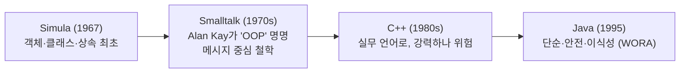

# 부록 A 언어와 도구 · A.1 Java

> 부록

## 들어가며

본문 곳곳에서 쓴 자바의 기초를 모았다. OOP와 상속의 어원과 철학, 값의 성질이 타입을 정한다는 박싱 이야기, 그리고 팩토리 말고 나머지 디자인 패턴이다.

---

## Java의 OOP·상속: 개념 → 어원 → 추구하는 방향

> **용도**: NotebookLM 소스 및 복습용. 이미 쓰는 Java를 "문법"이 아니라 **개념·역사·철학**으로 이해.
> **관점**: 언어는 도구지만, 그 도구가 *왜 그렇게 설계됐는지*를 알면 훨씬 잘 쓴다.
> **연결**: [C.1 큰 그림](c1-big-picture.md) · [A.1 Java](a1-java.md) · 게임엔진(Unity C#/Unreal C++)도 OOP 기반이라 그래픽스 트랙과도 연결.

---

### 0. 큰 그림 — 복잡함을 어떻게 길들일까

프로그램이 커지면 사람 머리로는 감당이 안 된다. 부품 수천 개가 서로 얽혀, 한 곳을 고치면 엉뚱한 데서 터진다. 이 복잡함을 길들이려는 한 가지 답이 바로 **객체지향**(OOP)이다.

**객체지향 프로그래밍**(OOP)은 프로그램을 "데이터(상태)와 그 데이터를 다루는 동작(메서드)을 하나로 묶은 **객체**(object)들의 상호작용"으로 바라보는 설계 방식이다. 현실 세계를 객체로 모델링해 **복잡도를 관리**하는 것이 목적. 이 아이디어는 1960년대 **Simula**에서 시작해 **Smalltalk**(Alan Kay가 "object-oriented"라는 말을 만듦)에서 꽃폈고, C++를 거쳐 **Java**(1995)가 대중화했다. Java는 "복잡하고 위험한 C++"의 대안으로 **단순함·안전함·이식성**(WORA)을 추구하며 OOP를 주류로 끌어올렸다.

---

### 1. OOP의 4대 개념 (Java의 뼈대)

| 개념 | 뜻 | 한 줄 |
|------|-----|-------|
| **캡슐화(encapsulation)** | 데이터를 숨기고 메서드로만 접근 | 내부는 감추고 필요한 창구만 연다 (`private` + getter/setter) |
| **상속(inheritance)** | 기존 클래스의 특성을 물려받아 확장 | 공통을 부모에 두고 자식이 이어받는다 (`extends`) |
| **다형성(polymorphism)** | 같은 호출이 객체에 따라 다르게 동작 | `draw()` 하나로 원·사각형이 각자 그림 |
| **추상화(abstraction)** | 핵심만 남기고 세부를 감춤 | "무엇을 하는가"만 노출, "어떻게"는 숨김 (인터페이스) |

**핵심 요약**: OOP = 캡슐화·상속·다형성·추상화로 복잡한 프로그램을 객체 단위로 나눠 관리.

`참조`: [위키백과: 객체 지향 프로그래밍](https://ko.wikipedia.org/wiki/객체_지향_프로그래밍) · [Wikipedia: OOP](https://en.wikipedia.org/wiki/Object-oriented_programming)

---

### 2. 상속(Inheritance) — 자세히

**정의**: 어떤 클래스(자식/subclass)가 다른 클래스(부모/superclass)의 필드·메서드를 물려받는 것. 공통 코드를 부모에 모아 **재사용**하고, 자식은 차이점만 추가·변경한다.

```java
class Animal {              // 부모
    String name;
    void breathe() { ... }  // 공통 동작
    void sound() { System.out.println("..."); }
}

class Dog extends Animal {  // 자식: Animal을 상속
    @Override
    void sound() { System.out.println("멍멍"); }  // 재정의(오버라이드)
}
```

- **is-a 관계**: "Dog **is a** Animal"이 성립할 때 상속이 적절하다.
- **오버라이드(override)**: 부모 메서드를 자식이 다시 정의 → **다형성**의 핵심.
- `super`: 부모의 생성자·메서드 호출.

**상속의 그림자 (현대적 주의)**
- 부모가 바뀌면 자식이 줄줄이 영향받는 **강한 결합**. (취약한 기반 클래스 문제)
- Java는 **다중 상속(부모 여럿) 금지** — 충돌·복잡도 때문. 대신 **인터페이스**로 여러 타입을 구현.
- 그래서 현대 설계 격언: **"상속보다 조합(Composition over Inheritance)"** — 물려받기보다 필요한 객체를 *가지고 있게* 하라.

**핵심 요약**: 상속 = 공통을 부모에 두고 자식이 물려받아 확장(is-a). 강하게 얽히므로, 요즘은 "상속보다 조합"을 권한다.

`참조`: [Oracle Java Tutorials – Inheritance](https://docs.oracle.com/javase/tutorial/java/IandI/subclasses.html)

---

### 3. 어원과 역사 (왜 이렇게 생겼나)

객체지향은 어느 날 뚝 떨어진 게 아니라, "**복잡한 프로그램을 어떻게 인간이 감당할까**"라는 고민이 30년에 걸쳐 다듬어진 결과다. 시뮬레이션에서 태어나(Simula), 철학이 붙고(Smalltalk), 실무로 내려왔다가(C++), 대중화됐다(Java).



*(도식 설명: 객체지향은 Simula(1967)에서 태어나 Smalltalk에서 'OOP'로 명명·철학화되고, C++로 실무화됐다가 Java(1995)에서 단순·안전·이식성으로 대중화됐다.)*

#### 3-1. Simula (1960년대) — 최초의 객체
- 노르웨이의 O.-J. Dahl과 K. Nygaard가 **시뮬레이션**을 위해 설계.
- **객체·클래스·상속·서브클래스·가상 메서드** 개념을 처음 도입. → OOP의 조상.

#### 3-2. Smalltalk / Alan Kay (1970년대) — "object-oriented"라는 말의 탄생
- Alan Kay가 Simula에 영감받아, Xerox PARC에서 Smalltalk 개발.
- **"object-oriented programming"이라는 용어를 만든 사람**(1960년대 후반부터 사용).
- 그의 원래 핵심은 흔히 오해하는 "상속"이 아니라 → **① 메시지 전달(messaging) ② 상태 캡슐화 ③ 늦은 바인딩(late binding)**. 객체끼리 *메시지를 주고받는* 것이 본질이라 봄.

#### 3-3. C++ (1980년대) — OOP를 실무 언어로
- Bjarne Stroustrup이 C에 객체 개념을 붙여 만듦("C with Classes").
- 강력하지만 **복잡하고, 메모리를 직접 관리해 위험**(포인터, 수동 해제).

#### 3-4. Java (1991 Oak → 1995) — 단순·안전·이식성
- James Gosling(Sun)이 처음엔 **작은 임베디드 기기**용으로 시작(프로젝트명 *Oak*).
- 목표: C 같은 익숙한 문법 + C/C++보다 **더 정밀하고 단순하며 안전하고 이식성 있게**.
- 1995년 공개, **"Write Once, Run Anywhere(WORA)"** — 한 번 짜면 어디서든 실행(JVM 위에서).

**핵심 요약**: 객체·상속은 Simula(1967)에서, "OOP"라는 말과 메시지 철학은 Alan Kay/Smalltalk에서, 실무화는 C++, 대중화는 Java에서. Java는 "복잡한 C++"의 안전·단순 대안으로 나왔다.

`참조`: [A Brief History of OOP (UT EECS)](https://web.eecs.utk.edu/~bvanderz/cs302/notes/oo-intro.html) · [Wikipedia: James Gosling](https://en.wikipedia.org/wiki/James_Gosling) · [Gosling – Java: an Overview (1995, PDF)](https://horstmann.com/corejava/java-an-overview/7Gosling.pdf)

---

### 4. Java가 추구하는 방향 (설계 철학)

| 철학 | 무슨 뜻 | 어떻게 구현했나 |
|------|---------|-----------------|
| **단순함(Simplicity)** | C++의 복잡·위험 요소 제거 | 포인터 산술·다중상속·연산자 오버로딩 제거 |
| **안전함(Safety)** | 프로그래머 실수를 막음 | **가비지 컬렉션**(GC)으로 메모리 자동 관리, 강한 타입 검사, 예외 처리 |
| **이식성(Portability, WORA)** | 어디서든 같은 결과 | 소스 → **바이트코드** → 어떤 **JVM**에서든 실행 |
| **객체지향 일관성** | 거의 모든 것을 객체로 | 클래스 중심 설계, 표준 라이브러리도 객체 |
| **네트워크·분산 지향** | 초기부터 인터넷 시대를 겨냥 | 안전한 실행, 플랫폼 독립 |

> **한 줄 철학**: "복잡하고 위험한 부분을 걷어내고(단순·안전), 어디서든 돌게 한다(이식성)." 이 방향이 Java를 기업용 표준으로 만들었다.

**핵심 요약**: Java의 방향 = 단순·안전(GC)·이식성(WORA). "강력하지만 위험한" C++의 대안으로 설계됨.

`참조`: [Gosling – Java: an Overview (1995)](https://horstmann.com/corejava/java-an-overview/7Gosling.pdf) · [Wikipedia: Java (programming language)](https://en.wikipedia.org/wiki/Java_(programming_language))

---

### 5. 다른 관점과의 연결 (개념 확장)

- **절차지향 vs 객체지향**: 절차지향은 "함수의 흐름" 중심, 객체지향은 "데이터+동작 묶음" 중심.
- **OOP vs 함수형(FP)**: FP는 상태 변화를 피하고 함수 조합을 강조. 현대 언어(Java도 8부터 람다·스트림)로 둘을 섞어 씀.
- **그래픽스/게임엔진과의 연결**: Unity(C#)·Unreal(C++)은 OOP로 게임 객체를 모델링(캐릭터=객체, 상속으로 적 종류 확장). → 그래픽스 트랙 ③ 게임엔진에서 이 개념이 그대로 쓰인다.

**핵심 요약**: OOP는 여러 패러다임 중 하나. 현대는 FP와 섞어 쓰며, 게임엔진 등 실무에서 여전히 뼈대다.

---

### 한 줄 용어 사전 (한↔영)

| 한국어 | English | 뜻 |
|--------|---------|-----|
| 객체 | object | 상태+동작을 묶은 것 |
| 클래스 | class | 객체를 찍어내는 틀 |
| 캡슐화 | encapsulation | 내부를 감추고 창구만 노출 |
| 상속 | inheritance | 부모 특성을 물려받아 확장 |
| 다형성 | polymorphism | 같은 호출이 객체별로 다르게 동작 |
| 추상화 | abstraction | 핵심만 남기고 세부를 감춤 |
| 오버라이드 | override | 부모 메서드를 자식이 재정의 |
| 인터페이스 | interface | "무엇을 하는가"의 계약 |
| 조합 | composition | 물려받기보다 객체를 가지고 있기 |
| 바이트코드 | bytecode | JVM이 실행하는 중간 코드 |
| GC | garbage collection | 메모리 자동 회수 |
| WORA | write once, run anywhere | 한 번 짜면 어디서든 실행 |

---

### NotebookLM 활용 팁
- "OOP 4대 개념을 예시와 함께 5문항 퀴즈로"
- "상속과 조합의 차이를 표로, 언제 뭘 쓸지"
- "Simula→Smalltalk→C++→Java 발전 타임라인을 만들어줘"
- "Alan Kay가 말한 진짜 OOP와, 흔히 아는 상속 중심 OOP의 차이를 설명해줘"

### 전체 참조 출처
- 위키백과, *객체 지향 프로그래밍* — https://ko.wikipedia.org/wiki/객체_지향_프로그래밍
- Wikipedia, *Object-oriented programming* — https://en.wikipedia.org/wiki/Object-oriented_programming
- UT EECS, *A Brief History of OOP* — https://web.eecs.utk.edu/~bvanderz/cs302/notes/oo-intro.html
- James Gosling, *Java: an Overview* (1995) — https://horstmann.com/corejava/java-an-overview/7Gosling.pdf
- Wikipedia, *James Gosling* — https://en.wikipedia.org/wiki/James_Gosling
- Oracle, *Java Tutorials – Inheritance* — https://docs.oracle.com/javase/tutorial/java/IandI/subclasses.html

_작성: 2026-07 · 개념·역사 정리. 세부 문법·최신 버전은 공식 문서 확인._

---

## 값의 성질이 타입을 결정 — 정수 타입 · 박싱 · 래퍼(wrapper)

> **출발점**: "값이 크면 타입도 커진다. int는 정수만, long은 32자리?"
> **바로잡기**: `int`는 **32비트**(≈10자리, ±21억), `long`은 **64비트**(≈19자리). "비트 수 ≠ 자릿수"다.
> **연결**: [1장 추상화와 복잡도](../part1/ch01-abstraction-and-complexity.md)(타입 선택) · [D.3 Unity GC](d3-unity-gc.md)(박싱→힙 할당)

---

### 1. 먼저: "비트"와 "자릿수"는 다르다

- 컴퓨터는 정수를 **비트(bit)** 개수로 표현한다. n비트면 2ⁿ가지 값.
- `int` = **32비트** → 약 42억 가지 → 부호 있으면 **약 ±21억** → 십진수로 **약 10자리**.
- `long` = **64비트** → **약 ±9.2×10¹⁸** → 십진수로 **약 19자리**.

> 즉 "long 32자리"가 아니라, **int가 32비트**. 헷갈리기 쉬운 지점.

---

### 2. 정수·실수 타입 크기표 (Java 기준)

| 타입 | 비트 | 대략 범위 | 십진 자릿수 | 쓰임 |
|------|------|-----------|-------------|------|
| `byte` | 8 | -128 ~ 127 | ~3 | 바이트 데이터 |
| `short` | 16 | -32,768 ~ 32,767 | ~5 | 메모리 절약 |
| `int` | 32 | **±약 21억** | ~10 | **기본 정수** |
| `long` | 64 | **±약 9.2×10¹⁸** | ~19 | 큰 수(시간ms, ID, 금액원) |
| `float` | 32 | (실수) | 유효숫자 ~7 | 정밀도 낮은 실수 |
| `double` | 64 | (실수) | 유효숫자 ~15~16 | **기본 실수** |

**선택 규칙**
- 값 범위가 int(21억)를 넘으면 → `long`. (예: 밀리초 시간, 조 단위 금액, 대량 ID)
- 넘치는데 int를 쓰면 → **오버플로**(값이 음수로 뒤집힘). 흔한 버그.
- 돈·정밀 계산은 float/double 대신 → `BigDecimal`(부동소수점 오차 회피).

**핵심 요약**: 값의 최대 범위로 정수 타입을 고른다. int(≈±21억) 넘으면 long. 오버플로 조심.

---

### 3. 원시 타입 vs 래퍼(wrapper) 클래스

Java의 타입은 두 종류다.

- **원시 타입(primitive)**: `int, long, double, boolean, char`… → **값 자체**를 스택/인라인에 저장. 가볍고 빠름.
- **래퍼 클래스(wrapper)**: 원시를 **객체로 감싼 것** → **힙에 객체**로 저장. null 가능, 메서드 보유.

| 원시 | 래퍼 |
|------|------|
| `int` | `Integer` |
| `long` | `Long` |
| `double` | `Double` |
| `float` | `Float` |
| `boolean` | `Boolean` |
| `char` | `Character` |
| `byte`/`short` | `Byte`/`Short` |

**핵심 요약**: 원시는 값(가벼움), 래퍼는 원시를 감싼 객체(힙, null·메서드 가능).

---

### 4. 박싱(Boxing) / 언박싱(Unboxing)

- **박싱**: 원시 → 래퍼. (`int` → `Integer`) — **힙에 객체 생성**.
- **언박싱**: 래퍼 → 원시. (`Integer` → `int`)
- **오토박싱(autoboxing)**: Java 5+에서 **자동 변환**. 편하지만 숨은 비용이 있다.

```java
Integer boxed = 10;      // 오토박싱: int 10 → Integer 객체 (힙 할당)
int raw = boxed;         // 언박싱: Integer → int
List<Integer> list = ... // 제네릭은 객체만 담아서 int가 자동 박싱됨
```

#### 왜 조심해야 하나 (성능·GC)
- 박싱마다 **힙에 객체가 생긴다** → 반복문·대량 데이터에서 **garbage 폭증 → GC 부담**.
  - → 이게 [Unity GC 노트](d3-unity-gc.md)의 "boxing → 힙 할당"과 **같은 이야기**. (C#도 값 타입→object 박싱 시 힙 할당)
- **Integer 캐시 함정**: Java는 `-128~127` 범위 Integer를 캐싱해 재사용.
  ```java
  Integer a = 100, b = 100;   // 캐시 → a == b : true
  Integer c = 200, d = 200;   // 새 객체 → c == d : false (!)
  ```
  → 래퍼 비교는 `==`(주소 비교)가 아니라 `.equals()`(값 비교)로 해야 안전.

**핵심 요약**: 박싱은 원시를 힙 객체로 만든다 → 편하지만 GC 부담·`==` 함정. 뜨거운 루프에선 피한다.

---

### 5. 언제 원시, 언제 래퍼를 쓸까

| 상황 | 선택 | 이유 |
|------|------|------|
| 성능·대량 배열·핫 루프 | **원시(int)** | 힙 할당·박싱 비용 없음 |
| 컬렉션·제네릭 (`List<Integer>`) | **래퍼** | 제네릭은 객체만 담음 |
| "값 없음"을 표현해야 (null) | **래퍼** | 원시는 null 불가 |
| 유틸 메서드·상수 필요 | **래퍼** | `Integer.parseInt`, `Integer.MAX_VALUE` |
| DB 매핑에서 미입력 구분 | **래퍼** | 0과 null을 구분 |

**핵심 요약**: 기본은 원시(가벼움), 컬렉션·null·유틸이 필요하면 래퍼. 래퍼 남발은 GC 부담.

---

### 6. C# / Unity 로 연결

- C#도 **값 타입(int, struct=스택/인라인)** vs **참조 타입(class=힙)** 구분이 있다.
- **박싱** = 값 타입을 `object`로 감쌈 → **힙 할당** → 게임 루프에서 GC spike 유발.
- 그래서 Unity 최적화에서 "**박싱 피하기, struct 활용**"이 강조된다. → Java의 원시/래퍼 개념과 뿌리가 같다.

---

### 한 줄 정리
> `int`=32비트(≈±21억, 10자리), `long`=64비트(≈19자리) — **"비트 ≠ 자릿수"**. 값 범위로 타입을 고르고 넘치면 오버플로.
> **원시**는 값(가벼움), **래퍼**는 감싼 객체(힙·null·메서드). **박싱**은 원시→힙 객체라 편하지만 GC 부담·`==` 함정이 있으니 핫 루프에선 피한다.

### 참조
- Oracle Java Tutorials – Primitive Data Types — https://docs.oracle.com/javase/tutorial/java/nutsandbolts/datatypes.html
- Oracle – Autoboxing and Unboxing — https://docs.oracle.com/javase/tutorial/java/data/autoboxing.html

_작성: 2026-07 · Java 기준. 값 범위는 언어·플랫폼에 따라 다를 수 있으니 공식 문서 확인._

---

## 자바 개발자를 위한 디자인 패턴 — 팩토리 말고 나머지도

> 관점: GoF 23개를 다 외우지 말고, **자바 표준 라이브러리·스프링에 이미 박혀 있는** 것부터 "언제 쓰나 + 어디에 있나"로 잡는다. (Factory는 아는 상태에서 확장)
> 관련: [A.1 Java](a1-java.md) · [C.2 학습 경로와 신경망 종류](c2-curriculum-and-nn-types.md) · 리스너=옵서버 (→ [3.2 GC 함정과 점검](../part1/ch03-2-gc-and-review.md)).

---

### 0. 큰 그림 — 세 분류

디자인 패턴 = "자주 나오는 문제의 검증된 해법 틀." 세 가지로 갈린다:

| 분류 | 질문 | 대표 |
|------|------|------|
| **생성(Creational)** | 객체를 **어떻게 만드나** | Factory, Builder, Singleton |
| **구조(Structural)** | 객체를 **어떻게 조립·연결하나** | Decorator, Adapter, Proxy, Facade |
| **행위(Behavioral)** | 객체가 **어떻게 협력·소통하나** | Observer, Strategy, Template Method |

> 자바 렌즈: 대부분 **JDK·스프링에서 이미 쓰고 있다.** 이름만 몰랐을 뿐.

---

### 1. 생성 패턴 (Creational)

| 패턴 | 한 줄 의도 | JDK/스프링 예 |
|------|-----------|--------------|
| **Factory Method** | 무엇을 만들지 **하위/메서드가 결정** | `Calendar.getInstance()`, `List.of()` |
| **Abstract Factory** | **관련 객체 묶음**을 함께 생성 | `DocumentBuilderFactory` |
| **Builder** | 복잡한 객체를 **단계적으로** 조립 | `StringBuilder`, `Stream.builder()`, Lombok `@Builder` |
| **Singleton** | 인스턴스 **딱 하나** | **스프링 Bean 기본 스코프**, `enum` 싱글턴 |
| **Prototype** | **복제**로 생성 | `Object.clone()` |

- **Builder**가 특히 유용: 생성자 인자가 많고 선택적일 때. `new Person.Builder().name("김").age(30).build()`.
- **Singleton**은 `enum`으로 만드는 게 안전(직렬화·리플렉션 방어). 스프링 쓰면 Bean이 이미 싱글턴.

---

### 2. 구조 패턴 (Structural)

| 패턴 | 한 줄 의도 | JDK/스프링 예 |
|------|-----------|--------------|
| **Decorator** | 원본을 **감싸 기능 덧붙임**(상속 대신 조립) | `new BufferedReader(new FileReader(f))`, `Collections.unmodifiableList()` |
| **Adapter** | 인터페이스 **변환**(끼워 맞춤) | `Arrays.asList()`, `InputStreamReader` |
| **Proxy** | **대리자**(접근 제어·지연·원격) | **스프링 AOP**, JDK 동적 프록시, Hibernate 지연 로딩 |
| **Facade** | 복잡한 서브시스템에 **단순 창구** | `javax.faces`, 서비스 계층 |
| **Composite** | **트리**를 개별·전체 동일 취급 | Swing 컴포넌트, `java.io.File` |
| **Flyweight** | **공유**로 메모리 절약 | `Integer.valueOf()` 캐시(-128~127) |

- **Decorator = IO 스트림** 그 자체. `new BufferedReader(new FileReader(...))`가 데코레이터 중첩. (자바 렌즈에서 "람다 패치"랑 결이 같음)
- **Proxy = 스프링 AOP**. `@Transactional`이 붙으면 스프링이 **프록시로 감싸** 트랜잭션을 열고 닫는다. (🔎 더 깊이 → [5장 트랜잭션과 락](../part2/ch05-transaction-and-lock.md) — 프록시라서 생기는 함정 4개·전파·readOnly) (→ [C.2 학습 경로와 신경망 종류](c2-curriculum-and-nn-types.md)의 LoRA=AOP 비유)

---

### 3. 행위 패턴 (Behavioral)

| 패턴 | 한 줄 의도 | JDK/스프링 예 |
|------|-----------|--------------|
| **Observer** | 이벤트 나면 **구독자에게 알림** | **리스너**(`addActionListener`), `PropertyChangeListener`, 스프링 `@EventListener` |
| **Strategy** | 알고리즘을 **갈아끼움** | `Comparator`, 람다로 넘기는 전략 |
| **Template Method** | 뼈대는 고정, **일부만 하위클래스** | `AbstractList`, `HttpServlet`(service→doGet) |
| **Iterator** | 순회를 **추상화** | `Iterator`, for-each |
| **Command** | 요청을 **객체로** 포장 | `Runnable`, `Callable` |
| **Chain of Responsibility** | 처리기를 **사슬**로 넘김 | 서블릿 `Filter`, 스프링 시큐리티 필터 |
| **State** | **상태별로 행동** 바뀜 | 상태 머신 |

- **Observer = 리스너** 바로 그것. 등록·해제·누수 주의는 [3.2 GC 함정과 점검](../part1/ch03-2-gc-and-review.md) 참고.
- **Strategy = 람다**. `list.sort(Comparator.comparing(...))`에서 정렬 "전략"을 람다로 주입. 자바 8 이후 전략 패턴은 대부분 람다로 대체.
- **Template Method**: `HttpServlet`을 상속해 `doGet()`만 채우는 게 딱 이 패턴. 뼈대(요청 분기)는 부모가, 세부만 내가.

---

### 자바 렌즈 — 한눈 매핑 (핵심만)

| 패턴 | "이미 쓰고 있던" 자바 |
|------|----------------------|
| Builder | `StringBuilder` |
| Singleton | 스프링 Bean |
| Decorator | `BufferedReader(new FileReader())` |
| Proxy | `@Transactional`(스프링 AOP) |
| Observer | `addXxxListener`(리스너) |
| Strategy | `Comparator`·람다 |
| Template Method | `HttpServlet.doGet()` |
| Iterator | for-each |

---

### 언제 뭘 쓰나 · 주의

- **먼저 문제를 만나고 패턴을 붙여라.** 패턴부터 깔면 **과설계(over-engineering)** — YAGNI 위반(→ [A.1 Java](a1-java.md) 7장 과한 추상화).
- 자바 8 이후 **Strategy·Command·Observer는 람다/메서드 참조로** 훨씬 짧게 쓴다. 굳이 클래스 안 만들어도 됨.
- 스프링을 쓰면 **Singleton·Proxy·Factory·Template**은 프레임워크가 이미 해준다 — **직접 구현할 일이 준다.**

---

### 한 줄 요약

디자인 패턴은 **3분류**(생성·구조·행위)로 잡고, **JDK·스프링에 이미 박힌 예**로 외우면 빠르다: **Builder=`StringBuilder`, Singleton=Bean, Decorator=IO 스트림, Proxy=`@Transactional`, Observer=리스너, Strategy=`Comparator`/람다, Template=`doGet`.** Factory만 알던 데서, "이미 쓰고 있던 것"에 이름을 붙이면 나머지가 한 번에 잡힌다.

### 참조
- Gamma et al., *Design Patterns (GoF)* — 원전
- [Refactoring.Guru — Design Patterns](https://refactoring.guru/design-patterns) (그림 설명 좋음)

---

## 정리 Q&A

### Java — 암기 Q&A (얕게)

> 형식: **① 결론·WHAT / ② 원리·HOW / ③ 확장·TRADE-OFF**. 쉬운 말 위주.
> 개념 상세: [A.1 Java](a1-java.md) · [A.1 Java](a1-java.md)

---

#### Q1. 객체지향(OOP)이 뭐야?
- **① 결론** 프로그램을 **객체**(데이터+동작 묶음)들의 상호작용으로 보는 방식.
- **② 원리** 현실을 객체로 모델링해 복잡함을 나눠 관리. 4대: 캡슐화·상속·다형성·추상화.
- **③ 확장** 재사용·유지보수에 강함. 단, 과하게 나누면 오히려 복잡해질 수 있다.

#### Q2. 상속이 뭐야?
- **① 결론** 부모 클래스의 것을 **물려받아** 자식이 확장하는 것.
- **② 원리** 공통 코드를 부모에 두고 자식은 차이만 추가·수정(오버라이드). "Dog is a Animal"일 때 적절.
- **③ 확장** 재사용에 좋으나 부모 바뀌면 자식이 줄줄이 영향 → 요즘은 "상속보다 조합"을 권함.

#### Q3. 원시 타입 vs 래퍼(wrapper)?
- **① 결론** 원시(int)는 값 자체, 래퍼(Integer)는 값을 감싼 **객체**.
- **② 원리** 원시는 가볍고 빠름(스택), 래퍼는 힙에 저장돼 null·메서드가 가능.
- **③ 확장** 컬렉션(`List<Integer>`)·null이 필요하면 래퍼, 성능·대량이면 원시.

#### Q4. 박싱(boxing)이 왜 문제야?
- **① 결론** 원시를 래퍼로 바꾸면 **힙에 객체가 생겨** garbage가 늘고 GC 부담.
- **② 원리** 오토박싱은 자동이라 반복문·컬렉션에서 나도 모르게 객체가 잔뜩 생긴다.
- **③ 확장** 뜨거운 루프에선 피하기. Integer는 -128~127만 캐싱돼 `==` 함정 → 비교는 `.equals()`.

#### Q5. Java는 왜 "어디서든 돌아간다"고 해?
- **① 결론** **한 번 짜면 어디서든 실행**(WORA)이 Java의 철학.
- **② 원리** 소스를 바이트코드로 바꾸고, 각 OS의 **JVM**이 그걸 실행하기 때문.
- **③ 확장** 이식성·안전(자동 메모리 관리 GC)이 강점. 대신 JVM 위라 네이티브보다 약간 느릴 수 있다.

_더 깊이: OOP 어원(Simula/Smalltalk), 제네릭, 함수형(람다·스트림) 등은 물어보면 파봄._

---

## 다음으로

자바 다음으로, 언어를 바꿔도 남는 것과 다시 배워야 하는 것을 A.2에서 본다.

👉 [부록 A 언어와 도구 · A.2 다른 언어로 옮겨가기](a2-other-languages.md)
