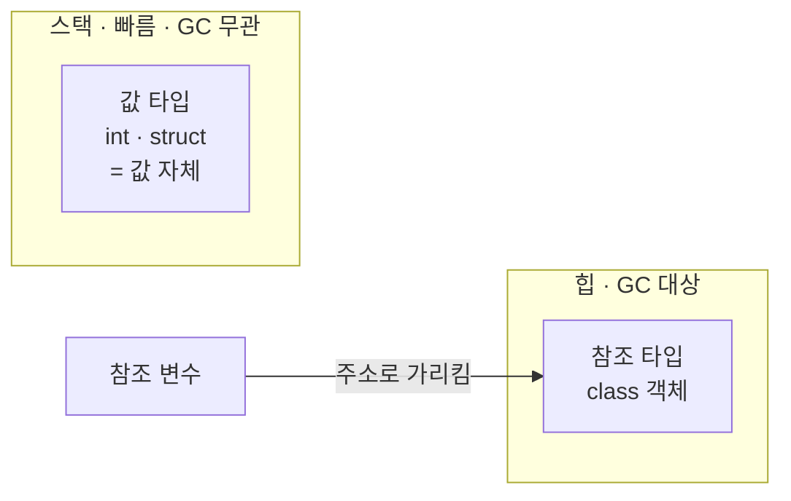

# 부록 A 언어와 도구 · A.2 다른 언어로 옮겨가기

> 부록

## 들어가며

언어 불문 공통으로 옮겨가는 것과 언어마다 다른 관용구를 먼저 나눈다. 그다음 C++·Java·C#이 왜 갈라졌는지, 자바 개발자가 C#과 Kotlin을 빠르게 익히는 법을 정리한다.

---

## 언어 불문 공통(커먼) — 무엇이 옮겨가고 무엇이 다른가

> 한 언어(자바)에서 배운 게 다른 언어(C# 등)로 **얼마나 그대로 옮겨가나?** 핵심은:
> **개념·원칙은 거의 그대로 옮겨가고, "관용구(idiom)"만 다르다.** 새 언어 학습 = 관용구 학습.

### 옮겨가는 것 (Common — 한 번 배우면 평생)

| 영역 | 왜 불문인가 |
|------|------------|
| **OOP 4원칙** (캡슐화·상속·다형성·추상화) | 객체 모델링 사고는 언어 무관 |
| **SOLID** | 설계 원칙. 자바든 C#든 좋은 설계의 기준 동일 |
| **디자인 패턴** (전략·옵저버·팩토리…) | "문제↔해결 구조"라 언어 불문. 단 *구현 관용구*는 다름(아래) |
| **시간/공간 복잡도(Big-O)** | 수학. 언어 무관 (Big-O) |
| **자료구조** (배열·해시·트리) | 개념 동일, 이름·API만 다름 |
| **동시성 개념** (락·경합·동시성vs병렬) | OS·하드웨어 레벨이라 불문 (동시성) |
| **트레이드오프 사고** | 측정·판단은 언어 위의 layer (트레이드오프) |

→ 즉 당신이 가진 **디자인 패턴·설계 감각은 C#에서도 그대로 자산**이다.

### 다른 것 (Idiom — 언어마다 다시 배움)

| 영역 | 다른 이유 |
|------|----------|
| **문법·키워드** | 당연히 다름 |
| **관용 표현** | 같은 패턴도 언어 기능으로 더 짧게 (예: 옵저버 → C#는 event) |
| **표준 라이브러리/생태계** | 컬렉션·비동기·DI 방식이 다름 |
| **명명·컨벤션** | 자바 camelCase 메서드 ↔ C# PascalCase |
| **빌드·프로젝트 구조** | Maven/Gradle ↔ .csproj/solution |

### 핵심 태도

> **"패턴을 안다"와 "그 언어의 관용구로 표현할 줄 안다"는 다르다.**
> 디자인 패턴을 아는 당신이 C#에서 막히는 건 *설계*가 아니라 *관용구·관례*다.
> → 그 차이만 Java vs C#에서 툴팁식으로 정리.

## C++ vs Java vs C# — 왜 갈라졌나 (역사·철학)

> 관점: 세 언어는 **사촌**인데 왜 다를까? **C++는 C+Simula의 후손, Java는 C++에 대한 반작용, C#은 Java에 대한 반작용**(이면서 C++의 유용함을 되살림). "파생된 근거"를 창시자 발언·문서로 추적한다.
> 자바 렌즈 전반: C.2 학습 경로와 신경망 종류 · Java 개념 A.1 Java · C# A.2 다른 언어 (C++·C#·Kotlin).

---

### 0. 한 줄 계보 — 누가 무엇에 반응했나

```
1967 Simula (OOP의 시초: 클래스·상속)
1972 C (Ritchie, 시스템 프로그래밍)
        └→ 1983 C++  (Stroustrup): C의 성능 + Simula의 OOP
                └→ 1995 Java (Gosling): C++에서 "위험한 것"을 제거
                        └→ 2002 C# (Hejlsberg): Java + C++이 버린 유용함 복원 + 신기능
```

- **C++** = C에 OOP를 더함 (성능 유지)
- **Java** = C++ **빼기 위험한 부분** (포인터·수동 메모리·다중상속…)
- **C#** = Java **더하기 C++의 좋은 것** (값 타입·연산자 오버로딩·결정적 정리) **더하기 신기능**(LINQ·async)

---

### 1. 세 언어 한눈

| | C++ | Java | C# |
|---|-----|------|-----|
| **창시자** | Bjarne Stroustrup (Bell Labs) | James Gosling (Sun) | Anders Hejlsberg (MS, Turbo Pascal·Delphi 창시자) |
| **공개** | 1983/85 | **1995** | **2002** |
| **원래 문제** | Simula OOP를 **C 성능**으로 (시뮬레이션 연구) | 원래 **셋톱박스** → 인터넷용 이식·안전 언어 | **.NET/CLR** 플래그십 언어 (J++ 소송 이후) |
| **철학 한 줄** | "C에 최대한 가깝게 — **쓰지 않는 것엔 비용 없다**(zero-overhead)" | "**단순·객체지향·친숙**" — 위험/혼란한 걸 뺀다 | **실용·생산성** — 검증된 걸 빌리고 아픈 곳을 고친다 |

> Java 백서는 C++의 *"드물게 쓰이고, 잘 이해되지 않으며, 혼란스러운 기능들"* 을 뺐다고 밝힌다(Gosling & McGilton, 1995).

---

### 2. 핵심 갈림길 — 무엇이 왜 다른가

#### ① 메모리 관리
| C++ | Java | C# |
|-----|------|-----|
| **수동**(`new`/`delete`, RAII) | **GC** | **GC** + 결정적 정리(`IDisposable`/`using`) |
- **왜 갈렸나**: C++는 **성능·예측 가능성**(GC 멈춤 없음). Java는 메모리 누수·댕글링 포인터를 "**용납 불가**"로 보고, 특히 **다운로드되는 모바일 코드**의 안전을 위해 GC 채택. C#은 GC를 따르되, C++ 개발자가 그리워한 **결정적 정리**(`using`)를 되살림.

#### ② 컴파일 대상
| C++ | Java | C# |
|-----|------|-----|
| **네이티브 기계어** | **바이트코드 → JVM** (WORA) | **IL → CLR** (다언어) |
- **왜**: Java의 **"Write Once, Run Anywhere"** — 이기종 기기에서 돌게 **아키텍처 중립** 설계(셋톱박스·인터넷 출신). C#의 CLR은 한 발 더 나가 **여러 언어(C#·F#·VB)가 같은 IL로 상호운용**하도록 설계. VM을 쓰는 이유: 이식성 + **바이트코드 검증**(실행 전 타입·메모리 안전) + GC·리플렉션.

#### ③ 포인터
| C++ | Java | C# |
|-----|------|-----|
| **raw 포인터**(+산술) | **없음**(참조만) | 참조 + `unsafe` 블록 안에서만 포인터 |
- **왜 Java가 뺐나**: 포인터는 **버그·보안 구멍의 주범.** 없애면 (1) 안전, (2) **GC가 객체를 자유롭게 이동** 가능, (3) 안전한 모바일 코드. C#은 "기본은 안전, 필요하면 `unsafe`로 책임지고" — 실용 절충.

#### ④ 값 타입 vs 참조 타입
| C++ | Java | C# |
|-----|------|-----|
| 자유(스택/힙 선택) | **거의 참조**(원시 8개만 값, 박싱) | **`struct` 값 타입** + 통합 타입 시스템 |
- **왜 C#이 값 타입을 추가**: 박싱·힙 할당·GC 부담을 피하려고. Hejlsberg는 `List<int>`가 진짜 int이길 원했다 — 박싱해서 공유하는 건 *"엄청 비싼 방법"*이라고. (→ A.1 Java)

#### ⑤ 제네릭 — 가장 큰 기술적 분기
| | 방식 | 결과 |
|---|------|------|
| **C++ 템플릿** | 컴파일 타임 코드 생성 | **코드 팽창**·난해한 에러 |
| **Java 제네릭** | **타입 소거**(런타임엔 `Object`) | **기존 JVM 하위호환**이 목적. 대가: `List<int>` 불가(박싱), 런타임 타입정보 없음 |
| **C# 제네릭** | **reified**(런타임에 진짜 타입, JIT가 특화) | `List<int>`가 진짜 int, 리플렉션 가능. 대가: **CLR 자체를 바꿔야** 했음 |
- **왜 다른가**: Sun은 **기존 JVM 생태계를 안 깨려고** 소거를 택했고, MS는 **CLR을 통제**하니 reified로 갈 수 있었다. (둘 다 2004~2005 비슷한 시기에 제네릭 도입, **정반대 구현**)

#### ⑥ 다중 상속 / ⑦ 연산자 오버로딩 / ⑧ 소멸
| 기능 | C++ | Java | C# |
|------|-----|------|-----|
| 다중 상속 | 있음(다이아몬드 문제) | **인터페이스만** | **인터페이스만** |
| 연산자 오버로딩 | 있음 | **없음**(가독성) | **부활**(값 타입 때문) |
| 소멸 | **결정적 소멸자** | `finalize()`(폐기됨) | `IDisposable`+`using` |
- **다중상속**: Gosling은 *"이해·구현·올바른 사용이 어렵다"* 며 실용적으로 제거 — 인터페이스가 유용한 부분만 취함.
- **연산자 오버로딩**: Java는 `a + b`가 비싼 동작을 숨겨 가독성을 해친다고 제외. C#은 값 타입(`decimal`·벡터)에 자연스러워 되살림.

---

### 3. C#은 Java를 어떻게 "고쳤나" (자바 개발자가 불평하던 것)

| Java 불만 | C# 해법 | 이유 |
|-----------|---------|------|
| **Checked exception**(`throws` 폭증) | **없앰** | Hejlsberg: **버전 관리**(throws에 예외 추가 = 클라 코드 깨짐) + **확장성**(사람들이 우회해 오히려 품질 저하) |
| 타입 소거(박싱·런타임 정보 없음) | **reified 제네릭** | 런타임에 충실한 타입 |
| 값 타입 없음 | `struct` | 성능·박싱 회피 |
| getter/setter 보일러플레이트 | **프로퍼티** (`{ get; set; }`) | 언어 차원 지원 |
| 연산자 오버로딩 없음 | **부활** | 값 타입 연산에 필요 |
| 비결정적 `finalize` | **`IDisposable`+`using`** | 결정적 자원 정리 |
| — | **LINQ·async/await** | 데이터 질의·비동기를 언어에 통합 |

> 한 줄: **C# = "Java의 문법·안전 + Java가 버린 C++ 기능(값타입·연산자·결정적 정리·reified 제네릭) + 신기능(LINQ·async)".**

---

### 4. 자바 렌즈 — 세 언어 성격 한 줄

- **C++**: 성능·통제 우선. **프로그래머를 다 믿는다**(발등 찍을 자유까지).
- **Java**: 안전·단순·이식 우선. **위험한 걸 빼앗는다.**
- **C#**: 생산성·실용. **Java의 안전은 유지하고, C++의 유용함을 돌려주고, 계속 새 기능**을 얹는다.

Java를 안다면 C#은 사촌(→ A.2 다른 언어 (C++·C#·Kotlin)), C++는 "포인터·수동 메모리·템플릿을 되찾은 조상"이라고 보면 지도가 잡힌다.

---

### 한 줄 요약
**C++**(성능·통제, C+Simula) → **Java**(안전·단순, C++에서 위험 제거) → **C#**(실용, Java+C++장점+신기능). 갈림길은 **메모리(수동/GC)·컴파일(네이티브/VM)·포인터·값타입·제네릭**(템플릿/소거/reified)이고, 각 선택엔 **성능 vs 안전 vs 생산성**이라는 서로 다른 우선순위가 깔려 있다.

### 출처
- Stroustrup, *A History of C++ (HOPL)* — https://www.stroustrup.com/hopl2.pdf
- Gosling & McGilton, *The Java Language Environment: A White Paper* (1995) — https://www.stroustrup.com/1995_Java_whitepaper.pdf
- Hejlsberg on generics (Artima) — https://www.artima.com/articles/generics-in-c-java-and-c
- Hejlsberg, *The Trouble with Checked Exceptions* (Artima) — https://www.artima.com/articles/the-trouble-with-checked-exceptions
- *Tips for Java Developers — A tour of C#* (Microsoft) — https://learn.microsoft.com/en-us/dotnet/csharp/tour-of-csharp/tips-for-java-developers

---

## Java ↔ C# ↔ Python — 툴팁식 비교 + 개발 가이드

> "자바에선 이렇게 하는데 C#/파이썬에선?" 을 **개념 → Java → C# → Python**로 빠르게 찾는 참조.
> 디자인 패턴·설계는 그대로 옮겨가고(공통), 여기선 **관용구 차이**만.
> NotebookLM에 넣고 "C#에서 X는 어떻게?" 물으면 툴팁처럼 답이 나온다.

### 1. 언어 기능 대조 (개념 → Java → C#)

| 개념 | Java | C# | Python |
|------|------|-----|--------|
| 프로퍼티 | `getX()/setX()` | `public int X { get; set; }` | **`@property` 데코레이터** |
| 컬렉션 질의 | Stream + 람다 | LINQ `.Where().Select()` | **리스트 컴프리헨션** `[f(x) for x in xs if ...]` |
| 비동기 | `CompletableFuture` | `async/await` | `async/await` (asyncio) |
| 콜백/이벤트 | 함수형 인터페이스 | `delegate`/`event`,`Func<>` | **함수가 일급 객체** (그냥 함수 전달) |
| 값 타입 | (없음) | `struct` = 값 타입 | (없음) 전부 객체 참조 |
| 타입 | 정적 | 정적 | **동적**(런타임), 선택적 타입힌트(`typing`) |
| null | `Optional<T>` | `T?`,`??`,`?.` | `None` (`?.` 없음, `x or 기본값`) |
| 불변 DTO | record | `record` | `@dataclass(frozen=True)` / `namedtuple` |
| 인터페이스 | `interface` | `interface`(`I`접두) | **ABC / `Protocol`**(덕 타이핑) |
| 패키지 | `package` | `namespace` | **모듈/패키지**(폴더+`__init__.py`) |
| 진입점 | `static void main` | `Main`/top-level | `if __name__ == "__main__":` |

### 2. 디자인 패턴 — 같은 패턴, C#은 언어 기능으로 더 짧게

당신의 패턴 지식은 그대로 쓰되, C#은 종종 **언어 기능이 패턴을 대신**한다:

| 패턴 | Java 관용 | C# 관용 | Python 관용 |
|------|----------|---------|------------|
| Observer | 인터페이스+리스너 | `event`/`delegate` | 콜러블(함수) 리스트 |
| Strategy | 인터페이스 주입 | `Func<>`/인터페이스 | **함수 전달**(일급 객체) |
| Iterator | `Iterator` 구현 | `IEnumerable`+`yield` | **제너레이터 `yield`** |
| Command | 인터페이스/람다 | `Action`/delegate | 콜러블 |
| Singleton | static+동기화 | DI 컨테이너 | **모듈 자체가 싱글톤** |
| Factory | 팩토리 클래스 | 팩토리/DI | 팩토리 함수 |

> 교훈: C#에선 "패턴을 클래스로 직접 짜기" 전에 **언어 기능(event/Func/yield/DI)으로 충분한지** 먼저 본다.

### 3. C# 개발 가이드 (자바 개발자용)

#### 명명 컨벤션 (자바와 가장 다른 부분 — 주의)
[Microsoft 공식](https://learn.microsoft.com/en-us/dotnet/csharp/fundamentals/coding-style/identifier-names)

| 대상 | Java | **C#** |
|------|------|--------|
| 클래스/인터페이스/struct | PascalCase | **PascalCase** (인터페이스는 `I` 접두 — `IRepository`) |
| 메서드 | camelCase | **PascalCase** ← 자바와 다름! `GetUser()` |
| 프로퍼티 | (getter) | **PascalCase** `UserName` |
| 지역변수/매개변수 | camelCase | camelCase |
| private 필드 | camelCase | `_camelCase` (밑줄 접두) |
| 상수 | UPPER_CASE | **PascalCase** |

#### 실무 관례 (idiomatic C#)
- **프로퍼티를 써라**: `getX()` 만들지 말고 `public int X { get; set; }`. 읽기전용은 `{ get; }`/`init`.
- **LINQ를 적극 활용**: 루프 대신 `.Where().Select().ToList()`.
- **async는 끝까지**: `await` 쓰면 호출 체인 전체를 `async Task`로 (블로킹 `.Result` 금지 — 데드락).
- **DI가 기본**: .NET에 내장 DI 컨테이너. `Program.cs`에서 `builder.Services.AddScoped<...>()`.
  → Singleton을 static으로 만들지 말고 DI lifetime으로.
- **record로 DTO**: 불변 데이터는 `record`.
- `var`: 우변에서 타입이 명백하면 `var` 사용 권장.
- **nullable 활용**: `string?`, `obj?.Prop`, `x ?? 기본값`.
- **프로젝트 구조**: 솔루션(`.sln`) > 프로젝트(`.csproj`) > 폴더. namespace는 폴더와 보통 일치시키되 명시.

#### "이럴 땐 이렇게" (자바 습관 → C# 전환)
- 자바: `list.stream().filter(...).collect(...)` → C#: `list.Where(...).ToList()`
- 자바: `getName()` 호출 → C#: `Name` (프로퍼티)
- 자바: `interface Foo` + 익명클래스 콜백 → C#: `Action`/`Func` 델리게이트
- 자바: `Optional<User>` → C#: `User?` + null 연산자

### 4. Python 개발 가이드 (자바/C# 개발자용)

#### 명명 컨벤션 ([PEP 8](https://peps.python.org/pep-0008/))
| 대상 | Java | C# | **Python** |
|------|------|-----|-----------|
| 클래스 | PascalCase | PascalCase | **PascalCase** |
| 메서드/함수 | camelCase | PascalCase | **snake_case** `get_user()` |
| 변수 | camelCase | camelCase | **snake_case** |
| 상수 | UPPER_CASE | PascalCase | **UPPER_CASE** |
| "private" | camelCase | `_camelCase` | `_leading_underscore`(관례, 강제 아님) |

#### 관용 (idiomatic Python)
- **getter/setter 대신** `@property` 데코레이터. 평소엔 그냥 public 속성 직접 접근(캡슐화 강박 X).
- **루프 대신 컴프리헨션**: `[x*2 for x in nums if x>0]` (LINQ/Stream 대응).
- **덕 타이핑**: 인터페이스 명시보다 "그 메서드가 있으면 된다". 명시가 필요하면 `Protocol`/`ABC`.
- **타입은 선택**: `def f(x: int) -> str:` 힌트는 문서·IDE용, 런타임 강제 아님(mypy로 검사).
- **DTO는 `@dataclass`**: 불변은 `@dataclass(frozen=True)`.
- **None 처리**: `?.` 없음 → `x if x else 기본값`, `x or 기본값`, `getattr(obj, 'a', None)`.
- **함수가 일급**: 콜백·전략은 그냥 함수를 넘긴다(델리게이트 불필요).
- **가상환경·패키지**: `venv` + `pip`/`poetry`, `requirements.txt`/`pyproject.toml`.

#### "이럴 땐 이렇게" (Java/C# 습관 → Python)
- 자바 `list.stream().filter().collect()` / C# `.Where().ToList()` → 파이썬 `[..for..if..]`
- `getName()` → 속성 직접 `obj.name` (또는 `@property`)
- 인터페이스+구현 주입 → **그냥 함수 전달** 또는 `Protocol`
- `Optional`/`T?` → `None` + `or`/조건식

### 관련 문서

- 단순함 원칙(YAGNI) — 패턴 남발 말고 필요할 때

---

## 자바 개발자를 위한 Kotlin — "자바의 TypeScript"라는 비유로

> 용도: 언어 전략 §6에서 "이직용 1~2주 투자" 판정을 받은 Kotlin의 개념 정리.
> 뼈대 비유: **TypeScript : JavaScript ≈ Kotlin : Java** — 런타임에 터지던 에러를 **컴파일 타임으로 끌어오는 층**. 이 비유가 어디까지 맞고 어디서 깨지는지가 이 노트의 절반이다.

---

### 0. 큰 그림 — 이 비유는 왜 그럴듯한가

JS 개발자가 TS를 쓰는 이유: `undefined is not a function`을 **배포 후 런타임**이 아니라 **저장하는 순간 컴파일러**가 잡아주니까. Kotlin이 자바에게 해주는 일이 정확히 그것이다 — 자바의 대표 런타임 사고인 **NullPointerException을 컴파일 에러로 승격**시킨다.

| | TypeScript | Kotlin |
|---|---|---|
| 밑바탕 | JavaScript 생태계 그대로 | JVM·자바 생태계 그대로 (Spring 포함) |
| 잡아주는 대표 사고 | `undefined`/타입 오용 | **NPE**·캐스팅 실수·switch 누락 |
| 도입 방식 | 파일 단위 점진 도입 | **파일 단위 혼합 컴파일** (한 프로젝트에 .java + .kt 공존) |
| 탈출구 | `any`, `!` | `!!`, 플랫폼 타입 |

> 한 줄 요약: **"기존 생태계를 버리지 않으면서, 런타임 사고를 컴파일 타임 증명으로 바꾸는 언어"** — 그래서 전환 비용이 1~2주로 낮다.

---

### 1. 탄생 배경 — JetBrains의 자기 문제

2010년, IntelliJ를 만드는 JetBrains의 상황: **수백만 줄 자바 코드베이스**를 매일 만지는데 자바가 피로했다 — 장황한 보일러플레이트, NPE, 발전이 멈춘 듯한 언어(당시 자바 6~7 시절). Scala를 검토했지만 "너무 복잡하고 컴파일이 느리다"고 판단, **실용주의를 명시적 목표로** 직접 만들었다(2011 공개, 2016 v1.0).

- 이름은 상트페테르부르크 앞바다의 **코틀린 섬** — 자바가 인도네시아 자바 섬인 것에 대한 의도된 대구다
- 2017 구글이 안드로이드 공식 언어로 채택, 2019 "안드로이드 우선" 선언 — 결정적 전환점
- **Spring이 공식 지원** (스프링 이니셜라이저에서 언어 선택란에 Kotlin이 있음) — 백엔드 이직 관점에서 중요한 건 안드로이드가 아니라 이쪽이다

> 탄생 목표가 "혁명"이 아니라 "**자바 개발자의 하루를 덜 아프게**"였다는 점이 언어 성격 전부를 설명한다 — 배울 게 적고, 자바와 섞어 쓸 수 있고, 급진적 개념이 없다.

---

### 2. 핵심 — 컴파일 타임으로 끌어온 에러 3종

#### ① 널 안전 (이 언어의 존재 이유)

자바에서 `String`은 사실 "String **또는 null**"이다 — null 가능성이 타입에 안 적혀 있어서, 확인은 개발자 기억력에 달려 있고, 실패하면 **런타임 NPE**다. Kotlin은 이걸 타입으로 쪼갠다:

```kotlin
var a: String  = "abc"     // null 불가 타입 — a = null 은 컴파일 에러
var b: String? = null      // null 가능 타입 — 물음표가 명시적 계약

b.length                   // ❌ 컴파일 에러: null일 수 있는데 바로 접근
b?.length                  // ✅ 안전 호출: null이면 결과도 null (자바 Optional.map 축약판)
b?.length ?: 0             // ✅ 엘비스: null이면 기본값 (Optional.orElse)
b!!.length                 // ⚠️ 탈출구: "내가 책임진다" — 여기서 NPE 나면 자업자득 (TS의 ! 와 동일)
```

> **원리**: "null 검사를 했는가"라는 **런타임 질문을 타입 시스템의 컴파일 타임 증명 문제로 변환**한 것. deep-jmm식으로 말하면 — 검사 시점과 사용 시점 사이의 틈을 컴파일러가 정적으로 막는다. Rust의 소유권이 메모리에 한 일을, Kotlin은 null에 한 셈이다 (야심의 크기는 다르지만 방향이 같다).

#### ② 스마트 캐스트 — instanceof 후 캐스팅 실수 제거

```kotlin
if (obj is String) {
    println(obj.length)    // 검사한 블록 안에서는 자동으로 String 취급 — 캐스팅 코드 자체가 없음
}
```

자바의 `if (obj instanceof String s)`(16+)가 뒤늦게 따라온 그 기능. 컴파일러가 **제어 흐름을 읽고 타입을 좁힌다** — TS의 type narrowing과 같은 개념.

#### ③ when + sealed — "빠뜨린 분기"가 컴파일 에러

```kotlin
sealed interface ExitResult                       // 하위 타입이 이 파일로 봉인됨
data class Paid(val fee: Int) : ExitResult
data object Unpaid : ExitResult
data object SeasonTicket : ExitResult

fun handle(r: ExitResult) = when (r) {            // ❌ SeasonTicket 분기를 빼면 컴파일 에러
    is Paid   -> open(r.fee)
    is Unpaid -> holdAndBill()
    SeasonTicket -> open(0)
}
```

새 출차 유형을 추가하면 **처리 안 한 모든 when이 컴파일 에러로 드러난다** — 자바 enum switch에서 분기 누락이 조용히 지나가 런타임 버그가 되던 것의 정반대. (자바도 21부터 sealed + switch 패턴매칭으로 따라왔다 — 방향의 승리)

---

### 3. 자바 렌즈 — 한눈 매핑

| Kotlin | 자바로 치면 | 비고 |
|---|---|---|
| `val` / `var` | `final` 변수 / 일반 변수 | 불변이 **기본 권장**이라 짧은 쪽이 val |
| `data class` | `record` (16+) | equals·hashCode·toString·copy 자동 |
| `String?` + `?.` | `Optional` 체인 | 문법 내장이라 래핑 비용·장황함 없음 |
| 확장 함수 | static 유틸 메서드 | `"abc".myUtil()`처럼 **점으로 호출되는** StringUtils |
| `companion object` | `static` 멤버 | Kotlin엔 static 키워드가 없다 |
| 기본 인자·이름 인자 | 오버로딩·Builder 패턴 | Builder 없이 `Fee(amount=5000, weekend=true)` |
| 코루틴 (`suspend`) | CompletableFuture / 가상 스레드 | 아래 트레이드오프 참조 |
| top-level 함수 | 클래스 없는 함수 | `public class Utils` 껍데기 소멸 |

---

### 4. 비유가 깨지는 곳 — TS와 결정적으로 다른 점 2개

**① 타입의 운명**: TS 타입은 컴파일하면 **지워지고 JS만 남는다**(런타임엔 타입이 없음). Kotlin은 변환물이 아니라 **그 자체로 JVM 바이트코드가 되는 1급 언어**다 — 런타임에도 자바와 동급 시민이고, 자바가 Kotlin을 호출하는 역방향도 완전하다. TS→JS의 일방통행과 다르다.

**② 플랫폼 타입 — 자바 경계의 구멍**: Kotlin이 **자바 코드를 호출**하면 그 반환값의 널 가능성을 알 수 없다(자바 타입엔 그 정보가 없으니까). 이때 타입이 `String!`(플랫폼 타입)이 되는데 — **널 검사를 강제하지 않고, 틀리면 런타임 NPE**다.

> 이건 TS에서 **타입 정의(.d.ts) 없는 JS 라이브러리**를 쓸 때와 정확히 같은 구멍이다. 교훈도 같다: **안전 보증은 언어 경계에서 끝난다.** Spring·JPA 같은 자바 라이브러리를 Kotlin에서 쓸 때 NPE가 "다시 나타나는" 지점이 바로 여기 — `@Nullable`/`@NotNull` 어노테이션이 붙은 라이브러리(스프링 대부분)는 컴파일러가 읽어서 구멍이 메워진다.

---

### 5. 확장 · 트레이드오프 — 무엇을 얻고 무엇을 치르나

#### 얻는 것

| 항목 | 크기 |
|---|---|
| NPE 클래스의 버그 **격감** (경계 제외) | ★★★ |
| 보일러플레이트 감소 (record·Builder·getter 소멸) → 코드량 대략 25~40%↓ | ★★☆ |
| **Spring 완전 호환** — 기존 지식 100% 재사용, 전환 1~2주 | ★★★ |
| 이직 시장 신호 — 토스 계열·핀테크 JD의 Java/Kotlin 병기 | ★★☆ |

#### 치르는 것

| 항목 | 내용 |
|---|---|
| **컴파일 시간** | javac보다 느리고, 어노테이션 처리(kapt)가 특히 느리다 (KSP로 완화 중) |
| **경계의 구멍** | 플랫폼 타입(§4) — "코틀린 쓰니 NPE 없겠지"라는 방심이 가장 위험한 순간 |
| **탈출구 남용 리스크** | `!!` 를 습관적으로 치면 자바보다 나쁘다 (경고조차 사라진 NPE) — TS에서 `any` 남발과 동형. 팀 컨벤션 필요 |
| **관용구 학습** | 스코프 함수(let/run/apply/also/with) 남발은 가독성 저하 — "쓸 수 있다"와 "써야 한다"는 다름 |
| **코루틴 러닝커브** | 구조적 동시성 개념이 별도 학습 거리. 단 **자바 21 가상 스레드 이후 "가벼운 동시성" 이점은 줄어드는 중** — 면접에서 이 논쟁을 아는 것 자체가 가점 |
| 안 맞는 곳 | JSP·레거시 유지보수 코드베이스(전환 이득보다 혼합 비용), 팀 전체가 자바만 아는 조직 |

> **정직한 결론**: Kotlin의 안전은 공짜가 아니라 **"자바 경계 관리 + 탈출구 절제"라는 규율을 지불하고 사는 것**이다. TS가 그랬듯 — 도구는 규율을 강제하지 않고 가능하게만 한다.

---

### 6. 이직용 1~2주 경로 (언어 전략 §6 실행판)

```
D1~2   문법 훑기 — 공식 Kotlin Koans (온라인, 설치 불필요)
D3~4   널 안전·컬렉션 API (map/filter/let) — 자바 Stream과 1:1 대조하며
D5~7   Spring Boot + Kotlin으로 미니 CRUD 1개 (이니셜라이저에서 Kotlin 선택만 하면 됨)
D8~10  기존 자바 코드 하나를 Kotlin으로 변환해보기 (IntelliJ 자동 변환 → 손으로 다듬기)
```

**면접 예상 질문 3개** (3단으로 답할 것):
1. "왜 Kotlin을 쓰나?" → 널 안전의 **컴파일 타임 증명** + Spring 호환 (§0·§2)
2. "Kotlin 쓰면 NPE가 정말 없나?" → **플랫폼 타입 구멍**을 아는지 보는 질문 (§4) — 이걸 답하면 차별화
3. "코루틴 vs 가상 스레드?" → 구조적 동시성 vs Loom, 이점 축소 논쟁 (§5)

---

### 3단 요약 (암기)

- **① 결론 · WHAT** — Kotlin은 **자바의 TypeScript**다: JVM·Spring 생태계를 그대로 두고, NPE·캐스팅 실수·분기 누락 같은 **런타임 사고를 컴파일 에러로 승격**시킨다. 전환 비용이 낮아(혼합 컴파일, 1~2주) 5~7년차 이직 투자로 효율이 높다.
- **② 원리 · HOW** — 핵심은 널 가능성을 타입에 명시(`String` vs `String?`)해서 "검사했는가"를 **컴파일러가 증명 가능한 문제로 변환**한 것. 스마트 캐스트와 sealed+when도 같은 원리 — 제어 흐름·타입 계층 정보를 컴파일러가 읽고 누락을 잡는다.
- **③ 확장 · TRADE-OFF** — 보증은 **자바 경계에서 끝난다**(플랫폼 타입 = TS의 타입정의 없는 JS와 같은 구멍), `!!` 남용은 자바보다 나쁘며, 컴파일은 느려진다. 그리고 자바 자신이 record·sealed·패턴매칭·가상 스레드로 **Kotlin의 답을 흡수 중**이라 격차는 줄어드는 추세 — "그래도 지금 왜 Kotlin인가"에 대한 답은 언어 우월이 아니라 **채용 시장과 전환 비용**이다.

---

## C# — 개념 노트 (얕게 시작)

> 용도: Unity와 직결되는 언어. Java를 알면 90%는 익숙하다.
> 심화는 물어보면서 점점 파기. 관련: A.1 Java · D.3 Unity GC

---

### 0. 큰 그림 — Java를 알면 C#은 거의 공짜

좋은 소식부터: Java를 할 줄 알면 C#은 **이미 90%를 아는 셈**이다. 문법 대부분이 겹치니까. 그러니 "새 언어 하나 더"가 아니라 "몇 가지 차이만 더"로 접근하면 된다.

C#은 마이크로소프트가 만든 언어로, **Java와 매우 비슷한 객체지향 언어**다. Unity 게임 개발의 기본 언어이기도 하다. Java를 안다면 문법 대부분이 친숙하고, 몇 가지 차이(값/참조 타입 구분, `struct`, LINQ, `async/await`)만 새로 익히면 된다.

### 1. Java와 비슷한 점
- 클래스·객체·상속·인터페이스 등 **OOP 기본이 거의 동일**.
- 자동 메모리 관리(**GC**), 강한 타입.
- 중괄호 문법(`{}`)도 비슷.

### 2. Java와 다른 핵심 (얕게)
- **값 타입 vs 참조 타입**: `struct`(값, 스택/인라인) vs `class`(참조, 힙). Java의 원시/객체 구분과 닮았지만 C#은 **내가 struct를 직접 만들 수 있다.**
- **박싱**: 값 타입을 `object`로 감싸면 **힙 할당** → Unity에서 GC 부담(→ A.1 Java와 같은 원리).
- **LINQ**: 데이터를 SQL처럼 질의(`where`, `select`).
- **async/await**: 비동기 코드를 동기처럼 쉽게 쓰는 문법.



*(도식 설명: 값 타입(struct·int)은 스택에 값 자체로 놓여 GC와 무관하고, 참조 타입(class)은 힙에 객체로 생겨 참조 변수가 그 주소를 가리킨다.)*

값 타입은 복사하면 서로 딴 몸이 되고, 참조 타입은 같은 객체를 함께 가리킨다. 게임 루프에서 값 타입(struct)을 잘 쓰면 힙 할당이 줄어 **GC 부담이 낮아진다** — Unity 최적화의 핵심.

**핵심 요약**: C# = "Java와 사촌". 값/참조 타입, struct, LINQ, async만 새로 익히면 된다.

### 참조
- Microsoft, C# 문서 — https://learn.microsoft.com/dotnet/csharp/

_이 노트는 얕은 시작. 값/참조 타입, LINQ, async 등은 물어보면 더 깊이 파봄._

---

## 정리 Q&A

### C# — 암기 Q&A (얕게)

> 형식: **① 결론·WHAT / ② 원리·HOW / ③ 확장·TRADE-OFF**. 쉬운 말 위주.
> 개념: A.2 다른 언어 (C++·C#·Kotlin)

---

#### Q1. C#이 뭐야? Java랑 비슷해?
- **① 결론** 마이크로소프트의 객체지향 언어. **Java와 사촌**처럼 비슷하다.
- **② 원리** 클래스·상속·GC·강한 타입이 거의 같음. 문법도 닮음.
- **③ 확장** 차이는 값/참조 타입, struct, LINQ, async 정도. Unity 게임의 기본 언어.

#### Q2. 값 타입 vs 참조 타입?
- **① 결론** 값 타입(`struct`, int)은 값 자체, 참조 타입(`class`)은 힙 객체를 가리킴.
- **② 원리** 값 타입은 복사되면 별개, 참조 타입은 같은 객체를 공유.
- **③ 확장** 값 타입은 가볍고 GC 부담이 적어 게임 최적화에 유리. Java의 원시/객체 구분과 닮음.

#### Q3. struct vs class?
- **① 결론** struct는 값 타입(가벼움), class는 참조 타입(유연).
- **② 원리** struct는 스택/인라인이라 할당 비용이 적고, class는 힙에 생겨 GC 대상.
- **③ 확장** 작고 자주 만드는 데이터는 struct로 GC를 줄임. 크거나 공유가 필요하면 class.

#### Q4. C#에서 박싱이 뭐야?
- **① 결론** 값 타입을 `object`로 감싸는 것 → **힙 할당**.
- **② 원리** int 같은 값이 object로 바뀌며 객체가 생김(언박싱은 반대).
- **③ 확장** Unity 게임 루프에서 박싱이 잦으면 GC spike → 피해야 함. (Java 박싱과 같은 문제)

#### Q5. async/await이 뭐야?
- **① 결론** 비동기(기다리는) 코드를 **동기처럼 쉽게** 쓰는 문법.
- **② 원리** `await`에서 결과를 기다리는 동안 스레드를 막지 않고 다른 일을 함.
- **③ 확장** 네트워크·파일 대기에 좋음. 흐름은 편해지나 내부 동작을 모르면 디버깅이 헷갈릴 수 있다.

_더 깊이: LINQ, 델리게이트/이벤트, Unity 코루틴 vs async 등은 물어보면 파봄._

---

## 함께 보기

- [서문 — 이 책을 읽는 법](../preface/00-how-to-read.md)
- [1장 추상화와 복잡도](../part1/ch01-abstraction-and-complexity.md)
- [3.1 스레드와 JMM](../part1/ch03-1-threads-and-jmm.md)
- [10장 설계의 출발점](../part3/ch10-design-starting-point.md)
- [A.1 Java](a1-java.md)
- [C.2 학습 경로와 신경망 종류](c2-curriculum-and-nn-types.md)
- [D.3 Unity GC](d3-unity-gc.md)
- [E.1 역량 로드맵·코드 설명법](e1-roadmap-and-explain.md)

---

## 다음으로

언어 다음은 도구다. IDE와 AI 코딩 에이전트를 A.3에서 정리한다.

👉 [부록 A 언어와 도구 · A.3 개발 도구와 LLM](a3-tools-and-llm.md)
