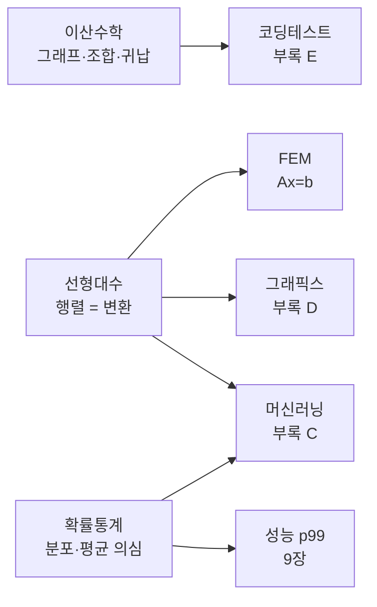

# 부록 B 수학

> 부록

## 들어가며

이산수학은 코딩테스트가 이미 가르쳐준 것, 선형대수는 '행렬은 변환', 확률통계는 '평균을 의심하는 기술'로 정리했다. 마지막 FEM은 미분방정식이 결국 Ax=b가 되는 이유다. 9장의 p99, 부록 C의 ML 수학과 이어진다.

### 한눈에 보기



> 네 가지 수학이 책의 어디에서 다시 쓰이는지를 그린 지도다. 이산수학은 코딩테스트로, 선형대수는 머신러닝·그래픽스·FEM으로, 확률통계는 9장의 p99와 머신러닝으로 이어진다.

---

## 이산수학 — 코딩테스트가 이미 가르쳐준 수학

> **이 노트의 관점**: 이산수학은 새로 배우는 과목이 아니다 — 코딩테스트 드릴에서 이미 손으로 푼 것들의 **이름과 족보**다. 여기서는 족보를 붙여서 "따로 놀던 유형들"을 한 그물로 묶는다.
> 형식: ① 결론 → ② 원리 → ③ 트레이드오프. NotebookLM 퀴즈용 용어 사전 포함.

---

### 0. 왜 만들어졌나 — 다리 건너기가 낳은 수학

- **1736 · 오일러 (쾨니히스베르크 다리 문제)** — "일곱 다리를 정확히 한 번씩 건너는 산책이 있는가?" 오일러는 지도를 버리고 **땅=점(vertex), 다리=선**(edge)으로 추상화한 뒤 "홀수 차수 정점이 2개를 넘으면 불가능"을 증명했다. **그래프 이론의 탄생** — 기하(거리·모양)를 버리고 **연결 관계만 남기는** 추상화가 핵심이었다.
- **1854 · 불(Boole)** — 논리를 대수로: 참/거짓을 1/0으로 계산하는 불 대수. 한 세기 뒤 섀넌(1937)이 이것이 **회로 그 자체**임을 보이며 디지털 컴퓨터의 수학적 기초가 됐다.
- 연속 수학(미적분)이 물리 세계를 다룬다면, **이산수학은 "셀 수 있는 것들"의 세계** — 그리고 컴퓨터는 본질적으로 셀 수 있는 기계라서, CS의 모국어가 됐다.

> 탄생 서사 한 줄: **오일러가 지도를 그래프로 바꾼 그 추상화가, 코테에서 "격자를 그래프로 보고 BFS"라고 말할 때 우리가 하는 바로 그 일이다.**

---

### 1. 지도 — 이산수학 5개 기둥 ↔ 내 코테 드릴

| 기둥 | 수학 이름 | 이미 푼 드릴 (실전판) |
|---|---|---|
| 그래프 이론 | vertex, edge, 차수, 연결성, 최단경로 | 격자 BFS/DFS · Union-Find |
| 조합론 (Combinatorics) | 곱의 법칙, 합의 법칙, 순열·조합, 포함-배제 | ★기출 이진 문자열 조합 개수 — "나열하지 말고 세라" |
| 재귀·귀납 (Recurrence & Induction) | 점화식, 수학적 귀납법, 불변식 | DP·배낭 · 파라메트릭 탐색의 루프 불변식 |
| 정수론 (Number Theory) | 모듈러 연산, 소수, gcd | 답을 `% 1_000_000_007`로 내는 모든 문제 |
| 논리·집합 (Logic & Sets) | 명제, 집합 연산, 관계, 함수 | 해시 집계의 키 공간 설계, 그리디의 교환 논증(증명) |

**Java 번역**: `Set`/`Map` = 집합·함수, `boolean` 논리 = 불 대수, 인접 리스트 = 그래프, 재귀 호출 스택 = 귀납의 실행형. **이산수학은 자바 컬렉션 프레임워크의 이론편이다.**

---

### 2. 기둥별 핵심 — "이름 붙이기"

#### 2.1 그래프 — 연결만 남기는 추상화

- 오일러의 정리(한붓그리기): **홀수 차수 정점이 0개 또는 2개**일 때만 가능. 증명 감각 — "들어간 횟수 = 나온 횟수"여야 하니 중간 정점은 짝수 차수여야 한다.
- 코테 번역: 격자·미로·친구관계·환승 — 겉모습이 달라도 **"점과 연결"로 환원되면 같은 문제**. BFS = 간선 가중치 1의 최단경로, Union-Find = "연결됐는가"만 묻는 동치관계 관리.
- 트리 = **사이클 없는 연결 그래프** (정점 n, 간선 n-1). 이 정의 하나로 "간선 수 세기" 류 문제가 판별된다.

#### 2.2 조합론 — 나열하지 말고 세라

- 곱의 법칙(각 자리 독립 선택), 합의 법칙(케이스 분할), 그리고 **중복을 빼는 기술**(포함-배제, 또는 기출처럼 "덮어쓰기 = 자동 dedup"인 DP 설계).
- $nCr = \frac{n!}{r!(n-r)!}$ 자체보다 중요한 건 "**이 문제의 답이 폭발적으로 커진다 → 직접 나열 금지, 세는 구조를 설계하라**"는 판별 신호. 기출 노트의 `end[c]` DP가 정확히 그 사례다.

#### 2.3 재귀·귀납·불변식 — 루프의 증명 도구

- 수학적 귀납법 = "기저 성립 + k 성립하면 k+1 성립" → 이게 코드에서는 **루프 불변식**(매 반복 전에 참인 명제)이 된다.
- 파라메트릭 탐색의 `lo`/`hi` 불변식("lo 왼쪽은 전부 ✗, hi 오른쪽은 전부 ✓")이 실전형 — **불변식을 문장으로 못 쓰면 경계(±1) 버그가 난다.**
- 점화식(recurrence) = DP의 수학 이름: $f(n)$을 $f(작은\ n)$으로 표현하기.

#### 2.4 정수론 — mod는 왜 1e9+7인가

- 답이 커지는 문제는 **모듈러 산술**로 관리: $(a+b) \bmod m = ((a \bmod m) + (b \bmod m)) \bmod m$ — 덧셈·곱셈은 중간중간 mod를 걸어도 안전하다 (나눗셈은 다름 — 모듈러 역원 필요, Lv3+).
- $10^9+7$인 이유: **소수**라서 역원이 존재하고, int 범위를 살짝 넘는 크기라 `long` 곱셈 한 번까지는 오버플로 안 남 — 관례이자 실용의 타협.

#### 2.5 논리·집합 — 문제 지문의 문법

- 지문의 "모든/어떤(∀/∃)", "A이면 B", "이상/초과"가 곧 논리식이다. **대우**(B가 아니면 A가 아니다)로 뒤집으면 쉬워지는 문제가 많다 — 그리디 반례 찾기가 사실 "명제의 반증" 연습이다.
- 집합으로 상태 공간을 정의하는 습관: "visited 집합", "가능한 답의 집합 ✗✗✓✓" — 탐색 드릴들의 공통 어휘.

---

### 3. 3단 요약 (암기)

- **① 결론 · WHAT** — 이산수학은 "셀 수 있는 것들의 수학"(그래프·조합·재귀·정수론·논리)이고, 코딩테스트 Lv2 유형들은 이 다섯 기둥의 실전판이다. 새 과목이 아니라 이미 푼 것들의 족보다.
- **② 원리 · HOW** — 공통 무기는 **추상화와 증명**: 오일러처럼 문제를 점·선·집합으로 환원하고, 귀납법(=루프 불변식)으로 맞음을 보장하며, 폭발하는 경우의 수는 나열 대신 구조(점화식·곱의 법칙)로 센다.
- **③ 확장 · TRADE-OFF** — 이산수학의 힘은 **버리는 것**에서 온다 — 오일러는 거리·모양을 버려서 다리 문제를 풀었다. 대신 버린 정보가 필요한 문제(기하·최적 경로의 실거리)에는 다른 도구가 필요하다. "무엇을 버려도 되는 문제인가"가 모델링 감각의 본체다.

### 용어 사전 (영 ↔ 한)

| 용어 | 뜻 |
|---|---|
| vertex / edge / degree | 정점 / 간선 / 차수 (정점에 붙은 간선 수) |
| Eulerian path | 한붓그리기 경로 — 홀수 차수 정점 0 또는 2개 |
| combinatorics / permutation / combination | 조합론 / 순열(순서 O) / 조합(순서 X) |
| inclusion-exclusion | 포함-배제 — 겹친 만큼 빼기 |
| recurrence relation | 점화식 — f(n)을 작은 f로 표현 |
| mathematical induction | 수학적 귀납법 — 기저 + 계단 |
| loop invariant | 루프 불변식 — 매 반복 전 참인 명제 |
| modular arithmetic | 모듈러 산술 — 나머지 세계의 연산 |
| modular inverse | 모듈러 역원 — mod 세계의 나눗셈 (m이 소수면 존재) |
| proposition / contrapositive | 명제 / 대우 (진리값 같음) |
| equivalence relation | 동치관계 — 반사·대칭·추이 (Union-Find가 관리하는 것) |

---

### 출처

- [Encyclopedia — The Birth of Graph Theory: Euler and the Königsberg Bridge Problem](https://www.encyclopedia.com/science/encyclopedias-almanacs-transcripts-and-maps/birth-graph-theory-leonhard-euler-and-konigsberg-bridge-problem)
- [Britannica — Königsberg bridge problem](https://www.britannica.com/science/Konigsberg-bridge-problem)
- [MAA — Euler's Solution to the Königsberg Bridge Problem](https://old.maa.org/press/periodicals/convergence/leonard-eulers-solution-to-the-konigsberg-bridge-problem)

### 연결

- 실전판 전체 색인: 코딩테스트 폴더
- 같은 수학 그룹: FEM의 수학 (연속 수학이 이산화되는 순간) · 선형대수
- 증명 사고의 면접판: 그리디 교환 논증

---

## 선형대수 — 행렬은 표가 아니라 변환이다

> **이 노트의 관점**: 선형대수를 "행렬 계산 규칙"으로 배우면 지루하고 안 남는다. "**행렬 = 공간을 움직이는 함수**"라는 3Blue1Brown식 직관으로 잡으면, FEM의 $Ku=f$, ML의 임베딩·어텐션, 그래픽스의 좌표 변환이 전부 한 문장으로 연결된다.
> 형식: ① 결론 → ② 원리 → ③ 트레이드오프. NotebookLM 퀴즈용 용어 사전 포함.

---

### 0. 왜 만들어졌나 — 방정식 풀이에서 공간의 언어로

- **기원전 중국 『구장산술』** — 3원 연립방정식을 지금의 가우스 소거법과 같은 절차로 풀었다. 방법이 이론보다 수천 년 빨랐다.
- **1693 라이프니츠 → 1750 크라머** — 행렬식(determinant)으로 연립방정식의 해를 공식화 (크라머 공식).
- **1800년경 가우스** — 천체 궤도·측지 계산의 최소제곱 문제를 풀며 **소거법을 체계화**. 여전히 "연립방정식 풀이 기술"이었다.
- **1844 그라스만** — 『Ausdehnungslehre』에서 처음으로 **n차원 벡터 공간**과 내적·외적을 정의. "숫자 풀이 기술"이 "**공간과 변환의 언어**"로 승격되는 순간 — 너무 앞서가서 당대엔 거의 무시당했다.

> 탄생 서사 한 줄: **계산(중국·가우스)이 먼저, 개념(그라스만)이 나중** — FEM과 반대로, 선형대수는 도구가 이론을 기다린 역사다. 그리고 컴퓨터가 등장하자 이 "연립방정식 풀이"가 시뮬레이션·ML·그래픽스 전부의 공통 엔진이 됐다.

---

### 1. 한 줄 본질 — 행렬 = 선형 변환

벡터 $v$는 공간의 화살표, 행렬 $A$는 **공간 전체를 회전·늘림·기울임하는 함수**다. $Av$ = "함수 $A$에 $v$를 넣은 결과".

- **선형**의 뜻: $A(u+v) = Au + Av$, $A(cv) = cAv$ — 격자선이 **평행·등간격을 유지**하며 변하는 변환. 이 제약 덕에 행렬 몇 개 숫자로 공간 전체의 움직임이 결정된다.
- **행렬 곱 = 함수 합성**: $ABv$ = "B 먼저, A 나중". 곱셈 순서가 안 바뀌는 이유(비가환)가 여기서 자명해진다 — "회전 후 늘림"과 "늘림 후 회전"은 다른 함수다.

**Java 번역**: 행렬은 `Function<Vector, Vector>`이고 행렬 곱은 `f.compose(g)`다. `compose` 순서를 바꾸면 다른 함수가 되는 것과 정확히 같은 이유로 $AB \neq BA$.

---

### 2. 핵심 개념 5개 — 전부 "변환" 관점으로

#### 2.1 $Ax=b$ — 역문제

"변환 $A$를 거친 결과가 $b$가 되는 입력 $x$는?" — FEM의 $Ku=f$가 이것이다("이 외력($f$)을 만드는 변위($u$)는?").

- **해가 있는가/유일한가**는 $A$가 공간을 어떻게 뭉개는지에 달렸다 → 아래 rank.
- 푸는 법 = 가우스 소거(직접법의 원형). n이 커지면 FEM 노트 3.2의 직접법/반복법 세계로 이어진다.

#### 2.2 행렬식(determinant) — 넓이 배율

$\det A$ = 변환이 **넓이(부피)를 몇 배로 만드는가**. $\det A = 0$이면 공간이 낮은 차원으로 **찌부러진다** → 정보가 사라져 역변환($A^{-1}$) 불가 → $Ax=b$가 안 풀리거나 해가 무한.

#### 2.3 rank — 살아남은 차원

변환 후 공간이 몇 차원인가. $3\times3$ 행렬이 rank 2면 3D를 평면으로 눌러버린 것. **full rank ⇔ $\det \neq 0$ ⇔ 역행렬 존재 ⇔ $Ax=b$ 해 유일** — 이 동치 사슬 하나가 시험·면접의 절반이다.

#### 2.4 고유벡터·고유값 (eigenvector, eigenvalue)

$Av = \lambda v$ — 변환해도 **방향이 안 바뀌는** 특별한 축($v$)과 그 축 위의 배율($\lambda$). 변환의 "본성"을 드러내는 좌표축이다.

- 회전·늘림이 섞인 복잡한 변환도 고유벡터 축에서 보면 "그냥 늘림"이 된다 (대각화).
- 실전 등장: PCA(데이터의 주축), 구조물 고유 진동수(FEM의 고유값 문제), PageRank(웹 그래프의 지배적 고유벡터), 반복법 솔버의 수렴 속도(조건수 = 최대/최소 고유값 비율).

#### 2.5 내적(dot product) — 닮음의 측정

$u \cdot v = \|u\|\|v\|\cos\theta$ — 두 벡터가 **같은 방향을 얼마나 보는가**. 0이면 직교(무관).

- ML 번역: 임베딩 유사도(코사인 유사도)가 정확히 이것 — 어텐션의 $QK^T$는 "쿼리와 키의 내적 = 관련도 점수" 행렬이다.
- 그래픽스 번역: 조명 계산의 $N \cdot L$(법선과 광원 방향의 내적) — 렌더링 수학.

---

### 3. 어디서 다시 만나나 — 한 장 지도

| 분야 | 등장 형태 | 핵심 개념 |
|---|---|---|
| 시뮬레이션 (FEM/FVM) | $Ku=f$ 풀이가 속도 지배 | 희소 행렬, 조건수, 고유값 |
| ML/LLM | 임베딩·가중치·어텐션 전부 행렬 곱 | 내적(유사도), 저차원 투영(rank) |
| 그래픽스 | 이동·회전·투영 = 4×4 행렬 | 변환 합성(곱 순서), 행렬식(뒤집힘 판정) |
| 백엔드 실무 | 추천 시스템(행렬 분해), 그래프 분석(PageRank) | 고유벡터, 희소성 |

> 요약: **GPU가 하는 일의 대부분이 행렬 곱**이고, 행렬 곱은 "함수 합성"이다. 선형대수는 이 시대 연산 인프라의 공용어다.

---

### 4. 3단 요약 (암기)

- **① 결론 · WHAT** — 행렬은 숫자 표가 아니라 **공간을 움직이는 선형 함수**이고, 행렬 곱은 함수 합성이다. $Ax=b$는 "이 결과를 만든 입력 찾기"라는 역문제다.
- **② 원리 · HOW** — 변환의 성질은 소수의 지표로 요약된다: 행렬식(부피 배율, 0이면 찌부러짐), rank(살아남은 차원), 고유벡터/고유값(방향 불변 축과 배율). "full rank ⇔ det≠0 ⇔ 역행렬 존재 ⇔ 해 유일"의 동치 사슬이 중심이다.
- **③ 확장 · TRADE-OFF** — 직관(변환)과 계산(소거법·분해)은 다른 층이다: 직관 없이 계산만 배우면 안 남고, 계산 없이 직관만 있으면 못 푼다. 그리고 실전의 병목은 개념이 아니라 **규모** — n이 커지는 순간 문제는 선형대수에서 수치 선형대수(솔버·조건수·부동소수 오차)로 넘어간다.

### 용어 사전 (영 ↔ 한)

| 용어 | 뜻 |
|---|---|
| vector / matrix | 벡터(공간의 화살표) / 행렬(선형 변환) |
| linear transformation | 선형 변환 — 격자가 평행·등간격 유지 |
| matrix multiplication | 행렬 곱 = 변환의 합성 (순서 중요, 비가환) |
| determinant | 행렬식 — 부피 배율, 0이면 차원 붕괴 |
| rank | 계수 — 변환 후 살아남은 차원 수 |
| inverse matrix | 역행렬 — 변환 되돌리기 (det≠0일 때만) |
| eigenvector / eigenvalue | 고유벡터/고유값 — 방향 불변 축과 그 배율 |
| dot product | 내적 — 방향 닮음 측정 (0 = 직교) |
| orthogonal | 직교 — 내적 0, 서로 독립인 방향 |
| condition number | 조건수 — 최대/최소 고유값 비율, 클수록 풀기 어려운 행렬 |
| sparse matrix | 희소 행렬 — 대부분 0 (FEM·그래프의 표준형) |
| diagonalization | 대각화 — 고유벡터 축으로 갈아타 "늘림만"으로 보기 |

---

### 출처

- [A Brief History of Linear Algebra and Matrix Theory (Vitulli)](https://convexoptimization.com/TOOLS/Vitulli.pdf)
- [A Brief History of Linear Algebra (Univ. of Utah)](https://www.math.utah.edu/~gustafso/s2012/2270/web-projects/christensen-HistoryLinearAlgebra.pdf)
- 직관의 원전: 3Blue1Brown "Essence of Linear Algebra" 시리즈 ([정리 노트](https://medium.com/@prajun_t/linear-algebra-582262175f5d))

### 연결

- 규모가 커지면: FEM의 수학 — 솔버 세계
- 셀 수 있는 세계는: 이산수학
- 응용처: 어텐션·트랜스포머 · 렌더링 수학 · 부동소수 오차

---

## 확률통계 — 평균을 의심하는 기술

> **이 노트의 관점**: 확률통계는 "불확실한 것을 그래도 계산하는" 수학이고, 백엔드 개발자는 이미 매일 쓰고 있다 — **p99 지연시간, 해시 충돌, 캐시 히트율, A/B 테스트**가 전부 확률통계다. 면접 단골 "그 숫자 평균인가요 p99인가요?"에 수학으로 답할 수 있게 만드는 노트.
> 형식: ① 결론 → ② 원리 → ③ 트레이드오프. NotebookLM 퀴즈용 용어 사전 포함.

---

### 0. 왜 만들어졌나 — 도박판이 낳은 수학

- **1654 · 파스칼 ↔ 페르마 편지** — 도박꾼의 질문: "게임이 중간에 끊기면 판돈을 어떻게 공정하게 나누나?" (**점수 문제, problem of points**). 두 사람은 "지금까지"가 아니라 "**앞으로 벌어질 수 있는 경우들**"을 전부 세어 나누자고 답했다 — 이때 태어난 개념이 **기대값(expectation)**. 확률론은 미래를 계산 가능한 대상으로 만든 최초의 수학이다.
- **1763 · 베이즈 (사후 출판)** — "결과를 봤을 때, 원인의 확률을 어떻게 갱신하나?" — 증거로 믿음을 업데이트하는 규칙. 스팸 필터부터 의료 진단까지의 원형.
- **1933 · 콜모고로프** — 3개 공리(0 이상, 전체=1, 배반사건은 덧셈)로 확률을 측도론 위에 공리화. 도박 직관이 기하학급 엄밀한 수학이 된 순간.

> 탄생 서사 한 줄: **이산수학의 조합론("경우의 수 세기")이 분모·분자가 되고, 거기에 "나누기"를 얹은 것이 확률이다.** 코테에서 세는 법을 익혔다면 확률의 절반은 이미 안다.

---

### 1. 확률 — 불확실성의 문법

#### 1.1 기대값 — 평균의 정체

$$E[X] = \sum x_i \, p_i$$

각 결과에 확률 가중치를 곱해 더한 것. 파스칼·페르마의 발명품이며, **"평균 응답시간"이 바로 이것**이다.

- **함정**: 기대값은 **분포의 모양을 숨긴다.** 평균 1초 = "전부 1초"일 수도, "대부분 0.1초 + 가끔 10초"일 수도. 그래서 다음이 필요하다 →

#### 1.2 분산·표준편차 — 흩어짐의 측정

$Var(X) = E[(X-E[X])^2]$ — 평균에서 벗어난 정도의 평균. 표준편차 $\sigma$는 그 제곱근(단위 복원).

- **백엔드 번역**: 평균이 같아도 $\sigma$가 크면 사용자 경험은 다르다. 지연시간 관리가 평균이 아니라 **분위수**(percentile)로 가는 이유 — p99 = "상위 1% 최악 경험의 경계". 성능 공학 노트의 p99가 여기에 뿌리를 둔다.

#### 1.3 분포 — 데이터의 생김새

| 분포 | 생김새 | 어디서 만나나 |
|---|---|---|
| 정규(normal) | 종 모양, 평균 근처 집중 | 측정 오차, 키·몸무게 — **덧셈으로 생기는 값** (중심극한정리) |
| 멱법칙/롱테일 | 대부분 작고 극소수가 거대 | **지연시간 꼬리, 트래픽, 인기도** — 평균이 대표값 노릇을 못 함 |
| 균등(uniform) | 전부 같은 확률 | 좋은 해시 함수의 목표 출력 |
| 포아송(Poisson) | 단위 시간당 사건 수 | **초당 요청 수(RPS)**, 장애 발생 건수 |

- **중심극한정리(CLT)**: 뭐든 **많이 더하면** 정규분포에 가까워진다 — "표본 평균"이 믿을 만해지는 이유이자, 부하 테스트에서 반복 측정이 의미를 갖는 근거.
- **주의**: 지연시간은 덧셈이 아니라 **최댓값·곱셈이 지배**하는 구조(직렬 호출 중 최악 구간)라 정규가 아니라 롱테일이 된다 — 평균 신봉이 위험한 수학적 이유.

#### 1.4 조건부 확률과 베이즈 — 믿음의 업데이트

$$P(원인 \mid 결과) = \frac{P(결과 \mid 원인)\,P(원인)}{P(결과)}$$

- **기저율 함정(base rate fallacy)**: 정확도 99% 검사가 양성이어도, 병 자체가 1만 명 중 1명이면 진짜 환자일 확률은 1%도 안 된다 — $P(원인)$(사전확률)을 무시한 대가.
- **백엔드 번역**: 알림이 울렸다("결과") → 진짜 장애일 확률("원인")은 **알림 규칙의 정확도만으로 못 구한다**. 평소 장애가 얼마나 드문지(사전확률)가 분모에 들어간다. 오탐 많은 모니터링이 무시당하는 이유의 수학이다.

#### 1.5 독립과 상관 — 곱해도 되는가

- 독립이면 $P(A \cap B) = P(A)P(B)$ — **"동시에 다 죽을 확률은 곱해서 아주 작다"는 가용성 계산은 독립일 때만 성립.** 같은 랙·같은 배포·같은 인증서면 독립이 아니고, 그래서 연쇄 장애가 계산보다 훨씬 잦다.
- **생일 역설**: 23명이면 생일 겹칠 확률 50% — 충돌은 직관보다 빨리 온다. HashMap이 충돌 처리를 전제로 설계된 이유, 그리고 "평균 O(1)"이 **확률적 보장**이라는 것의 근거.

---

### 2. 통계 — 일부를 보고 전체를 말하는 기술

확률이 "모형 → 데이터"(분포를 알 때 결과 예측)라면, 통계는 그 **역방향** "데이터 → 모형"(관측으로 분포를 추정)이다. 선형대수의 $Ax=b$처럼, 여기도 역문제가 본체다.

- **기술통계 vs 추론통계** — 요약(평균·분위수·히스토그램) vs 일반화(표본으로 모집단 주장). 대시보드는 기술통계, A/B 테스트는 추론통계.
- **표본의 함정** — 표본이 치우치면(피크 시간대만 측정, 생존자만 관측) 어떤 계산도 못 구해준다. **생존 편향**: 2차대전 귀환기의 총알 자국 분석 — 뚫린 곳이 아니라 "뚫리면 못 돌아온 곳"을 보강해야 했다.
- **A/B 테스트의 최소 문법** — 무작위 배정(교란 요인 차단) + 충분한 표본(우연과 효과 구분) + **p-값은 "효과 크기"가 아니라 "우연으로 보기 어려운 정도"**. 표본만 키우면 무의미한 차이도 유의해진다 — 유의성과 중요성은 다르다.
- **상관 ≠ 인과** — 같이 움직인다고 원인이 아니다(아이스크림과 익사 — 공통 원인은 여름). 장애 분석에서 "배포와 동시에 발생"이 곧 "배포 탓"이 아닌 이유 — 면접의 근본원인 분석과 닿는 사고법.

---

### 3. 어디서 다시 만나나 — 한 장 지도

| 분야 | 등장 형태 | 핵심 개념 |
|---|---|---|
| 성능 공학 | p50/p95/p99, 부하 테스트 반복 측정 | 분위수, 롱테일, CLT |
| 자료구조 | HashMap 평균 O(1), 블룸 필터 | 균등 분포 가정, 생일 역설, 오탐 확률 |
| 신뢰성 | 가용성 곱셈, 연쇄 장애 | 독립성 가정의 붕괴 |
| 모니터링 | 알림의 진짜 장애 확률 | 베이즈, 기저율 |
| ML | 손실 함수 = 최대우도, 과적합 | 추정, 표본↔모집단 일반화 — 학습 신호 노트 |
| 제품 결정 | A/B 테스트 | 무작위화, p-값, 효과 크기 |

---

### 4. 3단 요약 (암기)

- **① 결론 · WHAT** — 확률은 불확실한 미래를 세어서(조합론) 가중 평균(기대값)하는 문법이고, 통계는 그 역방향 — 관측된 일부로 전체를 추정하는 기술이다. 백엔드에선 p99·해시 충돌·가용성·A/B 테스트로 매일 등장한다.
- **② 원리 · HOW** — 기대값은 분포의 모양을 숨기므로 분산·분위수로 보완한다(평균 vs p99). 조건부 확률은 사전확률(기저율)을 곱해야 하고(베이즈), 확률의 곱셈은 독립일 때만 허용된다(연쇄 장애). 표본은 무작위여야 일반화가 성립한다.
- **③ 확장 · TRADE-OFF** — 통계의 모든 결론은 **가정 위에 선다**: 독립 가정, 분포 가정, 표본의 대표성. 계산이 틀리는 경우보다 **가정이 깨지는 경우**가 실무 사고의 대부분이다 — "그 숫자 평균인가요 p99인가요?"는 사실 "당신은 분포 가정을 의심해 봤나요?"라는 질문이다.

### 용어 사전 (영 ↔ 한)

| 용어 | 뜻 |
|---|---|
| expectation $E[X]$ | 기대값 — 확률 가중 평균 (파스칼·페르마의 발명) |
| variance / standard deviation | 분산 / 표준편차 — 흩어짐의 측정 |
| percentile (p99) | 분위수 — "하위 99%의 경계값", 꼬리 관리 지표 |
| distribution | 분포 — 값들의 생김새 (정규·롱테일·균등·포아송) |
| central limit theorem | 중심극한정리 — 많이 더하면 정규로 |
| long tail / power law | 롱테일/멱법칙 — 극소수가 지배, 평균 무력화 |
| conditional probability | 조건부 확률 — P(A given B) |
| Bayes' theorem / prior | 베이즈 정리 / 사전확률 — 증거로 믿음 갱신 |
| base rate fallacy | 기저율 함정 — 사전확률 무시 오류 |
| independence | 독립 — 곱셈이 허용되는 조건 |
| birthday paradox | 생일 역설 — 충돌은 직관보다 빨리 온다 |
| descriptive / inferential statistics | 기술통계(요약) / 추론통계(일반화) |
| survivorship bias | 생존 편향 — 살아남은 것만 보고 판단 |
| p-value | p-값 — "우연으로 보기 어려운 정도" (효과 크기 아님) |
| correlation vs causation | 상관 vs 인과 — 같이 움직임 ≠ 원인 |

---

### 출처

- [APS — Pascal's Letters to Fermat on the Problem of Points (1654)](https://www.aps.org/apsnews/2009/07/pascal-letters-fermat-points)
- [Rutgers — The Origin of Probability and the Problem of Points](https://sites.math.rutgers.edu/~cherlin/History/Papers2000/cheng.html)
- [Britannica — Bayes's theorem](https://www.britannica.com/topic/Bayess-theorem)
- [The Sources of Kolmogorov's Grundbegriffe (arXiv)](https://arxiv.org/pdf/math/0606533)
- [Berkeley — What is the significance of the Kolmogorov axioms?](https://www.stat.berkeley.edu/~aldous/Real_World/kolmogorov.html)

### 연결

- 세는 기술(분모·분자): 이산수학
- p99·Little's Law의 실전: 성능 공학
- 충돌의 현장: HashMap 내부
- 추정의 대규모판(손실·일반화): 학습 신호·라벨
- 같은 수학 그룹: 선형대수 · FEM의 수학

---

## FEM의 수학 — 미분방정식이 결국 Ax=b가 되는 이유

> 출발점: 영상 [An Intuitive Introduction to Finite Element Analysis (FEA), Part 1](https://www.youtube.com/watch?v=lH1vgdJwlDQ) + 현업 시뮬레이션 엔지니어와의 대화("FEM·FVM이 지배적이고, **행렬 풀이가 보통 속도를 좌우한다**").
> 이 노트의 목표: 그 대화를 **알아듣는 수학** — 물리 문제가 어떻게 연립일차방정식이 되고, 왜 마지막의 '행렬 풀이'가 전체 속도를 결정하는지.

---

### 0. 왜 만들어졌나 — 비행기가 낳은 수학

- **1943 · Courant** — 막대의 비틀림 문제를 풀며 영역을 **삼각형 조각**으로 쪼개 근사하는 아이디어를 처음 제시. 그러나 결과가 **당시엔 풀 수 없는 크기의 연립방정식**이라 묻혔다.
- **1956 · Turner & Clough (보잉)** — 복잡한 **항공기 구조**의 강성·처짐 해석에 같은 아이디어를 적용. 델타 날개는 기존 보(beam) 이론으로 계산이 안 됐고, 컴퓨터가 등장하면서 "큰 연립방정식"이 드디어 풀 수 있는 물건이 됐다.
- **1960 · Clough** — 논문 "The Finite Element Method in Plane Stress Analysis"에서 **Finite Element**(유한 요소)라는 이름을 확정.

> 탄생 서사 한 줄: **수학(1943)은 먼저 있었고, 컴퓨터(1950s)가 그것을 쓸 수 있게 만들었다.** 그래서 FEM의 병목은 처음부터 지금까지 "행렬을 얼마나 빨리 푸느냐"다 — 현업 대화의 "행렬 풀이가 속도를 좌우한다"는 60년 된 사실의 재확인이다.

---

### 1. 한 줄 본질 — 무한을 유한으로

물리 법칙은 미분방정식이다: "**모든 점**에서 이 관계가 성립한다" (열전도, 응력, 전자기…). 문제는 '모든 점' — 연속체는 **자유도가 무한**이라 컴퓨터로 직접 못 다룬다.

FEM의 답:

1. 영역을 **유한 개의 조각**(element)으로 쪼갠다 → 메시(mesh)
2. 각 조각 안에서는 해가 **단순한 함수**(1차·2차 다항식 = shape function)라고 가정한다
3. 그러면 미지수는 "모든 점의 값"이 아니라 **꼭짓점(node) 값 몇 개**로 줄어든다
4. 물리 법칙을 "각 조각에서 평균적으로(적분으로) 만족하라"로 완화한다 → **약형식(weak form)**
5. 그 결과가 연립일차방정식:

$$K\,u = f$$

$K$ = 강성 행렬(stiffness matrix, 재료·기하가 만드는 관계), $u$ = 노드 값(변위·온도·전위), $f$ = 외력·소스.

**Java 개발자 번역**: 연속 함수를 그대로 다루는 건 무한 케이스 분기와 같다. FEM은 이를 **"작은 클래스(element) + 고정된 인터페이스(shape function)"로 분해**하고, 전역 행렬은 각 element가 기여분을 `K.merge(i, j, value, Double::sum)` 하듯 합산해 만든다 — 실제로 이 단계 이름이 **assembly**(조립)다. 코테에서 쓴 `Map.merge` 집계 패턴과 구조가 같다.

---

### 2. 파이프라인 — 영상(Part 1)이 다루는 직관의 위치

```
① 메시 생성 ──▶ ② 형상함수 가정 ──▶ ③ 약형식(적분) ──▶ ④ 조립(K, f) ──▶ ⑤ 행렬 풀이 (Ku=f)
   기하 쪼개기      요소 안은 단순하게     미분을 적분으로        희소 행렬 완성      ★속도의 지배 항
```

- **② 형상함수** — 요소 안의 값은 노드 값의 **보간(interpolation)**: $u(x) = \sum N_i(x)\,u_i$. $N_i$는 "노드 $i$에서 1, 다른 노드에서 0"인 단순 함수. 영상의 핵심 직관이 여기다: **복잡한 곡면 = 단순 조각의 이어붙임.**
- **③ 약형식** — 원래 식(강형식)은 2차 미분을 요구하지만, 시험 함수를 곱해 **적분**하고 부분적분하면 미분 차수가 내려간다. 1차 다항식 요소로도 2차 미분 방정식을 풀 수 있게 되는 트릭 — "요구 조건을 완화해서(평균으로 만족) 표현력을 얻는" 트레이드오프.
- **④ 조립** — 각 요소는 자기 노드끼리만 관계를 만든다 → $K$는 대부분 0인 **희소(sparse) 행렬**. 노드 100만 개면 $K$는 100만×100만이지만, 실제 저장은 행마다 이웃 몇 개뿐.
- **⑤ 풀이** — 아래 3장. 여기가 대화에서 말한 "속도를 좌우"하는 지점.

---

### 3. 현업 대화 해독 — 행렬 풀이가 속도를 좌우한다

#### 3.1 FEM vs FVM — 왜 둘 다 지배적인가

| | FEM (유한 요소) | FVM (유한 체적) |
|---|---|---|
| 적분 방식 | 요소 **부피** 적분 (약형식) | 셀 **표면** 플럭스 적분 |
| 보존성 | 전역적으론 만족, 셀 단위 엄밀 보존은 아님 | **셀마다 엄밀 보존** (들어온 만큼 나간다) |
| 강점 | 응력·변형률 같은 **기울기 정확도**, 타원형 방정식(평형 문제) | 질량·운동량·에너지 **보존법칙** 그 자체인 유동 문제 |
| 주 무대 | 구조해석 (ANSYS Mechanical, COMSOL) | CFD (Fluent, OpenFOAM) |

> 유체의 지배방정식이 곧 보존법칙이라 CFD는 FVM이 자연스럽고, 평형·기울기가 본체인 구조·전자기는 FEM이 자연스럽다. **"둘 다 지배적"인 이유 = 도메인이 다르기 때문.** 그리고 둘 다 마지막엔 같은 곳에 도착한다: 큰 희소 연립방정식.

#### 3.2 솔버 두 갈래 — 직접법 vs 반복법

| | 직접법 (Direct) | 반복법 (Iterative) |
|---|---|---|
| 대표 | **MUMPS, PARDISO, UMFPACK** (LU/Cholesky 분해) | **CG**(대칭 양정치), **GMRES/BiCGSTAB**(비대칭) |
| 성격 | 한 번 분해하면 답 확정. **강건**하고 예측 가능 | 근사 해를 반복 개선. 메모리 적고 대규모에 유리 |
| 약점 | 분해 중 fill-in으로 **메모리 폭발** (3D 대형에서 한계) | 조건수 나쁘면 **수렴이 한없이 느림** |
| 처방 | — | **전처리기(preconditioner)**: ILU, 그리고 확산 지배·대규모면 **AMG(대수적 멀티그리드)** |

- **멀티그리드 직관**: 오차의 저주파(넓게 퍼진) 성분은 촘촘한 격자에서 잘 안 죽는다 → **거친 격자에서 잡고 내려온다.** 잘 맞는 문제에선 미지수 개수에 비례하는 O(n) 급 — 반복법이 대규모의 기본이 되는 이유.
- 대화의 **"도메인 density에 따라 완전 딴 소리일 수도"** — 행렬의 희소 패턴·조건수는 문제(격자 밀도, 재료 대비, 물리 종류)에 따라 완전히 달라서, 어떤 문제에선 직접법이, 어떤 문제에선 AMG-전처리 반복법이 정답이 된다. **만능 솔버는 없다** — COMSOL 매뉴얼조차 "문제 보고 골라라"가 공식 가이드다.

**백엔드 번역**: 직접법 = **배치 전체 정렬**(비싸지만 결정적), 반복법 = **캐시를 얹은 조회**(평소 빠른데 히트율(=전처리 품질)이 나쁘면 오히려 느림). "행렬 풀이가 속도를 좌우"는 우리 세계의 "결국 DB가 병목"과 같은 문장이다 — 앞 단계(메시·조립)는 선형으로 끝나는데 풀이만 초선형으로 자란다.

---

### 4. 3단 요약 (암기)

- **① 결론 · WHAT** — FEM은 "무한 자유도의 미분방정식"을 "유한 개 노드의 연립일차방정식 $Ku=f$"로 바꾸는 방법이다. 조각(element) 안은 단순 함수로 가정하고, 법칙은 적분(약형식)으로 완화해서 만족시킨다.
- **② 원리 · HOW** — 메시 → 형상함수 보간 → 약형식 → 조립(희소 행렬) → 풀이. 각 요소가 이웃 노드끼리만 관계를 만들므로 $K$는 희소하고, 조립은 `Map.merge` 합산과 같은 구조다.
- **③ 확장 · TRADE-OFF** — 속도는 마지막 '행렬 풀이'가 지배한다. 직접법(MUMPS·PARDISO)은 강건하지만 메모리가, 반복법(CG·GMRES+AMG)은 확장성이 좋지만 조건수가 발목을 잡는다. FEM/FVM 선택도, 솔버 선택도 도메인(보존이 본체인가, 기울기가 본체인가, 행렬이 얼마나 못됐나)이 결정한다 — 만능은 없다.

### 용어 사전 (영 ↔ 한)

| 용어 | 뜻 |
|---|---|
| mesh / element / node | 격자 / 요소(조각) / 절점(꼭짓점 미지수) |
| shape function | 형상함수 — 요소 안 보간 함수 ("내 노드에서 1, 남의 노드에서 0") |
| weak form | 약형식 — 미분 조건을 적분(평균)으로 완화한 식 |
| stiffness matrix $K$ | 강성 행렬 — 재료·기하가 만드는 노드 간 관계 |
| assembly | 조립 — 요소별 기여를 전역 행렬로 합산 |
| sparse matrix | 희소 행렬 — 대부분 0, 이웃 관계만 저장 |
| direct / iterative solver | 직접법(분해) / 반복법(수렴) |
| preconditioner / AMG | 전처리기 / 대수적 멀티그리드 — 반복법의 수렴 가속 장치 |
| conservation (FVM) | 보존성 — 셀 경계 플럭스로 들어온 만큼 나가게 강제 |

---

### 출처

- 영상: [An Intuitive Introduction to FEA, Part 1](https://www.youtube.com/watch?v=lH1vgdJwlDQ)
- 역사: [Eighty Years of the Finite Element Method (arXiv)](https://arxiv.org/pdf/2107.04960) · [75 Years of FEM (SimScale)](https://www.simscale.com/blog/75-years-of-the-finite-element-method-fem/) · [CADFEM — FEM history](https://www.cadfem.net/en/cadfem-informs/media-center/cadfem-journal/fem-history.html)
- FEM vs FVM: [COMSOL Blog — FEM vs FVM](https://www.comsol.com/blogs/fem-vs-fvm) · [Nature Architects — FEM and FVM in CFD](https://nature-architects.com/en/blog/2260/)
- 솔버: [COMSOL — Choosing the Right Linear System Solver](https://doc.comsol.com/5.5/doc/com.comsol.help.comsol/comsol_ref_solver.27.118.html) · [Sparse Linear Solvers Survey (arXiv 2025)](https://arxiv.org/html/2504.11716) · [AMG preconditioning for 3-D FEM (Oxford GJI)](https://academic.oup.com/gji/article/197/3/1442/655984)

### 연결

- 수치의 바닥: 부동소수 (IEEE 754) — 행렬 풀이의 오차가 사는 곳
- 같은 사고: 성능 공학 — "병목이 어디인가"를 먼저 묻는 습관
- 보간·기울기의 그래픽스판: 렌더링 수학

---

## 함께 보기

- [4.1 자료구조와 HashMap](../part1/ch04-1-data-structures-and-hashmap.md)
- [4.3 부동소수 (IEEE 754)](../part1/ch04-3-floating-point.md)
- [9장 성능과 스케일](../part2/ch09-performance-and-scale.md)
- [C.3 학습 신호와 역전파](c3-learning-signal-and-backprop.md)
- [C.4 RNN·임베딩·어텐션](c4-sequence-and-attention.md)
- [D.2 렌더링 수학·ML 비교](d2-rendering-math.md)
- [E.1 역량 로드맵·코드 설명법](e1-roadmap-and-explain.md)
- [E.2 코딩테스트 2주 압축](e2-coding-test-2week.md)
- [E.3 기출 복기·치트시트](e3-past-problems.md)
- [E.4 유형 훈련](e4-pattern-drills.md)

---

## 다음으로

수학을 가장 많이 쓰는 분야, AI·머신러닝으로 간다.

👉 [부록 C AI·머신러닝 · C.1 큰 그림](c1-big-picture.md)
