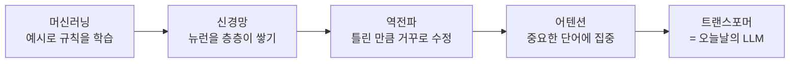
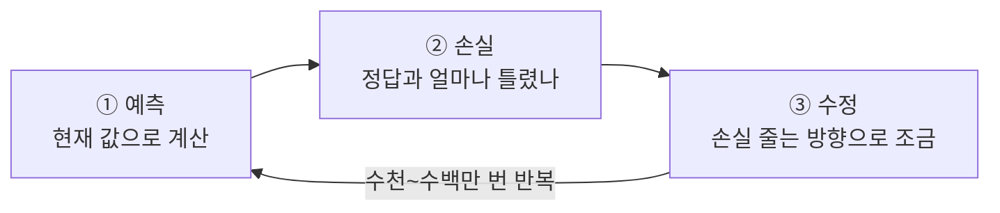
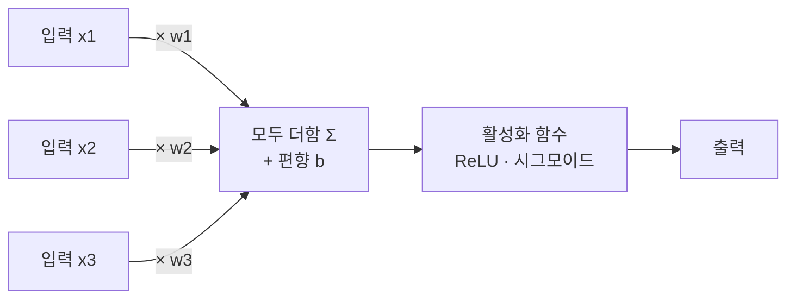
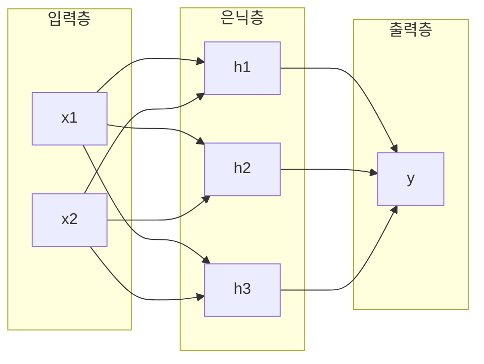
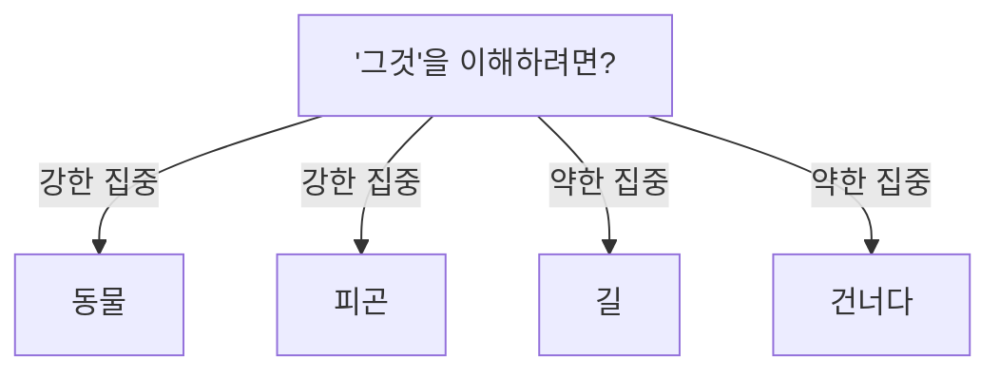
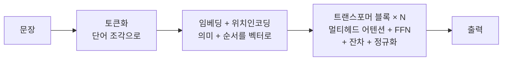

# 부록 C AI·머신러닝 · C.1 큰 그림

> 부록

## 들어가며

ML·그래픽스 학습 로드맵과, 분야가 바뀌어도 재사용되는 6가지 개념 렌즈를 먼저 둔다. 그다음 머신러닝에서 신경망, 어텐션까지 한 흐름으로 읽는 개념 노트다.

---

## C.1.1 학습 로드맵 — 개념 중심 (ML · 그래픽스)

>
> **원칙**: 공부의 본체는 **개념·수학**, 언어는 **실습 도구**. (→ Java 문법 떼듯 하지 않는다)

---

### 전체 그림

```
0단계 ─ 공통 뿌리 (선형대수)  ← ML·그래픽스 둘 다의 "어원"
              │
     ┌────────┴────────┐
     ▼                 ▼
 [트랙 A] ML        [트랙 B] 그래픽스
 언어: Python       경로: 브라우저 → C++
     └────────┬────────┘
              ▼
        융합 (NeRF·디퓨전·DLSS)
```

---

### 0단계 · 공통 뿌리: 선형대수 (며칠~2주)

ML도 그래픽스도 결국 **행렬·벡터 연산**이다. 여기만 잡으면 어느 트랙이든 수월해진다.
- 벡터, 행렬 곱, 내적(dot product), 기저·변환의 직관.
- **추천**: 3Blue1Brown, *Essence of Linear Algebra* (영상, 직관 최고) — https://www.3blue1brown.com/topics/linear-algebra
- **핵심 감각**: "행렬 곱 = 좌표(또는 특징)를 변환한다" 한 문장.

---

### 트랙 A · 머신러닝 (언어: Python 확정)

**개념 순서** (부록 C.1 참고 그대로)
1. 머신러닝이란 · 학습의 종류 → 2. 훈련·손실·경사하강 → 3. 과적합
4. 뉴런·신경망·순전파 → 5. 역전파 → 6. 어텐션 → 7. 트랜스포머 → 8. LLM

**도구**
| 용도 | 도구 |
|------|------|
| 언어 | **Python** |
| 라이브러리 | PyTorch(추천) 또는 TensorFlow, NumPy |
| 실습 환경 | **Google Colab**(설치 0, 무료 GPU) 또는 로컬 Jupyter |
| IDE | VS Code / PyCharm(JetBrains, IntelliJ 계열) |

> 언어는 "떼는" 게 아니라 개념 실험할 만큼만. Java 하셨으면 Python은 며칠이면 손에 익음.

> 📚 **상세 커리큘럼**(단계별·수학통계 상세·실습 링크): 부록 C.2.

---

### 트랙 B · 그래픽스 (경로: 브라우저 → C++)

#### B-1. 브라우저로 개념 손맛보기 (설치 0)
- **도구**: **Shadertoy**(브라우저에서 프래그먼트 셰이더 즉시), The Book of Shaders.
- 배우는 것: 픽셀 셰이더, 색·좌표·시간으로 그림 그리기 → 셰이더 감각.
- 자료: The Book of Shaders — https://thebookofshaders.com/

#### B-2. C++/OpenGL로 파이프라인 제대로
- **언어**: C++ + OpenGL, 셰이더는 GLSL.
- **IDE(IntelliJ 자리)**: **Visual Studio**(Windows 대표) 또는 **CLion**(JetBrains, 익숙한 조작).
- **디버깅 툴**: **RenderDoc**(프레임 뜯어보기, 무료).
- **개념 순서** (부록 D.1 참고 그대로)
  1. 3D 장면·정점·메시 → 2. 변환행렬(MVP) → 3. 파이프라인
  4. 정점셰이더 → 5. 래스터화 → 6. 프래그먼트·깊이버퍼
  7. 조명(Phong) → 8. 텍스처 → 9. PBR → 10. 레이트레이싱
- 자료: LearnOpenGL — https://learnopengl.com/ · Scratchapixel — https://www.scratchapixel.com/

**그래픽스 도구 요약표**
| 용도 | 도구 |
|------|------|
| 즉시 실험 | **Shadertoy** (브라우저) |
| 언어/API | C++ + OpenGL, GLSL |
| IDE | **Visual Studio** 또는 CLion |
| 디버깅 | **RenderDoc** |

---

### 융합 단계 (나중에)
두 트랙이 익으면 합류: NeRF·가우시안 스플래팅, 디퓨전 모델, DLSS·AI 디노이징, 미분 가능 렌더링.

---

### 별첨 · 언어를 "개념"으로 이해하기
언어는 도구지만, 언어가 **추구하는 설계 철학**을 알면 도구를 더 잘 쓴다.
- 부록 A.1 — Java의 OOP·상속을 개념·어원·철학으로 정리 (이미 아는 Java를 깊이 이해).

### 추천 진행 순서 (한 줄)
> **0단계 선형대수 → (관심 따라) ML은 Python으로 / 그래픽스는 Shadertoy→C++로 → 융합.** 언어는 그때그때 필요한 만큼만.

_작성: 2026-07 · 자료 링크는 접속 시점에 따라 변동될 수 있음._

---

## C.1.2 분야별 "알아야 할 개념 지도" — 재사용 렌즈 (Java → ML → 그래픽스)

> **아이디어**: 어떤 분야든 "핵심 이론"만으로는 못 쓴다. 그 분야를 **실제로 구축·운영하려면** 알아야 하는 주변 개념(설계 원칙·개발 실천·도구·배포)이 따로 있다.
> **방법**: 아래 **6개 카테고리 렌즈**를 정하고 → 잘 아는 **Java로 채운 뒤** → 같은 렌즈를 **ML·그래픽스에 대입**해 대응 개념을 찾는다.

---

### C.1.2.0 재사용 렌즈 — 6개 카테고리

| # | 카테고리 | 묻는 질문 |
|---|----------|-----------|
| 1 | **어원·역사** | 왜 생겼나? 어떤 문제를 풀려고? |
| 2 | **핵심 패러다임** | 어떤 사고방식으로 문제를 보나? |
| 3 | **설계 원칙** | 좋게 만들기 위한 규칙은? (YAGNI, DRY…) |
| 4 | **개발 실천** | 어떻게 협업·검증하나? (버전관리, 테스트, CI/CD) |
| 5 | **도구·생태계** | 무엇으로 만드나? (언어, 빌드, 프레임워크) |
| 6 | **배포·운영** | 어떻게 세상에 내보내고 유지하나? |

> 1~2는 "이해", 3~4는 "잘 만들기", 5~6은 "실제로 굴리기". 이론(2)만 알고 3~6을 모르면 "책은 읽었는데 못 만드는" 상태가 된다.

---

### C.1.2.1 Java로 채운 개념 지도 (기준 예시)

#### ① 어원·역사
- Simula(1967, 객체·상속) → Smalltalk(Alan Kay, "OOP" 용어) → C++ → **Java(1991 Oak→1995)**.
- 목적: "복잡·위험한 C++"의 대안 — 단순·안전·이식성. → 상세: 부록 A.1

#### ② 핵심 패러다임
- **객체지향(OOP)**: 캡슐화·상속·다형성·추상화. 현실을 객체로 모델링해 복잡도 관리.
- 최근엔 함수형(람다·스트림, Java 8+)도 혼용.

#### ③ 설계 원칙 (좋은 코드의 규칙)
| 원칙 | 뜻 |
|------|-----|
| **YAGNI** | "지금 필요 없으면 만들지 마라." 상상 속 미래를 위한 과잉 설계 금지 (익스트림 프로그래밍에서 유래) |
| **DRY** | "같은 지식을 반복하지 마라." 중복 제거, 한 곳에만 |
| **KISS** | "단순하게 유지하라." 문제가 허용하는 한 가장 단순한 설계 |
| **SOLID** | 객체지향 5원칙(단일책임·개방폐쇄·리스코프치환·인터페이스분리·의존역전). Robert C. Martin이 2000년대 초 정리 |

#### ④ 개발 실천 (협업·검증)
- **버전관리(Git)**: 코드 이력·협업. (이 저장소도!)
- **테스트 / TDD**: 단위 테스트(JUnit), 테스트 먼저 짜기.
- **코드 리뷰**: PR로 상호 검토.
- **CI/CD**: *지속적 통합*(변경마다 자동 빌드·테스트) + *지속적 배포*(자동 릴리스). 익스트림 프로그래밍에서 대중화.

#### ⑤ 도구·생태계
| 용도 | Java |
|------|------|
| 언어/런타임 | Java + **JVM**(바이트코드 실행) |
| 빌드·의존성 | **Maven**, **Gradle** |
| 테스트 | **JUnit** |
| IDE | **IntelliJ IDEA**, Eclipse |
| 대표 프레임워크 | **Spring**(웹·엔터프라이즈) |

#### ⑥ 배포·운영
- 패키징: **JAR/WAR** → 컨테이너(**Docker**) → 서버/클라우드 배포.
- 운영: 로깅·모니터링, CI/CD 파이프라인으로 자동화.

`참조`: [YAGNI (Martin Fowler)](https://martinfowler.com/bliki/Yagni.html) · [SOLID/DRY/KISS 정리](https://scalastic.io/en/solid-dry-kiss/) · [Continuous Integration (Fowler)](https://martinfowler.com/articles/continuousIntegration.html) · [Maven](https://maven.apache.org/) · [Gradle](https://gradle.org/) · [Spring](https://spring.io/)

---

### C.1.2.2 같은 렌즈로 본 ML vs 그래픽스 (대응표)

각 카테고리에서 "Java의 그 개념"이 **다른 분야에선 무엇에 해당하는가**.

| 카테고리 | Java | 머신러닝 | 컴퓨터 그래픽스 |
|----------|------|----------|-----------------|
| **① 어원** | Simula→Java, C++ 대안 | 통계·퍼셉트론(1958)→딥러닝 부흥(2012 AlexNet) | 기하·광학→Sketchpad(1963)→래스터/레이트레이싱 |
| **② 패러다임** | 객체지향 | 데이터로 학습(규칙 안 짬) | 3D→2D 렌더링(정답 공식) |
| **③ 설계 원칙** | YAGNI·DRY·SOLID | 재현성, 데이터 누수 방지, "단순 모델·베이스라인 먼저" | 성능 예산(frame budget), LOD, "측정 먼저(프로파일)" |
| **④ 개발 실천** | Git·JUnit·CI/CD | 실험추적·데이터버전관리·CI/CD+**CT(지속훈련)** | 애셋 파이프라인·이미지 회귀테스트·프로파일링 |
| **⑤ 도구** | JVM·Maven·Spring | **Python·PyTorch·MLflow·DVC·W&B** | **C++·GLSL·Visual Studio·RenderDoc·엔진** |
| **⑥ 배포·운영** | JAR·Docker | 모델 서빙(API)·드리프트 모니터·재훈련 → **MLOps** | 빌드·셰이더 컴파일·플랫폼별 최적화 |

> **핵심 통찰**: Java의 "CI/CD·버전관리·의존성 관리"는 ML에선 **MLOps**(데이터·모델 버전관리, 지속훈련), 그래픽스에선 **애셋 파이프라인·프로파일링**으로 *같은 문제를 다른 이름*으로 푼다.

---

### C.1.2.3 분야별로 더 파볼 "주변 개념" 목록 (다음 학습 후보)

#### 머신러닝 (MLOps 계열)
- **데이터 버전관리**: DVC, LakeFS
- **실험 추적·모델 레지스트리**: MLflow, Weights & Biases
- **지속훈련(CT)·CI/CD for ML**: 데이터 바뀌면 자동 재훈련·평가·롤백
- **서빙·모니터링**: 모델 API 배포, 데이터/개념 드리프트 감지
- **피처 스토어**: Feast / 클라우드: SageMaker, Vertex AI, Azure ML

`참조`: [MLflow](https://mlflow.org/) · [DVC](https://dvc.org/) · [Google Cloud – MLOps](https://cloud.google.com/architecture/mlops-continuous-delivery-and-automation-pipelines-in-machine-learning)

#### 컴퓨터 그래픽스
- **애셋 파이프라인**: 모델·텍스처를 게임/앱에 넣는 변환 흐름
- **프로파일링·디버깅**: RenderDoc, NVIDIA Nsight (프레임 분석)
- **성능 개념**: 배칭(draw call 줄이기), LOD(거리별 디테일), 컬링
- **엔진 아키텍처**: 씬 그래프, ECS(엔티티-컴포넌트-시스템)
- **대용량 버전관리**: Git LFS (텍스처·모델 파일)

`참조`: [RenderDoc](https://renderdoc.org/) · [NVIDIA Nsight](https://developer.nvidia.com/nsight-graphics) · [Real-Time Rendering](https://www.realtimerendering.com/)

---

### C.1.2.4 한 줄 정리

> 어떤 분야든 **①어원 ②패러다임 ③설계원칙 ④개발실천 ⑤도구 ⑥배포·운영** 6렌즈로 보면 "이론 너머 실제로 만드는 데 필요한 개념"이 한눈에 잡힌다. Java의 CI/CD·의존성 관리가 ML에선 **MLOps**, 그래픽스에선 **애셋 파이프라인**으로 대응된다.

---

### 검색 기록 (2026-07-15)
- 쿼리: `software engineering principles YAGNI DRY KISS SOLID CI/CD Martin Fowler build tools Maven Gradle`
  - 소스: [Martin Fowler – YAGNI](https://martinfowler.com/bliki/Yagni.html), [scalastic – SOLID/DRY/KISS](https://scalastic.io/en/solid-dry-kiss/). SOLID는 Robert C. Martin(2000년대 초) 정리, YAGNI·CI/CD는 익스트림 프로그래밍 유래 확인.
- 쿼리: `MLOps concepts data versioning DVC experiment tracking MLflow model serving CI/CD for machine learning 2026`
  - 소스: [MLflow](https://mlflow.org/), [DVC](https://dvc.org/), Walmart/DEV 블로그. CT(지속훈련)·모델 레지스트리·드리프트 모니터링 개념 확인.
- 반영: 1~3장(Java 채움, 대응표, 다음 학습 후보).

### 전체 참조 출처
- Martin Fowler – YAGNI — https://martinfowler.com/bliki/Yagni.html
- Martin Fowler – Continuous Integration — https://martinfowler.com/articles/continuousIntegration.html
- SOLID/DRY/KISS 개요 — https://scalastic.io/en/solid-dry-kiss/
- Maven — https://maven.apache.org/ · Gradle — https://gradle.org/ · Spring — https://spring.io/
- MLflow — https://mlflow.org/ · DVC — https://dvc.org/
- Google Cloud – MLOps — https://cloud.google.com/architecture/mlops-continuous-delivery-and-automation-pipelines-in-machine-learning
- RenderDoc — https://renderdoc.org/ · NVIDIA Nsight — https://developer.nvidia.com/nsight-graphics

_작성: 2026-07 · 개념 지도(렌즈) + 분야 대응. 도구·관행은 빠르게 바뀌므로 최신은 검색 확인._

---

## C.1.3 머신러닝 → 신경망 → 어텐션: 상세 학습 노트

---

### C.1.3.0 큰 그림 — 규칙을 "짜주기"에서 "스스로 찾기"로

컴퓨터는 태어날 때부터 고지식하다. 사람이 `이렇고 저러면 이렇게 해`라는 규칙을 하나하나 짜줘야만 움직인다. 계산기나 엑셀은 이 방식으로 충분하다. 그런데 **"이 사진이 고양이인가?"**, **"이 문장은 무슨 뜻인가?"** 같은 문제 앞에서 이 방식은 무너진다. 고양이를 규칙으로 정의해보라 — "귀가 뾰족하고, 수염이 있고…"라고 적는 순간, 접힌 귀 고양이·수염 짧은 고양이·뒤돌아 앉은 고양이가 전부 예외로 쏟아진다. **세상은 규칙으로 다 적기엔 너무 복잡하다.**

**머신러닝**은 여기서 방향을 튼다. 규칙을 적어주는 대신, **예시(데이터)를 잔뜩 보여주고 규칙을 스스로 찾게** 만든다. 고양이 사진 수만 장을 보여주면 기계가 "아, 이런 느낌이 고양이구나"를 알아서 익힌다. 사람이 아기에게 고양이를 가르치는 방식과 똑같다 — 정의를 외우게 하지 않고, 그냥 많이 보여준다.

이 "규칙 찾기 기계"의 성능을 끌어올리려고, 뇌의 뉴런을 흉내 내 **작은 계산기(뉴런)를 층층이 쌓은 것이 신경망**(딥러닝)이다. 층이 깊을수록 더 복잡한 패턴을 잡는다. 그리고 이 신경망을 **"틀린 만큼 거꾸로 되짚어 고치는"** 방식으로 훈련시키는 핵심 엔진이 **역전파**(경사하강)다.

여기까지가 이미지·숫자에 통하는 기초다. 그런데 **글과 말**은 한 가지가 더 필요하다 — 바로 **순서**와 **관계**다. "개가 사람을 물었다"와 "사람이 개를 물었다"는 단어는 같지만 뜻이 정반대고, "그것"이 무엇을 가리키는지는 저 앞 단어와의 관계에서 나온다. 이 "**어디를 봐야 하는가**"를 푸는 장치가 **어텐션**(attention)이고, 어텐션만으로 쌓아 올린 구조가 **트랜스포머(Transformer)** — 오늘날 ChatGPT·Claude 같은 대형 언어 모델(LLM)의 뼈대다.

이 절는 그 여정을 **한 계단씩** 밟는다: 규칙을 학습하는 법(머신러닝) → 그걸 담는 그릇(신경망) → 그릇을 훈련하는 법(역전파) → 언어를 이해하는 법(어텐션·트랜스포머).



*(도식 설명: 머신러닝(예시로 규칙 학습) → 신경망(뉴런을 층층이) → 역전파(거꾸로 수정) → 어텐션(중요 단어 집중) → 트랜스포머(=오늘날 LLM)로 한 계단씩 이어진다.)*

**학습 지도**

| 부 | 단원 | 한 줄 |
|----|------|-------|
| 1부 | 1. 머신러닝이란 | 예시로 규칙을 학습 |
| 1부 | 2. 학습의 종류 | 지도·비지도·강화 |
| 1부 | 3. 훈련·손실·경사하강 | 틀린 만큼 조금씩 고치기 |
| 1부 | 4. 일반화와 과적합 | 외우기 vs 이해하기 |
| 2부 | 5. 인공 뉴런 | 가중치×입력 + 활성화 |
| 2부 | 6. 신경망과 순전파 | 층을 통과하며 계산 |
| 2부 | 7. 역전파 | 오차를 거꾸로 되짚어 수정 |
| 3부 | 8. 순서 데이터의 문제 | 왜 RNN만으론 부족한가 |
| 3부 | 9. 어텐션 | 중요한 단어에 집중 |
| 3부 | 10. 셀프·멀티헤드 어텐션 | Q·K·V와 여러 손전등 |
| 3부 | 11. 트랜스포머 | 어텐션을 쌓은 구조 |
| 3부 | 12. LLM이 글을 쓰는 법 | 다음 토큰 예측 |

---

## C.1.4 1부. 머신러닝 기초

### C.1.4.1 머신러닝이란 무엇인가

**정의.** 머신러닝(machine learning)은 명시적으로 규칙을 프로그래밍하지 않고, 데이터(예시)로부터 패턴·규칙을 자동으로 학습해 새로운 입력에 대해 예측·판단하는 기술이다.

**전통 프로그래밍 vs 머신러닝**

- 전통 방식: `규칙 + 입력 → 출력` (사람이 규칙을 작성)
- 머신러닝: `입력 + 출력(정답) → 규칙(모델)` (기계가 규칙을 학습)

**왜 필요한가.** "고양이를 알아보라" 같은 문제는 규칙을 일일이 적기가 사실상 불가능하다. 예외가 너무 많기 때문. 대신 고양이 사진을 수천 장 보여주면 모델이 공통 패턴을 스스로 추출한다.

**핵심 용어**
- **데이터셋(dataset)**: 학습에 쓰는 예시 모음.
- **특징(feature)**: 입력을 이루는 개별 정보(예: 사진의 픽셀, 집값 예측의 평수·위치).
- **레이블(label)**: 정답(예: "고양이", 실제 집값).
- **모델(model)**: 입력 → 출력을 계산하는 함수. 내부에 학습되는 **파라미터**(parameter)를 가짐.

**핵심 요약**: 머신러닝 = 규칙을 입력하는 대신 예시로 규칙을 학습한다.

`참조`: [Google ML Crash Course](https://developers.google.com/machine-learning/crash-course) · [위키백과: 기계 학습](https://ko.wikipedia.org/wiki/기계_학습)

### C.1.4.2 학습의 세 가지 종류

1. **지도학습(supervised learning)** — 입력과 *정답(레이블)*을 함께 준다. 대부분의 실무 예측(분류·회귀)이 여기 속한다.
   - *분류(classification)*: 정답이 카테고리 (스팸/정상, 개/고양이).
   - *회귀(regression)*: 정답이 숫자 (집값, 온도).
2. **비지도학습(unsupervised learning)** — 정답 없이 데이터만 준다. 비슷한 것끼리 묶는 *군집화(clustering)*, 차원을 줄이는 *차원축소* 등.
3. **강화학습(reinforcement learning)** — 정답 대신 *보상(reward)*을 준다. 시행착오로 보상을 최대화하는 행동을 학습. 게임 AI, 로봇 제어 등.

> LLM은 크게 (1) 방대한 텍스트로 다음 단어를 맞히는 **자기지도학습(self-supervised)** 사전학습 → (2) 사람 피드백 기반 강화학습(RLHF)으로 다듬는 단계를 거친다.

**핵심 요약**: 정답을 주면 지도, 안 주면 비지도, 보상을 주면 강화학습.

`참조`: [Google ML Crash Course – Framing](https://developers.google.com/machine-learning/crash-course/framing) · [위키백과: 지도 학습](https://ko.wikipedia.org/wiki/지도_학습)

### C.1.4.3 훈련·손실·경사하강

**훈련(training)이란** 모델의 파라미터를 조정해 예측이 정답에 가까워지게 만드는 과정이다.

**과정 3단계 (반복)**
1. **예측(forward)**: 현재 파라미터로 출력을 계산한다. 처음엔 엉터리.
2. **손실 계산(loss)**: 예측이 정답과 얼마나 다른지를 하나의 숫자로 잰다. 작을수록 좋다.
   - 회귀: 평균제곱오차(MSE). 분류: 교차엔트로피(cross-entropy).
3. **수정(update)**: 손실을 줄이는 방향으로 파라미터를 조금 바꾼다.

이 세 단계는 한 번으로 끝나지 않고 **끝없이 도는 고리**다. 한 바퀴 돌 때마다 예측이 정답에 아주 조금씩 가까워진다.



*(도식 설명: 예측 → 손실 측정 → 파라미터 수정, 이 세 단계가 하나의 고리를 이루고, 고리를 수없이 반복할수록 모델이 정확해진다.)*

**그럼 "손실이 줄는 방향"은 어떻게 알까?** 여기서 **경사하강법**(gradient descent)이 등장한다. 손실을 파라미터로 미분한 값(**기울기, gradient**)은 "지금 위치에서 손실이 **가장 가파르게 커지는** 방향"을 알려준다. 우리는 손실을 **줄이고** 싶으니, 그 **반대 방향**으로 한 걸음씩 내려가면 된다.

머릿속에 이 장면을 그려보자 — **짙은 안개가 낀 산**에 서 있고, 목표는 가장 낮은 골짜기(=손실 최소)로 내려가는 것이다. 안개 때문에 전체 지형은 안 보이지만, **발밑의 경사**는 느낄 수 있다. 그래서 지금 발밑에서 가장 가파르게 내려가는 쪽으로 한 걸음, 또 한 걸음… 이렇게 조금씩 내려간다. 이게 경사하강의 전부다.

- **학습률(learning rate)**: 한 걸음의 크기. 너무 크면 골짜기를 건너뛰어 **발산**하고, 너무 작으면 **하염없이 느리다**. 적당한 보폭을 찾는 게 중요하다.

**핵심 요약**: 훈련 = (예측 → 손실 → 경사 반대로 조금 이동)을 수천~수백만 번 반복.

`참조`: [Google ML Crash Course – Reducing Loss](https://developers.google.com/machine-learning/crash-course/reducing-loss/gradient-descent) · [3Blue1Brown: Gradient descent](https://www.3blue1brown.com/lessons/gradient-descent)

### C.1.4.4 일반화와 과적합

**목표는 "외우기"가 아니라 "일반화(generalization)"** — 처음 보는 데이터에도 잘 맞히는 것.

- **과적합(overfitting)**: 훈련 데이터를 너무 통째로 외워, 새 데이터에서 성능이 떨어지는 현상. (시험 문제만 달달 외운 학생)
- **과소적합(underfitting)**: 모델이 너무 단순해 패턴조차 못 배운 상태.
- **데이터 분리**: 보통 데이터를 **훈련(train)/검증(validation)/테스트**(test)로 나눠, 못 본 데이터로 진짜 실력을 평가한다.
- **정규화(regularization)·드롭아웃(dropout)**: 과적합을 줄이는 대표 기법.

**핵심 요약**: 좋은 모델은 답을 외운 게 아니라 규칙을 이해해 새 문제도 푼다.

`참조`: [Google ML Crash Course – Generalization](https://developers.google.com/machine-learning/crash-course/generalization/peril-of-overfitting) · [위키백과: 과적합](https://ko.wikipedia.org/wiki/과적합)

---

## C.1.5 2부. 신경망 (딥러닝)

### C.1.5.5 인공 뉴런 (퍼셉트론)

**뉴런 하나가 하는 일**: 여러 입력을 받아 각각 **가중치**(weight)를 곱하고, 전부 더한 뒤 **편향**(bias)을 더하고, **활성화 함수**(activation)를 통과시켜 하나의 출력을 낸다.

```
출력 = 활성화( (입력1×가중치1) + (입력2×가중치2) + ... + 편향 )
```



*(도식 설명: 여러 입력에 각자의 가중치를 곱해 전부 더하고 편향을 보탠 뒤, 활성화 함수를 통과시켜 하나의 출력을 낸다.)*

**직관적으로는 "중요도를 곱한 투표"다.** 오늘 피자를 시킬지 정한다고 해보자. '배고픔'은 아주 중요(×5), '용돈 있음'도 중요(×3), '방금 간식 먹음'은 반대로 작용(×-4). 이 값들을 다 더한 점수가 기준선(편향)을 넘으면 "주문!"을 외친다. 뉴런이 하는 일이 정확히 이것 — 각 입력의 중요도(가중치)를 곱해 더하고, 그 합이 충분히 크면 신호를 내보낸다. **그리고 이 가중치들이 바로 학습으로 조금씩 바뀌는 값**이다.

- **가중치**: 각 입력의 *중요도*. 학습으로 바뀌는 핵심 값.
- **편향**: 판단의 기준선을 이동시키는 값.
- **활성화 함수**: 비선형성을 넣어 복잡한 패턴을 표현하게 함. 없으면 아무리 층을 쌓아도 직선(1차식)밖에 못 만든다.
  - 대표: **ReLU**(0보다 작으면 0, 크면 그대로), **시그모이드(sigmoid)**(0~1), **소프트맥스(softmax)**(여러 후보의 확률 분포).

**핵심 요약**: 뉴런 = (입력×가중치 합 + 편향)을 활성화 함수로 변환. 가중치가 학습 대상.

`참조`: [Nielsen – Neural Networks and Deep Learning, Ch.1](http://neuralnetworksanddeeplearning.com/chap1.html) · [3Blue1Brown: But what is a neural network?](https://www.3blue1brown.com/lessons/neural-networks)

### C.1.5.6 신경망과 순전파

**신경망(neural network)**: 뉴런을 **층**(layer)으로 묶고, 층을 여러 개 이어 붙인 구조.
- **입력층(input)** → **은닉층(hidden)** (여러 개 가능) → **출력층(output)**.
- 은닉층이 많을수록 "깊다" → **딥러닝(deep learning)**.



*(도식 설명: 입력층 뉴런들이 은닉층의 모든 뉴런과 연결되고, 은닉층이 다시 출력층으로 이어진다. 정보가 왼쪽 입력에서 오른쪽 출력으로 한 방향으로 흐른다.)*

**순전파(forward propagation)**: 입력이 층을 차례로 통과하며 계산되어 최종 출력이 나오는 과정. 정보가 왼쪽(입력)에서 오른쪽(출력)으로 **한 방향으로 흐르며** 각 뉴런에서 계산된다.

**왜 깊게 쌓나**: 층이 깊어질수록 점점 추상적인 특징을 잡는다. (이미지: 1층=선/모서리 → 중간층=눈·코 → 깊은층=얼굴 전체) 이를 **표현 학습**(representation learning)이라 한다.

> 🔎 **더 깊이 →** 표현 학습은 왜 잘 될까 — 계층적 특징의 실제 시각화, 깊이가 유리한 이유, 트랜스포머와의 연결.

**핵심 요약**: 신경망 = 뉴런 층을 쌓은 것. 깊게 쌓으면 추상적 개념까지 학습.

`참조`: [Dive into Deep Learning (d2l.ai)](https://d2l.ai/) · [CS231n: Neural Networks](https://cs231n.github.io/neural-networks-1/)

### C.1.5.7 역전파 (Backpropagation)

**문제**: 층이 여러 개일 때, 각 가중치를 *얼마나* 고쳐야 손실이 줄까?

**역전파**: 출력에서 계산한 오차를 **뒤에서 앞으로** 미분(연쇄법칙, chain rule)으로 되돌리며, 각 가중치가 오차에 기여한 정도(기울기)를 구한다. 그 기울기로 경사하강을 적용해 모든 가중치를 동시에 조금씩 수정한다.

**과정**
1. 순전파로 출력·손실 계산.
2. 역전파로 각 가중치의 기울기 계산 (출력층 → 입력층 방향).
3. 경사하강으로 가중치 갱신.
4. 1~3을 데이터 배치마다 반복.

- 비유: "더 뜨거워/더 차가워" 게임. 결과가 틀린 책임을 뒤 층부터 앞 층으로 나눠주며 각자 고칠 방향을 알려준다.

**핵심 요약**: 역전파 = 연쇄법칙으로 오차를 거꾸로 전파해 모든 가중치의 수정 방향을 한 번에 구하는 알고리즘.

`참조`: [3Blue1Brown: Backpropagation](https://www.3blue1brown.com/lessons/backpropagation) · [Nielsen Ch.2 – How backpropagation works](http://neuralnetworksanddeeplearning.com/chap2.html) · [CS231n: Backprop](https://cs231n.github.io/optimization-2/)

---

## C.1.6 3부. 어텐션과 트랜스포머

### C.1.6.8 순서(시퀀스) 데이터의 문제

문장·음성·시계열은 **순서**가 의미를 좌우한다. "개가 사람을 물었다" ≠ "사람이 개를 물었다".

**과거 방식 – RNN/LSTM**: 단어를 하나씩 순서대로 읽으며 "기억(은닉 상태)"을 갱신. 하지만 두 가지 한계:
1. **장거리 의존성**: 문장이 길면 앞 정보가 뒤까지 잘 전달되지 않음(기억이 희미해짐).
2. **병렬화 불가**: 순서대로 처리해야 해서 느림. (GPU를 충분히 못 씀)

→ 이 한계를 돌파하려고 **어텐션**이 등장했다.

**핵심 요약**: 순서 데이터는 장거리 관계 파악과 속도가 관건. RNN은 둘 다 약했다.

`참조`: [d2l.ai – RNN 장](https://d2l.ai/chapter_recurrent-neural-networks/) · [위키백과: LSTM](https://ko.wikipedia.org/wiki/장단기_기억)

### C.1.6.9 어텐션 (Attention) – 직관

**아이디어**: 한 단어를 이해할 때, 문장 속 *모든* 단어를 둘러보고 "어디에 얼마나 집중할지"를 점수로 정한다. 관련 깊은 단어에 높은 점수(집중)를 준다.

- 예: "그 **동물**은 길을 건너지 않았다. **그것**이 너무 피곤했기 때문이다."에서 "그것"을 해석할 때 "동물"에 강하게 집중.
- 비유: 손전등. 지금 처리하는 단어에서 관련 단어로 빛을 세게/약하게 비춘다. 빛의 세기 = **어텐션 가중치**.



*(도식 설명: '그것'이라는 단어가 문장 속 다른 단어들을 훑어보며 관련도(집중)를 다르게 준다 — '동물'·'피곤'엔 강하게, '길'·'건너다'엔 약하게. 이 집중의 세기가 어텐션 가중치다.)*

**RNN과의 차이**: 순서대로 기억을 넘기지 않고, 모든 단어 쌍의 관계를 **한 번에 직접** 계산한다 → 장거리 관계도 즉시 연결, 병렬 처리도 가능.

**핵심 요약**: 어텐션 = 각 단어가 다른 모든 단어에 대한 "집중 점수"를 매겨 관계를 직접 파악.

`참조`: [Jay Alammar – The Illustrated Transformer](https://jalammar.github.io/illustrated-transformer/) · [Lilian Weng – Attention? Attention!](https://lilianweng.github.io/posts/2018-06-24-attention/)

### C.1.6.10 셀프 어텐션과 멀티헤드 – 조금 더 자세히

**Query·Key·Value (질문·열쇠·값).** 각 단어는 세 벡터로 변환된다.
- **Query(Q)**: "나는 무엇을 찾고 있나?"
- **Key(K)**: "나는 어떤 정보를 갖고 있나?" (검색 태그)
- **Value(V)**: 실제 전달할 내용.

**계산 방식(셀프 어텐션)**
1. 한 단어의 Q를, 모든 단어의 K와 내적(dot product)해 **유사도 점수**를 구한다. (Q와 K가 잘 맞을수록 높은 점수)
2. 점수를 √(차원)으로 나눠 안정화하고(scaled), **소프트맥스**로 0~1 확률(집중 비율)로 변환한다.
3. 그 비율로 모든 단어의 **V를 가중합**해, 그 단어의 새 표현을 만든다.

수식 한 줄:
```
Attention(Q, K, V) = softmax( (Q · Kᵀ) / √dₖ ) · V
```

**셀프 어텐션(self-attention)**: Q·K·V가 모두 *같은 문장* 안에서 나온다 → 문장이 스스로를 들여다보며 내부 관계를 파악.

**멀티헤드 어텐션(multi-head attention)**: 손전등 하나가 아니라 여러 개(head)를 동시에 사용. 각 head가 서로 다른 관계를 담당(예: 문법 관계, 지시 대상, 의미 유사성). 결과를 합쳐 더 풍부하게 이해.

**핵심 요약**: 셀프 어텐션 = Q·K로 관련도 계산 → softmax로 집중 비율 → V를 가중합. 여러 head로 다양한 관계를 동시에 본다.

`참조`: [Attention Is All You Need (원논문, 2017)](https://arxiv.org/abs/1706.03762) · [The Illustrated Transformer](https://jalammar.github.io/illustrated-transformer/) · [The Annotated Transformer (Harvard)](https://nlp.seas.harvard.edu/annotated-transformer/)

### C.1.6.11 트랜스포머 (Transformer)

2017년 논문 *"Attention Is All You Need"*가 제안한 구조. RNN·CNN 없이 **어텐션만으로** 시퀀스를 처리한다. 병렬화가 잘 돼 대규모 학습이 가능해졌고, 오늘날 거의 모든 LLM의 바탕이 되었다.

**핵심 구성 요소**
- **토큰화(tokenization)**: 문장을 토큰(단어 조각) 단위로 쪼갬.
- **임베딩(embedding)**: 각 토큰을 의미를 담은 숫자 벡터로 변환.
- **위치 인코딩(positional encoding)**: 어텐션은 순서를 모르므로, 각 토큰에 "몇 번째인지"를 나타내는 위치 정보를 더해준다.
- **인코더/디코더 블록**: 각 블록 = 멀티헤드 어텐션 + 피드포워드 신경망(FFN). 여기에:
  - **잔차 연결(residual connection)**: 입력을 출력에 더해 깊은 층에서도 학습이 잘 되게 함.
  - **층 정규화(layer normalization)**: 값의 분포를 안정화.
- 이 블록을 **여러 층 쌓는다**(예: 수십~수백 층).



*(도식 설명: 문장을 토큰으로 쪼개고 → 각 토큰을 '의미+순서'가 담긴 벡터로 바꾼 뒤 → 어텐션·FFN으로 이뤄진 블록을 여러 층 통과시켜 → 결과를 낸다.)*

> 구조 갈래: 번역형은 인코더-디코더, GPT류 생성형은 **디코더-only**, BERT류 이해형은 **인코더-only**를 쓴다.

**핵심 요약**: 트랜스포머 = 임베딩+위치정보 → (멀티헤드 어텐션+FFN+잔차+정규화) 블록을 여러 층 쌓은 구조.

`참조`: [Attention Is All You Need](https://arxiv.org/abs/1706.03762) · [The Illustrated Transformer](https://jalammar.github.io/illustrated-transformer/) · [Hugging Face NLP Course](https://huggingface.co/learn/nlp-course/) · [위키백과: 트랜스포머](https://ko.wikipedia.org/wiki/트랜스포머_(기계_학습))

### C.1.6.12 LLM이 글을 쓰는 법 – 다음 토큰 예측

**대형 언어 모델**(LLM)은 결국 "**지금까지의 토큰들을 보고, 다음에 올 토큰의 확률**"을 계산하는 트랜스포머다.
1. 입력 문장을 토큰으로 변환.
2. 트랜스포머가 다음 토큰 후보들의 확률 분포(softmax)를 출력.
3. 그중 하나를 골라(가장 높은 것 또는 확률적 샘플링) 문장 뒤에 붙인다.
4. 붙인 결과를 다시 입력으로 넣어 그다음 토큰을 예측… 이를 반복해 문장을 완성한다. (**자기회귀, autoregressive**)

- **온도(temperature)**: 샘플링의 무작위성 조절. 낮으면 안정적·반복적, 높으면 창의적·엉뚱.
- 사전학습(방대한 텍스트로 다음 토큰 맞히기) → 미세조정/RLHF(사람 선호에 맞추기) 순으로 훈련된다.

**핵심 요약**: LLM = "다음 토큰 확률"을 반복 예측해 글을 이어 쓰는 트랜스포머.

`참조`: [Hugging Face LLM Course](https://huggingface.co/learn/nlp-course/) · [3Blue1Brown: But what is a GPT?](https://www.3blue1brown.com/lessons/gpt)

---

### 한 줄 용어 사전 (한↔영)

| 한국어 | English | 뜻 |
|--------|---------|-----|
| 머신러닝 | machine learning | 예시로 규칙을 학습하는 기술 |
| 특징 | feature | 입력을 이루는 개별 정보 |
| 레이블 | label | 정답 |
| 파라미터 | parameter | 모델 내부에서 학습되는 값 |
| 손실 | loss | 예측과 정답의 차이(작을수록 좋음) |
| 경사하강 | gradient descent | 손실을 줄이는 방향으로 파라미터 이동 |
| 학습률 | learning rate | 한 번에 이동하는 크기 |
| 과적합 | overfitting | 훈련 데이터를 외워 새 데이터에 약함 |
| 가중치 | weight | 입력의 중요도 |
| 편향 | bias | 판단 기준선 이동 값 |
| 활성화 함수 | activation | 비선형성을 넣는 함수(ReLU 등) |
| 순전파 | forward propagation | 입력→출력 계산 |
| 역전파 | backpropagation | 오차를 거꾸로 전파해 기울기 계산 |
| 어텐션 | attention | 어디에 집중할지 점수로 정하기 |
| 셀프 어텐션 | self-attention | 문장이 스스로의 내부 관계 파악 |
| Q·K·V | query/key/value | 질문·열쇠·값 벡터 |
| 멀티헤드 | multi-head | 여러 관계를 동시에 보는 어텐션 |
| 임베딩 | embedding | 토큰을 의미 벡터로 변환 |
| 위치 인코딩 | positional encoding | 순서 정보를 더해줌 |
| 트랜스포머 | transformer | 어텐션 기반 신경망 구조 |
| 토큰 | token | 문장을 쪼갠 처리 단위 |
| 자기회귀 | autoregressive | 앞 결과로 다음을 예측·반복 |

---

### NotebookLM 활용 팁

1. **이 파일 + 아래 원문 링크들**을 함께 소스로 추가하면, NotebookLM이 교차 확인해 더 정확히 요약한다.
2. NotebookLM에 시켜볼 만한 것:
   - "이 절를 5문항 퀴즈로 만들어줘 (정답 포함)"
   - "역전파를 초등학생에게 설명하듯 다시 써줘"
   - "머신러닝→트랜스포머 발전 타임라인을 표로 정리해줘"
   - "어텐션과 RNN의 차이를 비교 표로"
   - 오디오 개요(Audio Overview) 기능으로 팟캐스트처럼 듣기

#### NotebookLM에 소스로 직접 추가하면 좋은 링크 (복사용)

```
https://developers.google.com/machine-learning/crash-course
https://www.3blue1brown.com/topics/neural-networks
http://neuralnetworksanddeeplearning.com/
https://d2l.ai/
https://cs231n.github.io/
https://arxiv.org/abs/1706.03762
https://jalammar.github.io/illustrated-transformer/
https://nlp.seas.harvard.edu/annotated-transformer/
https://lilianweng.github.io/posts/2018-06-24-attention/
https://huggingface.co/learn/nlp-course/
```

---

### 전체 참조 출처

**머신러닝 기초**
- Google, *Machine Learning Crash Course* — https://developers.google.com/machine-learning/crash-course
- 위키백과, *기계 학습* — https://ko.wikipedia.org/wiki/기계_학습

**신경망 / 딥러닝**
- 3Blue1Brown, *Neural networks* (영상 시리즈) — https://www.3blue1brown.com/topics/neural-networks
- Michael Nielsen, *Neural Networks and Deep Learning* (무료 책) — http://neuralnetworksanddeeplearning.com/
- Aston Zhang 외, *Dive into Deep Learning* — https://d2l.ai/
- Stanford CS231n, *Convolutional Neural Networks for Visual Recognition* — https://cs231n.github.io/

**어텐션 / 트랜스포머**
- Vaswani 외(2017), *Attention Is All You Need* (원논문) — https://arxiv.org/abs/1706.03762
- Jay Alammar, *The Illustrated Transformer* — https://jalammar.github.io/illustrated-transformer/
- Harvard NLP, *The Annotated Transformer* — https://nlp.seas.harvard.edu/annotated-transformer/
- Lilian Weng, *Attention? Attention!* — https://lilianweng.github.io/posts/2018-06-24-attention/
- Hugging Face, *NLP / LLM Course* — https://huggingface.co/learn/nlp-course/

_작성: 2026-07 · 개념 이해용 학습 노트 (정확한 수식·구현은 원문 확인). 링크는 접속 시점에 따라 변동될 수 있음._

---

## 함께 보기

- [A.1 Java](a1-java.md)
- [C.3 학습 신호와 역전파](c3-learning-signal-and-backprop.md)
- [D.1 컴퓨터 그래픽스](d1-graphics.md)
- [D.2 렌더링 수학·ML 비교](d2-rendering-math.md)
- [E.1 역량 로드맵·코드 설명법](e1-roadmap-and-explain.md)

---

## 다음으로

큰 그림을 봤으니, 어떤 순서로 공부할지와 신경망의 종류를 C.2에서 정리한다.

👉 [부록 C AI·머신러닝 · C.2 학습 경로와 신경망 종류](c2-curriculum-and-nn-types.md)
