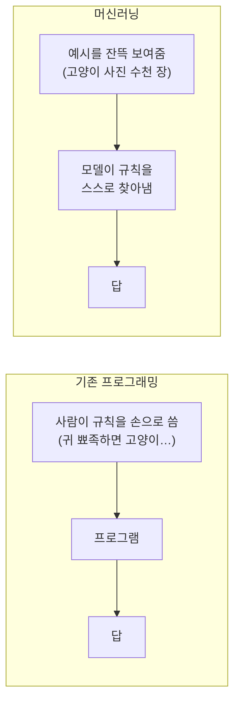
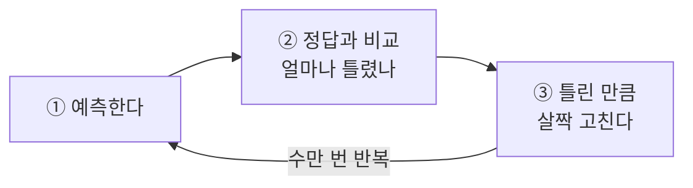
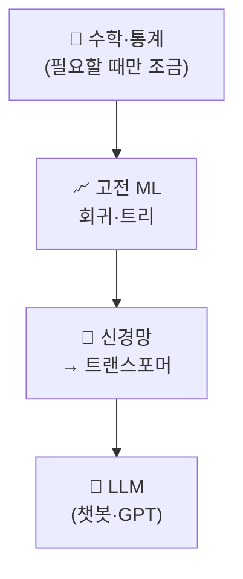
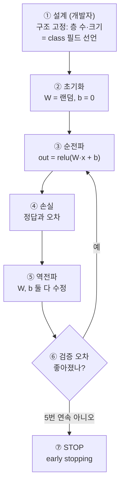

# 부록 C AI·머신러닝 · C.2 학습 경로와 신경망 종류

> 부록

## 들어가며

개념 우선 ML 커리큘럼, 자바 개발자가 아는 것으로 ML을 이해하는 법, 신경망 약어와 의도를 한눈에 본다. LLM이 무엇인지, 카파시식으로 밑바닥부터 이해하는 접근도 함께 둔다.

---

## C.2.1 ML 커리큘럼 — 개념 우선

> 원칙: **개념 먼저 → 바로 실습**, 수학·통계는 **just-enough**(필요할 때 판다). 관련: 부록 C.1 · 부록 C.1 · 부록 C.2.

---

### 시작하기 전에 — 처음이라면 여기부터 (그림으로)

처음이라 하나도 몰라도 괜찮아요. 딱 **세 장의 그림**만 보면 "이게 무슨 공부인지" 감이 와요.

> ☕ **자바 개발자라면**: 요리·양궁 비유 대신 **아는 Java 개념으로** 번역한 버전이 있어요 부록 C.2 참고 (모델=객체, 가중치=필드, 학습=자동 TDD).

#### 그림 1. 머신러닝이 뭐냐면 — "규칙을 안 짜주고, 예시로 스스로 배우게"



*(도식 설명: 기존 프로그래밍은 사람이 규칙을 직접 적어 프로그램을 만든다. 머신러닝은 규칙 대신 예시 데이터를 잔뜩 주면 모델이 규칙을 스스로 찾아낸다.)*

> 🍳 **요리 비유**: 기존은 **레시피를 손으로 다 적어주는 것**. 머신러닝은 완성된 요리 수천 접시를 맛보여 주며 "**레시피를 알아서 알아내**"라고 시키는 것.

#### 그림 2. 어떻게 배우냐면 — "틀리고 고치기"를 엄청 반복



*(도식 설명: 예측 → 정답과 비교해 오차 확인 → 틀린 만큼 조금 수정, 이 세 단계를 수만 번 반복하며 점점 정답에 가까워진다.)*

> 🎯 **양궁 비유**: 눈 감고 화살을 쏘고(예측) → "5cm 왼쪽 빗나감"을 듣고(정답 비교) → 조준을 살짝 고치고(수정) → 다시. 이걸 반복하면 과녁 한가운데.

#### 그림 3. 이 커리큘럼이 데려가는 길 — 큰 지도



*(도식 설명: 수학·통계 기초 → 고전 ML(회귀·트리) → 신경망·트랜스포머 → LLM 순으로, 아래로 갈수록 우리가 아는 챗봇에 가까워지는 학습 경로다.)*

> 무섭지 않아요. **한 번에 다 배우지 않아요.** 개념 하나 → 그림으로 이해 → 작은 실습, 이 사이클을 천천히 반복하면 돼요.

---

### C.2.1.0 3원칙

1. **개념 먼저(top-down)**: 개념을 먼저 잡고, 그 개념에 필요한 실습·수학을 **뒤에 바로** 붙인다. (동기 유지)
2. **just-enough 수학/통계**: 다 배우고 시작하지 않는다. 개념이 요구할 때 **그 조각만** 판다. (지도는 아래 §수학·통계)
3. **PyTorch 한 우물 · 2026 현대화**: 프레임워크는 PyTorch, LLM/Transformer 비중을 높게.

---

### 📐 단계별 커리큘럼

#### 0단계 · 수학·통계 (just-enough)
개념이 막힐 때 돌아와 그 조각만 판다. 처음부터 완주 X. (상세: 아래 §수학·통계)

#### 1단계 · Python / NumPy (최소)
- 목표: 개념을 **실험할 만큼만**. Java 하셨으면 며칠.
- 환경: **Google Colab**(설치 0, 무료 GPU).

#### 2단계 · 고전 ML (신경망 앞에)
신경망으로 바로 점프하지 말고, **고전 ML을 개념으로** 먼저. "왜 신경망이 필요한가"를 체감하게 됨.
- **선형/로지스틱 회귀** → 예측·분류의 원형, 손실·경사하강의 첫 무대.
- **결정 트리 / 랜덤 포레스트** → 규칙 기반, 해석 쉬움(표 데이터 강자).
- **SVM, KNN** → 경계 긋기·이웃 투표.
- **K-means 군집화 / PCA** → 비지도, 차원 축소.
- 실습: 사이킷런(scikit-learn). 부록 C.1 참고 1~4장과 연결.

#### 3단계 · 신경망 ~ 트랜스포머 (이미 있는 개념 노트 활용)
- 순서: 뉴런·순전파 → 역전파 → 어텐션 → 트랜스포머.
- **이미 정리됨**: 부록 C.1, 부록 C.2, 부록 C.3, 딥다이브(backprop·attention·layers-yolo).
- 실습: **PyTorch**로 미니 신경망 직접 구현.

#### 4단계 · 전문화 (택1)
- **NLP**: 임베딩·seq2seq·BERT 부록 C.4 참고.
- **컴퓨터 비전**: CNN·YOLO·세그멘테이션 부록 C.6 참고.
- **강화학습**: Q-러닝·정책경사.

#### 5단계 · LLM · 파인튜닝
- 사전학습(자기지도) → 파인튜닝 → **RLHF** (부록 C.3 참고).
- 실습: HuggingFace `transformers`, LangChain, OpenAI/Claude API.

#### 실전 (병행)
- **Kaggle**: 타이타닉 → Bike Sharing → Dogs vs Cats → Disaster Tweets.

---

### 📊 수학·통계 상세 — "왜 필요한가"와 함께

> 통째로 완주하지 말고, **개념이 요구하는 조각만** 골라 판다. 각 항목에 "**ML 어디서 쓰나**"를 붙였다.

#### A. 선형대수 (ML·그래픽스 공통 뿌리)
| 개념 | ML에서 어디에 |
|------|--------------|
| 벡터·행렬 곱 | 층 연산 자체(가중치 곱) |
| **내적(dot product)** | **어텐션 Q·K 점수**, 코사인 유사도(벡터 검색) |
| 기저·선형변환 | "행렬 곱 = 특징을 변환한다" |
| **고유값·고유벡터** | **PCA 차원 축소** |
- 자료: **3Blue1Brown, Essence of Linear Algebra**(직관 최고).

#### B. 미적분 (학습의 심장)
| 개념 | ML에서 어디에 |
|------|--------------|
| 미분·기울기(gradient) | **경사하강** — 오차 줄이는 방향 |
| **편미분** | 여러 가중치 각각의 책임 |
| **연쇄법칙(chain rule)** | **역전파** 바로 그 원리 |
- 자료: 3Blue1Brown, Essence of Calculus.

#### C. 확률·통계 (데이터·불확실성)
| 개념 | ML에서 어디에 |
|------|--------------|
| 평균·분산·표준편차 | 정규화, 데이터 이해 |
| **조건부확률·베이즈 정리** | 나이브 베이즈, 불확실성 추정 |
| 분포(정규·이항·포아송·균등) | 가중치 초기화, 노이즈 모델(Diffusion) |
| 표본·신뢰구간·**p-value·가설검정** | 실험 평가, A/B 테스트 |
| **정보이론: 엔트로피·크로스엔트로피** | **분류 손실 함수** 그 자체 |
| (선택) 시계열 AR·MA·ARIMA | 시계열 예측(전문화 단계) |
- 자료: **StatQuest(Josh Starmer)** — 통계 직관 최고. "공돌이의 수학정리노트", "손으로 푸는 확률분포".

> **연결 팁**: 크로스엔트로피 = "정답 분포와 예측 분포가 얼마나 다른가"(부록 C.3 참고의 정답 신호). 베이즈 = "증거로 믿음을 갱신"(확증편향 반대편).

---

### 🗺️ 자료 지도

| 목적 | 추천 |
|------|------|
| 수학 직관 | 3Blue1Brown(선대·미적분) |
| 통계 직관 | **StatQuest** |
| 고전 ML | Andrew Ng(Coursera), Hands-On ML 책 |
| 딥러닝 | 김성훈 "모두를 위한 딥러닝", Dive into Deep Learning |
| 비전 | Stanford CS231n |
| 실습 환경 | **Google Colab**(무료 GPU) |
| 프레임워크 | **PyTorch** |
| LLM | HuggingFace 코스, LangChain |
| 실전 | Kaggle |

---

### 추천 페이싱 (한 줄)

> **개념(우리 노트) → 그 개념에 필요한 수학 조각 → 사이킷런/PyTorch 실습 → Kaggle**를 한 사이클로 돈다. 수학·통계는 미리 완주하지 말고 **막힐 때 §상세에서 꺼내 판다.**

_자료 링크는 접속 시점에 따라 변동될 수 있음._

---

## C.2.2 자바 개발자를 위한 ML — 아는 걸로 이해하기

> 관점: ML은 **새 개념이 아니라 이미 아는 것의 재배치**. 당신이 아는 Java/OOP 개념으로 번역한다.

---

### C.2.2.0 한 장 요약 — ML ↔ Java 대응표

| ML 개념 | Java로 치면 | 한 줄 |
|---------|------------|-------|
| **모델(model)** | **상태(필드)를 가진 객체** | 학습된 파라미터 = 객체의 필드값 |
| **가중치(weights)·파라미터** | **멤버 변수(필드)** | 학습으로 채워지는 값 |
| **하이퍼파라미터** | **설정 파일**(application.yml) | 개발자가 정하는 값(층 수·학습률) |
| **학습(training)** | **빌드·컴파일 타임** | 무겁게 한 번 |
| **추론(inference)** | **런타임 실행** | 가볍게 반복 |
| **가중치 파일(.pt)** | **직렬화 객체·.jar** | 저장·배포 |
| **레이어(layer)** | **Stream 파이프라인 단계**(.map) | 데이터가 변환되며 흐름 |
| **순전파(forward)** | **함수 합성** f(g(h(x))) | 입력 → 출력 |
| **역전파(backprop)** | **옵티마이저가 필드를 자동 튜닝** | 학습 알고리즘(명확한 계산) |
| **손실 함수(loss)** | **테스트 assertion**(기대 vs 실제 차이) | 오차 측정 |
| **경사하강(gradient descent)** | **자동 튜닝 루프** (cf. APR·유전 프로그래밍) | 오차 줄이는 방향으로 필드값 수정 |
| **에폭(epoch)** | **전체 테스트 스위트 1회 실행** | 데이터 한 바퀴 |
| **오버피팅(overfitting)** | **테스트 케이스를 외운 하드코딩** | 새 입력엔 실패(일반화 실패) |
| **전이학습(transfer learning)** | **상속 후 메서드 오버라이드** | 사전학습 재사용, 마지막 층만 교체 |
| **텐서(tensor)** | **다차원 배열** float[][][] | 데이터 컨테이너 |
| **활성함수(activation)** | 비선형 변환 스텝 | 층 사이 가공 |
| **데이터셋** | 입력 데이터·테스트 픽스처 | 학습 재료 |

---

### C.2.2.1 "ML이 뭐냐" — 인터페이스는 있는데 구현이 없다

- **기존 방식**: 당신이 직접 짠다.
  ```java
  boolean isCat(Image img) {
      if (hasPointyEars(img) && hasWhiskers(img)) return true;  // 규칙을 손코딩
      // ... 끝없는 예외 처리
  }
  ```
- **ML 방식**: 몸통을 안 쓴다. **예시(고양이 사진 수천 장)로 그 메서드를 자동 생성.**
  - 마치 **인터페이스만 선언**하고, 구현체를 **런타임에 데이터가 채워주는** 느낌.
  - 규칙이 너무 복잡해 손으로 못 짜는 문제(사진·음성)에 쓴다.

> 핵심: **"규칙을 코딩" → "규칙을 데이터로 학습".** 개발자의 일은 규칙 작성이 아니라 **데이터·목표(손실) 설계**로 옮겨간다.

---

### C.2.2.2 "어떻게 배우나" — 자동화된 TDD

자바 개발자가 아는 **TDD 사이클**과 똑같다:

| TDD | ML 학습 |
|-----|---------|
| 기대값 있는 테스트 작성 | 정답(label) 준비 |
| 코드 실행 | 예측(순전파) |
| assertion 실패 확인 | 오차(손실) 계산 |
| 코드 수정 | 가중치 수정(경사하강) |
| 초록불 될 때까지 반복 | 오차 줄 때까지 반복 |

**차이 딱 하나**: 코드를 **사람이 아니라 옵티마이저가** 고친다. 역전파가 "어느 필드를 얼마나 고칠지"를 자동 계산(부록 C.3 참고).

> 💡 이 "자동으로 고치는 루프"는 진짜 있는 개념이다: 소프트웨어 연구의 **APR(Automated Program Repair, 예: GenProg)** — 패치 시도 → 테스트 → 나아지면 유지 → 반복. 경사하강과 판박이. (단 `ESLint --fix`·IDE 리팩터는 정해진 규칙 적용일 뿐, 이 탐색 루프가 아니다.)

---

### C.2.2.3 "여정" — 라이브러리 → 직접 조립 → 프레임워크

| 단계 | Java 감각 |
|------|-----------|
| **고전 ML**(sklearn) | 잘 만든 **라이브러리 API 갖다쓰기** (`model.fit()` 한 줄) |
| **신경망**(PyTorch) | 레이어를 **직접 조립**(빌더 패턴처럼 쌓음) |
| **LLM**(HuggingFace) | **Spring 같은 거대 프레임워크** 위에서 |

---

### C.2.2.4 비유가 깨지는 지점 (주의)

분석 도구지 100% 등가는 아니다. 다른 점:

- **결정적이지 않다**: 일반 메서드는 같은 입력에 같은 출력. 학습에는 **랜덤성**(가중치 초기화·데이터 순서)이 있어 매번 조금 다른 모델이 나온다. (추론은 보통 결정적)
- **필드를 못 읽는다**: 가중치는 필드지만 **의미 라벨이 없다**(블랙박스). "이 필드 = 고양이 귀"처럼 안 읽힘 (부록 C.6 참고).
- **테스트 철학이 반대**: 코딩은 테스트 통과가 목표지만, ML은 "**안 본 데이터**"로 시험한다. 훈련 데이터를 잘 맞히는 건 오히려 **오버피팅** 경고 (부록 C.3 참고).

---

### C.2.2.5 신경망 내부 한 조각 — 구조·가중치·편향 (코드+그림)

#### 구조는 고정, 값은 학습
| | 누가 정하나 | 시작값 |
|---|---|---|
| **구조(층 수·크기)** | **개발자가 설계(고정)** = class 필드 선언 | — |
| **가중치 `W`** | **학습(경사하강)** | 랜덤 (대칭 깨기) |
| **편향 `b`** | **학습(경사하강)** | 보통 0 |

#### 내부는 HashMap이 아니라 "행렬(배열) + 곱셈"
```java
class Layer {
    float[][] W;   // [출력뉴런수][입력수] — 랜덤으로 시작하는 숫자판
    float[]   b;   // 편향 — 보통 0으로 시작

    float[] forward(float[] x) {           // 순전파 = 행렬곱 + 활성함수
        float[] out = new float[W.length];
        for (int i = 0; i < W.length; i++) {
            float sum = b[i];              // ← 편향에서 출발
            for (int j = 0; j < x.length; j++)
                sum += W[i][j] * x[j];     // 가중치 곱해서 더하기
            out[i] = Math.max(0, sum);     // ReLU 활성함수
        }
        return out;
    }
}
```
저장 구조는 **`float[][]` 숫자판**이지 `HashMap.get(key)` 같은 **정확 조회가 아니다.** "key-value처럼"은 **동작 비유**(연구가 FFN을 연상 메모리로 해석):

| | HashMap | 신경망 층 |
|---|---|---|
| 조회 | 정확한 키 매칭 | 입력과 **내적(유사도)** |
| 결과 | value 딱 하나 | 여러 패턴이 **섞인** 값 |
| 성격 | 이산·O(1) | **흐릿(soft)·일반화** |

#### 편향(bias) = `y = ax + b`의 b
- `W`가 기울기, **`b`가 y절편.** 편향이 없으면 직선이 **원점을 반드시 통과**해 자유도가 없다.
- 뉴런에선 "**얼마나 쉽게 켜질까**(발화 문턱)"를 미는 값. 학습이 `W`와 **나란히** 조정한다:
```java
W[i][j] -= lr * gradW[i][j];   // 가중치 수정
b[i]    -= lr * gradB[i];      // 편향도 똑같이 수정
```

#### 몇 번 반복(epoch)? = early stopping
숫자로 안 정한다. **검증 오차가 나빠지기 직전까지.**
```
오차
 │＼
 │  ＼＿＿＿＿＿  ← 훈련 오차: 계속 내려감 (외우는 중)
 │    ＼
 │      ╲    ／  ← 검증 오차: 내려가다 다시 올라감
 │        ╲ ／
 │         ●   ← 여기서 STOP (검증 오차 최저 = 최적)
 └──────────────── 반복 횟수(epoch)
```
```java
float best = Float.MAX_VALUE; int patience = 0;
for (int epoch = 1; epoch <= MAX; epoch++) {
    trainOneEpoch(trainData);                  // 예측→오차→W,b 수정
    float valLoss = evaluate(validationData);  // 안 본 데이터로 채점
    if (valLoss < best) { best = valLoss; save(); patience = 0; }
    else if (++patience >= 5) break;           // 5번 연속 개선 없으면 정지
}
```
> 자바 렌즈: **유닛 테스트**(훈련 데이터)만 100% 맞추려 튜닝하지 말고, **통합 테스트(검증셋)** 통과율이 안 오르면 멈춘다.

#### 한 장 그림 — 전체 흐름


*(도식 설명: 개발자가 구조를 고정하면 W는 랜덤·b는 0으로 초기화되고, 순전파로 예측→손실 계산→역전파로 W와 b를 함께 수정하는 루프를 돈다. 검증 오차가 좋아지면 반복하고, 5번 연속 나빠지면 early stopping으로 멈춘다.)*

---

### 한 줄 요약

ML을 자바로 번역하면: **모델 = 상태 가진 객체, 가중치 = 필드, 학습 = 자동 TDD로 필드 채우기, 추론 = 런타임 실행.** 새 언어를 배우는 게 아니라 **아는 개념의 재배치**다. 단, **비결정성·블랙박스·"안 본 데이터로 시험"** 세 가지만 다르다는 걸 기억하면 된다.

### 참조

---

## C.2.3 신경망 종류 한눈에 — 약어 풀이·의도·장단점

---

### C.2.3.0 큰 그림 — 뼈대는 하나, 옷만 다르다

신경망 종류가 많아 보이지만, **뼈대는 전부 똑같아요**: 뉴런에 가중치를 곱해 더하고(순전파), 틀리면 거꾸로 고친다(역전파). 종류가 갈리는 건 딱 하나 — **"어떤 데이터에 맞는 사전지식(prior)을 얹었나"** 예요.

- 이미지엔 **"근처 픽셀끼리 관계 있다"**(지역성) → CNN
- 순서엔 **"앞 단어가 뒤에 영향 준다"**(순서·기억) → RNN
- 문장 전체 관계엔 **"멀리 있어도 바로 연결하자"**(어텐션) → Transformer

즉 **새 원리가 아니라 같은 원리에 옷을 갈아입힌 것**. 이 관점으로 보면 종류가 안 무서워요.

---

### 약어부터 풀기 (사전)

| 약어 | 영어 원문 | 한국어 뜻 | 한 줄 |
|------|-----------|-----------|-------|
| **ML** | Machine Learning | 기계 학습 | 데이터로 스스로 규칙을 배움 |
| **DL** | Deep Learning | 심층 학습 | 층을 깊게 쌓은 ML |
| **NN** | Neural Network | 신경망 | 뉴런을 이은 계산 구조 |
| **FNN** | **F**eed**f**orward **N**eural **N**etwork | 순전파 신경망 | 앞으로만 흐름, 고리 없음 |
| **MLP** | **M**ulti-**L**ayer **P**erceptron | 다층 퍼셉트론 | 완전연결 기본형 |
| **CNN** | **C**onvolutional **N**eural **N**etwork | 합성곱 신경망 | 이미지용 |
| **RNN** | **R**ecurrent **N**eural **N**etwork | 순환 신경망 | 순서·시퀀스용 |
| **LSTM** | **L**ong **S**hort-**T**erm **M**emory | 장단기 기억 | 기억 잘하는 RNN |
| **GRU** | **G**ated **R**ecurrent **U**nit | 게이트 순환 유닛 | LSTM 간소화판 |
| **GAN** | **G**enerative **A**dversarial **N**etwork | 생성적 적대 신경망 | 가짜를 만들어내는 망 |
| **VAE** | **V**ariational **A**uto**e**ncoder | 변이형 오토인코더 | 압축·생성 |
| **GNN** | **G**raph **N**eural **N**etwork | 그래프 신경망 | 관계망(SNS 등)용 |
| **GPT** | **G**enerative **P**re-trained **T**ransformer | 생성형 사전학습 트랜스포머 | 글 쓰는 LLM |
| **BERT** | **B**idirectional **E**ncoder **R**epresentations from **T**ransformers | 양방향 인코더 표현 | 문장 이해용 |
| **YOLO** | **Y**ou **O**nly **L**ook **O**nce | 한 번만 본다 | 빠른 물체 탐지(CNN) |

> "Transformer(트랜스포머)"는 약어가 아니라 그냥 이름 — "**변환**하는 기계"라는 뜻. 입력 문장을 다른 표현으로 변환한다는 의도.

---

### C.2.3.1 퍼셉트론 (Perceptron) — 모든 것의 조상

- **의도**: "뇌의 뉴런 하나를 흉내 내보자"(1958).
- **어떻게**: 입력에 가중치 곱해 더하고, 넘으면 1 아니면 0.
- **한계**: 뉴런 하나라 **직선으로 나눌 수 있는 문제만** 풀린다(XOR도 못 풀어 한 번 겨울이 옴).
- **의미**: 이걸 **여러 층 쌓은 게 MLP** → 딥러닝의 출발점.

---

### C.2.3.2 MLP (다층 퍼셉트론) = 좁은 뜻의 FNN — 기본형

- **의도**: 퍼셉트론 하나론 약하니 **층층이 쌓아** 복잡한 경계도 그리자.
- **어떻게**: 모든 뉴런이 다음 층 모든 뉴런과 연결(**완전연결, fully connected**). 앞으로만 흐름.
- **장점**: 구조가 단순, **아무 데이터에나** 붙일 수 있는 범용 기본기.
- **단점**: 이미지·문장 같은 **구조적 데이터엔 비효율** — 연결이 너무 많아 파라미터 폭발, 위치·순서 정보를 못 살림.
- **지금**: 단독 주력은 아니지만, **표(tabular) 데이터**나 다른 망의 **마지막 헤드**로 현역. 최신 모델(Transformer) 안에도 부품으로 들어감.

---

### C.2.3.3 CNN (합성곱 신경망) — 이미지의 왕

- **의도**: 이미지는 **근처 픽셀끼리** 의미가 있다(눈은 눈 근처에). 이 **지역성**을 살리자.
- **어떻게**: 작은 창(필터)을 이미지 위로 **훑으며(합성곱)** 같은 필터를 재사용 → 파라미터 대폭 절약. 낮은 층=선, 깊은 층=물체.
- **장점**: 이미지에 압도적, 파라미터 효율적, 위치가 조금 달라도 잘 인식.
- **단점**: 순서·문맥이 중요한 언어엔 부적합. 아주 먼 관계는 약함.
- **대표**: **YOLO**(물체 탐지), ResNet(분류), 얼굴 인식. (부록 C.6 참고)

---

### C.2.3.4 RNN (순환 신경망) — 순서를 기억하는 망

- **의도**: 말·시계열은 **순서**가 중요하다("나는 밥을 먹었다"의 어순). 앞 정보를 **기억**하며 읽자.
- **어떻게**: 출력을 **다시 자기 입력으로** 되먹임(순환 고리) → 이전 단어의 기억을 다음으로 전달.
- **장점**: 길이가 변하는 순서 데이터(문장·주가)에 자연스러움.
- **단점**: **긴 문장에서 앞을 까먹음**(기울기 소실), 순서대로만 처리해 **느림(병렬화 어려움)**.
- **지금**: 대부분 Transformer에 밀림. (부록 C.4 참고)

---

### C.2.3.5 LSTM / GRU — 기억을 개선한 RNN

- **의도**: RNN이 앞을 까먹는 문제를 고치자.
- **어떻게**: **게이트**(문)를 달아 "기억할 것/버릴 것"을 조절. LSTM은 문 3개, **GRU**는 2개로 간소화.
- **장점**: 긴 순서도 RNN보다 잘 기억.
- **단점**: 여전히 순차 처리라 느리고, Transformer만큼 긴 관계엔 약함.
- **대표**: 옛 번역기·음성 인식. 지금은 Transformer가 주류.

---

### C.2.3.6 Transformer (트랜스포머) — 현재의 스타

- **의도**: 순서대로 읽느라 느리고 먼 관계를 못 보는 RNN을 넘자. **문장 전체를 한 번에** 보고, **멀리 있는 단어도 바로 연결**하자.
- **어떻게**: **어텐션(attention)** — 각 단어가 다른 모든 단어를 둘러보고 "누구에게 집중할지" 점수를 매김. 순환 고리가 없어 **병렬 처리**가 빠름(넓은 뜻의 FNN).
- **장점**: 긴 문맥·먼 관계에 강함, 병렬로 빨라 **대규모 학습**에 최적 → LLM 시대를 엶.
- **단점**: 문장이 길수록 계산이 **제곱으로** 늘어 비쌈, 데이터·자원이 많이 듦.
- **대표**: **GPT**(글 생성), **BERT**(문장 이해), 요즘 이미지·음성까지 확장. (부록 C.4 참고)

---

### C.2.3.7 그 외 알아두면 좋은 계열 (생성·특수)

| 종류 | 약어 풀이 | 의도 | 한 줄 |
|------|-----------|------|-------|
| **GAN** | Generative Adversarial Network | 진짜 같은 걸 만들자 | **위조범 vs 감별사**를 경쟁시켜 진짜 같은 이미지 생성 |
| **Autoencoder / VAE** | (Variational) Autoencoder | 압축했다 복원하자 | 데이터를 작게 압축→복원, 이상탐지·생성 |
| **Diffusion** | Diffusion Model | 노이즈에서 그림을 빚자 | 잡음을 조금씩 걷어내 이미지 생성(요즘 그림 AI) |
| **GNN** | Graph Neural Network | 관계망을 다루자 | SNS·분자처럼 **연결 구조** 데이터 처리 |

---

### 한눈 비교표

| 종류 | 잘하는 데이터 | 핵심 아이디어 | 장점 | 단점 | 순환 |
|------|--------------|--------------|------|------|------|
| **MLP/FNN** | 표·범용 | 완전연결 | 단순·범용 | 구조적 데이터 비효율 | 없음 |
| **CNN** | 이미지 | 필터로 지역성 | 효율·이미지 최강 | 언어엔 부적합 | 없음 |
| **RNN** | 순서·시계열 | 되먹임 기억 | 순서 자연스러움 | 앞 까먹음·느림 | **있음** |
| **LSTM/GRU** | 긴 순서 | 게이트 기억 | 긴 순서 개선 | 여전히 느림 | **있음** |
| **Transformer** | 언어·범용 | 어텐션 | 먼 관계·병렬 빠름 | 계산 비쌈 | 없음 |

---

### 진화 순서 (같은 뼈대, 다른 옷)

| 시기 | 등장 | 무엇을 해결했나 |
|------|------|----------------|
| 1958 | 퍼셉트론 | 뉴런 1개 흉내 |
| 1980s | MLP + 역전파 | 층을 쌓아 복잡한 경계 |
| 2012 | CNN (AlexNet) | 이미지 혁명(지역성) |
| 1997~ | LSTM | 순서 기억 |
| **2017~** | **Transformer** | 먼 관계·병렬 → **LLM 시대** |

---

### 어떤 걸 언제 쓰나 (빠른 결정)

- **이미지·영상** → CNN (탐지는 YOLO)
- **글·번역·챗봇** → Transformer
- **표(엑셀) 데이터·간단한 예측** → MLP (또는 아예 비신경망 ML)
- **시계열(주가·센서)** → LSTM 또는 Transformer
- **그림·음성 생성** → Diffusion / GAN
- **관계망(SNS·분자)** → GNN

---

### 한 줄 요약

신경망 종류는 "**어떤 데이터에 맞춘 사전지식을 얹었나**"로 갈릴 뿐, **뼈대는 다 같은 FNN(뉴런·순전파·역전파)**. **MLP=기본기, CNN=이미지, RNN/LSTM=순서, Transformer=현재 스타**. 최신 모델도 안에 MLP를 부품으로 품고 있어요.

### 참조
- Google, *Machine Learning Crash Course* — https://developers.google.com/machine-learning/crash-course
- *Dive into Deep Learning* (d2l.ai) — https://d2l.ai/
- Stanford CS231n(CNN) — https://cs231n.github.io/

---

## C.2.4 LLM이란 무엇인가

### 핵심 개념

LLM(Large Language Model)은 대규모 텍스트 데이터로 학습된 신경망 모델이다.  
핵심은 **"다음 토큰을 예측"** 하는 것 — 이것만 반복하면 문장이 완성된다.

```
입력: "파이썬으로 리스트를"
예측: "정렬하는" → "방법은" → "sort()" → ...
```

### 작동 원리

```
텍스트 → 토크나이저 → 토큰 ID → Transformer → 확률 분포 → 다음 토큰
```

- **토큰**: 단어보다 작은 단위. "unhappy" → ["un", "happy"] (약 4글자 = 1토큰)
- **Transformer**: 토큰 간 관계(attention)를 계산하는 구조
- **Context Window**: 한 번에 볼 수 있는 토큰 수 — 이게 곧 "기억력"

### 학습 단계

1. **Pretraining** — 인터넷 텍스트 수조 개 토큰으로 다음 토큰 예측 학습
2. **Instruction Tuning** — "질문-답변" 형식으로 미세조정
3. **RLHF** — 사람 피드백으로 좋은 응답 강화

### 개발자가 알아야 할 것

| 개념 | 설명 | 실무 의미 |
|------|------|----------|
| Temperature | 출력 다양성 (0=결정론적, 1=창의적) | 코드생성은 낮게, 브레인스토밍은 높게 |
| Context Window | 한 번에 처리하는 토큰 수 | 큰 코드베이스 분석 가능 여부 결정 |
| Hallucination | 사실처럼 보이는 거짓 출력 | API 명세, 라이브러리 버전은 반드시 검증 |
| Knowledge Cutoff | 학습 데이터 기준일 | 최신 프레임워크는 공식 문서 직접 제공 필요 |

### LLM이 코드를 이해하는 방식

LLM은 AST(추상 구문 트리)를 파싱하지 않는다.  
**토큰 패턴**으로 코드를 인식한다.

- `def`, `class`, `import` 같은 키워드 패턴
- 들여쓰기, 괄호 구조
- 변수명의 의미론적 단서 (`userAge` → 나이 관련)

→ 그래서 **변수명과 함수명이 명확할수록 LLM 분석 품질이 올라간다.**

### 한계

- 코드 실행 불가 (추론만 함) — 실제 버그는 돌려봐야 앎
- 긴 파일은 context 초과 시 앞부분을 "잊음"
- 학습 데이터에 없는 내부 라이브러리/비공개 API는 모름

## C.2.5 카파시(Karpathy) 접근법 — 밑바닥부터 이해하기

### 핵심 철학

Andrej Karpathy (OpenAI 공동창업자, 전 Tesla AI 디렉터, 현 Anthropic pre-training)의 학습 철학:

> **"블랙박스를 쓰지 말고, 직접 만들어봐야 진짜로 이해한다."**

라이브러리를 가져다 쓰기 전에 그 라이브러리가 내부에서 무엇을 하는지 직접 구현해보는 것.

---

### LLM에 적용하면

| 수준 | 하는 것 | 이해 깊이 |
|------|---------|----------|
| 사용자 | ChatGPT 쓰기 | 입출력만 앎 |
| 개발자 | API 호출, 프롬프트 튜닝 | 파라미터 의미 앎 |
| **카파시 방식** | Transformer 직접 구현 | 왜 그렇게 동작하는지 앎 |

카파시의 대표 프로젝트:
- **nanoGPT** — GPT를 300줄로 직접 구현
- **micrograd** — 역전파를 100줄로 구현
- **llm.c** — C언어로 LLM 학습 구현

---

### 왜 이 접근법이 중요한가

```
블랙박스 사용자:
"왜 hallucination이 생기지?" → 모름

카파시 방식:
"왜 hallucination이 생기지?"
→ softmax 확률 분포에서 top-1이 항상 정답이 아님
→ 학습 데이터에 없는 패턴은 유사한 패턴으로 근사함
→ 그러니 검증이 필요한 것
```

---

### 실천 방법

#### 1단계: 개념을 직접 구현해보기
```python
# Attention 메커니즘 직접 구현
import numpy as np

def attention(Q, K, V):
    d_k = Q.shape[-1]
    scores = Q @ K.T / np.sqrt(d_k)   # 스케일링
    weights = softmax(scores)           # 확률화
    return weights @ V                  # 가중 합산
```

#### 2단계: 작은 것부터 키우기
- 토크나이저 → 임베딩 → attention → transformer → GPT

#### 3단계: 도구를 쓸 때도 내부를 의식하기
```
Claude Code 쓸 때:
"이 응답이 왜 이렇게 나왔지?"
→ context에 뭐가 들어갔는지 의식
→ temperature 설정이 영향을 줬나?
→ system prompt가 행동을 제약하고 있나?
```

---

### Claude Code와 연결

카파시 정신을 Claude Code 협업에 적용하면:

- **모호하게 "해줘**"가 아니라 내가 어디서 막혔는지 정확히 설명
- **결과만 받지 말고** 왜 그 방식인지 물어보기
- **생성된 코드를 그대로 쓰지 말고** 한 줄씩 이해한 뒤 사용

> 도구를 잘 쓰는 것과 도구에 의존하는 것은 다르다.

#### 카파시의 CLAUDE.md 4원칙

그가 Claude Code를 집중적으로 쓴 뒤 정리한 4가지 행동 원칙. 프로젝트 루트의
`CLAUDE.md`에 넣어 에이전트의 코딩 습관을 교정하는 용도로, 사실상 위 정신의 실천판이다.

- **Think Before Coding** — 코딩 전에 먼저 생각
- **Simplicity First** — 단순함 우선
- **Surgical Changes** — 수술적·최소 변경
- **Goal-Driven Execution** — 목표 주도 실행

(이 4줄을 개발자 Forrest Chang이 70줄 `CLAUDE.md`로 정리한 버전이 GitHub에서 10만+ 스타.)

### LLM Wiki — 이 레포의 뿌리

카파시는 "밑바닥 이해"에서 더 나아가, **지식을 어떻게 저장할지**에 대한 패턴도 제시했다:
**RAG(벡터DB) 대신, LLM이 함께 관리하는 "구조화된 마크다운 지식베이스"**.

- 핵심 주장: 임베딩 없이도, 잘 구조화된 md 문서 모음이 더 **투명하고 유지보수 쉽다**
- 그리고 그 md는 **1회성 문서가 아니라 계속 갱신되는 살아있는 위키** — 새 사실이 나오면
  토막을 덧붙이는 게 아니라 본문을 고친다 (그래서 이 절도 그렇게 관리한다)
- → **이 study-repo가 바로 그 패턴의 실천**이다

이 두 축(밑바닥 이해 + md 지식 구조화)이 이 레포 전체의 운영 철학이다.

### 관련 문서

- LLM으로 지식 유지하기 — LLM Wiki 패턴의 실천

---

## 함께 보기

- [A.3 개발 도구와 LLM](a3-tools-and-llm.md)
- [C.1 큰 그림](c1-big-picture.md)
- [C.4 RNN·임베딩·어텐션](c4-sequence-and-attention.md)
- [C.6 층별 특화와 YOLO](c6-layers-and-yolo.md)

---

## 다음으로

모델은 어디서 '정답'을 얻어 배울까? C.3에서 학습 신호와 역전파를 본다.

👉 [부록 C AI·머신러닝 · C.3 학습 신호와 역전파](c3-learning-signal-and-backprop.md)
