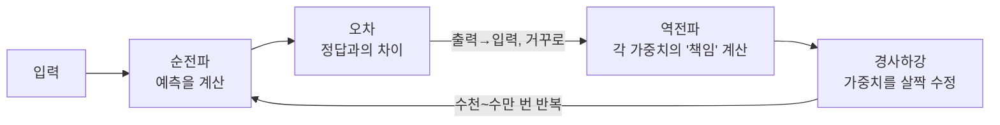
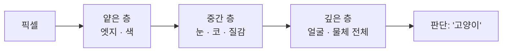

# 부록 C AI·머신러닝 · C.3 학습 신호와 역전파

> 부록

## 들어가며

지도학습과 자기지도학습이 정답을 얻는 방식과 확증편향, 역전파의 수학, 깊은 신경망이 잘 되는 이유(표현 학습)를 본다. 마지막은 같은 도구가 방향만 바꾸면 백도어가 되는 모델 편집 이야기다.

---

## 학습 신호 — ML은 "정답"을 어디서 얻나 (지도·자기지도), 그리고 확증편향

> 용도: "이미지는 라벨을 사람이 달지만, 글·음성은 어떻게 배우지?"와 "그럼 모델이 확증편향에 빠지는 것 아냐?"에 대한 참고 정리.
> 관련: [C.1 큰 그림](c1-big-picture.md)(12장 다음 토큰 예측) · [C.2 학습 경로와 신경망 종류](c2-curriculum-and-nn-types.md) · [C.4 RNN·임베딩·어텐션](c4-sequence-and-attention.md).

---

### 0. 큰 그림 — 학습의 연료는 "정답 신호(닻)"

신경망은 "**예측 → 정답과 비교 → 틀린 만큼 수정**"을 반복해 배운다(역전파). 그래서 학습에는 반드시 "**정답 신호**"가 필요하다. 이 정답이 **현실에 닻(anchor)을 내리고 있으면 → 진실로 수렴**, 닻이 흔들리면 → **확증편향으로 증폭**된다. 이 문서는 두 가지를 정리한다:

1. 미디어(이미지·글·음성…)마다 그 **정답을 어떻게 구하나.**
2. 언제 그 정답이 **닻을 잃고 확증편향**이 되나.

---

### 1. 정답을 얻는 4가지 방식

| 방식 | 정답(신호)은 누가 | 예 |
|------|-----------------|-----|
| **지도학습 (supervised)** | **사람이 라벨** 부여 | 이미지→"고양이", YOLO 박스 |
| **자기지도학습 (self-supervised)** | **데이터 자신** (일부를 가려 맞히기) | GPT(다음 단어), BERT(마스크) |
| **비지도학습 (unsupervised)** | 정답 없음, **구조만** 발견 | 군집화(비슷한 것 묶기) |
| **강화학습 (reinforcement)** | **보상 점수** | 게임 AI, RLHF(사람 선호로 미세조정) |

핵심은 위 두 개다. **이미지 = 보통 지도학습**(사람이 태깅), **글 = 보통 자기지도학습**.

---

### 2. 미디어별로 "정답"을 어떻게 만드나

#### 글(언어) — "다음 단어가 곧 정답"
`"나는 밥을 ___"` → 모델이 "먹었다"를 예측.
- 정답 "먹었다"는 **원래 문장에 이미 있던 단어**다. 그냥 가리고 물어본 것.
- 문장 하나가 **수십 개의 "문제+정답**"이 된다. 사람이 라벨을 달 필요가 없다.
- GPT = 다음 단어 예측(autoregressive). BERT = 가운데를 가림(`"나는 [MASK] 먹었다"` → "밥을").

#### 음성
- **지도**: 소리 ↔ 자막(대본) 쌍.
- **자기지도**: 소리 일부를 가리고 맞히기(wav2vec).

#### 이미지 + 글 (멀티모달)
- **CLIP**: 인터넷의 **이미지-캡션 쌍**을 서로의 정답으로 씀(대조학습). "이 사진엔 이 설명이 맞다"를 맞히게 함. 인터넷에 이미 짝이 널려 있어 라벨링이 공짜.

#### 영상
- **다음 프레임** 예측, 또는 일부 패치를 가리고 복원.

#### 그림 생성
- **Diffusion**: 원본에 노이즈를 씌웠다 **걷어내기**. 원본이 정답 역할.

> 공통 원리: **① 데이터의 일부를 숨기고 나머지로 맞히기**, 또는 **② 자연히 함께 오는 것(사진-설명)을 짝으로 쓰기.** → 사람 라벨 없이 정답을 얻는다.

---

### 3. 자기지도가 왜 "혁명"이었나

- 사람 라벨링은 비싸고 느리다(이미지 수백만 장 태깅).
- 자기지도는 **라벨 비용 0** → **인터넷 텍스트 전체**(수조 단어)를 통째로 학습 데이터로 쓸 수 있다.
- 그 정답의 닻이 **"실제 사람이 쓴 글"** 이라, 현실에 잘 붙어 있다. → LLM 폭발의 진짜 원동력.

**요즘 LLM의 실제 순서 (섞어 씀)**
1. **사전학습**: 인터넷 글로 **자기지도**(다음 단어 예측) → 언어 기본기.
2. **미세조정**: 소량 **사람 라벨**(지도) + **RLHF**(강화) → "질문에 잘 답하게" 다듬음.

---

### 4. 닻이 흔들리면 = 확증편향 (진짜 실패 모드)

학습 조정의 기준이 **자기 확신이 아니라 외부 정답**이면, 모델은 아무리 확신해도 정답과 다르면 깎인다 → **확증편향이 아니라 진실 수렴**. 하지만 **정답(닻)이 편향되거나·자기 출력으로 배우거나·피드백 루프가 생기면** 정확히 확증편향처럼 증폭된다:

| 상황 | 무슨 일 | 이름 |
|------|---------|------|
| 정답 자체가 편향 | 데이터의 편견을 그대로 학습·증폭 | 데이터 편향(bias) |
| **자기 출력으로 재학습** | 자기 실수를 정답인 양 다시 배워 오류 누적 | **model collapse** |
| 추천 시스템 루프 | 클릭한 것만 보여줌 → 편식 강화 | **필터 버블** |
| 사람이 좋아하는 답에 보상 | "진실"보다 "듣기 좋은 말"로 기울음 | **아첨(sycophancy)** |
| 훈련 데이터 과신 | 외운 것엔 강, 새 데이터엔 약 | **과적합(overfitting)** |

**특히** "자기 출력으로 배우기"가 위험하다 — 외부 정답이라는 닻이 사라지면 자기 확신을 정답 삼아 돌아가며 강화한다. (AI가 쓴 글로 다시 AI를 학습시키면 품질이 무너지는 이유)

**방어책 (닻을 지키는 장치)**
- **검증셋(validation)**: 훈련에 안 쓴 데이터로 시험 → 자기만족 아닌 진짜 실력 측정.
- **정규화·드롭아웃**: 과신 억제.
- **다양·고품질 데이터**: 편향 완화.
- **정답 품질·사람 피드백 설계**: 아첨·편향 방지.

---

### 한 줄 요약

ML의 연료는 **정답 신호(닻)**. **이미지는 사람 라벨(지도)**, **글은 "다음 단어 가리고 맞히기"로 데이터가 스스로 정답을 만든다(자기지도)** — 음성·영상·그림도 "일부 가리기 / 자연 짝짓기"로 라벨 없이 배운다. 이 정답이 **현실에 닻을 내리면 진실로 수렴**, **편향·자기참조·루프로 닻을 잃으면 확증편향으로 증폭**된다. "진실이냐 편향이냐"는 모델이 아니라 **학습 신호가 현실에 닻을 내렸는가**에 달렸다.

### 참조
- Google, *Machine Learning Crash Course* — https://developers.google.com/machine-learning/crash-course
- Radford et al., *CLIP* (2021) — https://arxiv.org/abs/2103.00020
- Shumailov et al., *The Curse of Recursion(model collapse)* (2023) — https://arxiv.org/abs/2305.17493

---

## 딥다이브 — 신경망과 역전파 수학 (논문·교재 기반)

> 기반: **Michael Nielsen, *Neural Networks and Deep Learning*, Ch.2** ([링크](http://neuralnetworksanddeeplearning.com/chap2.html)) · **Stanford CS231n – Backprop** ([링크](https://cs231n.github.io/optimization-2/)) · **3Blue1Brown – Backpropagation** ([링크](https://www.3blue1brown.com/lessons/backpropagation))
> 형식: 12살 요약 → 수식 심화. 얕은 버전은 [C.8 X 랭킹 알고리듬·정리](c8-ranking-and-log.md), [C.1 큰 그림](c1-big-picture.md).

---

### 0. 30초 직관 — 눈 감고 과녁 맞히기

눈을 가린 채 다트를 던진다고 해보자. 처음엔 엉뚱한 데 꽂힌다. 그런데 옆에서 친구가 매번 "**왼쪽으로 5cm 빗나갔어**"라고 알려준다면? 다음엔 오른쪽으로 조금, 그다음엔 더 조금… 결국 과녁 한가운데를 맞히게 된다.

신경망 학습이 정확히 이것이다. 처음엔 **아무렇게나** 답하고 → **정답과 얼마나 틀렸는지**(오차)를 재고 → 그 오차를 **출력에서 입력 쪽으로 거꾸로 되짚으며** 모든 연결에게 "너는 이만큼 잘못했으니 이 방향으로 살짝 고쳐"라고 전한다. 이 "거꾸로 되짚기"가 **역전파(backpropagation)**, "살짝 고치기"가 **경사하강**(gradient descent)이다.



*(도식 설명: 예측 → 오차 측정 → 역전파(각 가중치의 책임 계산) → 경사하강(수정)의 네 단계가 하나의 고리를 이루고, 이 고리를 수없이 반복할수록 신경망이 정확해진다.)*

핵심 마법은 **"틀린 책임을 어떻게 각 가중치에 정확히 나눠주느냐"** — 그 답이 아래 **연쇄법칙**과 **4대 방정식**이다.

---

### 1. 순전파 복습 — 뉴런의 계산

한 뉴런은 입력에 가중치를 곱해 더하고(=`z`), 활성화 함수 σ를 통과시킨다(=`a`).
```
zˡ = wˡ · aˡ⁻¹ + bˡ        (가중합)
aˡ = σ(zˡ)                  (활성화, 예: 시그모이드·ReLU)
```
- `l` = 층 번호, `w` = 가중치, `b` = 편향, `a` = 활성값.
- 입력층 → 은닉층 → 출력층으로 이 계산이 흘러가는 게 **순전파(forward)**.

---

### 2. 손실과 경사하강

**손실(cost) C**: 예측이 정답과 얼마나 다른지 하나의 숫자로. (예: 평균제곱오차, 교차엔트로피)

목표는 C를 **최소화**하는 w, b를 찾는 것. 방법은 **경사하강**:
$$
w \leftarrow w - \eta\,\frac{\partial C}{\partial w},\qquad
b \leftarrow b - \eta\,\frac{\partial C}{\partial b}
$$
- `∂C/∂w` = 기울기(gradient): C가 가장 가파르게 커지는 방향. 그 **반대**로 이동.
- `η` = **학습률(learning rate)**: 한 걸음 크기. 크면 발산, 작으면 느림.
- 비유: 안개 낀 산에서 발밑 경사만 보고 가장 낮은 골짜기로 한 걸음씩 내려가기.

핵심 질문: 층이 여러 개인데 **각 w, b의 기울기 ∂C/∂w를 어떻게 구하나?** → **역전파**.

---

### 3. 연쇄법칙과 계산 그래프 (CS231n)

역전파의 본질은 **연쇄법칙(chain rule)의 반복 적용**이다. 복잡한 함수를 작은 연산(게이트)들의 그래프로 쪼개고, 각 게이트는 두 가지를 안다:
1. 순전파 때의 **출력값**,
2. **지역 기울기(local gradient)** — 그 연산만의 미분.

역전파 때 각 게이트는 뒤에서 오는 **상류 기울기**(upstream gradient)를 받아, `상류 × 지역기울기`로 입력 쪽 기울기를 구한다.

#### 게이트별 기울기 흐름 (직관)
- **덧셈 게이트**: 지역 기울기 +1 → *"gradient on its output and distributes it equally to all of its inputs"* (기울기를 그대로 양쪽에 분배).
- **곱셈 게이트**: 지역 기울기 = 상대 입력값(뒤바뀜) → "기울기 스위처". 작은 입력 × 큰 상류기울기 = 그 입력에 큰 기울기.
- **max 게이트**: 순전파 때 **가장 컸던 입력**에만 기울기를 그대로 보내고 나머지는 0.

> CS231n: 이 곱셈(연쇄법칙) 덕에 "single and relatively useless gate"가 신경망이라는 거대한 회로의 톱니가 된다.

---

### 4. 역전파 4대 방정식 (Nielsen)

`δˡ_j = ∂C/∂zˡ_j` 를 "층 l의 뉴런 j의 **오차**"로 정의하면, 역전파는 4개의 방정식으로 요약된다. (⊙ = 원소별 곱, Hadamard product)

**BP1 — 출력층 오차**
$$
\delta^L = \nabla_a C \odot \sigma'(z^L)
$$
"출력이 정답과 얼마나 다른가(∇_a C)"에 "활성화의 민감도(σ′)"를 곱함.

**BP2 — 오차를 한 층 뒤로 전파**
$$
\delta^l = \big((w^{l+1})^{\top}\delta^{l+1}\big)\odot \sigma'(z^l)
$$
다음 층 오차 δˡ⁺¹를 가중치로 거꾸로 끌어와, 이 층의 활성화 민감도를 곱함. → **뒤에서 앞으로** 오차가 흐른다.

**BP3 — 편향의 기울기**
$$
\frac{\partial C}{\partial b^l_j} = \delta^l_j
$$
편향 기울기는 그 뉴런의 오차와 같다.

**BP4 — 가중치의 기울기**
$$
\frac{\partial C}{\partial w^l_{jk}} = a^{l-1}_k\,\delta^l_j
$$
"입력 활성값 × 출력 오차". 입력이 크고 오차가 클수록 그 가중치를 많이 고친다.

> 이 4식으로 **모든 층의 ∂C/∂w, ∂C/∂b**를 한 번의 역방향 통과로 전부 구한다. (그래서 빠르다)

---

### 5. 역전파 알고리즘 (한 스텝)

1. **순전파(feedforward)**: 입력 → 각 층의 z, a 계산·저장.
2. **출력 오차**: BP1로 δᴸ 계산.
3. **역전파(backpropagate)**: BP2로 δᴸ⁻¹, …, δ² 를 뒤로 차례로 계산.
4. **기울기**: BP3·BP4로 ∂C/∂b, ∂C/∂w 계산.
5. **갱신**: 경사하강으로 w, b 업데이트.
6. 데이터 배치마다 1~5 반복(미니배치 SGD).

---

### 6. 활성화 함수와 기울기 소실

- **시그모이드(sigmoid)**: 출력 0~1. 하지만 입력이 크거나 작으면 σ′ ≈ 0 → BP2에서 오차가 계속 작아짐 → **기울기 소실(vanishing gradient)**, 깊은 망 학습이 어려움.
- **ReLU** (`max(0,x)`): 양수 구간에서 기울기 1이라 소실이 덜함 → 딥러닝을 실용화한 핵심. (단 음수는 0 → "죽은 ReLU" 문제)
- 이 "기울기 소실" 때문에 잔차 연결(ResNet)·정규화 같은 기법이 나왔고, **트랜스포머의 잔차+LayerNorm**도 같은 맥락(→ [C.4 RNN·임베딩·어텐션](c4-sequence-and-attention.md) 6장).

---

### 7. 왜 중요한가

- 역전파는 **모든 딥러닝의 학습 엔진**. 트랜스포머·CNN·확산모델 전부 이걸로 학습된다.
- 계산 그래프 + 연쇄법칙 = 오늘날 **자동 미분(autograd)** 프레임워크(PyTorch·TensorFlow)의 원리. 우리가 수식을 직접 안 짜도 프레임워크가 계산 그래프를 만들어 역전파를 자동 수행.

---

### 용어 사전
| 용어 | 뜻 |
|------|-----|
| 순전파 | 입력→출력 계산 |
| 손실(cost) | 예측과 정답의 차이 |
| 경사하강 | 기울기 반대로 파라미터 이동 |
| 학습률 η | 한 걸음 크기 |
| 연쇄법칙 | 합성함수 미분 = 지역기울기 곱 |
| δ (delta) | 층·뉴런의 오차 ∂C/∂z |
| 기울기 소실 | 깊은 층에서 gradient가 0에 수렴 |
| autograd | 계산그래프로 역전파 자동화 |

### 출처
- Nielsen, M. *Neural Networks and Deep Learning*, Ch.2 "How the backpropagation algorithm works." — http://neuralnetworksanddeeplearning.com/chap2.html
- Stanford CS231n. *Backpropagation, Intuitions.* — https://cs231n.github.io/optimization-2/
- 3Blue1Brown. *Backpropagation / Backpropagation calculus.* — https://www.3blue1brown.com/lessons/backpropagation

_4대 방정식은 Nielsen 표기 기준. 짧은 인용은 출처 표기, 나머지는 재정리._

---

## 딥다이브 — 표현 학습: 깊은 신경망은 왜 잘 될까

> 기반: **Zeiler & Fergus (2014), "Visualizing and Understanding CNNs"** · **Bengio 외 (2013), "Representation Learning: A Review"** · **d2l.ai**
> 이 페이지는 [C.1 큰 그림](c1-big-picture.md) 6단원 "왜 깊게 쌓나"를 더 깊이 판 것. (사이드바에는 없고, 인라인 링크·검색으로 도달)

---

### 0. 30초 직관 — 단순한 것을 쌓아 복잡한 것을 만든다

깊은 신경망이 강한 이유는 한마디로 "**조립**"이다. 얕은 층은 아주 **단순한 특징**(선, 색 얼룩)만 본다. 그런데 그 단순한 조각들을 **다음 층이 조합**하면 조금 더 복잡한 것(눈, 바퀴)이 되고, 또 조합하면 더 복잡한 것(얼굴, 자동차)이 된다. 사람이 "고양이의 특징"을 손으로 정의해주지 않아도, 네트워크가 **데이터로부터 이 특징 계단을 스스로 만든다.** 이것이 **표현 학습**(representation learning)이다.



*(도식 설명: 픽셀에서 시작해 층을 지날수록 특징이 단순→복잡으로 조립된다. 얕은 층은 선·색, 중간 층은 눈·코 같은 부분, 깊은 층은 얼굴 전체를 잡아 최종 판단으로 이어진다.)*

---

### 1. 계층적 특징 — 실제로 눈으로 확인됨

Zeiler & Fergus(2014)는 CNN의 각 층이 **무엇에 반응하는지**를 시각화했다. 결과가 딱 위 직관대로였다:
- **1층**: 방향이 다른 **엣지(선)**, 단순한 색 블롭.
- **중간층**: 이 엣지들이 모여 **텍스처, 모서리, 원형** 같은 패턴.
- **더 깊은 층**: **눈·코·바퀴** 같은 "부품".
- **가장 깊은 층**: **얼굴·개·자동차** 같은 완전한 물체.

즉 네트워크는 "저수준 → 고수준" 특징의 **계단**을 자동으로 학습한다. (사람이 옛날에 손으로 만들던 SIFT·HOG 같은 특징을 대체)

---

### 2. 왜 "깊이"가 유리한가

같은 걸 얕고 넓은 망으로도 이론상 표현할 수 있는데, 왜 깊게 쌓을까?

1. **조합적 효율**: 부품을 재사용해 조립하면 **훨씬 적은 뉴런**으로 복잡한 함수를 표현한다. (얕게 하면 경우의 수를 통째로 외워야 해 폭발적으로 커짐)
2. **추상화 단계**: 문제를 "한 방에" 풀지 않고 **작은 변환을 여러 번** 거치는 게 학습에 유리.
3. **전이 가능성**: 얕은 층이 배운 "엣지·질감"은 **다른 과제에도 그대로 재사용**된다(전이학습·파인튜닝의 토대).

> 단, 깊다고 무조건 좋은 건 아니다 — 너무 깊으면 **기울기 소실**(→ [C.3 학습 신호와 역전파](c3-learning-signal-and-backprop.md))로 학습이 어려워, **잔차 연결(ResNet)**·정규화 같은 장치가 필요하다. (트랜스포머의 잔차+LayerNorm도 같은 이유 → [C.4 RNN·임베딩·어텐션](c4-sequence-and-attention.md))

---

### 3. 트랜스포머와의 연결

이 "층마다 추상화가 깊어진다"는 원리는 CNN만의 것이 아니다. **트랜스포머도 층을 지날수록** 단어의 표현이 점점 문맥을 머금은 추상적 표현으로 바뀐다 — 얕은 층은 문법·표면 패턴, 깊은 층은 의미·관계를 담는다고 알려져 있다.

**핵심 요약**: 깊은 신경망 = 단순 특징을 층층이 조합해 복잡한 개념을 만드는 "표현 학습" 기계. 계층적 특징은 실제 시각화로 확인됐고, 깊이는 조합 효율·재사용성 때문에 유리하다.

### 출처
- Zeiler, M. & Fergus, R. (2014). *Visualizing and Understanding Convolutional Networks.* — https://arxiv.org/abs/1311.2901
- Bengio, Y., Courville, A., Vincent, P. (2013). *Representation Learning: A Review and New Perspectives.* — https://arxiv.org/abs/1206.5538
- *Dive into Deep Learning* — https://d2l.ai/

---

## 모델에 심기 — 파인튜닝·모델 편집·백도어 (같은 도구, 방향만 반대)

> 관점: "레이어만 빼서 튜닝되나? 안전을 심나, 거짓·환각을 심나?"에 대한 정리. **같은 메커니즘이 안전도 악의도 심을 수 있다**(대칭). 방어 관점의 교육용.
> 관련: [C.3 학습 신호와 역전파](c3-learning-signal-and-backprop.md)(닻·확증편향) · [C.6 층별 특화와 YOLO](c6-layers-and-yolo.md)(층별 제어) · [C.2 학습 경로와 신경망 종류](c2-curriculum-and-nn-types.md).

---

### 0. 한 줄 — 같은 칼, 요리도 흉기도

특정 층·뉴런을 골라 조정하는 기술(파인튜닝·모델 편집)은 **안전 행동을 심는 데도, 거짓·백도어를 심는 데도** 쓰인다. 도구는 하나, **방향만 반대.** 그래서 ML **보안**이 중요하다.

---

### 1. "레이어만 빼서 튜닝" — 된다 (PEFT)

- **동결(freeze) 후 일부만 학습**: 나머지 층 얼리고 특정 층만 → **서브클래스에서 메서드 하나만 오버라이드**.
- **LoRA / 어댑터(PEFT, Parameter-Efficient Fine-Tuning)**: 원본 가중치를 **안 건드리고**, 특정 층에 **작은 학습 모듈**(diff)을 끼워 그것만 학습.
  - **자바 렌즈**: **AOP/데코레이터로 특정 조인포인트에 패치를 주입**하는 것. 원본 `.jar`은 그대로, **얇은 diff만** 얹는다. 배포·롤백도 쉬움.

```
원본 모델(고정) ──▶ [LoRA 패치를 특정 층에 끼움] ──▶ 살짝 다른 행동
   = 원본 .jar 불변         = 데코레이터/AOP diff
```

---

### 2. 특정 지식만 콕 편집 — Model Editing

연구는 **사실이 저장된 위치(주로 중간 MLP 층)를 찾아** 그 가중치를 편집한다.

- **ROME**(Rank-One Model Editing) · **MEMIT**: "에펠탑은 로마에 있다" 같은 **특정 사실을 콕 집어** 바꾼다. FFN 층을 **key-value 연상 메모리**로 보고 해당 항목을 수정(Meng et al. 2022; Geva et al. 2021).
- **Knowledge Neurons**(Dai et al. 2021): 특정 뉴런이 특정 사실을 담고 있음을 보임 → 콕 집어 켜거나 끔.
- **자바 렌즈**: **HashMap의 특정 key에 새 value를 `put`** 하는 것과 비슷. 단 정확 매칭이 아니라 **흐릿한(soft) 매칭**이라, 하나 고치면 **주변 지식이 딸려 바뀌는 부작용**(ripple)이 있다.

---

### 3. 좋은 쪽 — 안전·정렬 심기

- **Safety fine-tuning**: 유해 요청 거절, 정중한 응답 등을 학습으로 심음.
- **RLHF**(사람 피드백 강화학습): "사람이 선호하는 답"에 보상 → 정렬(alignment). (→ [C.3 학습 신호와 역전파](c3-learning-signal-and-backprop.md))
- **가드레일**: 입출력 필터를 덧댐(모델 밖 방어).

---

### 4. 나쁜 쪽 — 거짓·환각·백도어 심기 (보안 위협)

같은 기술이 악용되면:

- **데이터 포이즈닝(data poisoning)**: 학습 데이터에 **오염 샘플**을 섞어 특정 오작동을 유도.
- **백도어(backdoor)**: 특정 **트리거 입력**(예: 희귀 단어·패턴)에서만 나쁘게 행동하게 심음. 평소엔 정상이라 **탐지가 어렵다**.
  - **자바 렌즈**: **공급망 공격(supply-chain)** — 의존성에 몰래 악성 코드를 넣거나, 특정 조건에서만 터지는 **로직 폭탄(logic bomb)**.
- **거짓 사실 주입**: 모델 편집으로 틀린 정보를 정답인 양 심음 → 그럴듯하게 퍼뜨림.

> 이건 [C.3 학습 신호와 역전파](c3-learning-signal-and-backprop.md)의 "닻이 흔들리면 확증편향"의 **공격 버전** — 신뢰할 수 없는 출처의 모델·데이터·가중치를 그대로 쓰면 위험.

---

### 5. 방어 (defenses)

- **출처 검증(provenance)**: 신뢰할 수 있는 곳의 **가중치·데이터만** 사용. 해시·서명 확인.
- **평가·레드팀(red-teaming)**: 트리거·이상 행동을 **적극적으로 찾아** 시험.
- **데이터 위생**: 학습 데이터 정제·중복·이상치 제거.
- **행동 모니터링**: 배포 후 이상 출력 추적. 가드레일 병행.
- **자바 렌즈**: 낯선 `.jar`(모델)을 무심코 의존성에 넣지 않는다 = **아무 사전학습 모델이나 프로덕션에 올리지 않기.**

---

### 면접·복습 3단 Q&A

#### Q1. 사전학습 모델을 통째로 재학습 안 하고 조금만 손보려면?
- **① 결론** **PEFT**(LoRA·어댑터) — 원본 고정, 작은 패치만 학습.
- **② 원리** 특정 층에 저차원 diff를 끼워 그것만 업데이트. 비용·메모리 절감.
- **③ 확장** 데코레이터처럼 여러 태스크용 패치를 갈아끼움. 원본 재사용.

#### Q2. 모델에 특정 사실을 어떻게 넣거나 고치나?
- **① 결론** **모델 편집**(ROME/MEMIT) — 사실이 든 중간 MLP 층 가중치를 수정.
- **② 원리** FFN을 key-value 메모리로 보고 해당 항목을 갱신.
- **③ 확장** 부작용(ripple)·거짓 주입 위험 → 출처·평가 필수.

#### Q3. 왜 낯선 모델을 그냥 쓰면 위험한가?
- **① 결론** **백도어·포이즈닝**이 심겨 있을 수 있다.
- **② 원리** 특정 트리거에서만 오작동 → 평소엔 정상이라 탐지 어려움(로직 폭탄).
- **③ 확장** 공급망 공격과 동형. 출처 검증·레드팀으로 방어.

---

### 한 줄 요약
**레이어만 빼서 튜닝은 된다(PEFT), 특정 지식 편집도 된다**(ROME/MEMIT).이 기술은 **안전을 심을 수도, 거짓·백도어를 심을 수도** 있어 방향만 반대다. 그래서 **모델·데이터·가중치의 출처 검증과 평가**가 핵심. 자바로 치면 **AOP 패치**(LoRA)와 **공급망 공격**(백도어)이 같은 주입 지점을 쓰는 셈.

### 출처
- Meng et al., *Locating and Editing Factual Associations in GPT (ROME)*, 2022 — https://arxiv.org/abs/2202.05262
- Meng et al., *Mass-Editing Memory in a Transformer (MEMIT)*, 2022 — https://arxiv.org/abs/2210.07229
- Geva et al., *Transformer Feed-Forward Layers Are Key-Value Memories*, 2021 — https://arxiv.org/abs/2012.14913
- Dai et al., *Knowledge Neurons in Pretrained Transformers*, 2021 — https://arxiv.org/abs/2104.08696
- Hu et al., *LoRA: Low-Rank Adaptation of Large Language Models*, 2021 — https://arxiv.org/abs/2106.09685

---

## 다음으로

순서가 있는 데이터, 즉 문장을 다루는 법으로 간다. C.4는 RNN에서 어텐션까지다.

👉 [부록 C AI·머신러닝 · C.4 순서와 어텐션](c4-sequence-and-attention.md)
