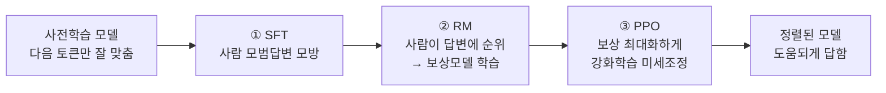

# 부록 C AI·머신러닝 · C.5 LLM 정렬·구조·논문

> 부록

## 들어가며

RLHF와 RLAIF로 모델을 정렬하는 법, 적게 켜서 크게 쓰는 MoE 구조, 그리고 환각·추론·창발을 논문으로 읽는다.

---

## RLHF / RLAIF — 모델을 '말 잘 듣게' 만드는 정렬(Alignment)

> 학습용 문서. 요약 → 상세 → "알면 AI를 더 잘 쓰는 법" 순. 인용은 검증된 arXiv만.

### 요약 (3줄)

- 사전학습만 한 LLM은 "다음 토큰"만 잘 맞출 뿐, **사람이 원하는 대로 답하진 않는다.**
- 그걸 사람(또는 AI)의 **선호 피드백으로 교정**하는 과정이 RLHF(사람)/RLAIF(AI).
- 그래서 같은 베이스 모델도 **정렬 방식에 따라 성격·말투·거부 행동이 완전히 달라진다.**

### 상세

#### 1. 왜 필요한가 — 사전학습의 빈틈
사전학습 모델은 인터넷 텍스트의 분포를 흉내 낼 뿐이라, "질문에 도움되게 답하라"는
목표가 없다. → **정렬(alignment)** 단계가 베이스 모델을 '비서'로 바꾼다.

#### 2. RLHF 3단계 (InstructGPT 파이프라인)
[InstructGPT, Ouyang 외 2022, arXiv:2203.02155](https://arxiv.org/abs/2203.02155)
```
① SFT   : 사람이 쓴 모범 답변으로 지도학습 (Supervised Fine-Tuning)
② RM    : 사람이 여러 답변에 순위 매김 → 보상모델(Reward Model) 학습
③ PPO   : 보상모델 점수를 강화학습으로 최대화하게 본 모델을 미세조정
```
- 충격적 결과: **1.3B RLHF 모델이 175B GPT-3보다 선호됨** → 크기보다 정렬이 중요.



#### 3. RLAIF — 사람 대신 AI가 피드백
[Constitutional AI, Bai 외 2022, arXiv:2212.08073](https://arxiv.org/abs/2212.08073)
- 사람 라벨링은 비싸고 느림 → **모델이 '헌법(원칙)'에 비춰 자기 답을 비판·수정**.
- 그 자기 생성 선호쌍으로 보상모델 학습 → RLAIF(RL from AI Feedback).
- "도움됨 + 무해함" 같은 원칙을 명시적으로 주입 → Claude의 거부/안전 행동의 뿌리.

#### 4. DPO — 보상모델·RL 없이 더 간단하게
[DPO, Rafailov 외 2023, arXiv:2305.18290](https://arxiv.org/abs/2305.18290)
- 별도 보상모델·PPO 없이, 선호쌍으로 **모델을 직접 최적화**. 안정적이고 구현이 단순.
- 이후 KTO, IPO, ORPO 등 변형 다수. → "정렬 = 고정 기술"이 아니라 **빠르게 진화 중**.

#### 5. 정렬세(alignment tax)와 부작용
- 너무 강하게 정렬하면 **성능 저하·과도한 거부·아첨**(sycophancy)이 생길 수 있음.
- → 정렬은 "안전 vs 유용성"의 줄다리기. (환각-창의 트레이드오프와 같은 결의 문제)

#### 6. 정렬 방법 계보 (나열) — RLHF만 있는 게 아니다
- **SFT(지도 미세조정)**: 모범답변 모방. 정렬의 기본 토대.
- **RLHF (PPO)**: 보상모델 + 강화학습. 강력하지만 파이프라인이 복잡(RM·PPO 불안정).
- **RLAIF / Constitutional AI**: 사람 대신 AI가 원칙 기준으로 피드백 → 라벨링 비용↓.
- **DPO**: 보상모델·RL 없이 선호쌍으로 직접 최적화. 단순·안정 → 최근 많이 쓰임.
- **그 외 변형**: KTO(좋음/나쁨 이진 신호), IPO(과적합 완화), ORPO(SFT+선호 한 번에) 등.
  → "정렬 = 한 기술"이 아니라 **목적(안정성/비용/품질)에 따라 고르는 도구 모음**.

#### 7. 정렬이 만드는 행동들 (체감 사례)
- **거부(refusal)**: 위험·민감 요청 차단 — Constitutional 원칙의 결과.
- **아첨(sycophancy)**: 사용자가 좋아할 답으로 기울기 — RLHF 보상의 부작용.
- **장황함/면책**: "일반적으로는…" 같은 회피 — 평가가 안전한 답을 보상해서.
- **거짓 자신감**: 모르면서 단정 — [환각 논문](c5-llm-alignment-and-papers.md)의
  "찍기 보상"과 같은 뿌리.

### 알면 AI를 더 잘 쓰는 법 (어필 포인트)

> **핵심: "AI를 잘 쓴다 = AI가 왜 그렇게 답하는지 알고 쓴다."**

- **거부/회피를 만나면**: 모델의 안전 정렬(Constitutional) 때문임을 알고, 맥락·의도를
  명확히 줘서 우회가 아니라 **정당한 요청임을 전달**한다.
- **아첨(무조건 동의)을 의심**: RLHF는 "사람이 좋아할 답"을 보상하므로, 모델이
  내 의견에 영합할 수 있다 → **반대 근거를 일부러 요구**해 검증. (이번 세션 내내 한 검증과 동일)
- **모델 선택 감각**: 같은 작업도 정렬 성향이 다르면 결과가 다르다 → 보수적 답이
  필요하면 안전 정렬 강한 모델, 자유로운 발상엔 덜 정렬된/temperature 높은 설정.
- **프롬프트 = 미니 정렬**: system prompt로 "원칙"을 주는 건 Constitutional AI의 축소판.
  역할·제약·금지사항을 명시하면 그 방향으로 행동이 정렬된다.

### 관련 문서

- [LLM이란 무엇인가](c2-curriculum-and-nn-types.md) — 사전학습 단계
- [논문: 환각·추론·창발](c5-llm-alignment-and-papers.md) — 정렬세·환각과 연결
- [카파시 접근법](c2-curriculum-and-nn-types.md)

---

## MoE (Mixture-of-Experts) — 적게 켜서 크게 쓰는 구조

> 학습용 문서. 요약 → 상세 → "알면 AI를 더 잘 쓰는 법" 순. 인용은 검증된 arXiv만.

### 요약 (3줄)

- 거대한 모델 전체를 매번 다 쓰면 비용이 폭발한다.
- MoE는 **여러 '전문가(expert)' 중 토큰마다 일부만 켠다** → 전체 파라미터는 크지만
  **토큰당 연산은 거의 일정**.
- 그래서 최신 고성능 오픈모델 상당수가 MoE (DeepSeek, Mixtral 등).

### 상세

#### 1. 핵심 아이디어 — 희소 활성화(sparse activation)
보통(dense) 모델은 모든 파라미터가 매 토큰에 관여한다. MoE는 FFN 블록을
여러 **전문가**로 나누고, **라우터**(router)가 토큰마다 적합한 소수(예: 64개 중 2개)만 켠다.
```
토큰 → 라우터 → [전문가 중 top-k 선택] → 그 전문가만 연산
→ 총 파라미터 ↑↑ , 토큰당 연산 ≈ 그대로
```

#### 2. 대표 연구
- **Switch Transformer** [Fedus 외 2021, arXiv:2101.03961](https://arxiv.org/abs/2101.03961)
  — top-1 라우팅으로도 품질 유지, dense 대비 **사전학습 ~7배 빠름**.
- **Mixtral** [Jiang 외 2024, arXiv:2401.04088](https://arxiv.org/abs/2401.04088)
  — 토큰마다 전문가 **2개** 선택하는 오픈 MoE.
- **DeepSeekMoE** [2024, arXiv:2401.06066](https://arxiv.org/abs/2401.06066)
  — **공유 전문가 분리** + **세분화된 전문가**로 전문성↑. DeepSeek-V3로 production 규모 확장.

#### 3. 장점과 함정
- 장점: 같은 추론 비용으로 **더 큰 지식 용량**. 학습·추론 효율↑.
- 함정:
  - **로드 밸런싱** — 특정 전문가에만 토큰이 쏠리면 나머지가 논다 (보조 손실로 분산 유도).
  - **메모리** — 안 켜도 전문가 파라미터는 **다 적재**해야 함 → VRAM 요구 큼.
  - **라우팅 불안정** — 같은 입력이 다른 전문가로 가면 결과가 흔들릴 수 있음.

#### 4. 라우팅을 더 자세히 — 토큰은 어떻게 전문가를 고르나
- **게이팅(gating)**: 라우터가 토큰 벡터로 각 전문가 점수를 내고(softmax) 상위 k개(top-k)만 선택.
  k=1이면 Switch, k=2면 Mixtral.
- **top-k 의미**: k가 크면 더 많은 전문가를 켜 품질↑·연산↑. 작으면 빠름·불안정.
- **보조 손실(auxiliary loss)**: 특정 전문가 쏠림을 막으려 "부하를 고르게"라는 페널티를 학습에 추가.
- **전문가 용량(capacity)**: 한 전문가가 한 배치에서 받을 토큰 상한. 넘치면 토큰이 버려져(overflow) 품질에 영향.

#### 5. 변형·진화 (나열)
- **공유 전문가(shared expert)**: 항상 켜지는 전문가로 공통 지식 담당(DeepSeekMoE) → 나머지는 특화 집중.
- **세분화(fine-grained)**: 전문가를 잘게 쪼개 더 많이 켬 → 조합 다양성·정밀도↑.
- **노드 제한 라우팅**: 분산 학습 시 토큰이 너무 많은 노드로 흩어지지 않게 제한(통신비↓).

#### 6. dense vs MoE 한눈에
| | Dense | MoE |
|---|------|-----|
| 토큰당 활성 파라미터 | 전체 | 일부(top-k) |
| 총 파라미터 대비 추론 비용 | 높음 | 낮음(희소) |
| VRAM(메모리) | 활성=총 | **총 파라미터 다 적재** |
| 학습 난이도 | 단순 | 라우팅·밸런싱 복잡 |
| 추론 일관성 | 안정 | 라우팅 따라 흔들릴 수 있음 |

#### 7. 언제 MoE가 부적합한가
- VRAM이 빠듯한 환경(전체 적재 부담) → 작은 dense가 나을 수 있음.
- 극단적 저지연·완전 재현성이 필요한 경우(라우팅 변동성).
- 파인튜닝/배포 단순함이 중요한 소규모 팀.

### 알면 AI를 더 잘 쓰는 법 (어필 포인트)

> **핵심: 구조를 알면 "왜 이 모델이 빠른데 똑똑한지 / 어디서 한계가 오는지"를 안다.**

- **모델 스펙 읽는 눈**: "총 671B / 활성 37B" 같은 표기를 보면 **MoE구나, 추론은
  37B급 비용이구나**를 즉시 해석. (dense 70B와 비용·성격이 다름)
- **셀프호스팅 판단**: MoE는 활성 파라미터가 작아도 **전체를 VRAM에 올려야** 하므로,
  로컬 구동 시 메모리 산정을 활성이 아닌 **총 파라미터 기준**으로 한다.
- **일관성 기대치 조정**: 라우팅 특성상 같은 질문에도 미세하게 답이 흔들릴 수 있음 →
  중요한 작업은 temperature를 낮추고 **재현성**을 따로 확인.
- **비용 직관**: "왜 거대 모델인데 API가 의외로 싸지?"의 답이 MoE(희소 활성화)인 경우가 많다.

### 관련 문서

- [LLM이란 무엇인가](c2-curriculum-and-nn-types.md)
- [모델별 비교](a3-tools-and-llm.md) — 컨텍스트·비용 비교
- [RLHF / RLAIF 정렬](c5-llm-alignment-and-papers.md)

---

## 논문으로 보는 LLM — 환각·추론·창발 (읽을거리)

> 초안 (검토 중). LLM을 "밑바닥부터" 이해하려는 사람을 위한 검증된 논문 리스트.
> 모든 항목은 실제 arXiv 논문이며, 한 줄 발췌 + 링크를 단다.
> ⚠️ LLM이 가짜 논문을 지어내는 일이 흔하므로, 인용 전 반드시 원문 링크를 확인할 것.

### 큰 그림 — 왜 "버전에 따라 이론이 달라지나"

LLM 능력에 대한 "이론"은 고정된 진리가 아니다. **무엇을, 어떻게 측정하느냐**에 따라
결론이 바뀐다(아래 C). 그래서 모델 버전·학습법·평가 벤치가 바뀌면 "이 모델은 추론한다/
못 한다" 같은 해석도 흔들린다. → 논문을 읽을 때 **결론보다 '어떤 가정·지표 위에서
나온 결론인지'를 먼저 본다.**

---

### A. 환각(Hallucination) — 왜 있고, 왜 못/안 없애나

#### 1. Why Language Models Hallucinate (Kalai 외, OpenAI, 2025)
arXiv: [2509.04664](https://arxiv.org/abs/2509.04664)
- 환각은 미스터리가 아니라 **통계적 부산물**. 표준 훈련·평가가 "모르면 찍기"를 보상하기 때문.
- LLM은 "시험 잘 보는 기계"로 최적화됨 → 불확실할 때 찍으면 점수가 오르니 찍는다.
- 해법: 새 환각 벤치를 추가하는 게 아니라, **기존 벤치의 채점 방식**(불확실성 처벌)을 고쳐야.

#### 2. Hallucination is Inevitable: An Innate Limitation of LLMs (Xu 외, 2024)
arXiv: [2401.11817](https://arxiv.org/abs/2401.11817)
- 환각을 **형식적으로 정의**하고, 제거 불가능함을 **증명**.
- LLM은 모든 계산 가능 함수를 학습할 수 없으므로, 범용 문제해결기로 쓰면 **반드시** 환각.

#### 3. On the Fundamental Impossibility of Hallucination Control (2025)
arXiv: [2506.06382](https://arxiv.org/abs/2506.06382)
- **창의성 = 환각의 다른 얼굴.** 새로운 비유·예측을 만들려면 데이터 너머로 나가야 하고,
  그건 "정보 보존의 위반" → 창의는 본질적으로 환각을 동반.
- 그래서 용도별로 트레이드오프를 설계: **의료 진단=진실성 최대**, **창작 도구=통제된 환각 허용**.
- → "환각을 0으로 만들면 창의도 0이 된다"는 핵심 통찰.

#### 4. H-Neurons: 환각 관련 뉴런의 존재·영향·기원 (2025)
arXiv: [2512.01797](https://arxiv.org/abs/2512.01797)
- 환각을 신호하는 뉴런이 **전체의 0.1% 미만**으로 희소하게 존재 → 식별·예측 가능.
- 그 뉴런을 **억제/활성화**해 출력을 바꿀 수 있다(개입 지점).
- 단 개입은 **도메인 특이적** → 무턱대고 누르면 다른 도메인 일반화·창의가 손상될 수 있음.
- → "없앨 수 있는데 왜 안 없애나"의 실증적 답: 부작용(창의·일반화 손상) 때문.

---

### B. 추론(Reasoning) — 학습법에 따라 능력이 갈린다

#### 5. Towards Large Reasoning Models: A Survey of Reinforced Reasoning (Xu 외, 2025)
arXiv: [2501.09686](https://arxiv.org/abs/2501.09686)
- RL + Chain-of-Thought으로 **좋은 추론 궤적을 시행착오로 탐색**.
- test-time에 **더 긴 중간 토큰**("생각")을 허용하면 추론 정확도가 크게 오름 (o1/DeepSeek-R1 계열).
- → 추론력은 모델 크기만이 아니라 **학습·추론 방법의 산물**.

#### 6. Stop Overthinking: A Survey on Efficient Reasoning (2025)
arXiv: [2503.16419](https://arxiv.org/abs/2503.16419)
- 길게 생각하는 게 **항상 이득은 아님** — 과한 사고는 비용·지연·오류를 늘릴 수 있음.
- → "얼마나 생각하게 할지"도 설계 변수.

---

### C. "창발(Emergence)"은 진짜인가 — 측정이 결론을 바꾼다

#### 7. Emergent Abilities of Large Language Models (Wei 외, 2022)
arXiv: [2206.07682](https://arxiv.org/abs/2206.07682)
- 작은 모델엔 없던 능력이 **규모를 키우면 예측 불가하게 창발**한다고 주장.

#### 8. Are Emergent Abilities of LLMs a Mirage? (Schaeffer 외, 2023)
arXiv: [2304.15004](https://arxiv.org/abs/2304.15004)
- 창발은 **연구자의 metric 선택이 만든 착시**. 능력의 92%가
  Multiple-Choice/Exact-Match 같은 **불연속 지표**에서만 "갑툭튀"로 보임.
- 연속 지표로 보면 성능은 **매끄럽게 예측 가능**하게 증가.
- → **같은 데이터, 다른 지표 → 정반대 결론.** "버전·평가에 따라 이론이 달라진다"의 교과서 사례.

---

### 어떻게 공부할까 (밑바닥 이해 루트)

1. **개념 먼저**: [LLM이란 무엇인가](c2-curriculum-and-nn-types.md) — 토큰·attention·확률분포
2. **환각의 본질**: A-1 → A-3 (통계적 부산물 → 창의와의 트레이드오프)
3. **추론의 출처**: B-5 (RL+CoT가 추론을 만든다)
4. **비판적 시각**: C-7 vs C-8 (측정이 결론을 바꾼다 → 논문은 가정부터 본다)
5. **직접 구현**: [카파시 접근법](c2-curriculum-and-nn-types.md) (nanoGPT 등)

### 관련 문서

- [LLM이란 무엇인가](c2-curriculum-and-nn-types.md) — hallucination, knowledge cutoff 기초
- [카파시 접근법](c2-curriculum-and-nn-types.md) — 밑바닥부터 이해
- [모델별 비교](a3-tools-and-llm.md)

---

## 다음으로

언어에서 비전으로 넘어간다. C.6은 층별 특화와 YOLO다.

👉 [부록 C AI·머신러닝 · C.6 깊이·층별 특화와 YOLO](c6-layers-and-yolo.md)
