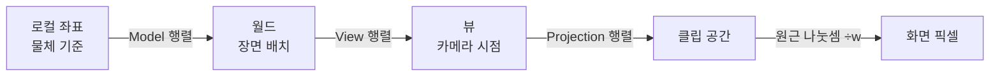
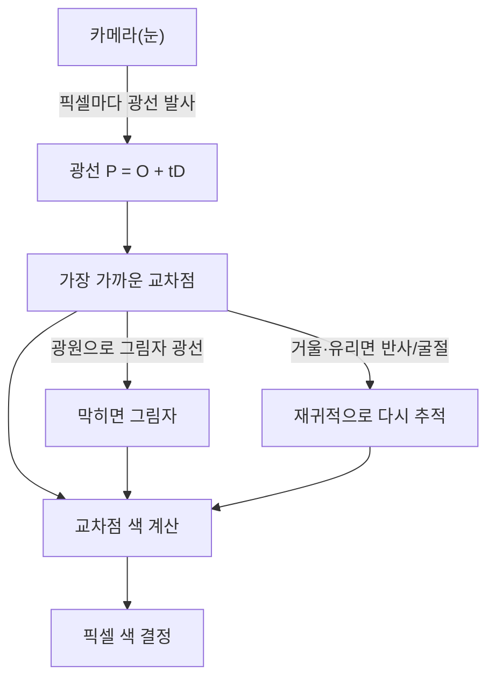

# 부록 D 그래픽스와 Unity · D.2 렌더링 수학과 ML 비교

> 부록

## 들어가며

좌표변환·래스터화·레이트레이싱의 수학, 그래픽스와 머신러닝의 비교와 융합, 검색 기록과 정리 Q&A를 모았다.

---

## 딥다이브 — 렌더링 수학 (좌표변환·래스터화·레이트레이싱)

> 기반: **LearnOpenGL – Coordinate Systems** ([링크](https://learnopengl.com/Getting-started/Coordinate-Systems)) · **Scratchapixel – Ray Tracing / Rasterization** ([링크](https://www.scratchapixel.com/)) · **PBR Book** ([링크](https://pbr-book.org/))
> 형식: 12살 요약 → 수식 심화. 얕은 버전은 [D.2 렌더링 수학·ML 비교](d2-rendering-math.md), [D.1 컴퓨터 그래픽스](d1-graphics.md).

---

### 0. 30초 직관 — 3D 세계를 사진 한 장으로

게임 화면이든 픽사 영화든, 결국 하는 일은 하나다: **3차원 공간에 떠 있는 점들을, 2차원 화면의 픽셀 색으로 바꾸기.** 사진사가 3D 세상을 카메라로 찍어 평면 사진으로 만드는 것과 똑같다.

이 "찍기"는 두 단계다. 먼저 **어디에 찍힐지**(위치) — 물체 좌표를 여러 번 행렬로 변환해 화면 좌표로 옮긴다(모델→카메라→화면). 그다음 **무슨 색일지**(빛) — 두 가지 방식이 있다. **래스터화**는 삼각형을 픽셀로 빠르게 칠하고(게임), **레이트레이싱**은 픽셀마다 빛의 경로를 추적해 사실적으로 계산한다(영화). 아래에서 그 수학을 하나씩 본다.

---

### 1. 좌표 변환 파이프라인 (MVP)

정점(vertex)은 다섯 좌표계를 차례로 거친다:

*(도식 설명: 물체의 로컬 좌표가 Model→View→Projection 행렬을 차례로 거쳐 클립 공간으로 가고, 마지막 원근 나눗셈(÷w)으로 화면 픽셀 좌표가 된다.)*
행렬 곱으로 (오른쪽→왼쪽 순서로 적용):
$$
V_{clip} = M_{proj}\,M_{view}\,M_{model}\,V_{local}
$$
- **Model 행렬**: 물체를 로컬 원점에서 월드로 배치(이동·회전·크기).
- **View 행렬**: 씬 전체를 카메라 시점으로 옮김.
- **Projection 행렬**: 3D를 클립 공간으로 눌러 담아 원근을 준비.

> LearnOpenGL: 곱은 오른쪽부터 평가 — Model이 먼저, 그다음 View, 마지막 Projection.

---

### 2. 투영과 원근 나눗셈

#### 동차좌표(homogeneous coordinates)
3D 점 (x,y,z)에 네 번째 성분 **w**를 붙여 (x,y,z,w)로 다룬다. 이 w가 **원근 나눗셈**을 가능케 하는 열쇠. 덕분에 이동·회전·투영을 **행렬 곱 하나로 통일**한다.

#### 원근 투영(perspective) vs 직교(orthographic)
- **원근**: 멀수록 w가 커진다. LearnOpenGL: *"the further away a vertex is, the higher its w component becomes."* 이후 **원근 나눗셈**(각 좌표를 w로 나눔)으로 먼 물체가 작아진다 → 사람 눈처럼.
- **직교**: w=1로 유지 → 나눗셈이 효과 없음 → 거리와 무관하게 크기 유지(설계도·2D).

---

### 3. 래스터화 수학

투영된 삼각형이 화면에서 덮는 픽셀을 찾는다.

#### 무게중심 좌표(barycentric coordinates)
삼각형 정점 A,B,C에 대해 내부 점 P를:
$$
P = \alpha A + \beta B + \gamma C,\quad \alpha+\beta+\gamma = 1,\quad \alpha,\beta,\gamma \ge 0
$$
- α,β,γ가 모두 0 이상이면 **P는 삼각형 내부** → 그 픽셀은 삼각형에 속함.
- 같은 α,β,γ로 정점의 색·깊이·UV를 **보간(interpolation)**해 픽셀 값을 만든다.

#### 깊이 버퍼(z-buffer)
여러 삼각형이 같은 픽셀을 덮으면, 보간한 **깊이 z**를 비교해 **가장 가까운 것**만 남긴다 → 앞 물체가 뒤를 가림.

> 래스터화가 빠른 이유: 삼각형 하나를 픽셀로 채우는 건 단순·병렬 작업이라 GPU에 최적.

---

### 4. 레이트레이싱 수학

카메라(눈)에서 픽셀로 광선을 쏴, 부딪힌 물체의 색을 계산.

#### 광선(ray) 정의
$$
P(t) = O + tD, \quad t \ge 0 \qquad (O=\text{카메라}, \ D=\text{방향})
$$

#### 카메라 광선 생성 (Scratchapixel 단계)
픽셀 좌표 → 월드 방향으로 변환:
1. **Raster→NDC**: 픽셀을 이미지 크기로 나눠 [0,1].
2. **NDC→Screen**: [-1,1]로 재매핑(중앙 기준).
3. **종횡비 보정**: x에 width/height 곱해 정사각 픽셀 유지.
4. **시야각(FOV)**: 좌표에 `tan(FOV/2)` 곱해 보이는 범위 조절.
5. **카메라→월드 변환**: 카메라 공간 방향을 월드로.

#### 교차(intersection)
- 광선과 물체(구·삼각형)의 교차점 t를 구함. 여러 개면 **가장 작은 t(가장 가까운 hit)** 채택.
- Scratchapixel: 교차하면 *"the color of the pixel ... is set with the color of the object at this intersection point."*

#### 광선 종류 (재귀)
- **1차 광선(primary)**: 카메라 → 픽셀.
- **그림자 광선(shadow)**: 교차점 → 광원. 막히면 그림자.
- **반사/굴절 광선**: 거울·유리에서 튕기거나 꺾여 재귀적으로 추적.
- **패스 트레이싱**: 여러 번 무작위로 튕겨 간접광까지 → 매우 사실적(영화).

*(도식 설명: 카메라에서 픽셀마다 광선을 쏴 가장 가까운 교차점을 찾고, 그 점에서 그림자·반사/굴절 광선을 재귀로 추적해 색을 계산한 뒤 픽셀 색을 정한다.)*

---

### 5. 조명 모델 — 퐁(Phong) 수식

한 점의 밝기 = 세 성분의 합:
$$
I = k_a I_a + k_d\,(N\cdot L)\,I_d + k_s\,(R\cdot V)^n\,I_s
$$
- **앰비언트** `k_a·I_a`: 사방의 은은한 기본 밝기.
- **디퓨즈** `k_d·(N·L)`: 표면 법선 N과 빛 방향 L의 내적. 정면일수록(N·L 큼) 밝음.
- **스페큘러** `k_s·(R·V)^n`: 반사 방향 R과 시선 V의 내적을 n제곱. n(광택)이 클수록 하이라이트가 좁고 날카로움.
- 내적(dot product)이 "두 방향이 얼마나 일치하나"를 재는 도구로 조명의 핵심.

> 현대는 물리 기반(PBR): 에너지 보존·BRDF로 더 사실적. (→ [D.1 컴퓨터 그래픽스](d1-graphics.md) 11장)

---

### 6. 왜 GPU인가 (연결)

- 좌표 변환(행렬 곱)·픽셀 셰이딩·광선 교차 모두 **대량 병렬 계산** → GPU가 수천 코어로 동시에 처리.
- 이 행렬 곱 병렬성은 **신경망 학습과 동일한 연산** → 그래픽스 GPU가 AI 붐도 이끔. (→ [D.2 렌더링 수학·ML 비교](d2-rendering-math.md))

---

### 용어 사전
| 용어 | 뜻 |
|------|-----|
| MVP | Model·View·Projection 변환 |
| 동차좌표 | (x,y,z,w), w로 원근 나눗셈 |
| 원근 나눗셈 | 좌표를 w로 나눠 원근 부여 |
| 무게중심좌표 | α,β,γ로 삼각형 내부·보간 |
| z-buffer | 깊이 비교로 가림 처리 |
| ray = O+tD | 광선의 원점+방향 표현 |
| N·L | 법선·빛 내적(디퓨즈) |
| BRDF | 표면의 빛 반사 함수(PBR) |

### 출처
- Joey de Vries. *LearnOpenGL – Coordinate Systems.* — https://learnopengl.com/Getting-started/Coordinate-Systems
- Scratchapixel. *Ray Tracing: Generating Camera Rays / Rasterization.* — https://www.scratchapixel.com/
- Pharr, Jakob, Humphreys. *Physically Based Rendering.* — https://pbr-book.org/

_짧은 인용은 출처 표기, 수식은 표준 표기로 재정리._

---

## 컴퓨터 그래픽스 ↔ 머신러닝: 비교와 융합

> **용도**: NotebookLM 소스 및 복습용. 두 학습 노트를 잇는 다리.
> **연결**: [C.1 큰 그림](c1-big-picture.md) · [D.1 컴퓨터 그래픽스](d1-graphics.md)
> **한 줄**: 전통적으로는 정반대(규칙을 알고 그림 vs 규칙을 모르니 배움)지만, 수학·GPU를 공유하며 요즘은 융합 중.

---

### 0. 큰 그림

**컴퓨터 그래픽스**는 "정답 공식을 아는" 문제다. 빛의 물리와 기하를 사람이 수식으로 적어, 3D 장면을 2D 이미지로 **그린다**. **머신러닝**은 "공식을 모르는" 문제다. 규칙을 적는 대신 데이터에서 패턴을 **배운다**. 방향도 반대에 가깝다(그래픽스는 장면→이미지, ML은 이미지→의미 또는 데이터 생성). 그런데 둘 다 바탕은 **선형대수(행렬 곱)**이고 **GPU 병렬 연산**에 의존한다. 이 공통 뿌리 때문에, 최근에는 서로의 영역을 넘나들며 **뉴럴 렌더링·생성 모델·AI 가속** 형태로 융합하고 있다.

---

### 1. 근본적으로 다른 점

| 관점 | 컴퓨터 그래픽스 | 머신러닝 |
|------|----------------|----------|
| 규칙의 출처 | 사람이 **수식으로 직접** 작성 (빛의 물리, 투영 기하) | 데이터에서 **스스로 학습** (규칙을 적지 않음) |
| 방향 | 3D 장면 → 2D 이미지 (**정방향**, 답을 앎) | 이미지 → 의미/라벨, 또는 새 데이터 생성 (**역방향·통계적**) |
| 결과 성격 | 결정적 (같은 입력 → 같은 출력) | 확률적 (분포에서 예측·샘플링) |
| 투명성 | 화이트박스 (원리 설명 가능) | 블랙박스 (내부 근거 파악 어려움) |
| 핵심 질문 | "이 장면을 어떻게 **그릴까**?" | "이 데이터의 **패턴은 뭘까**?" |
| 오차의 역할 | 보통 정확한 계산 (근사는 성능용) | **오차(loss)를 줄이는 것**이 학습의 전부 |
| 데이터 의존 | 장면·재질만 있으면 그림 | **대량의 예시 데이터**가 필수 |

**요약**: 그래픽스는 "정답 공식을 아는" 문제, ML은 "공식을 모르니 예시로 배우는" 문제.

---

### 2. 의외로 똑같은 뿌리

둘 다 바탕은 **선형대수(행렬·벡터 연산)**이고, 그래서 둘 다 **GPU의 대량 병렬 계산**에 의존한다.

| | 그래픽스 | 머신러닝 |
|---|---|---|
| 핵심 연산 | 정점 좌표 × **변환 행렬(MVP)** | 뉴런 입력 × **가중치 행렬** |
| 반복 대상 | 수백만 정점·픽셀 | 수백만 파라미터·데이터 |
| 하드웨어 | GPU (병렬 코어 수천 개) | GPU (동일) |

> **결국 "행렬 곱을 엄청 많이 하는" 같은 일**이다. 그래픽스용으로 발전한 GPU가 딥러닝 붐을 그대로 일으킨 이유. (NVIDIA가 그래픽 카드 회사이면서 AI 대장주가 된 배경)

**요약**: 규칙을 만드는 방식은 정반대지만, 계산의 알맹이(행렬 곱·GPU)는 같다.

---

### 3. 요즘은 경계가 허물어지는 중 (융합)

| 융합 사례 | 무슨 일인가 | 어느 쪽이 어느 쪽을? |
|-----------|-------------|----------------------|
| **뉴럴 렌더링 / NeRF / 가우시안 스플래팅** | 사진 몇 장으로 3D 장면을 학습해 새 시점을 렌더링 | ML이 **렌더링을 학습** |
| **디퓨전 모델**(Stable Diffusion 등) | 텍스트→이미지 생성. 예전엔 그래픽스가 하던 "그리기" | ML이 **그래픽스를 대체** |
| **DLSS · AI 업스케일링** | 저해상도를 고해상도로 복원해 프레임 향상 | ML이 **그래픽스를 가속** |
| **AI 디노이징** | 레이트레이싱 노이즈를 깨끗하게 (광선 적게 쏘고 보정) | ML이 **그래픽스를 보조** |
| **미분 가능 렌더링(differentiable rendering)** | 렌더링 파이프라인을 미분 가능하게 만들어 역전파로 장면 파라미터 학습 | 그래픽스를 **ML처럼** |

**요약**: ML이 렌더링을 대신/가속하고, 그래픽스는 미분 가능해져 ML과 한 몸이 되어간다.

---

### 4. 개념 대응표 (같은 아이디어, 다른 이름)

| 공통 아이디어 | 그래픽스에서 | 머신러닝에서 |
|---------------|--------------|--------------|
| 행렬 변환 | MVP 변환(좌표 이동) | 가중치 곱(특징 변환) |
| 병렬 프로그램 | 셰이더(shader) | 텐서 연산 커널 |
| 기본 처리 단위 | 정점·프래그먼트 | 뉴런·텐서 원소 |
| 반복 최적화 | (대개 없음, 직접 계산) | 경사하강·역전파 |
| 품질 vs 속도 | 오프라인 vs 실시간 | 큰 모델 vs 경량 모델 |

---

### 5. 한 줄 정리

- **전통적으로는 정반대** — 그래픽스는 규칙을 알고 그리고, ML은 규칙을 모르니 배운다.
- **수학(선형대수)·하드웨어(GPU)를 공유** — 계산의 본질은 행렬 곱.
- **요즘은 융합** — 뉴럴 렌더링·생성 모델·AI 가속으로 서로의 영역을 넘나든다.

---

### NotebookLM 활용 팁
- "그래픽스와 ML의 차이를 5문항 퀴즈로 만들어줘 (정답 포함)"
- "두 분야가 GPU를 공유하는 이유를 중학생에게 설명하듯 써줘"
- "뉴럴 렌더링·디퓨전·DLSS가 각각 어느 쪽이 어느 쪽을 돕는지 표로"

### 참조 (심화용 검색 키워드)
> 아래는 더 파볼 때 검색할 키워드. 정확한 최신 출처는 검색으로 확인 권장.
- Neural Rendering, NeRF (Neural Radiance Fields), 3D Gaussian Splatting
- Diffusion Models, Stable Diffusion, Latent Diffusion
- NVIDIA DLSS, AI Denoising, Differentiable Rendering
- 기반 노트: [C.1 큰 그림](c1-big-picture.md), [D.1 컴퓨터 그래픽스](d1-graphics.md)

_작성: 2026-07 · 개념 비교용 요약. 융합 분야는 빠르게 바뀌므로 최신 자료는 검색 확인._

---

## 검색 기록 — 컴퓨터 그래픽스 (렌더링) 학습

> `graphics/concept.md`를 작성하며 실제로 검색·확인한 기록.
> 목적: 출처 추적, NotebookLM 소스 재현, 나중에 다시 찾을 때 참고.

### 2026-07-15

#### 검색 1 — 렌더링 파이프라인·래스터화 학습 자료
- **쿼리**: `computer graphics rendering pipeline rasterization learn resources LearnOpenGL Scratchapixel PBR book`
- **찾은 핵심 소스**:
  - Scratchapixel — https://www.scratchapixel.com/
    - 래스터화·레이트레이싱을 바닥부터 설명하는 입문 교재.
  - LearnOpenGL (Joey de Vries) — https://learnopengl.com/
    - 실습 중심 OpenGL 튜토리얼(삼각형→조명→PBR).
  - Physically Based Rendering (PBRT, 무료) — https://pbr-book.org/
  - Khronos – Rendering Pipeline Overview — https://www.khronos.org/opengl/wiki/Rendering_Pipeline_Overview
  - Fabian Giesen – A Trip Through the Graphics Pipeline — https://fgiesen.wordpress.com/2011/07/09/a-trip-through-the-graphics-pipeline-2011-index/
- **노트 반영**: 4~8단원(파이프라인·셰이더·래스터화).

#### 검색 2 — 레이트레이싱·실시간 렌더링·GPU 단계
- **쿼리**: `Ray Tracing in One Weekend real-time rendering book The Book of Shaders GPU pipeline stages`
- **찾은 핵심 소스**:
  - Ray Tracing in One Weekend (Peter Shirley, 2016~, 무료) — https://raytracing.github.io/
    - 주말에 레이트레이서 하나 만들기. 입문 필독.
  - 실시간 레이트레이싱(RTX) 파이프라인 단계 설명 자료들 (Ray Generation → Traversal(BVH) → Intersection → Shading).
- **노트 반영**: 12·13단원(레이트레이싱·실시간 RT).

#### 추가로 노트에 인용한 표준 자료 (기존에 알던 안정적 출처)
- The Book of Shaders — https://thebookofshaders.com/
- Real-Time Rendering (책 포털) — https://www.realtimerendering.com/
- WebGL Fundamentals — https://webglfundamentals.org/
- MIT OCW 6.837 Computer Graphics — https://ocw.mit.edu/courses/6-837-computer-graphics-fall-2012/
- NVIDIA – Ray Tracing — https://developer.nvidia.com/discover/ray-tracing

### 다음에 더 파볼 것 (TODO)
- [ ] 셰이더 언어(GLSL) 직접 작성 실습 (The Book of Shaders)
- [ ] 그림자 기법 (섀도우 매핑) 상세
- [ ] 전역 조명(GI)·앰비언트 오클루전
- [ ] BVH 자료구조 구현
- [ ] AI 디노이징·DLSS가 렌더링에 쓰이는 방식 (→ AI 노트와 연결)

---

## 정리 Q&A

### 컴퓨터 그래픽스 — 암기 Q&A (얕게)

> 형식: **① 결론·WHAT / ② 원리·HOW / ③ 확장·TRADE-OFF**. 쉬운 말 위주.
> 개념 상세: [D.1 컴퓨터 그래픽스](d1-graphics.md)

---

#### Q1. 렌더링이 뭐야?
- **① 결론** 3D 장면을 **2D 화면 그림(픽셀)**으로 바꾸는 계산.
- **② 원리** 물체 모양·재질·빛·카메라 정보를 받아 각 픽셀의 색을 정한다.
- **③ 확장** 게임은 빠른 실시간(래스터화), 영화는 느리지만 사실적(레이트레이싱).

#### Q2. 3D 물체는 왜 삼각형으로 만들어?
- **① 결론** 모든 면을 **삼각형**으로 쪼개 다룬다.
- **② 원리** 세 점은 항상 한 평면을 이뤄 계산이 간단하고, GPU가 삼각형 채우기에 최적화돼 있다.
- **③ 확장** 삼각형이 많을수록 정교하나 무거워짐 → 거리별로 개수를 줄이기도(LOD).

#### Q3. 래스터화 vs 레이트레이싱?
- **① 결론** 래스터화는 도형을 픽셀로 빠르게 칠하기, 레이트레이싱은 빛의 경로를 추적하기.
- **② 원리** 래스터화는 삼각형이 덮는 픽셀을 채움. 레이트레이싱은 픽셀마다 빛을 쏴 부딪힘·반사를 계산.
- **③ 확장** 래스터화는 빠르나 조명이 근사, 레이트레이싱은 사실적이나 무겁다. 요즘은 섞어 씀(하이브리드).

#### Q4. 셰이더가 뭐야?
- **① 결론** GPU에서 도는 **작은 프로그램**. 정점 위치·픽셀 색을 계산.
- **② 원리** 정점 셰이더는 위치를, 프래그먼트 셰이더는 색을 정한다.
- **③ 확장** 조명·그림자·특수효과가 다 여기서 나옴. GLSL/HLSL로 작성.

#### Q5. 그래픽스에 GPU가 왜 필요해?
- **① 결론** 픽셀·정점이 수백만 개라 **동시에 대량 계산**해야 하기 때문.
- **② 원리** GPU는 단순 계산 코어가 수천 개라 같은 연산을 병렬로 처리.
- **③ 확장** 이 병렬성이 AI(행렬 곱)에도 딱 맞아, 그래픽스용 GPU가 딥러닝 붐도 이끌었다.

_더 깊이(논문·교재 기반): **[D.2 렌더링 수학·ML 비교](d2-rendering-math.md)** — MVP 변환·래스터화(무게중심)·레이트레이싱·퐁 조명 수식._

---

## 다음으로

그래픽스가 실제로 돌아가는 엔진, Unity의 GC를 D.3에서 본다.

👉 [부록 D 그래픽스와 Unity · D.3 Unity GC](d3-unity-gc.md)
