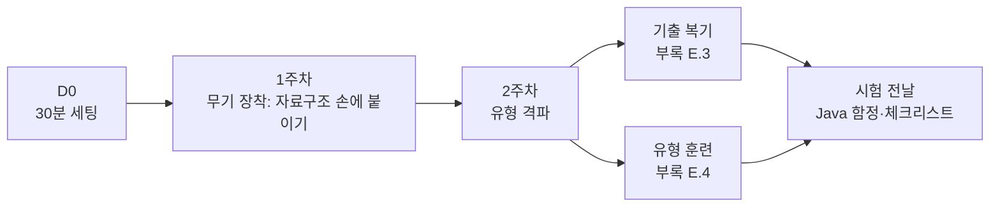

# 부록 E 면접과 코딩테스트 · E.2 코딩테스트 2주 압축

> 부록

## 들어가며

Java·HackerRank 기준의 2주 압축 로드맵과, 기출 복기·유형 훈련 노트를 어떻게 쓰는지에 대한 안내다.


### 한눈에 보기



> 2주 로드맵의 흐름이다. 시작 전 30분 세팅, 1주차에 자료구조를 손에 붙이고, 2주차에 유형을 격파한다. 그다음 기출 복기(E.3)와 유형 훈련(E.4)으로 다지고, 시험 전날에는 Java 함정과 체크리스트만 다시 본다.

---

## 코딩테스트 2주 압축 로드맵 (Java · HackerRank 기준)

> 대상: 배열·정렬까지는 아는 기초 수준 / 목표: 코딩테스트 통과 실력 + 기본기 재정비
> 기준 플랫폼: HackerRank · 언어: Java
> 관련: [학습 로드맵](c1-big-picture.md) · [백엔드 심화 로드맵](e1-roadmap-and-explain.md) · [자바로 보는 자료구조](../part1/ch04-1-data-structures-and-hashmap.md) · [Q&A 자료구조·알고리즘](../part1/ch04-3-floating-point.md) · [Java 타입/박싱](a1-java.md)

---

### 0. import 써도 되나?

**써도 됩니다. 제한 없습니다.**

- HackerRank 실행환경은 표준 라이브러리 import를 전부 허용합니다.
- 오히려 HackerRank가 제공하는 Java 문제 **보일러플레이트 자체가** 이렇게 시작합니다:

```java
import java.io.*;
import java.util.*;
import java.util.stream.*;

public class Solution {
    public static void main(String[] args) throws IOException {
        // ...
    }
}
```

- `java.util.*`(List, Map, Set, Deque, PriorityQueue, Arrays, Collections), `java.io.*`, `java.util.stream.*` 모두 정상 사용 가능
- 외부 라이브러리(Gson, Apache Commons 등)도 일부 사전설치되어 있지만 **알고리즘 문제에서는 쓸 일 없습니다**

**"순수 Java"의 실전적 의미는 이것입니다:**

| 구분 | 판단 |
|---|---|
| `java.util` 자료구조 사용 | ✅ 당연히 사용. 안 쓰면 오히려 시간 낭비 |
| `Arrays.sort()`, `Collections.sort()` | ✅ 사용. 정렬을 직접 구현하는 건 학습용일 때만 |
| 자료구조 직접 구현(LinkedList, Stack 등) | ⚠️ **학습 목적일 때 1회만**. 실전에서는 내장 사용 |
| 외부 라이브러리 | ❌ 알고리즘 문제엔 불필요 |

> **결론: import 걱정 말고, 대신 `java.util`을 무기로 쓸 줄 아는 데 시간을 쓰세요.** 그게 이 로드맵 1주차의 핵심입니다.

#### 언어 버전 선택

| 버전 | 메모리 | 권장도 |
|---|---|---|
| Java 8 (OpenJDK 8) | 512MB | **기본 권장** — 모든 문제 보일러플레이트가 이 기준 |
| Java 15 / 17 / 21 | 2048MB (17/21) | `var`, record 쓰고 싶거나 메모리 빡셀 때 |

시간 제한은 전 버전 공통 **4초**입니다. 넉넉해 보이지만 `Scanner`를 쓰면 이게 모자랍니다(→ 아래 D0 참조).

---

### D0. 시작 전 30분 세팅 (건너뛰지 말 것)

#### ① 입출력 템플릿 하나 외우기

`Scanner`는 대용량 입력에서 **10배 이상 느립니다**. 시간초과의 가장 흔한 원인입니다.

```java
import java.io.*;
import java.util.*;

public class Solution {
    public static void main(String[] args) throws IOException {
        BufferedReader br = new BufferedReader(new InputStreamReader(System.in));
        StringBuilder sb = new StringBuilder();

        int n = Integer.parseInt(br.readLine().trim());

        StringTokenizer st = new StringTokenizer(br.readLine());
        int[] a = new int[n];
        for (int i = 0; i < n; i++) a[i] = Integer.parseInt(st.nextToken());

        // ... 풀이 ...

        sb.append(answer).append('\n');
        System.out.print(sb);   // 출력도 모아서 한 번에
    }
}
```

**검증**:이 템플릿을 보지 않고 3분 안에 타이핑할 수 있으면 통과.

#### ② 시간복잡도 감각 (4초 / 1억 연산 기준)

| n 범위 | 허용 복잡도 | 떠올릴 것 |
|---|---|---|
| n ≤ 20 | O(2ⁿ), O(n!) | 완전탐색, 백트래킹 |
| n ≤ 1,000 | O(n²) | 2중 반복문 OK |
| n ≤ 100,000 | O(n log n) | 정렬, 이분탐색, 우선순위큐 |
| n ≤ 1,000,000 | O(n) | 해시맵, 투포인터, 누적합 |

**검증:** 문제를 읽고 제약조건 n을 본 순간, 코드 짜기 전에 "이건 O(n log n)이어야 한다"가 먼저 나오면 통과.

---

### 1주차 — 무기 장착 (자료구조를 손에 붙이기)

#### D1. Java 자료구조 매핑표 암기 + 배열 워밍업

**핵심: "이 문제엔 뭘 쓰지?"를 고민하는 시간을 0으로 만든다.**

| 필요한 것 | Java 클래스 | 핵심 메서드 |
|---|---|---|
| 가변 배열 | `ArrayList<Integer>` | `add / get / size / remove(idx)` |
| 중복 제거·존재 확인 | `HashSet<Integer>` | `add / contains / remove` |
| 개수 세기·매핑 | `HashMap<K,V>` | `put / get / getOrDefault / merge` |
| 스택 | `ArrayDeque<Integer>` | `push / pop / peek` |
| 큐 (BFS) | `ArrayDeque<Integer>` | `offer / poll / peek` |
| 최소/최대 힙 | `PriorityQueue<Integer>` | `offer / poll / peek` |
| 정렬된 맵/셋 | `TreeMap` / `TreeSet` | `firstKey / floorKey / ceilingKey` |

> ⚠️ `Stack`, `Vector`는 레거시(동기화 오버헤드). **`ArrayDeque`로 통일하세요.**

**개수 세기 관용구 — 이건 통째로 외웁니다:**
```java
map.put(x, map.getOrDefault(x, 0) + 1);   // 또는
map.merge(x, 1, Integer::sum);
```

**문제 (Warm-up):** Sock Merchant / Counting Valleys / Repeated String / Jumping on the Clouds

**검증:** 4문제 모두 통과 + 각 문제에서 쓴 자료구조를 한 줄로 설명 가능

---

#### D2. 해시맵 집중 (코딩테스트 최빈출 1위)

O(n²) 완전탐색을 O(n)으로 바꾸는 기술. **"이미 본 것을 기억한다"** 패턴.

```java
// Two Sum 패턴 — 이 형태를 뼈대로 기억
Map<Integer, Integer> seen = new HashMap<>();
for (int i = 0; i < n; i++) {
    int need = target - a[i];
    if (seen.containsKey(need)) return new int[]{seen.get(need), i};
    seen.put(a[i], i);
}
```

**문제:** Hash Tables: Ransom Note / Two Strings / Sherlock and Anagrams / Frequency Queries

**검증:** Frequency Queries를 시간초과 없이 통과 (여기서 `HashMap` 두 개를 동시에 굴리는 감이 잡힙니다)

---

#### D3. 정렬 + Comparator (Java 특화 함정 구간)

라이브러리 정렬을 **쓰는 법**이 핵심입니다. 직접 구현은 D3 마지막 30분에 버블/머지 한 번씩만.

```java
// 1) 객체 정렬
Arrays.sort(arr, (x, y) -> x.price - y.price);              // 오버플로 위험!
Arrays.sort(arr, Comparator.comparingInt(o -> o.price));    // 이게 안전

// 2) 다중 기준 (1순위 점수 내림차순, 2순위 이름 오름차순)
list.sort(Comparator.comparingInt(P::getScore).reversed()
                    .thenComparing(P::getName));

// 3) int[] 내림차순은 안 됩니다 → Integer[]로 박싱하거나 정렬 후 뒤집기
Integer[] boxed = Arrays.stream(a).boxed().toArray(Integer[]::new);
Arrays.sort(boxed, Comparator.reverseOrder());
```

> ⚠️ **`Arrays.sort(int[], Comparator)` 오버로드는 존재하지 않습니다.** 기초 단계에서 가장 많이 막히는 지점입니다.

**문제:** Sorting: Comparator / Mark and Toys / Fraudulent Activity Notifications

**검증:** Comparator를 람다로 즉석에서 작성 가능 + 다중 기준 정렬을 검색 없이 작성

---

#### D4. 문자열 처리

```java
String s = "abc";
char c = s.charAt(0);
int idx = c - 'a';                    // 알파벳 → 0~25 인덱스
char[] cs = s.toCharArray();
Arrays.sort(cs);
String sorted = new String(cs);       // 애너그램 판별 관용구
```

> ⚠️ 반복문 안에서 `s += x` **금지**. O(n²)가 됩니다. → 반드시 `StringBuilder.append()`

**문제:** Strings: Making Anagrams / Alternating Characters / Sherlock and the Valid String

**검증:** 문자 빈도수를 `int[26]`으로 세는 코드를 즉시 작성

---

#### D5. 스택 · 큐

```java
Deque<Character> stack = new ArrayDeque<>();
stack.push(c);  stack.pop();  stack.peek();  stack.isEmpty();

Deque<int[]> queue = new ArrayDeque<>();
queue.offer(new int[]{r, c});  int[] cur = queue.poll();
```

**문제:** Balanced Brackets / Equal Stacks / Min Max Riddle(도전)

**검증:** Balanced Brackets를 15분 안에 통과

---

#### D6. 완전탐색 · 재귀 · 백트래킹

```java
void dfs(int depth, ...) {
    if (depth == n) { /* 정답 처리 */ return; }
    for (int i = 0; i < k; i++) {
        if (visited[i]) continue;
        visited[i] = true;
        dfs(depth + 1, ...);
        visited[i] = false;     // ← 되돌리기. 빠뜨리면 전부 틀립니다
    }
}
```

**문제:** Recursion: Fibonacci Numbers / Recursion: Davis' Staircase / Recursive Digit Sum

**검증:** 재귀 함수의 종료조건과 되돌리기 위치를 스스로 설명 가능

---

#### D7. 1주차 복습 — 새 문제 금지

- D1~D6에서 **틀렸거나 검색해서 푼 문제만** 다시 풉니다
- 오답노트 작성: `문제명 | 왜 틀렸나 | 어떤 패턴이었나` 한 줄씩

**검증:** 재도전 문제를 검색 없이 전부 통과

---

### 2주차 — 유형 격파

#### D8. 투포인터 · 슬라이딩 윈도우 · 누적합

O(n²) → O(n) 전환의 두 번째 무기.

```java
// 누적합: 구간 [l, r] 합을 O(1)로
long[] pre = new long[n + 1];
for (int i = 0; i < n; i++) pre[i + 1] = pre[i] + a[i];
long sum = pre[r + 1] - pre[l];
```

> ⚠️ 합계는 **거의 항상 `long`**. `int` 누적합은 10만 개만 넘어도 터집니다.

**문제:** Minimum Absolute Difference in an Array / Array Manipulation(누적합 핵심)

**검증:** Array Manipulation을 O(n) 누적합으로 통과 (O(n²)면 시간초과)

---

#### D9. 이분탐색

```java
// 값 탐색
int idx = Arrays.binarySearch(a, key);   // 없으면 음수 반환

// 매개변수 탐색(파라메트릭) — 실전은 이쪽이 더 많이 나옵니다
long lo = 1, hi = MAX;
while (lo < hi) {
    long mid = lo + (hi - lo) / 2;       // (lo+hi)/2는 오버플로 위험
    if (possible(mid)) hi = mid;
    else lo = mid + 1;
}
// lo == hi == 답
```

**문제:** Hash Tables: Ice Cream Parlor / Minimum Time Required(파라메트릭)

**검증:** "최소 ~를 구하라 + 판정 함수가 만들어진다" → 이분탐색을 떠올리면 통과

---

#### D10. 그리디

정렬 후 앞에서부터 취하는 패턴이 대부분. **왜 그리디가 성립하는지 한 줄로 설명할 수 있어야** 합니다.

**문제:** Luck Balance / Greedy Florist / Max Min

**검증:** 각 문제에서 "무엇을 기준으로 정렬했고 왜 그게 최적인가"를 설명

---

#### D11~D12. 그래프 (BFS/DFS) — 2일 배정

2주 코스에서 **가장 배점이 높은 구간**입니다.

```java
// 2차원 격자 BFS 표준형
int[] dr = {-1, 1, 0, 0}, dc = {0, 0, -1, 1};
Deque<int[]> q = new ArrayDeque<>();
boolean[][] vis = new boolean[R][C];
q.offer(new int[]{sr, sc});  vis[sr][sc] = true;

while (!q.isEmpty()) {
    int[] cur = q.poll();
    for (int d = 0; d < 4; d++) {
        int nr = cur[0] + dr[d], nc = cur[1] + dc[d];
        if (nr < 0 || nr >= R || nc < 0 || nc >= C) continue;
        if (vis[nr][nc] || grid[nr][nc] == 0) continue;
        vis[nr][nc] = true;
        q.offer(new int[]{nr, nc});
    }
}
```

> ⚠️ **방문 체크는 큐에 넣을 때** 합니다. 꺼낼 때 하면 중복 삽입으로 터집니다.

- **D11:** 격자 BFS/DFS → DFS: Connected Cell in a Grid / Find the nearest clone
- **D12:** 인접리스트 그래프 → BFS: Shortest Reach in a Graph / Roads and Libraries

**검증:** 격자 BFS 템플릿을 빈 화면에서 10분 안에 작성

---

#### D13. DP 입문 (욕심내지 않기)

2주 코스에서는 **1차원 DP까지만** 확실히 합니다.

```java
// 점화식 세우는 순서: ① dp[i]가 뭘 뜻하는지 한 문장 ② 이전 상태에서 오는 경로 ③ 초기값
int[] dp = new int[n + 1];
dp[0] = 1; dp[1] = 1;
for (int i = 2; i <= n; i++) dp[i] = dp[i-1] + dp[i-2];
```

**문제:** Max Array Sum / Candies

**검증:** `dp[i]`의 정의를 말로 먼저 쓰고 나서 코드를 짜는 습관이 붙으면 통과

---

#### D14. 실전 모의 + 최종 점검

- 90분 타이머 켜고 **처음 보는 문제 3개** (Easy 1 + Medium 2)
- 끝나고 아래 체크리스트 자가진단

---

### 1.5 실전 기출 복기 🔎

실제 시험에서 만난 문제(기출)와 같은 급의 훈련 문제를 **"🤔 생각 → 📖 읽기 → ✅ 확인" 순서로 추론부터 재구성**한 노트. 답을 외우는 게 아니라 **문제를 봤을 때 무엇에 주목하는지**를 연습하는 용도다.

> **수준 기준선**: 실전에서 만난 문제들이 **HackerRank Medium ≈ 기업 코테 3문제 세트의 2번 문제(중)** 급으로 확인됨. 앞으로 훈련 문제도 **이 급으로 통일해서 추가**한다 (1번 워밍업 급은 시간 낭비, 3번 급은 당락 기여도 낮음 — 2번이 합격선이다).

| 노트 | 유형 | 난이도 (HackerRank / 기업) | 핵심 한 줄 |
|---|---|---|---|
| [이진 문자열 조합 개수](e3-past-problems.md) ★기출 | Distinct Subsequences DP | Medium / 2번(중~중상) | 마지막 글자로 분류 + **덮어쓰기 = 중복 제거**. 4형제 판별표 포함 |
| [REST API 페이지네이션](e3-past-problems.md) ★기출 | HTTP + 집계(max / 그룹 합산) | Intermediate 인증 / 1~2번(하~중) | **첫 응답은 데이터가 아니라 지도(total_pages)**. 국가별 합산-argmax 변형 포함 |
| [Sherlock and Anagrams](e3-past-problems.md) | 해시 그룹핑 + 조합 공식 | Medium / 2번(중) | 쌍을 세지 말고 **정규화 키로 묶어 c(c-1)/2**. 기출 1번과 같은 "결과로 세기" 사고 |
| [중복 없는 최장 부분문자열](e3-past-problems.md) | 슬라이딩 윈도우 | Medium / 1~2번(중) | 불변식 유지 + **`left = max(left, last+1)` 후퇴 금지**. D8 유형의 관문 |
| [격자 BFS/DFS](e4-pattern-drills.md) | 탐색 (flood fill·최단) | Medium / 2번(중) | 덩어리=아무거나, **최단=BFS 고정**, 방문 표시는 넣을 때 |
| [파라메트릭 이분탐색](e4-pattern-drills.md) | 판정+이분탐색 | Medium / 2번(중~중상) | **"계산하지 말고 검증하라"** — D9 실전판 |
| [우선순위 큐(힙)](e4-pattern-drills.md) | 힙 | Medium / 2번 | "매번 최솟값" 신호 — 반복문 속 sort 충동 |
| [그리디 교환 논증](e4-pattern-drills.md) | 정렬+증명 | Medium / 2번 | 회의실=끝나는 순 — D10 실전판 |
| [누적합+해시](e4-pattern-drills.md) | prefix+Map | Medium / 2번 | 음수면 윈도우 사망 → `pre−K` 조회 |
| [DP 테이블 (배낭)](e4-pattern-drills.md) | 최적화 DP | Medium / 2번 | 상태를 말로 먼저 · 0/1은 역순 — D13 실전판 |
| [Union-Find](e4-pattern-drills.md) · [스택 시뮬](e4-pattern-drills.md) · [문자열 구현](e4-pattern-drills.md) | 대비용 3종 | Lv1~3 | 전체 목록·판별 지도는 [기출 폴더 README](e2-coding-test-2week.md) |

---

### 2. Java 특화 함정 모음 (시험 전날 이것만 다시 보기)

| # | 함정 | 대응 |
|---|---|---|
| 1 | `Scanner` 시간초과 | `BufferedReader` + `StringTokenizer` |
| 2 | `int` 오버플로 (10⁹ 초과) | 합계·곱셈은 `long` |
| 3 | `Integer` 비교에 `==` | `.equals()` 또는 `intValue()` (−128~127만 캐시됨) |
| 4 | `Arrays.sort(int[], cmp)` 없음 | `Integer[]`로 박싱 |
| 5 | 반복문 안 `String +=` | `StringBuilder` |
| 6 | `(lo+hi)/2` 오버플로 | `lo + (hi-lo)/2` |
| 7 | `list.remove(int)` vs `remove(Object)` | 값 삭제는 `remove(Integer.valueOf(x))` |
| 8 | 2차원 배열 `Arrays.fill` 안 먹힘 | 행마다 `for` 돌며 fill |
| 9 | BFS 방문체크 위치 | 큐에 **넣을 때** 체크 |
| 10 | `Stack` / `Vector` 사용 | `ArrayDeque` |

---

### 3. 최종 자가진단 체크리스트

시험 전 아래에 전부 ✅면 준비 완료입니다.

- [ ] BufferedReader 입출력 템플릿을 3분 안에 작성
- [ ] 제약조건 n을 보고 목표 복잡도를 먼저 말할 수 있음
- [ ] HashMap 개수 세기 관용구를 검색 없이 작성
- [ ] Comparator 다중 기준 정렬을 검색 없이 작성
- [ ] 격자 BFS 템플릿을 빈 화면에서 10분 안에 작성
- [ ] 이분탐색(파라메트릭) 틀을 검색 없이 작성
- [ ] `dp[i]`의 정의를 말로 먼저 쓰고 코드를 짬
- [ ] 위 함정 10개를 보고 각각 대응책이 바로 나옴

---

### 4. 운영 원칙

1. **하루 2~3문제.** 5문제 대충보다 2문제 완전이해가 낫습니다.
2. **30분 막히면 답을 봅니다.** 대신 답을 본 문제는 **다음 날 반드시 다시** 풉니다.
3. **오답노트는 코드가 아니라 패턴을 적습니다.** "정렬 후 투포인터" 한 줄이 코드 50줄보다 오래 갑니다.
4. **직접 구현은 학습용 1회.** 실전에서는 `java.util`을 씁니다. (→ 0장 결론)

---

#### 참고

- 문제명은 HackerRank *Interview Preparation Kit* 기준입니다. 사이트에서 제목으로 검색하면 찾을 수 있고, 개편으로 일부 명칭이 바뀌었을 수 있습니다.
- 실행환경 사양 출처: HackerRank Execution Environment 문서

---

## 🧪 코딩테스트 기출 복기 & 유형 훈련

> GitHub에서 이 폴더를 열면 보이는 인덱스. 상위 계획은 [코딩테스트 2주 로드맵](e2-coding-test-2week.md).
> 모든 노트는 답을 먼저 보여주지 않고 **🤔 생각(멈춰서 스스로) → 📖 읽기(접힌 추론을 열어서) → ✅ 확인(손 검증)** 순서로 진행된다 — 풀이 암기가 아니라 **문제를 봤을 때 무엇에 주목하는지**를 훈련하는 형식.

### 수준 기준선

실전 기출이 **HackerRank Medium ≈ 기업 코테 3문제 세트의 2번 문제(중)** 급으로 확인됨. 이 폴더의 훈련 문제는 전부 이 급으로 통일한다 — **2번 문제가 합격선**이다 (1번 워밍업 급은 시간 대비 이득이 없고, 3번 급은 당락 기여도가 낮다).

척도 환산: **프로그래머스 Lv2 ≈ HackerRank Medium ≈ 기업 2번** (Lv1=Easy=1번, Lv3=Hard=3번). 즉 이 폴더의 목표 대역은 **프로그래머스 Lv2 ~ Lv3 초입**이다.

### 노트 목록

| # | 노트 | 유형 | 난이도 (HackerRank / 기업) | 핵심 한 줄 |
|---|---|---|---|---|
| 1 | [이진 문자열 조합 개수](e3-past-problems.md) ★기출 | Distinct Subsequences DP | Medium / 2번(중~중상) | 마지막 글자로 분류 + **덮어쓰기 = 중복 제거**. 겉모습 같은 4형제 판별표 포함 |
| 2 | [REST API 페이지네이션](e3-past-problems.md) ★기출 | HTTP + 집계(max/그룹 합산) | Intermediate 인증 / 1~2번(하~중) | **첫 응답은 데이터가 아니라 지도(total_pages)**. 국가별 합산-argmax 변형 포함 |
| 3 | [Sherlock and Anagrams](e3-past-problems.md) | 해시 그룹핑 + 조합 공식 | Medium / 2번(중) | 쌍을 세지 말고 **정규화 키로 묶어 c(c-1)/2** |
| 4 | [중복 없는 최장 부분문자열](e3-past-problems.md) | 슬라이딩 윈도우 | Medium / 1~2번(중) | 불변식 유지 + `left = max(left, last+1)` **후퇴 금지** |
| 5 | [격자 BFS/DFS](e4-pattern-drills.md) | 탐색 (flood fill·최단) | Lv2 / 2번(중) | 덩어리 세기=아무거나, **최단=BFS 고정** · 방문 표시는 **넣을 때** |
| 6 | [파라메트릭 이분탐색](e4-pattern-drills.md) | 판정 함수 + 이분탐색 | Lv2~3 / 2번(중~중상) | **"계산하지 말고 검증하라"** — 정렬된 건 배열이 아니라 ✗✗✓✓ 경계 |
| 7 | [우선순위 큐(힙)](e4-pattern-drills.md) | 힙 | Lv2 / 2번(중) | "매번 최솟값" = 힙 · 반복문 속 sort 충동이 판별 신호 |
| 8 | [그리디 교환 논증](e4-pattern-drills.md) | 정렬 + 증명 | Lv2 / 2번(중) | 회의실=**끝나는 순** · "바꿔치기해도 안 나빠진다" 한 줄 증명 |
| 9 | [누적합+해시](e4-pattern-drills.md) | prefix + HashMap | Lv2 / 2번(중) | **음수 섞이면 윈도우 사망** → `pre−K` 과거 조회 · `{0:1}` 초기값 |
| 10 | [DP 테이블 (배낭)](e4-pattern-drills.md) | 최적화 DP | Lv2~3 / 2번(중~중상) | 상태를 **말로 먼저** · 0/1 배낭 **역순**, 완전 배낭 정순 |
| 11 | [Union-Find](e4-pattern-drills.md) | 대표 관리 | Lv2~3 / 2~3번 | **자라나는 그래프** 질의 = UF · 경로압축 대입 필수 |
| 12 | [스택 시뮬레이션](e4-pattern-drills.md) | 최근성 짝짓기 | Lv1~2 / 1~2번 | "지우면 양옆이 만난다" = 스택 O(n) · 빈 스택/잔여 검사 |
| 13 | [카카오식 문자열 구현](e4-pattern-drills.md) | 명세 옮기기 | Lv1~2 / 1~2번 | 지문 길고 입력 작으면 **명세:함수=1:1** + 중간값 대조 |
| 📋 | [org.json 치트시트](e3-past-problems.md) | 암기용 API 표면 | — (시험 전날 복습) | **7줄 최소 세트** + get vs opt + 예외 3종 디버깅 순서 |

### 사고 연결 지도

노트들이 공유하는 사고 패턴 — 새 문제를 만나면 이 중 어느 것인지부터 판별:

- **"나열하지 말고 세라"** — 결과가 지수적으로 많으면 분류 기준을 잡아 개수만 굴린다 (1번: 마지막 글자 / 3번: 정규화 키)
- **"순회 중엔 모으고, 끝나고 판단하라"** — 최종 승자를 중간에 알 수 없으면 Map에 누적 후 argmax (2번 §3.5 / 3번)
- **"불변식을 유지하며 밀어라"** — 연속 구간 최장/최단은 창의 조건을 매 턴 복구 (4번)

### NotebookLM에 넣기 (Raw 링크 — 복사해서 소스 추가)

```
https://raw.githubusercontent.com/mgj96/study-repo/main/study/coding-test-2week.md
https://raw.githubusercontent.com/mgj96/study-repo/main/study/coding-test/binary-distinct-combinations.md
https://raw.githubusercontent.com/mgj96/study-repo/main/study/coding-test/rest-api-pagination.md
https://raw.githubusercontent.com/mgj96/study-repo/main/study/coding-test/sherlock-and-anagrams.md
https://raw.githubusercontent.com/mgj96/study-repo/main/study/coding-test/longest-unique-substring.md
https://raw.githubusercontent.com/mgj96/study-repo/main/study/coding-test/grid-bfs-dfs.md
https://raw.githubusercontent.com/mgj96/study-repo/main/study/coding-test/parametric-binary-search.md
https://raw.githubusercontent.com/mgj96/study-repo/main/study/coding-test/priority-queue-heap.md
https://raw.githubusercontent.com/mgj96/study-repo/main/study/coding-test/greedy-exchange-argument.md
https://raw.githubusercontent.com/mgj96/study-repo/main/study/coding-test/prefix-sum-hashmap.md
https://raw.githubusercontent.com/mgj96/study-repo/main/study/coding-test/dp-table-knapsack.md
https://raw.githubusercontent.com/mgj96/study-repo/main/study/coding-test/union-find.md
https://raw.githubusercontent.com/mgj96/study-repo/main/study/coding-test/stack-simulation.md
https://raw.githubusercontent.com/mgj96/study-repo/main/study/coding-test/string-implementation.md
https://raw.githubusercontent.com/mgj96/study-repo/main/study/coding-test/org-json-cheatsheet.md
```

추천 프롬프트: *"각 노트의 🤔 생각 질문만 뽑아 퀴즈로 내고, 내 답과 📖 추론을 비교해줘"* — 노트 형식이 그대로 문답 훈련이 된다.

### 딥다이브 백로그 (우선순위순 · 전부 2번 문제 급)

커버리지 진단으로 뽑은 다음 드릴 후보. 위에서부터 순서대로 작성한다:

| # | 유형 | 대표 문제 | 왜 이 순서인가 |
|---|---|---|---|
**✅ 백로그 1~9 전부 작성 완료 (2026-08-31)** — 위 노트 목록 5~13번이 그 결과물이다. 이로써 **기업 2번 문제 대역의 주요 유형이 전부 드릴로 커버**됐다.

다음 후보(필요 시): 단조 스택(히스토그램·오큰수, 3번 급) · 다익스트라(가중치 최단, 3번 급) · LIS/편집거리(DP 확장) — 2번 대역을 졸업할 때 추가한다.

> 형식은 고정(🤔 생각 → 📖 읽기 → ✅ 확인). 각 드릴은 "**이 유형임을 알아채는 지문 신호**"를 0단계에 반드시 포함한다 — 풀이보다 판별이 먼저다.

### 새 노트 추가 규칙

1. 실전에서 만난 문제는 **★기출** 표시, 훈련용은 표시 없음 — 전부 2번 문제 급 유지
2. 형식 고정: 0단계 판별 → 🤔/📖(details 접기)/✅ 단계들 → 결론 코드(Java) → 손 추적 표 → 함정 체크리스트 → 3단 요약
3. 추가 시 이 README 표 + [로드맵 §1.5](e2-coding-test-2week.md) 표 + NotebookLM 소스 목록에 한 줄씩 등록

---

## 다음으로

실제 시험에 나온 문제들을 E.3에서 복기한다.

👉 [부록 E 면접과 코딩테스트 · E.3 기출 복기와 치트시트](e3-past-problems.md)
