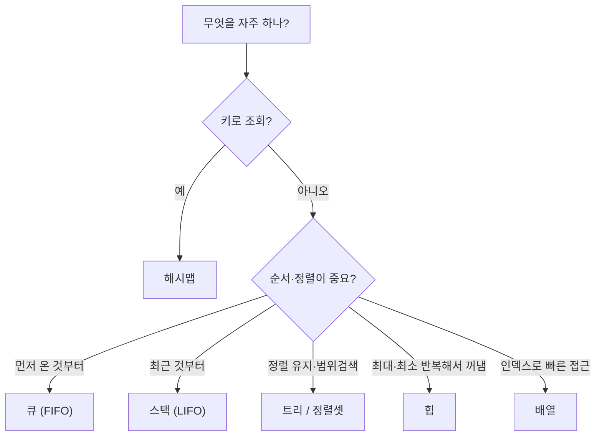
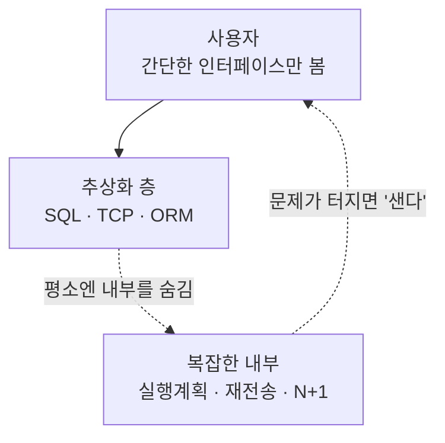

# 1장 추상화와 복잡도

> 1부 컴퓨터가 일하는 방식

## 들어가며

구조를 바꾸는 판단은 결국 "비용을 어디서 치르나"의 문제다. 이 장은 그 비용을 재는 첫 번째 자, Big-O와 추상화를 다룬다. 알고리즘을 어떻게 추론하는지, 자료구조를 무엇으로 고르는지, 추상화가 무엇을 감추고 무엇을 비싸게 만드는지, 그리고 컴퓨터가 실제로 어떻게 돌아가는지까지 한 번에 훑는다.

---

## CS 사고법: 알고리즘 추론 · 자료구조 선택 · 추상화의 명암

> **목적**: "언제 어떤 자료구조/변수를 쓸지" 추론하는 힘 + **추상화의 강점과 약점**을 균형 있게 이해.
> **관점**: 추상화는 강력하지만 공짜가 아니다. 강점과 한계를 함께 말할 수 있어야 한다. (→ trade-off 사고)
> **관련**: [C.1 큰 그림](../appendix/c1-big-picture.md) · [E.1 역량 로드맵·코드 설명법](../appendix/e1-roadmap-and-explain.md)

---

### 0. 큰 그림 — 왜 어떤 코드는 1초, 어떤 코드는 10분일까

똑같은 결과를 내는 두 프로그램인데, 하나는 눈 깜짝할 새 끝나고 하나는 몇 분을 잡아먹는다. 대개 그 차이는 **어떤 자료구조·알고리즘을 골랐는가**에서 갈린다.

좋은 개발자는 코드를 "돌아가게" 짜는 걸 넘어 **"왜 이 자료구조를, 왜 이 방식으로"**를 추론한다. 그 추론의 두 축이 (1) **효율성 분석(Big-O)** 과 (2) **자료구조·변수 선택**이다. 그리고 이 모든 걸 편하게 해주는 게 **추상화**인데 — 추상화는 복잡도를 숨겨 생산성을 주지만, **"모든 비자명한 추상화는 샌다(leaky)"**. 그래서 강점과 약점을 같이 알아야 한다.

---

## 1부. 알고리즘 추론 — Big-O

### 1. Big-O란

**Big-O 표기**: 입력 크기 n이 커질 때 **연산 횟수(또는 메모리)가 얼마나 빨리 증가하는가**를 나타내는 척도. 실제 시간(초)이 아니라 **증가율(scale)**을 본다.

- 왜: n=10에선 다 빠르다. **n=100만일 때 누가 살아남나**를 보려는 것.
- 보통 **최악의 경우(worst case)**를 기준으로 말한다.

### 2. 자주 나오는 복잡도 (빠른 순)

| 표기 | 이름 | 예 | 체감 |
|------|------|-----|------|
| O(1) | 상수 | 해시맵 조회, 배열 인덱스 접근 | 항상 즉시 |
| O(log n) | 로그 | 이진 탐색, 균형 트리 | 매우 좋음 |
| O(n) | 선형 | 배열 전체 순회 | 무난 |
| O(n log n) | 선형로그 | 좋은 정렬(병합·퀵) | 정렬의 현실적 한계 |
| O(n²) | 제곱 | 이중 반복(버블 정렬) | n 커지면 위험 |
| O(2ⁿ)·O(n!) | 지수·팩토리얼 | 완전탐색, 순열 | 사실상 사용 불가 |

### 3. 추론하는 법
- **입력 크기 n을 먼저 정의**한다(배열 길이? 사용자 수?).
- **반복이 몇 겹인가**: 한 겹 O(n), 두 겹 중첩 O(n²).
- **반씩 줄어드나**: 이진 탐색·분할정복 → O(log n) 요소.
- **공간복잡도도** 같이: 속도를 위해 메모리를 더 쓰는 trade-off(예: 캐싱).

**핵심 요약**: Big-O = 입력이 커질 때의 증가율. 반복 겹수·분할 여부로 추론하고, 최악의 경우로 말한다.

`참조`: [Big-O Cheat Sheet](https://www.bigocheatsheet.com/) · [위키백과: 점근 표기법](https://ko.wikipedia.org/wiki/점근_표기법)

---

## 2부. 언제 어떤 자료구조·변수를 쓸까

### 4. 자료구조 선택 가이드

접근 패턴이 선택을 결정한다. "무엇을 자주 하는가?"를 먼저 물어라.

| 자료구조 | 강점(빠른 연산) | 약점 | 언제 쓰나 |
|----------|------------------|------|-----------|
| **배열(Array)** | 인덱스 접근 O(1) | 중간 삽입·삭제 O(n), 크기 고정 | 개수·접근 패턴이 정해져 있을 때 |
| **동적 배열/리스트** | 끝 추가 분할상환 O(1) | 중간 삽입 O(n) | 순서 있는 가변 목록 |
| **연결 리스트** | 앞/중간 삽입·삭제 O(1) | 조회 O(n), 캐시 비효율 | 앞쪽 삽입·삭제 잦을 때 |
| **해시맵/셋** | 조회·삽입·삭제 평균 O(1) | 순서 없음, 최악 O(n), 메모리↑ | **키로 빠른 조회**, 중복 제거 |
| **스택(LIFO)** | push/pop O(1) | 임의 접근 불가 | 되돌리기, 재귀·괄호 검사 |
| **큐(FIFO)** | enqueue/dequeue O(1) | 임의 접근 불가 | 순서 처리, BFS, 작업 대기열 |
| **트리(균형 BST)** | 정렬 유지 + 탐색 O(log n) | 구현 복잡 | **정렬 상태 유지 + 범위 검색** |
| **힙(Heap)** | 최소/최대 O(1) 조회 | 전체 정렬은 아님 | 우선순위 큐, top-K |

> 💧 각 구조가 **숨긴 진짜 비용(겉보기 O(1) 함정)** 과 Java 클래스·import는 → [4.1 자료구조와 HashMap](ch04-1-data-structures-and-hashmap.md). "새는 추상화"(7장)의 실제 예.

**빠른 판단 규칙**
- "키로 조회가 잦다" → **해시맵**
- "순서대로 처리" → **큐**, "최근 것부터" → **스택**
- "정렬을 유지하며 삽입·범위검색" → **트리/정렬셋**
- "가장 큰/작은 것 반복해서 꺼냄" → **힙**
- "인덱스로 빠르게 접근, 크기 안정" → **배열**

**결정 트리로 한눈에**



*(도식 설명: '무엇을 자주 하나'로 갈라진다 — 키로 조회면 해시맵, 순서 처리면 큐/스택, 정렬·범위검색이면 트리, 최대·최소 반복이면 힙, 인덱스 접근이면 배열을 고른다.)*

> ☕ **자바 클래스·import 매핑**(`ArrayList`·`HashMap`·`ArrayDeque` + import 문)은 → [4.1 자료구조와 HashMap](ch04-1-data-structures-and-hashmap.md).

### 5. 변수·원시 타입 선택 (언제 어떤 타입)

- **정수 크기**: 값 범위가 크면 `int`(약 21억)로 부족 → `long`. **오버플로**는 흔한 버그.
- **실수 정밀도**: `float`/`double`은 **근사값** → 돈 계산엔 부적합, `BigDecimal`(Java) 같은 정밀 타입.
- **불변 vs 가변**: 불변(immutable)은 안전·동시성에 유리, 가변은 성능. (예: Java `String` 불변)
- **널 가능성**: null을 허용할지 → `Optional` 등으로 명시하면 NPE 예방.
- **선택 기준**: "이 변수가 가질 수 있는 값의 **범위·정밀도·불변성·null 여부**"를 먼저 생각.

**핵심 요약**: 자료구조·타입은 "무슨 연산이 잦은가 + 값의 범위·정밀도"로 고른다. 접근 패턴이 자료구조를, 값의 성질이 타입을 결정한다.

`참조`: [Big-O Cheat Sheet – Data Structures](https://www.bigocheatsheet.com/) · [HackerEarth – Big-O & 자료구조](https://www.hackerearth.com/practice/notes/big-o-cheatsheet-series-data-structures-and-algorithms-with-thier-complexities-1/)

---

## 3부. 추상화의 강점과 약점

### 6. 추상화의 강점

**추상화(abstraction)**: 복잡한 내부를 숨기고 **핵심 인터페이스만** 노출하는 것. (예: `list.sort()` 하나로 정렬 — 내부 알고리즘은 몰라도 됨)

| 강점 | 설명 |
|------|------|
| **복잡도 관리** | 세부를 숨겨 큰 그림에 집중 |
| **생산성** | 매번 바닥부터 안 짜도 됨(라이브러리·API) |
| **재사용·협업** | 인터페이스만 맞추면 팀이 병렬 작업 |
| **변경 격리** | 내부 구현을 바꿔도 사용부는 그대로 |

→ 시스템이 복잡할수록 추상화에 **더 의존**할 수밖에 없다.

#### 왜 복잡할수록 더 의존하나 (이유)
취향이 아니라 **뇌의 한계 + 구조적 폭발** 때문에 불가피하다.

1. **작업기억 한계(7±2)**: 사람이 동시에 머리에 올릴 수 있는 "덩어리"는 몇 개뿐. 부품이 많을수록 세부를 **한 개념으로 압축**해야 담긴다. (`list.sort()` = 정렬을 1덩어리로)
2. **상호작용은 N² 폭발**: 부품 N개면 얽힘은 약 N². 캡슐화로 내부를 숨겨 **따져야 할 얽힘을 잘라야** 한다.
3. **층(layer) 위에 서기**: `HashMap`·TCP·JVM·GC를 다시 검증하지 않고 믿고 쌓는다. 탑이 높을수록 **아래층을 안 뜯어보는 신뢰**에 의존.
4. **분업(팀)**: 팀이 병렬로 일하려면 **인터페이스만 합의**하고 내부는 서로 몰라야 한다.

> ☕ 자바 렌즈: 큰 앱 = 클래스 수천 개. 각각을 `interface` 뒤 블랙박스로 취급해야 산다. 코드가 클수록 라이브러리·인터페이스에 더 기댄다. (비유: 오두막은 못 하나까지 알지만, 초고층 빌딩은 아무도 모든 볼트를 모른다 — 표준 인터페이스 덕에 선다.)

#### 관점: 추상화 = "사람 친화(자연어 쪽)로 끌어올리기"
추상화는 설명의 수준을 **기계 세부 → 사람 개념**으로 올린다. `list.sort()`는 거의 영어("정렬해")처럼 읽힌다. 프로그래밍 언어의 역사가 그 방향이다:

```
기계어(0101) → 어셈블리 → C → Java → 고수준 API → (지금) 자연어 프롬프트(LLM)
← 기계에 가까움                                   사람/자연어에 가까움 →
```

→ "복잡함을 사람이 다룰 수 있는 **친숙한 개념으로 번역**하는 것"이 추상화다. (LLM에게 자연어로 시키는 건 추상화의 끝판.)

> ⚠️ **단, 친숙함이 기계 현실을 완전히 가리진 못한다.** 예: `list.get(i)`는 O(1)처럼 친숙해 보이지만 **`LinkedList`면 O(n)** — 숨긴 비용이 샌다. 그래서 추상화는 "몰라도 되게" 해주지만, **성능·한계가 중요할 땐 아래층을 알아야** 한다. (→ 7장 새는 추상화, [4.1 자료구조와 HashMap](ch04-1-data-structures-and-hashmap.md))

### 7. 추상화의 약점 — 새는 추상화 (Law of Leaky Abstractions)

> **Joel Spolsky (2002)**: **"모든 비자명한 추상화는, 어느 정도 샌다(All non-trivial abstractions, to some degree, are leaky)."**

추상화가 숨기려던 **내부 세부가 결국 밖으로 새어 나와**, 사용자가 그 내부를 알아야만 문제를 풀 수 있게 되는 현상.



*(도식 설명: 추상화는 평소 복잡한 내부를 숨겨 사용자가 간단한 인터페이스만 쓰게 해준다. 하지만 성능·오류 문제가 터지면 그 내부 세부가 밖으로 새어 나와, 결국 사용자가 내부를 알아야 해결할 수 있다.)*

**대표 사례**
- **TCP**: "신뢰적 연결"을 추상화하지만, 재전송이 생기면 **성능이 요동**치고 연결이 끊기기도 → 내부가 샌다.
- **SQL**: "무엇을 원하는지"만 쓰면 되지만, 논리적으로 같은 쿼리가 **수천 배 느릴** 수 있음 → 실행계획(내부)을 알아야 함.
- **2차원 배열 순회**: 가로/세로 순서에 따라 **캐시 미스**로 속도가 크게 다름 → 메모리 배치(내부)가 샌다.
- **컬렉션 인터페이스**: `List.get(i)`가 `ArrayList`면 O(1), `LinkedList`면 O(n) → 같은 인터페이스라도 **내부 구현이 성능으로 샌다**. (→ [4.1 자료구조와 HashMap](ch04-1-data-structures-and-hashmap.md))
- **ORM**: 객체로 DB를 다루지만, N+1 쿼리 문제처럼 결국 **SQL(내부)**을 알아야 함.

**핵심 함정**
> "추상화는 **일하는 시간**은 줄여주지만, **배우는 시간**은 줄여주지 않는다."
> 즉, 편하게 쓰다가도 문제가 터지면 **결국 커튼 뒤(내부)를 배워야** 한다.

**과한 추상화(over-abstraction)의 약점**
- 계층이 너무 많으면 오히려 **이해·디버깅이 어려움**.
- 성능 오버헤드(간접 호출·래핑).
- YAGNI 위반: 필요 없는 유연성을 위한 추상화는 복잡도만 늘림.

### 8. 균형 잡기 (실전 지침)
- **평소엔 추상화를 신뢰**하되, **성능·버그가 걸리면 한 층 아래를 열어본다.**
- 자신이 쓰는 추상화의 **비용(내부에서 무슨 일이 일어나는지)**을 대략 알아둔다.
- 추상화를 **만들 때**: 꼭 필요한 만큼만(YAGNI), 새는 부분을 문서화.

**핵심 요약**: 추상화는 복잡도를 숨겨 생산성을 주지만 **완벽히 숨기진 못한다(leaky)**. 강점을 누리되 내부를 알아둬야 문제를 푼다.

`참조`: [Joel Spolsky – The Law of Leaky Abstractions](https://www.joelonsoftware.com/2002/11/11/the-law-of-leaky-abstractions/) · [Wikipedia – Leaky abstraction](https://en.wikipedia.org/wiki/Leaky_abstraction)

---

### 9. CS 지식 응용 Q&A (실전 예시)

> "CS 지식으로 문제를 이해·해결한다"의 대표 예. 표면 현상 뒤의 **원리(내부)**를 알아야 답이 나온다 — 곧 *새는 추상화*를 들여다보는 연습.

**Q1. 게임 서버의 Thread 수는 CPU Core 수에 비례할까?**
- **비례하지 않는다(경우에 따라).** CPU를 계속 쓰는 작업(**CPU-bound**)이면 스레드가 코어 수를 넘어봤자 **컨텍스트 스위칭 비용**만 늘어 최적은 ≈코어 수.
- 하지만 게임 서버는 네트워크·디스크 **대기(I/O-bound)**가 많아, 대기 중 스레드는 CPU를 안 쓰므로 **코어보다 훨씬 많이** 둬도 이득. → 워크로드가 결정한다(요즘은 비동기 I/O·스레드풀).

**Q2. 렌더링에서 Texture 크기가 2의 거듭제곱인 이유는?**
- **밉맵**을 만들 때 반씩(÷2) 줄이는데, 2의 거듭제곱이라야 끝까지 **딱 나눠떨어짐**.
- GPU가 주소를 **비트 연산(shift)**으로 계산·정렬해 **메모리 접근이 빠름**, 타일링(반복)도 깔끔.
- (요즘 GPU는 NPOT도 지원하지만, 밉맵·성능 때문에 여전히 2의 거듭제곱 선호.)

**Q3. 남은 메모리보다 작은 공간을 할당하는데 왜 Out of Memory?**
- **메모리 단편화(fragmentation)**. 남은 총량은 충분해도 **연속된(contiguous)** 빈 공간이 없으면, 요청한 크기의 **한 덩어리**를 못 잡아 실패.
- 그 외: 32비트 **주소공간 한계**, 프로세스별 메모리 제한, 가상↔물리 매핑 문제.

**Q4. 부동소수점 연산인데 같은 식의 결과가 왜 달라질까?**
- 부동소수점은 **근사값**이라 매 연산에 **반올림 오차**가 있고, 덧셈이 **결합법칙이 안 성립** → `(a+b)+c ≠ a+(b+c)`.
- 그래서 **연산 순서**가 바뀌면(컴파일러 최적화, SIMD 병렬합산, **FMA**, float↔double 정밀도 차이) 결과가 미세하게 달라진다.

**핵심 요약**: 네 문제 모두 "겉보기"가 아니라 **내부(스케줄링·GPU 메모리·힙 단편화·IEEE754)**를 알아야 풀린다. 이게 CS를 배우는 이유.

---

### 한 줄 용어 사전 (한↔영)

| 한국어 | English | 뜻 |
|--------|---------|-----|
| 시간복잡도 | time complexity | 입력 대비 연산 증가율(Big-O) |
| 최악의 경우 | worst case | 가장 느린 상황 기준 |
| 분할상환 | amortized | 평균적으로 본 비용(가끔 비쌈) |
| 해시맵 | hash map | 키→값 O(1) 조회 구조 |
| 이진탐색트리 | BST | 정렬 유지 + O(log n) 탐색 |
| 힙 | heap | 최소/최대 우선 구조 |
| 오버플로 | overflow | 타입 범위 초과 버그 |
| 불변 | immutable | 생성 후 못 바꿈(안전) |
| 추상화 | abstraction | 내부를 숨기고 인터페이스만 노출 |
| 새는 추상화 | leaky abstraction | 내부 세부가 새어 나오는 현상 |

---

### NotebookLM 활용 팁
- "자료구조 선택 기준을 결정 트리(flowchart)로 만들어줘"
- "Big-O 복잡도별로 예시 알고리즘 5문항 퀴즈"
- "새는 추상화 사례(TCP·SQL·ORM)를 각각 3줄로 설명"
- "추상화의 강점과 약점을 면접 답변용으로 정리(WHAT·HOW·TRADE-OFF)"

### 검색 기록 (2026-07-15)
- 쿼리: `Law of Leaky Abstractions Joel Spolsky abstraction strengths weaknesses tradeoffs` → [Joel on Software](https://www.joelonsoftware.com/2002/11/11/the-law-of-leaky-abstractions/), [Wikipedia](https://en.wikipedia.org/wiki/Leaky_abstraction). "모든 비자명한 추상화는 샌다", TCP·SQL·2D배열·ORM 사례, "일하는 시간은 줄이나 배우는 시간은 안 줄인다" 확인.
- 쿼리: `Big-O cheat sheet data structures when to use array vs hashmap vs tree` → [bigocheatsheet.com](https://www.bigocheatsheet.com/), HackerEarth. 자료구조별 평균/최악 복잡도, 선택 기준 확인.

### 전체 참조 출처
- Joel Spolsky – The Law of Leaky Abstractions — https://www.joelonsoftware.com/2002/11/11/the-law-of-leaky-abstractions/
- Wikipedia – Leaky abstraction — https://en.wikipedia.org/wiki/Leaky_abstraction
- Big-O Cheat Sheet — https://www.bigocheatsheet.com/
- HackerEarth – Big-O & 자료구조 — https://www.hackerearth.com/practice/notes/big-o-cheatsheet-series-data-structures-and-algorithms-with-thier-complexities-1/

_작성: 2026-07 · 개념·추론 정리. 세부 구현·언어별 타입은 공식 문서 확인._

---

## Big-O 표기 — 정석부터

> Phase 1의 첫 문서. 읽기만으로는 안 된다 — 맨 아래 **직접 풀어보기**를 손으로 풀고,
> 막히면 다시 위로 올라온다. (깊이는 문제를 직접 풀 때 생긴다.)

### 1. 왜 필요한가 — "빠르다"를 객관화

"이 코드 빠르다"는 컴퓨터·언어·입력에 따라 다르다. 그래서 **입력 크기 n이 커질 때
연산 횟수가 어떤 비율로 늘어나는가**라는, 기계와 무관한 척도가 필요하다. 그게 Big-O다.

핵심: Big-O는 **실행 시간(초)이 아니라 증가율(growth rate)** 이다.

### 2. 정의 (점근 표기)

함수 T(n)이 충분히 큰 n에서 어떤 상수배의 g(n)을 넘지 않으면 `T(n) = O(g(n))`.

```
T(n) = O(g(n))  ⇔  어떤 상수 c>0, n₀가 있어서  n ≥ n₀ 이면  T(n) ≤ c·g(n)
```
- **O (빅오)**: 상한 (최악의 경우, "이보다 나쁘진 않다")
- **Ω (오메가)**: 하한 (최선)
- **Θ (세타)**: 상·하한이 같을 때 (정확한 증가율)

대화에서 "O(n)"이라 하면 보통 **Θ(n) 수준의 최악 상한**을 뜻한다.

### 3. 두 가지 단순화 규칙 (정석)

#### 규칙 ①: 상수는 버린다
`3n`, `100n`, `0.5n` 모두 **O(n)**. 이유: n이 커지면 상수배는 증가율을 안 바꾼다.
→ Big-O는 "기계·언어 차이(상수배)"를 일부러 무시해 **본질적 증가율**만 본다.

#### 규칙 ②: 지배항만 남긴다
`n² + n + 100` → **O(n²)**. n이 커지면 n²가 압도하므로 작은 항은 무시.
```
n=1000일 때:  n² = 1,000,000  /  n = 1,000  /  상수 = 100
→ n²가 99.9% 지배
```

### 4. 자주 나오는 복잡도 (작은 → 큰)

| 표기 | 이름 | 대표 예 | n=1,000,000이면 |
|------|------|---------|----------------|
| O(1) | 상수 | 배열 인덱싱, 해시 조회 | 1번 |
| O(log n) | 로그 | 이진탐색 | 약 20번 |
| O(n) | 선형 | 배열 한 번 순회 | 100만 번 |
| O(n log n) | 선형로그 | 병합·퀵 정렬 | 약 2천만 번 |
| O(n²) | 제곱 | 이중 루프 | 1조 번 (사실상 불가) |
| O(2ⁿ) | 지수 | 부분집합 완전탐색 | 우주가 끝나도 못 끝냄 |

> 직관: **O(log n)은 "입력이 2배여도 +1번"**, O(n²)는 "입력 2배면 4배"가 된다.

### 5. 분석하는 법 (단계별)

```
1. 기본 연산 1회 = O(1)
2. 순차 실행 = 더한 뒤 지배항 (O(a)+O(b) → 큰 쪽)
3. 루프 = 반복 횟수 × 본문
4. 중첩 루프 = 곱셈 (바깥 n × 안쪽 n = n²)
5. 입력을 매번 절반으로 = log n (이진탐색·균형트리)
6. 분할정복 = 마스터 정리 (예: 병합정렬 T(n)=2T(n/2)+O(n) = O(n log n))
```

#### 예제 (손으로 따라가기)
```python
def f(arr):              # arr 길이 n
    total = 0            # O(1)
    for x in arr:        # n번 반복
        total += x       #   O(1)  → 합쳐서 O(n)
    for i in arr:        # n번
        for j in arr:    #   n번  → 중첩 = O(n²)
            print(i, j)  #     O(1)
    return total         # O(1)
# 합계: O(1)+O(n)+O(n²)+O(1) → 지배항 O(n²)
```

### 6. 흔한 함정

- **O(n²)를 못 알아본다**: 리스트 안에서 `if x in list`(선형검색)를 루프 돌면 숨은 O(n²).
  → Set/dict(O(1) 조회)로 바꾸면 O(n).
- **빅오만 보고 안심**: 빅오가 같아도 상수·캐시가 실제 속도를 가른다.
  → [메모리 계층](ch02-1-memory-hierarchy.md)과 함께 봐야.
- **최선/평균/최악 혼동**: 퀵정렬은 평균 O(n log n)이나 최악 O(n²). 해시는 평균 O(1)이나 최악 O(n).
- **작은 n에선 빅오가 무의미**: n이 작으면 O(n²)가 O(n log n)보다 빠를 수도 (상수 차이).

### 7. 공간 복잡도

시간뿐 아니라 **추가로 쓰는 메모리**도 같은 표기로 본다.
예: 입력 외에 배열 하나 더 만들면 O(n) 공간. 재귀는 **호출 스택 깊이**가 공간 비용.
→ 시간 vs 공간도 트레이드오프 ([트레이드오프 읽는 법](../preface/00-how-to-read.md)).

---

### 직접 풀어보기 (이게 핵심)

> 답을 보기 전에 **종이/에디터에 직접** 빅오를 적어보라. 그다음 코드로 입력 크기를
> 10배씩 키우며 **실제 시간을 재서** 예측과 맞는지 확인하라. (예측↔측정이 깊이를 만든다.)

**Q1.** 다음 각각의 시간복잡도는?
```python
# (a)
for i in range(n):
    for j in range(n):
        ...
# (b)
i = n
while i > 1:
    i = i // 2
# (c)
for i in range(n):
    for j in range(i):   # ← 안쪽이 i까지!
        ...
```

**Q2.** `arr`에 중복이 있는지 검사하는 두 방법의 빅오를 각각 구하고, 왜 다른지 설명하라.
```python
# 방법 A: 이중 루프로 모든 쌍 비교
# 방법 B: set에 넣으며 이미 있으면 중복
```

**Q3.** (측정) Q2의 두 방법을 직접 구현해, n = 1천 / 1만 / 10만에서 시간을 재라.
빅오 예측대로 격차가 벌어지는가? 작은 n에서는 어떤가?

**Q4.** (사고) 빅오가 같은 O(n)인데 실제 속도가 다른 예를 하나 만들어보라.
(힌트: 배열 순회 vs 링크드리스트 순회 — [메모리 계층](ch02-1-memory-hierarchy.md))

<details>
<summary>힌트 (먼저 풀고 열기)</summary>

- Q1: (a) O(n²) (b) O(log n) — 매번 절반 (c) 0+1+…+(n-1) = n(n-1)/2 → **O(n²)**
- Q2: A는 O(n²)(모든 쌍), B는 O(n)(각 원소 1번 + set 조회 O(1))
</details>

### 다음 단계

→ [정렬](#) (예정): 왜 비교 기반 정렬은 O(n log n)이 한계인가
→ 학습 로드맵으로 돌아가기

### 관련 문서

- [시간복잡도·자료구조(직관·실무)](ch01-abstraction-and-complexity.md)
- [메모리 계층과 지연시간](ch02-1-memory-hierarchy.md)

---

## 시간복잡도와 자료구조 — Big-O 직관과 선택 기준

> 학습용 문서. 요약 → 상세 → 실무 연결 순.

### 요약 (3줄)

- Big-O는 **입력이 커질 때 비용이 어떻게 늘어나는지**의 증가율 (상수·작은 입력은 무시).
- 자료구조 선택 = "어떤 연산을 자주 하느냐"에 따라 결정 (검색·삽입·순회).
- 단, 빅오가 같아도 **캐시 친화성**이 실제 속도를 가른다 → 메모리 계층과 함께 봐야.

### 상세

#### 1. Big-O 직관
| 표기 | 이름 | 예 | 입력 10배 늘면 |
|------|------|-----|---------------|
| O(1) | 상수 | 해시 조회, 배열 인덱싱 | 그대로 |
| O(log n) | 로그 | 이진탐색, 균형트리 | 거의 그대로 |
| O(n) | 선형 | 배열 순회 | 10배 |
| O(n log n) | 선형로그 | 좋은 정렬 | ~13배 |
| O(n²) | 제곱 | 이중 루프, 버블정렬 | 100배 |
| O(2ⁿ) | 지수 | 완전탐색 | 폭발 |

→ 핵심은 정확한 식이 아니라 "**n이 커질 때 감당 가능한가**"의 감각.

#### 2. 자료구조별 트레이드오프
| 구조 | 검색 | 삽입/삭제 | 특징 |
|------|------|----------|------|
| 배열(Array) | O(n) / 인덱스 O(1) | 끝 O(1), 중간 O(n) | **연속 메모리 → 캐시 최강** |
| 해시맵(Hash) | 평균 O(1) | 평균 O(1) | 순서 없음, 충돌 시 저하 |
| 균형 트리 | O(log n) | O(log n) | **정렬 유지**, 범위 검색 |
| 링크드리스트 | O(n) | 지점 알면 O(1) | 흩어진 메모리 → 캐시 약함 |
| 스택/큐 | - | O(1) | LIFO / FIFO |

#### 3. 빅오만으로 부족한 이유 (메모리 계층)
링크드리스트와 배열 순회는 둘 다 O(n)이지만, 배열이 **수배~수십배 빠르다**.
포인터를 따라가면 매번 cache miss가 나기 때문. → [메모리 계층](ch02-1-memory-hierarchy.md)
"빅오가 같으면 **연속 메모리(배열) 쪽을 의심 없이 고른다**"가 실전 기본값.

#### 4. 분할상환(amortized)
동적 배열 append는 가끔 O(n)(재할당)이지만 **평균은 O(1)**. 가끔 비싼 연산이
드물게 일어나면 평균으로 보는 게 맞다 (해시 리사이즈도 동일).

### 실무 연결 — 이걸 알면 무엇이 달라지나

- **"왜 느리지" 진단**: 루프 안의 루프(O(n²))나 반복되는 선형 검색(리스트에서 `includes`)이
  흔한 범인. → 자주 찾으면 Set/Map(O(1))로 바꾼다.
- **자료구조를 먼저 정하라**: 알고리즘보다 자료구조 선택이 성능을 더 크게 좌우하는 경우가 많다.
- **AI에게 요청 시**: "성능 좋게"가 아니라 "이건 10만 건을 자주 검색하니 O(1) 조회 구조로"처럼
  **연산 빈도와 규모**를 주면 정확한 선택을 한다.

### 관련 문서

- [메모리 계층과 지연시간](ch02-1-memory-hierarchy.md)
- [Scale-up vs Scale-out](../part2/ch09-performance-and-scale.md)

---

## CS 근간 — 컴퓨터는 어떻게 돌아가나 (면접 + 뿌리)

> 관점: 자료구조 말고 **컴퓨터 그 자체의 뿌리**. 면접 단골이자 개념의 근간. 각 항목에 **★ = 딥다이브 우선순위** 표시. 자바 렌즈.
> 자료구조는 [4.1 자료구조와 HashMap](ch04-1-data-structures-and-hashmap.md), GC는 [3.2 GC 함정과 점검](ch03-2-gc-and-review.md), 통신은 [8장 통신](../part2/ch08-communication.md).
> **★ 항목엔 전용 딥다이브 노트**가 있다: [메모리 계층](ch02-1-memory-hierarchy.md) · [JMM](ch03-1-threads-and-jmm.md) · [HashMap 내부](ch04-1-data-structures-and-hashmap.md) · [가상 메모리](ch02-2-virtual-memory.md) · [B+트리 인덱스](ch04-2-btree-index.md) · [부동소수](ch04-3-floating-point.md).
>
> 🧪 **직접 돌려보기**: 부동소수·Big-O·해시 충돌·경쟁상태를 브라우저에서 실제로 실행·측정하는 [CS 실험실](https://mgj96.github.io/study-repo/labs/cs-playground.html) (인터랙티브, 새 탭). 전체 실험 목록은 [실험실](https://mgj96.github.io/study-repo/labs/).

---

### 0. 학습 순서 (의존성 순)
숫자 표현 → **컴퓨터 실행(메모리 계층)** → OS(동시성) → 복잡도 → 네트워크 → 종합(면접 토픽). 뒤로 갈수록 앞의 것을 재사용한다.

---

### 1. 컴퓨터가 코드를 실행하는 법

#### 1.1 CPU — fetch·decode·execute
명령을 **가져와(fetch) → 해석(decode) → 실행(execute)** 를 클럭(예: 3GHz=초당 30억 틱)마다 반복. **레지스터**는 칩 위의 가장 빠른 저장소. 고수준 코드도 결국 이 사이클로 내려간다.

#### 1.2 메모리 계층 ★★ — 현대 성능의 1순위 지렛대
빠름→느림: **레지스터 → L1 → L2 → L3 → RAM → SSD → 디스크 → 네트워크.** 데이터는 **캐시 라인(보통 64바이트)** 단위로 이동. **지역성(locality)** — 최근 것/가까운 것을 다시 쓰면 캐시가 먹힘.

| 연산 | 대략 지연 | 체감(×10억) |
|------|-----------|-------------|
| L1 캐시 | ~1 ns | 1초 |
| 분기 예측 실패 | ~3 ns | 3초 |
| Mutex lock/unlock | ~17 ns | 17초 |
| **RAM 접근** | ~100 ns | **~2분** |
| SSD 랜덤 읽기 | ~16 µs | ~4.5시간 |
| 데이터센터 왕복 | ~500 µs | ~6일 |
| **디스크 seek(HDD)** | ~2–10 ms | **수개월** |

> 외울 비율: **RAM은 L1보다 ~100배 느리고, 디스크 seek은 RAM보다 ~10만 배 느리다.** → 왜 `ArrayList`가 `LinkedList`를 실측에서 이기나(지역성), 왜 배열 순회 방향이 속도를 바꾸나가 다 여기서 나온다.

**한 발 더**: 캐시는 **바이트 하나가 아니라 라인(64B) 통째로** 실어온다 → 인접 데이터를 공짜로 얻음(공간 지역성). 반대로 두 스레드가 **같은 라인의 다른 필드**를 각자 쓰면 서로의 캐시를 무효화하는 **false sharing**으로 느려진다(자바는 `@Contended`/패딩으로 방어). → 그래서 "객체 그래프(포인터 추적)"보다 "원시값 배열"이 빠르다(데이터 지향 설계).
> ★ 딥다이브 → [2.1 메모리 계층과 캐시](ch02-1-memory-hierarchy.md)

#### 1.3 스택 vs 힙 — 함수 호출의 기계장치
- **스택**: 스레드마다 하나. 함수 호출 시 **스택 프레임**(반환 주소·지역 변수·인자)을 쌓고, 리턴 시 팝. 빠르고 자동 회수. 너무 깊으면 **StackOverflowError**.
- **힙**: 공유. 자바는 **모든 객체가 힙**, 스택엔 원시값과 **참조**만. GC 관리.
- → StackOverflow vs OutOfMemory 차이, 지역 변수가 스레드 안전한 이유, 스택 트레이스의 정체.

#### 1.4 컴파일 vs 인터프리트 vs JIT
- 컴파일(C): 소스 → 기계어(빠름·플랫폼 종속). 인터프리트(옛 파이썬): 한 줄씩(이식·느림).
- **자바 경로**: `.java` → (javac) → **바이트코드** → JVM이 **처음엔 해석** → **JIT(HotSpot)** 이 자주 도는 hot 메서드를 **런타임에 네이티브로** 컴파일(프로파일 기반 인라이닝). → "한 번 작성, 어디서나" + 준네이티브 속도. JVM 웜업의 이유.
- ★ 딥다이브: HotSpot 티어 컴파일·역최적화 · GraalVM AOT vs JIT.

---

### 2. 운영체제

#### 2.1 프로세스 vs 스레드
- **프로세스** = 자기만의 **격리된 주소 공간**을 가진 실행 단위. **스레드** = 프로세스 안 실행 단위, **힙·코드 공유** + 각자 스택·레지스터.
- **컨텍스트 스위칭**: OS가 상태를 저장/복원해 한 코어로 여럿 돌림(비용 있음, 프로세스 전환이 더 비쌈).
- → 스레드는 싸게 통신(공유 메모리)하지만 위험(경쟁). 자바 `Thread` / 가상 스레드(Loom).

#### 2.2 CPU 스케줄링
어떤 스레드를 다음에 돌릴지: FCFS·SJF·**라운드로빈**(타임슬라이스)·우선순위·**MLFQ**(대화형 우대). 선점형이라 타이머로 중단 가능.

#### 2.3 가상 메모리·페이징 ★
프로세스마다 **사설 가상 주소 공간** → MMU가 **페이지 테이블**로 물리 주소로 변환(페이지 보통 4KB, **TLB**가 캐시). 없는 페이지 참조 시 **page fault** → 디스크에서 로드. 이점: **(1) 격리·보호, (2) 물리 RAM보다 큰 메모리(스왑), (3) 단순한 프로그래밍 모델.**
- **한 발 더**: 자바 힙도 가상 메모리 위에 있다 → GC가 힙 전체를 훑으면 **page fault**가 터질 수 있고, `-Xmx`보다 실제 상주 메모리(RSS)가 큰 것도 이 때문. thrashing(스왑 폭주)에 빠지면 시스템이 사실상 멈춘다.
- ★ 딥다이브 → [2.2 가상 메모리와 페이징](ch02-2-virtual-memory.md)

#### 2.4 동시성 ★★★ — 가장 어렵고 가장 많이 물어봄
- **race condition**: 공유 가변 상태를 동기화 없이 접근 → `count++`(읽기-수정-쓰기)는 원자적이 아님 → 갱신 유실.
- **mutex/lock**: 임계 구역에 하나만. **원자성**: 나눌 수 없음(전부 아니면 전무).
- **deadlock**: 서로가 쥔 락을 순환 대기. **Coffman 4조건**(상호배제·점유대기·비선점·순환대기) 다 성립해야 → 하나 깨면 예방(예: 전역 락 순서).
- **자바 메모리 모델(JMM)**: 한 스레드의 쓰기가 **언제 다른 스레드에 보이나**를 정의.
  - `synchronized` → 상호배제 **+ happens-before**(가시성·순서).
  - `volatile` → 가시성·재정렬 방지(단 `x++` 원자성은 **아님**).
  - `happens-before`: A가 B보다 먼저면 A의 효과가 B에 보인다 — JMM의 핵심.
- **한 발 더 — 왜 `volatile`만으론 부족한가**: `count++`는 읽기→+1→쓰기 3단계라, 두 스레드가 겹치면 갱신이 유실된다. `volatile`은 **가시성**만 줄 뿐 이 묶음을 원자적으로 못 만든다 → `AtomicInteger`(CAS) 또는 `synchronized` 필요.
- **CAS(Compare-And-Swap)**: "값이 아직 A면 B로 바꿔라"를 **하드웨어가 원자적으로** 수행 → 락 없이(lock-free) 동시성. 단 **ABA 문제**(A→B→A로 되돌아오면 못 알아챔) 주의.
- **더블 체크 락킹**: 싱글턴 지연 초기화 시 필드를 `volatile`로 안 하면 **재정렬 때문에 반쯤 만들어진 객체**가 보일 수 있다(고전 버그).
- ★ 딥다이브 → [3.1 스레드와 JMM](ch03-1-threads-and-jmm.md)

---

### 3. 숫자 표현

#### 3.1 2의 보수·정수 오버플로
- 음수는 **2의 보수**(비트 반전+1) — 0이 하나, 덧셈 하드웨어 통일. 자바 `int`: −21억~+21억.
- **오버플로는 조용히 순환**: `Integer.MAX_VALUE + 1 == Integer.MIN_VALUE`(예외 없음). 유명 버그: 이진 탐색의 `(low+high)/2` 오버플로.

#### 3.2 부동소수(IEEE 754) ★ — 왜 0.1 + 0.2 ≠ 0.3
- 실수는 `부호 × 가수 × 2^지수`. **2진법**이라 0.1은 유한 표현 불가(10진의 1/3처럼) → 반올림 오차 누적 → `0.1 + 0.2 = 0.30000000000000004`.
- **규칙: 돈 계산에 float/double 금지 → `BigDecimal` 또는 정수(센트).** float `==` 비교 금지(epsilon 사용). `NaN != NaN`이라는 함정도.
- ★ 딥다이브 → [4.3 부동소수 (IEEE 754)](ch04-3-floating-point.md)

#### 3.3 유니코드·UTF-8 vs UTF-16
- **ASCII**(7비트, 영어) → **Unicode**(문자→코드포인트) → **UTF-8**(가변 길이 바이트 인코딩, 웹 표준, ASCII 호환).
- **문자 ≠ 바이트 ≠ 자바 `char`**. 자바 String은 **UTF-16** → 이모지는 **서로게이트 쌍**이라 `"😀".length() == 2`. I/O에 charset 명시 필수.

---

### 4. 네트워크

#### 4.1 "google.com 치면 생기는 일" ★ (계층을 다 훑는 종합 질문)
1. 브라우저 캐시 확인 → 2. **DNS**로 이름→IP → 3. **TCP 3-way handshake**(SYN→SYN-ACK→ACK) → 4. **TLS**(HTTPS) → 5. **HTTP** 요청 → 6. 응답 → 7. 렌더링.

| TCP/IP 계층 | 예 |
|-------------|-----|
| 응용 | HTTP·DNS·TLS |
| 전송 | **TCP·UDP** |
| 인터넷 | IP |
| 링크 | Ethernet·Wi-Fi |

- **TCP**(연결·신뢰·순서, 웹·DB) vs **UDP**(비연결·저오버헤드, DNS·영상·게임). (→ [8장 통신](../part2/ch08-communication.md))

---

### 5. 복잡도·계산 이론

- **Big-O**: 입력 n에 따른 증가율(상수 무시). O(1) < O(log n) < O(n) < O(n log n) < O(n²) < O(2ⁿ). **분할상환**(ArrayList add) 구분. (→ [1장 추상화와 복잡도](ch01-abstraction-and-complexity.md))
- **P vs NP** (쉽게): **P**=빨리 푼다, **NP**=빨리 **검증**한다(스도쿠 답은 즉시 확인, 풀기는 어려울 수). **NP-완전**=NP 중 최난이도(하나 빨리 풀면 다 풀림). **P=NP?** 는 미해결(대부분 P≠NP로 믿음). → 언제 완벽한 알고리즘 찾기를 **멈추고 휴리스틱**으로 갈지 알려줌.

---

### 6. 면접 단골 (종합 — 앞의 1~5를 재사용)

| 토픽 | 한 줄 | 연결 |
|------|-------|------|
| **해싱** | 키→고정 정수, 충돌은 체이닝/개방주소 | [4.1 자료구조와 HashMap](ch04-1-data-structures-and-hashmap.md) |
| **HashMap 내부** ★ | 버킷+체이닝, 8개↑ 트리화, load 0.75 리사이즈 | [4.1 자료구조와 HashMap](ch04-1-data-structures-and-hashmap.md) |
| **캐싱·LRU** | HashMap+이중연결리스트로 O(1) | [4.1 자료구조와 HashMap](ch04-1-data-structures-and-hashmap.md) |
| **동시성 버그** | race·deadlock·visibility, 불변·락순서로 방어 | §2.4 |
| **GC·메모리 누수** | 도달 가능하면 못 치움, 세대별 GC | [3.2 GC 함정과 점검](ch03-2-gc-and-review.md) |
| **REST** | 자원 URL+HTTP 메서드, 무상태·멱등 | [8장 통신](../part2/ch08-communication.md) |
| **DB 인덱스(B+트리)** ★ | 얕은 고차 트리로 디스크 I/O 최소(메모리 계층!) | [4.2 B+트리와 DB 인덱스](ch04-2-btree-index.md) |
| **ACID·트랜잭션** | 원자·일관·격리·지속, 격리수준 트레이드오프 | (DB 노트 예정) |

---

### ⭐ 시간 없으면 이것부터 (딥다이브 top 6 — 전용 노트 있음)
1. **메모리 계층·캐시 라인** → [2.1 메모리 계층과 캐시](ch02-1-memory-hierarchy.md) — 실무 성능 1순위
2. **JMM: `volatile` vs `synchronized`** → [3.1 스레드와 JMM](ch03-1-threads-and-jmm.md) — 가장 어렵고 최다 면접
3. **HashMap 내부** → [4.1 자료구조와 HashMap](ch04-1-data-structures-and-hashmap.md) — 자바 내부 시그니처 질문
4. **가상 메모리·페이징** → [2.2 가상 메모리와 페이징](ch02-2-virtual-memory.md) — OS의 마스터 추상화
5. **B+트리 DB 인덱스** → [4.2 B+트리와 DB 인덱스](ch04-2-btree-index.md) — 자료구조 ↔ 디스크 지연 연결
6. **부동소수 0.1+0.2** → [4.3 부동소수 (IEEE 754)](ch04-3-floating-point.md) — 작지만 즉시 실용

---

### 출처 (핵심)
- **CSAPP** — https://csapp.cs.cmu.edu/ · **OSTEP**(무료) — https://pages.cs.wisc.edu/~remzi/OSTEP/
- **Latency Numbers** — https://colin-scott.github.io/personal_website/research/interactive_latency.html
- **JMM (JSR-133 FAQ)** — https://www.cs.umd.edu/~pugh/java/memoryModel/jsr-133-faq.html · JLS Ch.17
- **부동소수(Goldberg)** — https://docs.oracle.com/cd/E19957-01/806-3568/ncg_goldberg.html
- **유니코드(Spolsky)** — https://www.joelonsoftware.com/2003/10/08/the-absolute-minimum-every-software-developer-absolutely-positively-must-know-about-unicode-and-character-sets-no-excuses/
- **DDIA**(인덱스·트랜잭션, Kleppmann) · **Use The Index, Luke** — https://use-the-index-luke.com/

---

## 다음으로

Big-O는 연산 횟수를 세지만, 실제 시간은 데이터가 어디에 있느냐로 갈린다. 다음 장에서는 추상화 아래에서 시간을 가장 많이 잡아먹는 것, 메모리를 본다.

👉 [2장 메모리 · 2.1 메모리 계층과 캐시](ch02-1-memory-hierarchy.md)
