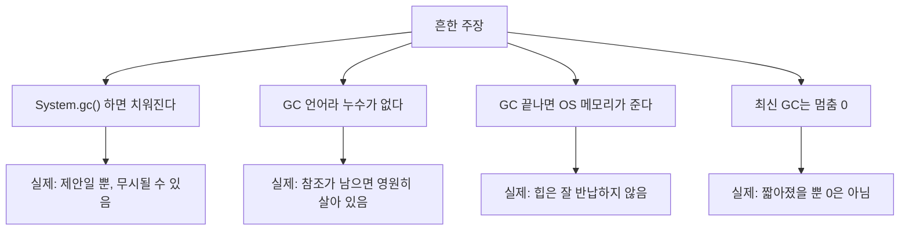

# 3장 동시성 · 3.2 GC 함정과 점검

> 1부 컴퓨터가 일하는 방식

## 들어가며

"이렇게 하면 GC가 줄어든다"는 말 중 상당수는 소스를 보면 사실이 아니다. 이 절은 그런 주장들을 실제 동작과 대조한다. 끝의 정리 문제는 동시성·락·네트워크를 한 번에 묶어, 어떤 접근이 맞는지 스스로 골라보게 한다.

### 한눈에 보기



> 왼쪽은 자주 듣는 GC에 대한 주장, 오른쪽은 소스와 공식 문서로 확인한 실제 동작이다. System.gc()는 제안일 뿐이고, 참조가 남은 객체는 GC가 있어도 누수가 되며, 힙은 OS에 잘 돌려주지 않고, 저지연 GC도 멈춤을 0으로 만들지는 못한다.

---

## GC 놓치기 쉬운 함정 — "된다"는 주장 vs 실제 (소스 기준)

> 관점: "요즘 GC는 좋아져서 된다"는 말이 많지만, **공식 문서·소스를 보면 조건·한계**가 붙는다. 필수 함정부터.
> Java 중심 + Unity/C#는 D.3 Unity GC(공식 매뉴얼 기반). 자바 렌즈: C.2 학습 경로와 신경망 종류.

---

### 왜 이 문서가 필요한가
GC는 "자동이라 신경 안 써도 된다"고 배우지만, **성능·메모리 사고의 단골 원인**이다. "된다더라"를 **벤더 문서·JEP 원문으로 검증**하는 습관이 핵심.

---

### 핵심 함정 (필수부터)

#### ① `System.gc()`는 "명령"이 아니라 "제안"
- JVM이 **무시할 수 있다**(명세상 보장 없음). 프로덕션에서 호출하면 오히려 **전체 STW**를 유발할 수 있어 **금지**. (Unity의 `GC.Collect()`도 실시간 중 금지 — 같은 교훈)

#### ② GC ≠ 메모리 누수 방지
- **참조가 남아 있으면 절대 못 지운다.** static 컬렉션, 리스너 미해제, 캐시, ThreadLocal → **논리적 누수(memory leak)**. GC가 있어도 누수는 난다.

#### ③ 메모리를 OS에 잘 안 돌려준다
- 힙이 한 번 커지면 **잘 안 줄어든다**(역사적 기본 동작). G1은 조건부로만 uncommit, **ZGC/Shenandoah가 반환을 개선**했지만 **기본 설정·플랫폼에 따라 제한적**.
- → **소스 기준 결론**: "피크 사용량 ≈ 상주 메모리"로 예산을 잡아라. (Unity는 더 심함 — **WebGL은 아예 반환 안 함**, → D.3 Unity GC)

#### ④ 저지연 GC도 "총 일"을 줄이는 게 아니다
- ZGC·Shenandoah는 **STW를 짧게 분산**할 뿐, **처리량(throughput)과 트레이드오프**가 있다(CPU·배리어 오버헤드). "무료로 빨라진다"가 아님.
- Unity **Incremental GC와 같은 원리** — 스파이크를 분산할 뿐 총량은 그대로.

#### ⑤ "완전 무정지(STW 0)"는 과장
- 저지연 GC도 **짧게라도 STW 구간**이 있다(초기 마킹 등). "pause 없음"이 아니라 "pause가 매우 짧음".

#### ⑥ `finalize()`는 폐기(deprecated), 쓰지 마라
- **언제 불릴지 보장 없음**(영영 안 불릴 수도). 리소스 정리는 try-with-resources / `Cleaner`로.

#### ⑦ OOM인데 "메모리 남아 보임"
- Java는 **압축**(compaction)을 해서 힙 단편화는 덜하지만 — **큰 연속 배열 요구**, **Metaspace**(클래스 메타), **off-heap**(다이렉트 버퍼)은 별개 원인. (Unity/Boehm GC는 **비압축**이라 단편화로 OOM이 더 흔함, → D.3 Unity GC)

---

### 면접 3단 Q&A

#### Q1. "요즘 GC(ZGC 등)는 멈춤이 없다"는 맞말?
- **① 결론** 과장. **멈춤이 매우 짧을 뿐**, STW 0은 아니고 **처리량을 대가로** 낸다.
- **② 원리** 동시(concurrent) 마킹·재배치로 pause를 분산. 대신 읽기/쓰기 배리어·CPU 비용 발생.
- **③ 확장** "총 작업량은 안 준다"는 게 핵심(Incremental GC와 동일). 지연 vs 처리량 선택.

#### Q2. GC 언어인데 왜 메모리 누수가 나?
- **① 결론** **참조가 남아 있으면** GC가 못 지운다.
- **② 원리** 도달 가능(reachable)하면 살려둔다. static 맵·리스너·캐시가 붙잡고 있으면 도달 가능 → 영구 상주.
- **③ 확장** 해결: 약한 참조(`WeakReference`), 리스너 해제, 캐시 만료. 프로파일러로 "누가 붙잡나" 추적.

#### Q3. 힙이 남는데 왜 OS 메모리는 안 줄어?
- **① 결론** GC는 보통 **힙 안에서 재사용**만 하고 **OS 반환은 소극적**.
- **② 원리** 재확장 비용을 피하려 붙잡음. 최신 GC가 개선했지만 조건부.
- **③ 확장** 예산은 **피크 기준**. 컨테이너 메모리 한도 설정 시 주의.

---

#### Q4. 왜 오래 켜두면 버벅이고, 재시작하면 정상화돼? (실생활)
- **① 결론** 시간이 지나며 **살아있는 객체(live set)가 늘어** GC가 잦아지고(끊김), 메모리가 커져(스왑) 느려진다. 재시작 = **메모리 회수 + live set 리셋** → 정상.
- **② 원리 — GC가 "안 돈" 게 아니다**
  - GC는 **아무도 참조 안 하는 것(쓰레기)만** 치운다. 그런데 누수·캐시·`static`·리스너가 객체를 **계속 참조**하면, GC가 봐도 **"살아있음"으로 판단해 못 치운다** — 게을러진 게 아니라 **치울 "자격"이 없는 것**(도달 가능 = 생존).
  - 회수한 것도 힙 안에서 재사용할 뿐 **OS 반환은 소극적**(③) → 상주 메모리는 계속↑.
  - 결과: **live set↑ → GC 더 자주·길게 → 프레임 멈칫**(끊김) / **메모리↑ → 스왑 → 전체 느림**.
  ```
  오래 켬 → live set↑(누수·캐시) → GC 잦음·길어짐 → 프레임 멈칫
                              ↘ 메모리↑ → RAM 부족 → OS 스왑 → 전체 느림
  재시작 → 메모리 통째 회수 + live set 0 → 쌩쌩
  ```
- **③ 확장** 근본 원인은 **누수(참조 미해제)** — 재시작은 임시방편(서버는 주기적 rolling restart로 버팀). 발열 스로틀링·GPU 리소스 누수·단편화 등 **비(非)메모리 원인**도 섞여 재시작이 "만능약"처럼 보인다. 해결: 참조 해제·풀링·캐시 만료 (→ D.3 Unity GC).

### 누수 막는 법 (코드)

#### 먼저 오해 정리 — "수동 회수"는 없다
자바엔 `free()`가 없다. **회수는 언제나 GC가 한다.** "수동으로 푼다"는 건 회수가 아니라 **참조 끊기** — GC가 치울 **자격**을 주는 것.
```
참조 남음 → GC 못 치움 (누수)
참조 없음 → GC가 알아서 치움   (수동 null/remove, 또는 스코프 종료로 자동)
```
- 지역 변수는 스코프를 벗어나면 참조가 저절로 끊겨 GC가 회수 → 보통 **수동 불필요.**
- `static`·캐시·리스너처럼 **오래 사는 참조**만 직접 끊어줘야 한다.
- ⚠️ **힙 안 회수 ≠ OS 반환** → 참조를 다 끊어도 프로세스 메모리는 안 줄 수 있음(③).

#### 1. 리스너 — 등록↔해제 짝 (+ 참조 보관 함정)
```java
// ❌ 등록만 → subject가 this를 붙잡아 못 죽음
button.addListener(this::onClick);

// ✅ 같은 참조를 보관해 lifecycle에서 해제
Listener l = this::onClick;
button.addListener(l);
void dispose() { button.removeListener(l); }   // 참조 끊김 → 회수 가능
```
> ⚠️ `removeListener(this::onClick)`는 **새 람다라 제거가 안 됨** — 등록 때 참조를 변수에 보관해야 한다.

**어디서 해제하나 — 등록의 "짝"이 되는 소멸 시점에**

| 상황 | 등록(register) | 해제(unregister) |
|------|---------------|------------------|
| 일반 객체 | 생성자·`init()` | `close()`(AutoCloseable)·`finally` |
| Swing/데스크톱 | 화면 생성 시 | `dispose()`·창 닫힘(windowClosing) |
| 서블릿/웹 | `contextInitialized` | `contextDestroyed` |
| Spring Bean | `@PostConstruct` | `@PreDestroy` |
| Android | `onStart`/`onResume` | `onStop`/`onPause` |

- 규칙: **등록한 계층과 같은 계층의 "소멸 콜백"에서 해제.** `add`한 곳이 있으면 `remove`할 곳을 **반드시 짝지어** 둔다.
- ⚠️ **익명·내부 클래스 리스너**는 바깥 객체(`this`)를 통째로 붙잡는다 → 안 풀면 그 객체 그래프 전체가 누수. → 참조 보관 후 해제, 또는 `WeakReference`·정적 중첩 클래스.
- 이벤트 리스너는 **옵서버(Observer) 패턴**의 대표 사례 (→ A.1 Java).

#### 2. 캐시 — 자동 회수 구조로
```java
Map<Key, Value> cache = new HashMap<>();      // ❌ 안 지우면 계속 쌓임
Map<Key, Value> cache = new WeakHashMap<>();  // ✅ 키가 안 쓰이면 GC 자동 회수
// ✅ 또는 크기·시간 제한(LRU 자동 축출): Caffeine / Guava Cache
```

#### 3. 리소스 — try-with-resources
```java
try (var conn = open()) {   // 블록 끝나면 자동 close (예외가 나도!)
    ...
}                            // 수동 close 잊을 일 없음
```

#### 4. 기타 단골
- `ThreadLocal`: 다 쓰면 `finally`에서 `remove()`.
- `static` 컬렉션: 앱 내내 상주 → 캐시로 쓰지 말거나 크기 제한.
- `finalize()` 금지 → `Cleaner`.

#### 대칭 원칙 (한 줄)
> `add`↔`remove` · `open`↔`close` · `register`↔`unregister` · `acquire`↔`release` — **짝을 항상 붙여** 코딩. 손으로 기억하지 말고 **try-with-resources·약한 참조로 구조화.**

### 습관 한 줄
> "요즘 되던데?"를 들으면 **JEP/공식 문서 원문**(예: ZGC JEP, Unity 매뉴얼)을 열어 **조건·한계**를 확인한다. 소스가 진실.

### 참조
- Oracle, *HotSpot GC Tuning Guide* — https://docs.oracle.com/en/java/javase/17/gctuning/
- OpenJDK, *ZGC (JEP)* — https://openjdk.org/projects/zgc/
- Unity Manual, *Garbage collector* — D.3 Unity GC

---

## 정리 Q&A

### 동시성·락·네트워크 — 오늘치 정리 + 팁 + 퀴즈

> 오늘 공부(Redis vs DB 락, 네트워크 왕복, 인메모리 vs 디스크)를 저장 + 놓치기 쉬운 팁 +
> 직접 풀 퀴즈. **NotebookLM에 이 소스를 넣고 "이 자료로 퀴즈 내줘"** 하면 자가 테스트 가능.
> 실측: [lab-benchmarks](https://github.com/mgj96/lab-benchmarks)

### 1. 핵심 정리 (오늘치)

**5전략 (동시 재고차감):**
- `none`: 락 없음 → 빠르나 **초과판매**(정합성 실패)
- `redis-lock`: Redis 분산락 → 정합 O, **왕복 4회 + 2개 시스템**
- `db-row-lock`: `SELECT FOR UPDATE` → 정합 O, 핫로우 경합·트랜잭션 점유
- `db-atomic`: `UPDATE ... WHERE stock>0` → **락 없이 정합 + 왕복 1회 (가장 가벼움)**
- `db-split-lock`: 재고를 N행으로 쪼개 경합 분산

**왜 db-atomic이 빨랐나 (역설):**
- redis-lock도 데이터는 DB에서 처리 → Redis는 **락만**(추가 왕복). 인메모리 속도는 **디스크를 대체할 때만** 이득.
- DB는 핫 로우를 **RAM 버퍼풀**에 캐싱 → "디스크=느림"은 반만 맞음.

**네트워크 비용 = 왕복(RTT) 횟수** (전송량 아님):
- redis-lock 왕복이 큰 이유 ① DB 일에 Redis 왕복 2회 추가 ② 시스템 2개 ③ **경합 시 락 재시도로 폭증**.

**인메모리(Redis)가 이기는 임계:** 작업셋 > RAM / 수만+ ops/s·<1ms / DB가 병목 / 휘발 OK.

**db-atomic의 숨은 비용:** 부하가 전부 DB(확장 어려운 공유 자원)로 집중 → 다른 쿼리까지 느려짐.

### 2. 더 알면 좋을 팁 · 놓치기 쉬운 점

1. **락을 아예 안 쓰는 길**: `UPDATE ... WHERE stock>0`(조건부=낙관적 update)나
   **Redis 원자 명령 `DECR`**(단일 스레드라 그 자체가 원자적)로 카운터를 락 없이 처리 가능.
   → 우리 벤치엔 없던 6번째 옵션. Redis DECR은 매우 빠르나 **durability 약함**.
2. **낙관 vs 비관 락**: 저경합이면 낙관적(version/CAS)이 빠름(대기 없음). 고경합·재시도 비싸면 비관적.
3. **락 TTL 함정**: 너무 **짧으면** 작업 중 만료→두 명이 동시 보유(정합 깨짐), 너무 **길면** 죽은 락이 남을 막음.
4. **Redlock 안전성 논쟁**(Kleppmann vs antirez): 시계 스큐·프로세스 일시정지(GC 등)로 상호배제가
   깨질 수 있고 **fencing token이 없다** → **정합성 critical이면 Redlock 대신 ZooKeeper류**,
   효율 목적(중복 크론 방지 등)이면 OK.
   출처: [Kleppmann](https://martin.kleppmann.com/2016/02/08/how-to-do-distributed-locking.html),
   [antirez 반박](https://antirez.com/news/101)
5. **멱등성·유니크 제약**: 락으로 막기보다 **구조적으로 중복 불가**하게(예: 주문ID UNIQUE) 만드는 게
   종종 더 견고. "중복 결제 방지"는 락보다 멱등키가 정석.
6. **큐 직렬화**: 핫 자원을 단일 컨슈머 큐로 순서화 → 락 경합 자체를 제거.
7. **커넥션 풀 고갈**: 행락은 트랜잭션을 오래 쥠 → 고동시성에서 풀 고갈·데드락. db-atomic은 1쿼리라 안전.
8. **핫 로우는 DB 안에서도 직렬화**: 같은 행 쓰기는 내부 행락으로 줄세워짐 → 카운터 분할(shard)로 완화.

### 3. 추가 예제 (어떤 접근이 맞을까)

| 상황 | 적합한 접근 | 왜 |
|------|------------|-----|
| 쿠폰 선착순 1000장 | db-atomic 조건부 UPDATE | 재고와 동일, 단일 DB면 단순·빠름 |
| 좋아요 수(쓰기 폭주, 정합 느슨) | Redis INCR 또는 비정규화+배치 | 정확한 즉시값 불필요, DB 부하 분리 |
| 중복 결제 방지 | 멱등키 / UNIQUE 제약 | 락보다 구조적으로 견고 |
| 분산 크론 중복 실행 방지 | Redlock(효율 용도) OK | 정합성 critical 아님 |
| 샤딩된 다중 DB의 전역 락 | Redis/ZooKeeper | 단일 DB 락은 범위 밖 |

### 4. 퀴즈 (직접 풀고 → 답 펼쳐 확인 / NotebookLM에 "퀴즈 내줘")

**Q1.** redis-lock의 네트워크 왕복이 db-atomic보다 많은 이유 3가지는?

**Q2.** "Redis는 인메모리라 항상 빠르다"가 이 벤치에서 안 맞은 이유는?

**Q3.** 인메모리 저장소가 DB보다 유리해지는 임계 조건을 2가지 이상 들어라.

**Q4.** db-atomic이 빠른데도 "이게 최고"라고 단정하면 안 되는, 지표에 안 잡히는 비용은?

**Q5.** 동시성이 매우 높을 때 db-row-lock보다 db-split-lock이 나은 이유는?

**Q6.** 정합성이 절대적으로 중요한 락에 Redlock을 쓰면 안 되는 이유와 대안은?

**Q7.** 락을 아예 안 쓰고 정합성을 지키는 방법을 2가지 들어라.

**Q8.** (적용) 좋아요 수처럼 쓰기 폭주 + 정합성 느슨이면 어떤 접근이 좋고 왜?

**Q9.** 락 TTL을 너무 짧게 / 너무 길게 잡으면 각각 무슨 문제가 생기나?

**Q10.** (사고) 단일 DB·중간 트래픽 서비스라면 어떤 전략을 기본값으로? YAGNI 관점에서 설명하라.

<details>
<summary>정답·해설 (먼저 풀고 펼치기)</summary>

- **A1.** ① DB 작업 위에 Redis 락 획득/해제 왕복 2회 추가 ② Redis·DB 두 시스템 경로 ③ 경합 시 락 재시도가 Redis 왕복으로 누적.
- **A2.** redis-lock도 데이터는 DB에서 처리(Redis는 락만) → 인메모리가 디스크를 *대체*한 게 아니라 *추가*돼 왕복만 늘었다. 게다가 DB 핫로우는 버퍼풀(RAM)에 있어 사실상 메모리 접근.
- **A3.** 작업셋 > RAM(버퍼풀) / 수만+ ops/s·<1ms p99 / DB가 이미 병목(부하 분리) / 데이터 휘발 OK(세션·랭킹).
- **A4.** 부하가 전부 DB(수평 확장 어려운 공유 자원)로 집중 → 같은 DB 쓰는 다른 모든 쿼리가 느려진다.
- **A5.** 단일 핫로우는 내부 행락으로 직렬화됨. N행으로 쪼개면 경합이 ~1/N로 분산돼 동시성↑.
- **A6.** 시계 스큐·프로세스 일시정지로 상호배제가 깨질 수 있고 fencing token이 없다. 정합성 critical이면 ZooKeeper 등 합의 시스템.
- **A7.** 조건부 원자 UPDATE(`WHERE stock>0`) / 멱등키·UNIQUE 제약 / Redis 원자 DECR / 큐 직렬화 중 2개.
- **A8.** Redis INCR(원자, DB 부하 분리, 휘발 OK) 또는 비정규화+배치 반영. 정확한 즉시 정합이 불필요하고 쓰기가 많아서.
- **A9.** 짧으면: 작업 중 만료 → 두 클라이언트가 동시에 락 보유(정합 깨짐). 길면: 죽은/멈춘 보유자의 락이 남아 다른 작업을 오래 막음.
- **A10.** 모놀리스+단일 DB면 db-atomic(조건부 UPDATE)으로 시작. 지금 분산이 필요 없으니 Redis를 미리 넣지 않는다(YAGNI). 측정된 병목(DB 포화·샤딩 필요)이 생기면 그때 Redis/큐로 진화(Gall's Law).

</details>

### 관련 문서

- 정답은 없다 — 경험담 (사례1)
- 네트워크 기초 — 왕복이 비싼 이유

---

## 함께 보기

- [서문 — 이 책을 읽는 법](../preface/00-how-to-read.md)
- [8장 통신](../part2/ch08-communication.md)
- [10장 설계의 출발점](../part3/ch10-design-starting-point.md)
- [14장 전환 사례와 판단 기준](../part4/ch14-migration-case-studies.md)
- [A.1 Java](../appendix/a1-java.md)
- [C.2 학습 경로와 신경망 종류](../appendix/c2-curriculum-and-nn-types.md)
- [D.3 Unity GC](../appendix/d3-unity-gc.md)

---

## 다음으로

1부의 마지막은 데이터를 담는 그릇이다. 해시맵, B+트리, 그리고 숫자 자체를 담는 방식까지. 4장으로 간다.

👉 [4장 데이터를 담는 구조 · 4.1 자료구조와 HashMap](ch04-1-data-structures-and-hashmap.md)
