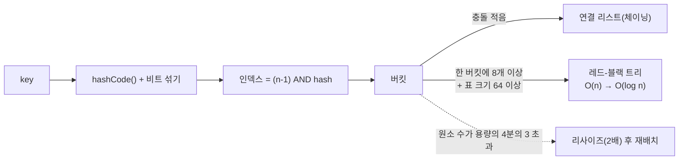

# 4장 데이터를 담는 구조 · 4.1 자료구조와 HashMap

> 1부 컴퓨터가 일하는 방식

## 들어가며

자바 컬렉션을 무엇을 언제 쓰는지부터 시작해, 자료구조의 내부가 어떻게 생겼는지, 그리고 HashMap이 어떻게 O(1)을 지키는지를 본다. 해시 충돌·리사이즈·트리화가 왜 그렇게 설계됐는지가 핵심이다.


### 한눈에 보기



> HashMap은 키의 hashCode를 섞어 버킷 번호를 계산한다. 같은 버킷에 몰리면 연결 리스트로 잇고, 한 버킷이 8개를 넘고 표가 충분히 크면 트리로 바꿔 최악을 O(log n)으로 막는다. 원소가 용량의 75%를 넘으면 표를 두 배로 늘려 다시 나눈다.

---

## 자바로 보는 자료구조 — 뭘 언제 쓰나 + 놓치기 쉬운 함정

> 관점: 추상 자료구조를 **실제 Java Collections**에 매핑하고, 자바 개발자가 **자주 놓치는 함정**을 필수부터 정리.
> 추상 선택 가이드(결정 트리)는 [1장 추상화와 복잡도](ch01-abstraction-and-complexity.md) 4장. 자바 렌즈 전반: [C.2 학습 경로와 신경망 종류](../appendix/c2-curriculum-and-nn-types.md).

---

### 0. 추상 자료구조 ↔ Java Collections 지도

| 추상 | Java 클래스 | 핵심 연산 | 언제 |
|------|------------|-----------|------|
| 배열(고정) | `int[]` · `T[]` | 인덱스 접근 O(1) | 크기 고정·인덱스 접근 |
| 동적 배열 | `ArrayList` | get O(1), 끝 add 분할상환 O(1) | **기본 리스트** (대부분 이거) |
| 연결 리스트 | `LinkedList` | 양끝 O(1), get O(n) | 거의 안 씀 (§1 함정) |
| 해시맵 | `HashMap` | 평균 O(1) | **키로 조회** |
| 정렬맵 | `TreeMap` | O(log n), 정렬 유지 | 정렬·범위 검색 |
| 삽입순서맵 | `LinkedHashMap` | O(1) + 순서 보존 | **LRU 캐시**, 순서 필요할 때 |
| 셋 | `HashSet` / `TreeSet` | O(1) / O(log n) | 중복 제거 / 정렬 집합 |
| 스택·큐 | `ArrayDeque` | 양끝 O(1) | **스택·큐 둘 다** (Stack/LinkedList 대신) |
| 우선순위 큐 | `PriorityQueue` | peek O(1), poll O(log n) | top-K, 다익스트라 |

> 감각: **리스트=`ArrayList`, 맵=`HashMap`, 스택/큐=`ArrayDeque`, 우선순위**=`PriorityQueue`만 기본으로 손에 익혀도 90%.

#### import 한눈에 (복사용)
```java
// 배열: import 불필요 (언어 내장). 유틸이 필요할 때만:
import java.util.Arrays;          // Arrays.sort(), Arrays.asList() ...

// 리스트
import java.util.List;            // 인터페이스 (변수 타입엔 이걸 권장)
import java.util.ArrayList;       // 기본 동적 배열
import java.util.LinkedList;      // 연결 리스트 (거의 비권장)

// 맵
import java.util.Map;             // 인터페이스
import java.util.HashMap;         // 키 조회 O(1)
import java.util.TreeMap;         // 정렬·범위
import java.util.LinkedHashMap;   // 삽입/접근 순서 보존 (LRU 캐시)

// 셋
import java.util.Set;             // 인터페이스
import java.util.HashSet;         // 중복 제거
import java.util.TreeSet;         // 정렬 집합
import java.util.LinkedHashSet;   // 순서 보존 집합

// 스택·큐·덱
import java.util.Deque;           // 인터페이스 (스택+큐 겸용)
import java.util.ArrayDeque;      // 스택·큐 둘 다 (Stack 대신)
import java.util.Queue;           // 큐 인터페이스
import java.util.PriorityQueue;   // 우선순위 큐(힙)

// 동시성 (멀티스레드)
import java.util.concurrent.ConcurrentHashMap;  // 스레드 안전 맵

// ⚠️ 쓰지 말 것 (레거시)
import java.util.Stack;           // Vector 기반 → ArrayDeque 사용
import java.util.Vector;          // 동기화 오버헤드 → ArrayList 사용
```

> 팁: 변수 타입은 **인터페이스**로 선언하고 구현만 바꾸는 게 관례 — `List<String> xs = new ArrayList<>();`

---

### 1. 놓치기 쉬운 함정 (필수부터)

#### ① `LinkedList`는 거의 쓰지 마라 (제일 흔한 오해)
- 이론상 "중간 삽입 O(1)"이지만, **그 위치를 찾는 데 O**(n)이고 **캐시 지역성이 나빠** 실측은 거의 항상 `ArrayList`가 빠르다.
- 노드마다 객체 + 포인터 → **메모리·GC 부담**도 큼. → **의심되면 `ArrayList`.**

#### ② `Stack` 클래스 쓰지 마라
- `java.util.Stack`은 **레거시**(`Vector` 기반, 불필요한 동기화). → `ArrayDeque`를 스택으로: `push`/`pop`.

#### ③ `HashMap` 키엔 `equals` + `hashCode` **둘 다** 오버라이드
- 커스텀 객체를 키로 쓰는데 하나만 재정의하면 **조회 실패**(넣었는데 못 찾음). 계약: **같으면 hashCode도 같아야.**
  ```java
  // record는 equals/hashCode 자동 → 키로 안전
  record Point(int x, int y) {}
  ```

#### ④ 오토박싱 비용 (자바 렌즈의 핵심)
- `HashMap<Integer, Integer>` 는 `int`를 **`Integer`로 박싱** → 힙 할당·GC 부담 (→ [A.1 Java](../appendix/a1-java.md)).
- 핫패스·대용량이면 primitive 특화 컬렉션(예: Eclipse Collections, fastutil) 고려.

#### ⑤ 초기 용량 · load factor
- `HashMap` 기본 용량 16, **load factor 0.75** 초과 시 **rehash**(재해시 비용). 큰 데이터면 `new HashMap<>(expectedSize)`.
- `ArrayList`도 크기 알면 초기 용량 지정 → 재할당 회피.

#### ⑥ 순회 중 수정 → `ConcurrentModificationException`
- for-each 도는 중 `remove` 하면 fail-fast 예외. → `Iterator.remove()` 또는 `removeIf()`.

#### ⑦ 정렬 컬렉션 주의
- `TreeMap`/`TreeSet`은 **`Comparable` 또는 `Comparator` 필요**, **null 키 불가**.
- `HashMap` 순회 순서는 **보장 없음**(버전 따라 다를 수 있음). 순서 필요하면 `LinkedHashMap`.

---

### 2. 면접 3단 Q&A (자바 기준)

#### Q1. `ArrayList` vs `LinkedList` 언제?
- **① 결론** 거의 항상 `ArrayList`. `LinkedList`는 특수 경우만.
- **② 원리** ArrayList=연속 배열(인덱스 O(1), 캐시 친화). LinkedList=노드 흩어짐(get O(n), 캐시·GC 불리).
- **③ 확장** "양끝 삽입·삭제만 잦다"면 `ArrayDeque`가 LinkedList보다 낫다.

#### Q2. `HashMap`은 어떻게 평균 O(1)? 최악은?
- **① 결론** 해시로 **바로 버킷을 계산**해 접근 → 평균 O(1). 최악 O(n)(또는 O(log n)).
- **② 원리** key의 hashCode로 버킷 인덱스 결정. 충돌 시 버킷에 체이닝. 자바 8+는 버킷이 커지면 **트리화**해 최악을 O(log n)으로 완화.
- **③ 확장** hashCode가 나쁘면 충돌 폭증 → 성능 저하. equals/hashCode 계약이 성능의 전제.

#### Q3. 스택이 필요하면?
- **① 결론** `Stack` 말고 `ArrayDeque`.
- **② 원리** Stack은 Vector 기반 동기화라 느리고 낡음. ArrayDeque는 배열 기반 비동기 덱.
- **③ 확장** 큐도 `ArrayDeque`, 우선순위는 `PriorityQueue`. LinkedList를 큐로 쓰지 말 것.

#### Q4. 커스텀 객체를 `HashMap` 키로 쓸 때 주의?
- **① 결론** `equals`+`hashCode` **둘 다** 재정의(또는 `record` 사용).
- **② 원리** 조회는 hashCode로 버킷 찾고 equals로 확인. 불일치면 넣고도 못 찾음.
- **③ 확장** 키는 **불변(immutable)** 이어야 안전 — 넣은 뒤 필드 바뀌면 버킷이 어긋남.

#### Q5. 우선순위 큐는 언제?
- **① 결론** "가장 크거나 작은 걸 **반복해서** 꺼낼 때" — `PriorityQueue`(힙).
- **② 원리** peek O(1), 삽입·삭제 O(log n). 전체 정렬은 아님(부분 순서).
- **③ 확장** top-K, 다익스트라, 이벤트 스케줄러. 기본은 최소힙 → 최대힙은 `Comparator.reverseOrder()`.

---

### 한 줄 요약
자바에선 **리스트=`ArrayList`, 맵=`HashMap`, 스택·큐=`ArrayDeque`, 우선순위**=`PriorityQueue`가 기본. 함정은 **LinkedList·Stack 지양, equals+hashCode 계약, 오토박싱 비용, rehash·fail-fast**. → 추상 선택 기준은 [1장 추상화와 복잡도](ch01-abstraction-and-complexity.md), GC 함정은 [3.2 GC 함정과 점검](ch03-2-gc-and-review.md).

### 참조
- [Java Collections 튜토리얼](https://docs.oracle.com/javase/tutorial/collections/) · [Big-O Cheat Sheet](https://www.bigocheatsheet.com/)

---

## 자료구조 딥다이브 — 내부는 어떻게 생겼나 (흥미 위주)

> 관점: "쓰는 법"에서 "**왜 그렇게 빠른가**"로. 겉보기 O(1) 뒤의 진짜 기계장치를 뜯어본다.
> 얕은 실무 가이드는 [4.1 자료구조와 HashMap](ch04-1-data-structures-and-hashmap.md), 선택 기준은 [1장 추상화와 복잡도](ch01-abstraction-and-complexity.md).

---

### 0. 왜 딥다이브? — 마법의 정체를 알면 함정도 보인다

`ArrayList`는 무한히 커지는데 왜 빠르고, `HashMap`은 어떻게 한 방에 찾고, `TreeMap`은 왜 안 쏠릴까? 내부를 알면 **성능 함정**(새는 추상화)이 눈에 보인다. 자바 렌즈로 파본다.

---

### 1. 동적 배열은 어떻게 "무한히" 커지나 — 분할상환의 마법

`ArrayList`는 사실 **고정 크기 배열**이다. 꽉 차면?
- **더 큰 배열을 새로 만들고 → 통째로 복사** (자바는 약 1.5배로 키움).
- 복사는 O(n)인데, 어떻게 "끝에 추가 O(1)"이라 하나?

**분할상환(amortized) 트릭**: 복사는 **가끔만** 일어난다. n개 넣는 동안 총 복사량을 다 합쳐도 **약 2n** → 한 번당 평균 O(1). "가끔 큰 비용을 여러 번에 나눠 갚는" 셈.

```
용량 4 → 꽉 참 → 8로 복사(4번) → ... → 16으로 복사(8번) ...
총 복사 = 4+8+16+... ≈ 2n  →  한 번당 평균 O(1)
```
> 💡 왜 하필 **2배(또는 1.5배)**? 고정량(+10)씩 늘리면 복사가 O(n)씩 자주 나 총 O(n²). **곱셈 성장**이라야 분할상환 O(1)이 성립. 이게 "숨은 재할당 비용"(→ [4.1 자료구조와 HashMap](ch04-1-data-structures-and-hashmap.md) 함정)의 정체.

---

### 2. HashMap 내부 — 버킷·해시·트리화

**흐름**: `key.hashCode()` → 섞어서(hash) → **버킷 배열의 인덱스** 계산 → 그 칸에 저장.

```
key ─hashCode()→ 정수 ─(비트 섞기)→ index = hash & (배열크기-1) → bucket[index]
```
- **충돌**(다른 키가 같은 버킷): 그 칸에 **연결 리스트로 매달음**(체이닝).
- **load factor 0.75**: 채워짐이 75% 넘으면 **배열 2배로 리사이즈 + 전부 재배치(rehash)**. → 왜 0.75? **공간(메모리) vs 충돌(속도)의 절충**. 낮추면 빠르지만 메모리↑.
- **자바 8의 트리화(treeify)**: 한 버킷에 **8개 이상** 쌓이면 연결 리스트를 **레드-블랙 트리로 전환** → 최악을 O(n)에서 **O**(log n)으로. (악의적 해시 충돌 공격 방어)
  - 왜 8? 좋은 해시라면 한 버킷에 8개가 쌓일 확률이 통계적으로 극히 낮음(푸아송 분포) → 그 이상이면 "비정상"으로 보고 트리화.

> 그래서 `HashMap`이 "평균 O(1), 최악 O(log n)". `hashCode`가 나쁘면 다 한 버킷에 몰려 느려진다(→ equals/hashCode 계약이 성능의 전제).

---

### 3. 균형 트리 — 왜 한쪽으로 안 쏠리나 (`TreeMap` = 레드-블랙)

일반 이진탐색트리(BST)는 **정렬된 데이터를 넣으면 한쪽으로 쭉 쏠려** 사실상 연결 리스트(O(n))가 된다.

**자가 균형 트리**가 해법: 넣을 때마다 **회전**(rotation)으로 높이를 낮게 유지 → 항상 O(log n).
- `TreeMap`·`TreeSet` = **레드-블랙 트리**(노드에 빨강/검정 색칠, 규칙 위반 시 회전·재색칠로 균형).
- DB 인덱스는 **B-트리/B+트리**(한 노드에 여러 키 → 디스크 읽기 최소화, §5).

> 핵심 직관: "정렬 유지"의 대가로 **삽입마다 균형 잡는 일**을 한다. 그래서 `HashMap`(O(1))보다 느리지만 **정렬·범위검색**이 된다.

---

### 4. 힙(Heap) — 배열로 트리를 흉내낸다

`PriorityQueue`는 **완전 이진 트리**인데, 저장은 **그냥 배열**이다.
- 부모-자식 관계를 **인덱스 계산**으로: 부모 `i` → 자식 `2i+1`, `2i+2`. 포인터가 필요 없다!
- **삽입**: 끝에 넣고 부모와 비교하며 **위로 올림(sift-up)** — O(log n).
- **최소값 꺼내기**: 루트 제거 → 마지막 원소를 루트로 → **아래로 내림(sift-down)** — O(log n).

> 흥미: "트리인데 배열"이라 **캐시 친화적이고 메모리 낭비가 없다.** top-K·다익스트라의 심장.

---

### 5. 흥미로운 특수 자료구조 (deep-dive 후보)

| 자료구조 | 한 줄 매력 | 어디에 쓰이나 |
|----------|-----------|--------------|
| **Trie(트라이)** | 문자를 트리로 → 접두어 검색 | 자동완성, 사전 |
| **Bloom Filter** | "없는 건 확실, 있는 건 아마" (확률적) | 캐시 미스 회피, DB 존재 검사 |
| **LRU 캐시** | `HashMap` + 이중 연결 리스트 | `LinkedHashMap`, 캐시 |
| **Skip List** | 확률적 다층 링크로 O(log n) | Redis Sorted Set |
| **B-트리 / B+트리** | 한 노드에 여러 키 → 디스크 I/O 최소 | **DB 인덱스**, 파일시스템 |
| **Union-Find(서로소 집합)** | 그룹 합치기·찾기 거의 O(1) | 네트워크 연결성, 크루스칼 MST |
| **Segment Tree / Fenwick** | 구간 합·갱신 O(log n) | 경쟁 프로그래밍 |
| **Ring Buffer(원형 큐)** | 고정 크기 재사용 | 로그·오디오 버퍼, 스트리밍 |

> 특히 **B+트리**(DB 인덱스)와 **Bloom Filter**(대규모 시스템)는 실무에서 자주 만난다 — 딥다이브 1순위.

---

### 6. 더 팔 것 (deep-dive 목록)
- [ ] **HashMap 리사이즈·treeify 소스** 뜯어보기 (JDK `HashMap.java`)
- [ ] **레드-블랙 트리 회전** 직접 그려보기
- [ ] **B+트리로 DB 인덱스** 동작 (→ [8장 통신](../part2/ch08-communication.md) 이후 DB 노트)
- [ ] **Bloom Filter 수학** (오탐률 계산)
- [ ] **LRU를 `LinkedHashMap`으로** 5줄 구현
- [ ] **Union-Find 경로 압축** (거의 O(1)의 비밀)

---

### 한 줄 요약
겉보기 O(1) 뒤엔 기계장치가 있다: **동적 배열=곱셈 성장으로 분할상환**, **HashMap=버킷+체이닝+트리화(load 0.75, treeify 8)**, **TreeMap=레드-블랙 자가 균형**, **힙=배열로 트리 흉내**. 그리고 **B+트리·Bloom·Trie·Union-Find**는 실무·면접의 흥미로운 다음 단계.

### 참조
- [Visualgo — 자료구조 애니메이션](https://visualgo.net/) · [Big-O Cheat Sheet](https://www.bigocheatsheet.com/) · JDK `HashMap.java` 소스

---

## 딥다이브 — HashMap 내부는 어떻게 O(1)인가

> 관점: `map.get(key)`가 왜 "한 방에" 나오는가. 그리고 그 O(1)이 **깨지는 순간**과 자바 8이 그걸 어떻게 방어하는지.
> 얕은 실무 가이드는 [4.1 자료구조와 HashMap](ch04-1-data-structures-and-hashmap.md), 자료구조 전반은 [4.1 자료구조와 HashMap](ch04-1-data-structures-and-hashmap.md), 이론 배경은 [1장 추상화와 복잡도](ch01-abstraction-and-complexity.md).

---

### 0. 30초 직관 — 사물함 번호

수천 명의 물건을 **찾아 헤매지 않고** 꺼내려면? 사람마다 "이름"을 계산해서 **사물함 번호**로 바꾼다. 이름 "김철수" → 계산 → 217번 사물함. 다음에 김철수 물건이 필요하면 **다시 217을 계산**해서 곧장 그 칸으로 간다. 순회가 없다 → O(1).

이 "이름을 번호로 바꾸는 계산"이 **해시**, 사물함 한 칸이 **버킷(bucket)**, 사물함 전체가 **버킷 배열**(`Node[] table`)이다. 문제는 딱 하나 — **다른 이름이 같은 번호로 계산되는 충돌(collision)**. HashMap 내부의 거의 모든 정교함은 이 충돌을 다루는 장치다.

---

### 1. 뼈대 — 버킷 배열 `Node[] table`

HashMap의 실체는 **배열**이다. 각 칸(버킷)에는 `Node` 객체가 들어간다.

```java
// OpenJDK HashMap.java 개념 발췌
static class Node<K,V> {
    final int hash;   // 계산해 둔 해시(재계산 방지용 캐시)
    final K key;
    V value;
    Node<K,V> next;   // 같은 버킷의 다음 노드 → 체이닝(연결 리스트)
}

transient Node<K,V>[] table;   // 버킷 배열. 처음 put 시 lazy 생성
```

- 저장 흐름: `key.hashCode()` → 비트 섞기(`hash`) → **인덱스 계산** → `table[index]`에 `Node` 배치.
- `Node`가 `next`를 가진다는 점이 핵심 — 한 버킷에 여러 노드를 **연결 리스트로 매달 수 있다**(충돌 해결 = 체이닝).
- 자바 개발자 시각: 겉은 `Map`이지만 속은 `LinkedList`를 원소로 갖는 배열, 즉 **배열 + 연결 리스트의 하이브리드**다.

---

### 2. 인덱스 계산 — `(n-1) & hash` 와 비트 섞기의 진짜 이유

버킷 배열 크기 `n`은 **항상 2의 거듭제곱**(16, 32, 64 …)이다. 그래서 인덱스를 이렇게 구한다.

```java
// 인덱스 = 나머지(hash % n)와 동일하지만 훨씬 빠름
int index = (n - 1) & hash;
```

`n`이 2의 거듭제곱이면 `n - 1`은 하위 비트가 전부 1인 마스크(예: `n=16` → `n-1 = 0b1111`)다. 그래서 `(n-1) & hash`는 **`hash`의 하위 몇 비트만 골라 쓰는 것**과 같다. `%` 나눗셈보다 `&`가 빠르기 때문에 이 설계를 택했다.

#### 그런데 하위 비트만 쓰면 생기는 문제

인덱스가 **하위 비트에만** 좌우되므로, `hashCode()`가 상위 비트에서만 다르고 하위 비트가 같은 키들은 **전부 같은 버킷으로 몰린다.** 예를 들어 `hashCode`가 `...0000`, `...10000`, `...100000`처럼 하위 4비트가 같으면 `n=16`에서 모두 같은 칸이다. 좋은 `hashCode`도 이 배치에서는 무력해진다.

#### 해결 — 상위 비트를 하위로 섞어 내린다

그래서 자바 8은 인덱스 계산 **전에** 해시를 한 번 흩뿌린다.

```java
// OpenJDK HashMap.java
static final int hash(Object key) {
    int h;
    return (key == null) ? 0 : (h = key.hashCode()) ^ (h >>> 16);
}
```

`h >>> 16`은 상위 16비트를 하위 16비트 자리로 내린 값이고, 이를 원래 `h`와 `XOR`한다. 결과적으로 **상위 비트의 정보가 하위 비트에 섞여 들어온다.** 그 후 `(n-1) & hash`를 하면, 어차피 하위 비트만 보더라도 그 안에 **상위 비트의 다양성이 녹아 있어** 충돌이 줄어든다.

> 정리: 인덱스는 하위 비트만 본다(2의 거듭제곱 + `&` 때문) → 그러니 값싼 연산 한 번(`h ^ (h >>> 16)`)으로 **상위 비트를 하위로 흘려보내** 충돌을 줄인다. "완벽한 해시 함수를 새로 만들기"가 아니라 "기존 `hashCode`를 싸게 보정하기"가 목적이라 `>>> 16` XOR 한 줄이면 충분하다.

---

### 3. 충돌 해결 — 체이닝(버킷당 연결 리스트)

인덱스가 같은 키가 여러 개면 그 버킷에 **연결 리스트로 매단다.**

```java
// put 개념: 같은 버킷을 순회하며 equals로 중복 확인 → 없으면 꼬리에 추가
Node<K,V> p = table[index];
while (p != null) {
    if (p.hash == hash && (p.key == key || key.equals(p.key)))
        break;              // 같은 키 → value 갱신
    p = p.next;             // 아니면 다음 노드로
}
// 끝까지 없으면 새 Node를 리스트에 추가
```

- **조회(get)**: 버킷을 찾은 뒤 그 리스트를 순회하며 `hash` 먼저 비교(싸다) → 같으면 `equals`로 확정.
- 버킷 하나에 `k`개가 몰리면 그 버킷 조회는 O(k). 모두가 한 버킷에 몰리는 최악에는 **O**(n)까지 나빠질 수 있다 → 다음 절이 이걸 막는다.

---

### 4. 트리화(Treeification) — 최악 O(n)에서 O(log n)으로

자바 8의 핵심 개선. 한 버킷의 리스트가 너무 길어지면 **레드-블랙 트리로 전환**한다.

#### 규칙 (정확히)

- **리스트 → 트리**: 한 버킷의 노드 수가 `>= 8`(`TREEIFY_THRESHOLD`) **그리고** 전체 배열 용량이 `>= 64`(`MIN_TREEIFY_CAPACITY`)일 때 그 버킷을 레드-블랙 트리(`TreeNode`)로 바꾼다.
- **용량이 `< 64`면 트리화 대신 리사이즈**: 배열이 아직 작을 땐 트리로 만드는 것보다 **배열을 키워 재분산(rehash)** 하는 편이 낫다. 작은 배열에서는 충돌 자체가 용량 부족 탓일 가능성이 크기 때문.
- **트리 → 리스트(되돌림)**: 리사이즈 등으로 그 버킷 노드 수가 `<= 6`(`UNTREEIFY_THRESHOLD`)으로 줄면 다시 연결 리스트로 환원한다.

> `8`과 `6` 사이에 **틈**(hysteresis)을 둔 이유: 임계값이 하나뿐이면 7↔8을 오갈 때마다 트리화/역트리화가 반복(진동)된다. 6과 8로 벌려 두면 경계에서 왔다 갔다 하는 비용을 막는다.

#### 왜 하필 `8`인가 — 푸아송 분포와 DoS 방어

`hashCode`가 충분히 고르게 분포하면, 한 버킷에 `k`개가 쌓일 확률은 **푸아송 분포**(λ=0.5)를 따른다. OpenJDK `HashMap.java`의 주석이 이 표를 직접 싣고 있다.

```
// OpenJDK HashMap.java 주석 발췌 (버킷당 노드 수의 기대 분포, λ=0.5)
// 0:    0.60653066
// 1:    0.30326533
// 2:    0.07581633
// ...
// 8:    0.00000006   (약 6e-8)
```

즉 **정상적인 해시라면 한 버킷에 8개가 쌓일 확률은 약 6e-8**(6천만 분의 1)로 사실상 일어나지 않는다. 그러니 실제로 8개가 쌓였다면 그것은 우연이 아니라 **비정상 신호** — 나쁜 `hashCode`이거나, 일부러 같은 버킷으로 몰리도록 조작된 키(해시 충돌 공격)다.

- **해시 플러딩(hash-flooding) DoS 방어**: 공격자가 `hashCode`가 같아지는 키를 대량으로 넣으면, 트리화가 없던 자바 7에서는 한 버킷 리스트가 무한정 길어져 조회가 O(n)이 되고 서버가 마비된다. 자바 8은 이 경우를 **O(log n) 트리**로 눌러 피해를 제한한다.
- 트리화는 **평상시엔 거의 발동하지 않는 안전장치**다. 8이라는 문턱은 "정상 트래픽에서는 절대 안 넘지만, 공격/불량 해시는 반드시 넘는" 지점으로 고른 값이다.

> 그래서 HashMap의 정확한 복잡도는 **평균 O(1), 최악 O(log n)**(트리화 이후). 단, 트리화가 성립하려면 키가 `Comparable`이거나 내부적으로 비교 가능해야 트리 정렬이 되고, 아니면 순서를 정하는 보조 로직을 탄다.

---

### 5. 로드 팩터 0.75 와 리사이즈 — 공간 vs 충돌의 절충

- **load factor = 0.75**(기본). 원소 수가 `capacity * 0.75`(임계값 `threshold`)를 넘으면 배열을 **2배로 키우고 전부 재배치(rehash)** 한다. 기본 16 → 임계 12를 넘으면 32로.
- **왜 0.75인가**: 채움 비율과 충돌은 반비례가 아니라 급격한 트레이드오프다.
  - 너무 높이면(예: 0.95) 배열이 빽빽해 충돌↑ → 조회 느려짐.
  - 너무 낮추면(예: 0.5) 충돌은 줄지만 **빈 칸이 많아 메모리 낭비↑**, 리사이즈도 잦아짐.
  - 0.75는 이 둘의 **경험적 균형점**이다.
- **2배로 키우는 이유**: 크기를 항상 2의 거듭제곱으로 유지해야 `(n-1) & hash` 트릭이 성립한다. 게다가 자바 8은 재배치 시 각 노드가 **"제자리에 남거나, 정확히 (기존 위치 + 기존 용량)으로 이동"** 둘 중 하나임을 이용해 rehash를 최적화한다(`hash & oldCap` 비트 하나로 판정).
- 리사이즈는 O(n) 작업이지만 **가끔만** 일어나 분할상환(amortized)으로 put 평균은 여전히 O(1)이다(동적 배열의 곱셈 성장 논리와 동일, → [4.1 자료구조와 HashMap](ch04-1-data-structures-and-hashmap.md)).

```java
// 리사이즈 개념: 용량 2배 → 각 노드를 새 배열에 재배치
Node<K,V>[] oldTab = table;
int oldCap = oldTab.length;
int newCap = oldCap << 1;                 // 2배
Node<K,V>[] newTab = new Node[newCap];
// 각 노드는 (hash & oldCap)==0 이면 제자리, 아니면 index+oldCap 로 이동
```

> 미리 크기를 알면 `new HashMap<>(expected / 0.75 + 1)`로 초기 용량을 지정해 **리사이즈를 원천 회피**할 수 있다(실무 성능 팁).

---

### 6. hashCode / equals 계약 — 어기면 조회가 "조용히" 실패한다

HashMap의 정확성은 두 메서드의 **계약**에 전적으로 의존한다.

1. `a.equals(b)`가 `true`면 **반드시** `a.hashCode() == b.hashCode()`.
2. `hashCode()`는 같은 객체에 대해 (상태가 안 변하는 한) 일관된 값을 반환.

#### 왜 어기면 "조용히" 실패하나

`get(key)`는 먼저 `hashCode`로 **버킷을 찾고**, 그 안에서 `equals`로 확정한다. 만약 `equals`는 같다고 하는데 `hashCode`가 다르면 — **애초에 다른 버킷을 뒤지므로** 저장해 둔 값을 영영 못 찾는다. 예외도, 컴파일 에러도 없이 그냥 `null`이 나온다. 그래서 "조용한 실패(silent failure)"다.

```java
// 안티패턴: equals만 재정의, hashCode는 Object 기본(주소 기반) → 계약 위반
// put한 키와 논리적으로 같은 키로 get 해도 버킷이 달라 null 반환
```

- **`equals`를 재정의하면 `hashCode`도 반드시 함께 재정의**한다. IDE 자동 생성이나 `record`를 쓰면 안전하다.
- 반대로 `hashCode`가 항상 같은 상수를 반환해도(계약은 지킴) 모든 키가 한 버킷에 몰려 O(n)이 된다 — 정확하지만 느리다.

---

### 7. 키는 왜 불변(immutable)이어야 하나

키를 넣은 **뒤에** 그 키 객체의 필드를 바꿔 `hashCode`가 달라지면?

- put 당시엔 버킷 A(옛 해시)에 저장됐는데, 이제 `hashCode`는 버킷 B(새 해시)를 가리킨다.
- get은 버킷 B를 뒤지지만 데이터는 버킷 A에 있다 → **못 찾는다.** 키가 "미아"가 된다.

그래서 HashMap 키로는 `String`, `Integer`, `record`처럼 **불변 타입**을 쓰는 것이 원칙이다. 가변 객체(예: 필드가 바뀌는 엔티티)를 키로 쓰고 나서 상태를 바꾸면 맵이 깨진다.

```java
// 좋은 키: record — 필드가 final, equals/hashCode 자동 생성, 불변
public record UserId(String tenant, long seq) {}   // 그대로 HashMap 키로 안전

// 사용
Map<UserId, User> users = new HashMap<>();
users.put(new UserId("acme", 42L), user);
User u = users.get(new UserId("acme", 42L));   // 논리적으로 같은 키 → 정확히 조회
```

> `record`는 컴포넌트 기반 `equals`/`hashCode`를 컴파일러가 생성하고 필드가 `final`이라 **계약 준수 + 불변**을 공짜로 준다. 자바 16+ 개발자의 기본 키 선택지.

---

### 8. null 키 처리

- HashMap은 **`null` 키 하나**와 **여러 `null` 값**을 허용한다.
- `null` 키의 해시는 `hash(null) == 0`으로 정의되어 **항상 0번 버킷**에 저장된다(위 `hash()` 코드의 삼항 참고).
- 대조적으로 **`ConcurrentHashMap`과 `Hashtable`은 `null` 키·값을 금지**한다(뒤 절). 이유는 동시성 맥락에서 "값이 없음"과 "값이 null"을 구분할 수 없어 `get`이 `null`을 반환할 때 모호해지기 때문.

---

### 9. 동시성 — HashMap vs Hashtable vs ConcurrentHashMap

| 항목 | HashMap | Hashtable | ConcurrentHashMap |
|------|---------|-----------|-------------------|
| 스레드 안전 | 아니오 | 예 | 예 |
| 잠금 단위 | 없음 | **객체 전체**(모든 메서드 `synchronized`) | **버킷(bin) 단위** |
| 쓰기 방식 | — | 전 구간 직렬화 | 빈 칸은 **CAS**, 충돌 버킷은 **head에만 `synchronized`** |
| 읽기 잠금 | — | 있음(느림) | 대부분 **무잠금**(`volatile` 노드) |
| null 키/값 | 허용 | 금지 | 금지 |
| 등장 | 오래됨 | 레거시(JDK 1.0) | 권장(동시성) |

- **HashMap**: 동기화 전혀 없음. 단일 스레드/외부 동기화 전제. **자바 7에서는 여러 스레드가 동시에 리사이즈하면 연결 리스트가 꼬여 무한 루프(CPU 100%)에 빠질 수 있다** — 옛 리사이즈가 리스트를 뒤집는 방식이라 순환 참조가 생겼기 때문. 자바 8은 리사이즈 로직을 바꿔 이 특정 버그는 완화됐지만, **여전히 동시 사용은 데이터 유실·미정의 동작**이라 금지다.
- **Hashtable**: 모든 메서드가 객체 전체에 `synchronized`. 한 스레드가 `get` 하는 동안 다른 스레드는 **다른 버킷조차** 접근 못 함 → 경합 심하면 병목. 사실상 레거시.
- **ConcurrentHashMap**: 잠금을 **버킷 단위로 쪼갠다.**
  - 빈 버킷에 처음 넣을 땐 락 없이 **CAS**(compare-and-swap)로 시도 → 성공하면 잠금 자체가 없다.
  - 이미 노드가 있는 버킷만 그 **head 노드에 `synchronized`** — 서로 다른 버킷을 건드리는 스레드들은 **병렬로** 진행한다.
  - 읽기는 노드 필드가 `volatile`이라 대개 **잠금 없이** 최신 값을 본다.
  - (자바 7의 세그먼트 락 방식을 자바 8에서 이 per-bin 방식으로 교체해 동시성이 더 세밀해졌다.)

> 한 줄 대비: Hashtable = "**건물 전체에 자물쇠 하나**", ConcurrentHashMap = "**사물함마다 자물쇠**"(게다가 빈 사물함은 자물쇠도 생략). 그래서 동시성 맵이 필요하면 답은 `ConcurrentHashMap`이다.

---

### HashMap이 최악 O(n)에서 O(log n)으로 — 한 흐름으로 다시 보기

1. **이상적**: 좋은 해시 → 버킷에 고르게 1개씩 → 조회 **O(1)**.
2. **충돌 발생**: 같은 버킷에 여러 개 → 그 버킷은 연결 리스트 → 조회 **O(k)**.
3. **최악(자바 7 또는 트리화 전)**: 전부 한 버킷 → 리스트 길이 n → **O(n)**. 해시 플러딩 공격의 표적.
4. **자바 8 방어**: 한 버킷이 `>= 8`(그리고 용량 `>= 64`)이 되면 그 버킷만 레드-블랙 트리로 → 그 버킷 조회 **O(log n)**.

*(도식 설명: 버킷 하나가 `[a]→[b]→[c]→…→[h]` 8노드 리스트로 길어지는 순간, 그 칸만 균형 이진 트리로 재구성되어 세로로 깊던 탐색이 로그 깊이로 납작해진다. 나머지 버킷들은 그대로 리스트/단일 노드로 남는다.)*

> 그래서 정확한 표현은 **"평균 O(1), 최악 O(log n)"**. 그 "log n"을 지탱하는 게 트리화이고, 트리화가 필요할 만큼 몰리지 않게 막는 게 비트 섞기·로드 팩터·리사이즈다. 네 장치가 협력해 O(1)을 지킨다.

---

### 용어 사전

| 용어 | 뜻 |
|------|-----|
| 버킷(bucket) / bin | `Node[] table` 배열의 한 칸. 같은 인덱스로 계산된 키들이 모이는 자리 |
| 체이닝(chaining) | 같은 버킷의 충돌 키들을 연결 리스트(또는 트리)로 매다는 방식 |
| 트리화(treeification) | 버킷 리스트가 `>= 8`(용량 `>= 64`)일 때 레드-블랙 트리로 전환 |
| 로드 팩터(load factor) | 채움 비율 임계값(기본 0.75). 넘으면 리사이즈 |
| 리사이즈(resize) | 배열을 2배로 키우고 전 원소를 재배치(rehash) |
| CAS | compare-and-swap. 락 없이 원자적으로 값 교체(`ConcurrentHashMap` 삽입) |
| hash spreading | `h ^ (h >>> 16)`로 상위 비트를 하위로 섞어 충돌을 줄이는 보정 |
| 해시 플러딩 | 같은 버킷으로 몰리는 키를 대량 주입해 O(n)을 유발하는 DoS 공격 |

---

### 출처

- **OpenJDK `HashMap.java` 소스** — `hash()`의 `(h = key.hashCode()) ^ (h >>> 16)`, `TREEIFY_THRESHOLD=8` / `UNTREEIFY_THRESHOLD=6` / `MIN_TREEIFY_CAPACITY=64`, 그리고 **버킷당 노드 수 기대 분포를 담은 푸아송(λ=0.5) 주석**(8일 확률 약 6e-8).
- **Oracle Java SE 21 API — `HashMap`**: https://docs.oracle.com/en/java/javase/21/docs/api/java.base/java/util/HashMap.html
- 교차 링크: [4.1 자료구조와 HashMap](ch04-1-data-structures-and-hashmap.md) · [4.1 자료구조와 HashMap](ch04-1-data-structures-and-hashmap.md) · [1장 추상화와 복잡도](ch01-abstraction-and-complexity.md)

---

## 다음으로

메모리 안의 자료구조가 HashMap이라면, 디스크 위의 대표 자료구조는 B+트리다. 4.2절에서 DB 인덱스로 넘어간다.

👉 [4장 데이터를 담는 구조 · 4.2 B+트리와 DB 인덱스](ch04-2-btree-index.md)
