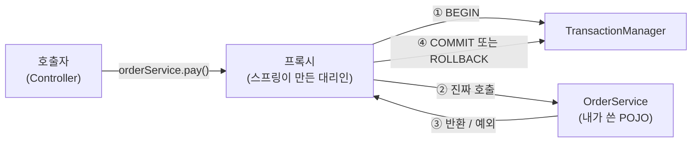

# 5장 트랜잭션과 락

> 2부 데이터와 일관성

## 들어가며

같은 SELECT가 다른 값을 주는 이유는 격리 수준에 있다. 이 장은 DB 쪽에서 트랜잭션 격리와 락을 본 뒤, 애플리케이션 쪽에서 스프링 `@Transactional`이 프록시·전파·readOnly로 그것을 어떻게 감싸는지 이어서 본다. 정합성 문제의 '한 대짜리' 해법이다.

---

## 딥다이브 — 트랜잭션 격리와 락: 같은 SELECT가 다른 값을 주는 이유

> 기반: **ANSI SQL-92 표준** · **Berenson et al., *A Critique of ANSI SQL Isolation Levels* (SIGMOD 1995)** · **Reed, *Naming and Synchronization...* (MIT 박사논문 1978, MVCC의 기원)** · **MySQL/PostgreSQL/Oracle 공식 문서**
> 형식: 30초 직관 → 역사 → 원리 → 트레이드오프. 5장 트랜잭션과 락의 3줄 답을 실무 깊이로 승격한 노트.
> 관련: 인덱스가 락 범위를 정하는 원리는 4.2 B+트리와 DB 인덱스, JVM 쪽 낙관적 동시성은 3.1 스레드와 JMM, 스프링에서의 경계는 5장 트랜잭션과 락.

---

### 0. 30초 직관 — 트랜잭션 안에서 세상이 바뀐다

```sql
BEGIN;
SELECT balance FROM account WHERE id = 1;   -- 10,000원
-- ... 그 사이 다른 세션이 입금을 커밋 ...
SELECT balance FROM account WHERE id = 1;   -- 15,000원?  10,000원?
```

**정답은 "격리수준에 달렸다**"다. READ COMMITTED면 15,000원(바뀐 세상이 보임), REPEATABLE READ면 10,000원(트랜잭션 시작 시점의 세상이 유지됨).

여기서 이 노트의 중심 질문이 나온다:

> **"다른 사람의 변경을 언제부터 보이게 할 것인가"** — 이걸 정하는 다이얼이 격리수준이고,
> 그 다이얼을 구현하는 두 기술이 **락**(못 보게 막기)과 **MVCC**(과거를 보여주기)다.

---

### 1. 격리수준 — 이상현상을 실제 SQL로 재현하기

#### 1-1. 왜 "수준"이 여러 개인가 (1992)

완벽한 격리(SERIALIZABLE)는 비싸다 — 동시성이 죽는다. 그래서 ANSI SQL-92는 "**어떤 이상현상까지 허용할 것인가**"로 단계를 나눴다. 격리수준은 기능이 아니라 **성능과 정확성의 거래 조건표**다.

#### 1-2. 이상현상 3종 — 시나리오로

**① Dirty Read — 커밋 안 된 것을 읽음** (READ UNCOMMITTED에서만)

```
세션A: UPDATE account SET balance = 0 WHERE id = 1;   (아직 커밋 안 함)
세션B: SELECT balance ...  → 0원 읽음
세션A: ROLLBACK;                                       ← 0원은 존재한 적 없는 값
```
B는 **역사에 없던 값**으로 의사결정을 했다. 그래서 실무에서 READ UNCOMMITTED는 사실상 안 쓴다.

**② Non-Repeatable Read — 같은 행을 두 번 읽었는데 값이 다름** (READ COMMITTED까지 허용)

0장의 예가 정확히 이것이다. 한 트랜잭션 안에서 **같은 행**의 값이 변한다.

**③ Phantom Read — 같은 조건으로 두 번 읽었는데 행 수가 다름** (REPEATABLE READ까지 허용*)

```
세션A: SELECT count(*) FROM parking WHERE zone = 'B';  → 10건
세션B: INSERT INTO parking (zone) VALUES ('B'); COMMIT;
세션A: SELECT count(*) ...                             → 11건 (유령이 나타남)
```
②는 **행의 값**이, ③은 **행의 존재**가 변한다. 이 구분이 중요하다 — 값은 행 락으로 지킬 수 있지만, **"아직 없는 행"은 잠글 대상이 없기 때문**이다(→ 3장 갭 락).

#### 1-3. 표 — 그리고 표의 함정

| 격리수준 | Dirty | Non-Repeatable | Phantom |
|---|---|---|---|
| READ UNCOMMITTED | 허용 | 허용 | 허용 |
| READ COMMITTED | 차단 | 허용 | 허용 |
| REPEATABLE READ | 차단 | 차단 | 허용* |
| SERIALIZABLE | 차단 | 차단 | 차단 |

> ⚠️ **이 표를 외우는 것으로 끝내면 안 되는 이유**: 1995년 Berenson 등(Microsoft·Sybase 연구진)이 *A Critique of ANSI SQL Isolation Levels*에서 **표준의 정의 자체가 불완전**함을 보였다 — 표에 없는 이상현상(Lost Update, Write Skew)이 존재하고, MVCC 기반 DB들의 실제 동작(Snapshot Isolation)은 이 표의 어느 칸에도 정확히 안 맞는다.
> 실무 결론: **"내 DB의 이 격리수준"이 무엇을 막는지는 표가 아니라 그 DB 문서로 확인한다.**
> 대표 사례 — *InnoDB의 REPEATABLE READ는 갭 락 덕에 팬텀을 상당 부분 막는다*(표와 다름). PostgreSQL의 REPEATABLE READ는 사실상 Snapshot Isolation이다.

#### 1-4. 기본값이 제일 중요하다

| DB | 기본 격리수준 |
|---|---|
| Oracle | READ COMMITTED |
| PostgreSQL | READ COMMITTED |
| **MySQL(InnoDB)** | **REPEATABLE READ** |
| SQL Server | READ COMMITTED |

**같은 코드가 Oracle과 MySQL에서 다르게 동작한다.** 멀티 DB를 다루는 환경(Oracle·MariaDB·PostgreSQL 혼용)이라면 이 차이가 "가끔 나는 이상한 버그"의 단골 원인이다.

---

### 2. MVCC — 안 막고 과거를 보여준다

#### 2-1. 발상의 전환 (1978)

락으로 격리를 구현하면 **읽기가 쓰기를 막고 쓰기가 읽기를 막는다.** 조회가 많은 시스템에선 치명적이다.

David Reed의 1978년 MIT 박사논문에서 기원한 **MVCC**(다중 버전 동시성 제어)는 질문을 뒤집었다:

> "지금 값을 보여주려고 쓰기를 막을 게 아니라, **각 트랜잭션에게 자기 시작 시점의 과거 버전을 보여주면** 되지 않나?"

**읽기와 쓰기가 서로를 막지 않게 된다.** 읽는 쪽은 스냅샷을 보고, 쓰는 쪽은 새 버전을 만든다. git으로 치면 — 남이 push하는 동안에도 나는 **내가 clone한 시점의 스냅샷**을 계속 읽을 수 있는 것과 같다.

#### 2-2. 구현은 DB마다 다르다 — 그리고 그 차이가 운영 이슈다

| DB | 옛 버전을 어디에 | 대가 |
|---|---|---|
| **Oracle** | **Undo 세그먼트** (별도 공간) | undo가 재사용되면 `ORA-01555 snapshot too old` |
| **MySQL(InnoDB)** | **Undo 로그** | 긴 트랜잭션이 있으면 undo가 못 지워져 부풀어 오름 |
| **PostgreSQL** | **테이블 안에** 옛 행을 그대로 둠 (xmin/xmax 표시) | 죽은 행 청소 = **VACUUM**. 안 돌면 테이블 비대·트랜잭션 ID 랩어라운드 |

> **공통 교훈 하나로 수렴한다**: 어떤 구현이든 **"오래 열려 있는 트랜잭션"이 독**이다.
> 스냅샷을 유지해줘야 하니 옛 버전을 못 지운다 → undo 고갈(Oracle), undo 비대(MySQL), VACUUM 불능(PostgreSQL).
> Spring 노트 5장의 "왜 짧은 트랜잭션이어야 하나(1987 Sagas)"의 저장엔진 버전이다.

---

### 3. 락의 실제 — 인덱스가 락 범위를 정한다

#### 3-1. 행 락은 사실 "인덱스 레코드 락"이다

InnoDB에서 `UPDATE ... WHERE ...`는 **조건에 맞는 행**이 아니라 **스캔한 인덱스 레코드**를 잠근다. 결과가 같아 보이지만 전혀 다르다:

```sql
UPDATE parking SET status = 'OUT' WHERE car_no = '12가3456';

-- car_no에 인덱스 있음  → 그 레코드 근처만 잠김
-- car_no에 인덱스 없음  → 풀스캔 = 스캔한 전 행이 잠김 (사실상 테이블 락)
```

> "**인덱스 안 걸었더니 느리다"보다 무서운 게 "인덱스 안 걸었더니 다 잠긴다**"다.
> 락 경합·데드락 장애의 상당수가 실행계획 문제다 — 인덱스 구조는 4.2 B+트리와 DB 인덱스.

#### 3-2. 갭 락 — 없는 행을 잠그는 법

팬텀(1-2 ③)을 막으려면 "아직 없는 행"의 자리를 잠가야 한다. InnoDB(REPEATABLE READ)는 **인덱스 레코드 사이의 틈**(gap)을 잠근다:

```
인덱스 값:   10        20        30
             │← gap →│← gap →│
세션A: SELECT ... WHERE id BETWEEN 10 AND 30 FOR UPDATE;
세션B: INSERT id = 25  → 갭 락에 걸려 대기   ← 팬텀 차단
```

**대가**: 갭 락은 **실제 행보다 넓은 범위**를 잠근다. 서로 인접 갭을 잡고 상대 갭에 INSERT하려는 두 세션이 만나면 — **데드락**. "동시 INSERT가 많은 테이블에서 이유 모를 데드락"의 단골 원인이 이것이다.

#### 3-3. 데드락 — 예방보다 탐지-재시도

```
세션A: 주차면 1 잠금 → 주차면 2 요청 (대기)
세션B: 주차면 2 잠금 → 주차면 1 요청 (대기)   ← 서로 영원히 대기
```

현대 DB는 **탐지 후 한쪽을 죽이는** 전략을 쓴다(InnoDB는 대기 그래프에서 사이클 발견 시 더 작은 트랜잭션 롤백). 그래서 애플리케이션의 의무는 두 가지다:

1. **락 순서 규약** — 여러 자원을 잠글 땐 항상 같은 순서로(예: id 오름차순). 사이클 자체가 안 생긴다.
2. **데드락 예외를 재시도** — 탐지-롤백은 정상 동작이다. `DeadlockLoserDataAccessException`을 버그가 아니라 **재시도 신호**로 다룬다.

#### 3-4. 낙관적 락 — DB 버전의 CAS

3.1 스레드와 JMM에서 본 CAS("기대한 값 그대로면 커밋, 아니면 재시도")의 DB 버전이 **버전 컬럼**이다:

```sql
UPDATE parking SET status = 'OUT', version = version + 1
 WHERE id = 42 AND version = 7;   -- 내가 읽었던 버전 그대로일 때만 성공
-- 영향 행 수 0 = 누가 먼저 바꿈 → 다시 읽고 재시도 (또는 사용자에게 알림)
```

| | 비관적 락 (`FOR UPDATE`) | 낙관적 락 (version) |
|---|---|---|
| 충돌이 잦으면 | 유리 (재시도 낭비 없음) | 재시도 폭풍 |
| 충돌이 드물면 | 락 대기가 낭비 | **유리** |
| 커넥션 점유 | 대기 동안 계속 쥠 | 안 쥠 |
| 대상 | DB 안에서 완결 | **화면 조회 후 저장** 같은 긴 흐름에도 가능 |

> 마지막 줄이 실무 포인트다. "관리자 화면에서 열어두고 30분 뒤 저장" 같은 흐름은 비관적 락으론 못 지킨다(그동안 커넥션을 쥘 수 없으니). **긴 사용자 흐름 = 낙관적 락**이 기본 선택이다.
> 재시도 전략은 분산 정합성 노트의 멱등성과 만난다 — 재시도가 안전하려면 그 연산이 멱등해야 한다.

---

### 4. 3단 요약 (암기용)

#### Q1. 격리수준은 뭘 기준으로 고르나?

- **① 결론 · WHAT** 격리수준은 기능이 아니라 **"어떤 이상현상까지 감수하고 동시성을 살 것인가"의 거래 조건**이다. 대부분의 서비스는 **DB 기본값**(READ COMMITTED 또는 InnoDB의 REPEATABLE READ)으로 충분하고, 돈 계산 같은 구간만 락이나 낙관적 버전으로 좁게 보강한다.
- **② 원리 · HOW** 낮출수록 Dirty → Non-Repeatable → Phantom 순으로 이상현상이 허용된다. 단 ANSI 표는 불완전하다(Berenson 1995) — Lost Update·Write Skew는 표에 없고, MVCC DB의 실제 동작(Snapshot Isolation)은 표의 칸에 안 맞는다. InnoDB의 RR은 갭 락으로 팬텀을 상당 부분 막고, PostgreSQL의 RR은 사실상 스냅샷 격리다.
- **③ 확장 · TRADE-OFF** 전역으로 SERIALIZABLE을 올리는 건 거의 항상 과잉이다(동시성 붕괴·데드락 급증). 반대로 기본값에만 의존하면 Oracle과 MySQL의 **기본값이 달라** 같은 코드가 다르게 동작한다 — 멀티 DB 환경에서는 격리수준을 명시적으로 문서화해야 한다.

#### Q2. MVCC는 어떻게 락 없이 일관된 읽기를 주나?

- **① 결론 · WHAT** 쓰기를 막는 대신 **각 트랜잭션에게 시작 시점의 과거 버전(스냅샷)을 보여준다.** 읽기와 쓰기가 서로를 막지 않는다.
- **② 원리 · HOW** 쓰기는 제자리 덮어쓰기가 아니라 **새 버전 생성**이고, 옛 버전은 Oracle=undo 세그먼트, MySQL=undo 로그, PostgreSQL=테이블 내 죽은 행(xmin/xmax)으로 보관된다. 읽는 쪽은 자기 스냅샷에 보이는 버전만 고른다.
- **③ 확장 · TRADE-OFF** 옛 버전 보관이 비용이다 — 그리고 **긴 트랜잭션이 그 청소를 막는다**: `ORA-01555`, undo 비대, VACUUM 불능이 전부 같은 뿌리다. 또 MVCC의 "일관된 읽기"는 **쓰기 충돌까지 막아주진 않아서**(Lost Update·Write Skew), 갱신 경합은 여전히 락이나 버전 컬럼으로 따로 지켜야 한다.

#### Q3. 데드락이 났다. 어떻게 대응하나?

- **① 결론 · WHAT** 단기: **데드락 예외를 재시도**한다(DB의 탐지-롤백은 정상 동작). 장기: **락 획득 순서를 통일**하고, **실행계획을 확인**한다(인덱스 없는 UPDATE가 광범위 락의 주범).
- **② 원리 · HOW** InnoDB의 행 락은 실제로는 **스캔한 인덱스 레코드 락**이라, 인덱스가 없으면 풀스캔 = 전 행 잠금이 된다. REPEATABLE READ에서는 **갭 락**이 실제 행보다 넓은 범위를 잠가, 동시 INSERT가 많은 테이블에서 서로의 갭을 물고 데드락이 난다.
- **③ 확장 · TRADE-OFF** 데드락을 0으로 만드는 건 목표가 아니다 — 예방(순서 규약)에는 설계 비용이, 회피(락 최소화)에는 정합성 리스크가 붙는다. 현실 균형은 **"드물게 나고, 나면 자동 재시도로 흡수"**. 충돌이 드문 긴 사용자 흐름은 애초에 락 대신 **낙관적 버전 컬럼**(DB판 CAS)으로 설계하는 게 데드락 표면적 자체를 줄인다.

---

### 용어 사전

| 용어 | 뜻 |
|------|-----|
| 격리수준 | 다른 트랜잭션의 변경을 언제부터 보이게 할지의 단계 |
| Dirty / Non-Repeatable / Phantom | 미커밋 읽음 / 같은 행 값 변함 / 행 수 변함 |
| Lost Update | 두 갱신이 겹쳐 한쪽이 조용히 사라짐 (ANSI 표 밖) |
| Write Skew | 각자 검사 후 각자 갱신해 불변식이 깨짐 (스냅샷 격리의 구멍) |
| MVCC | 다중 버전 동시성 제어. 스냅샷을 보여줘 읽기-쓰기 비차단 |
| Snapshot Isolation | 트랜잭션 시작 시점 스냅샷 기반 격리. PostgreSQL RR의 실체 |
| undo / VACUUM | 옛 버전 보관소(Oracle·MySQL) / PostgreSQL의 죽은 행 청소 |
| 갭 락 | 인덱스 레코드 사이 틈을 잠가 팬텀 INSERT를 차단 |
| 락 순서 규약 | 여러 자원을 항상 같은 순서로 잠가 사이클 예방 |
| 낙관적/비관적 락 | 버전 검사 후 재시도 / 먼저 잠그고 작업 |
| 버전 컬럼 | 낙관적 락 구현용 정수 컬럼. DB판 CAS |

### 연결 지도
- **인덱스 구조 (락 범위의 결정자)**: → 4.2 B+트리와 DB 인덱스
- **JVM의 CAS·낙관적 동시성 (동형 원리)**: → 3.1 스레드와 JMM
- **스프링에서의 트랜잭션 경계·전파**: → 5장 트랜잭션과 락
- **재시도와 멱등성**: → 7.1 멱등성·Outbox·Saga
- **3줄 버전 (출발점)**: → 5장 트랜잭션과 락
- **학습 순서**: → E.1 역량 로드맵·코드 설명법

### 출처
- ANSI X3.135-1992 (SQL-92) — 격리수준 정의
- Berenson, H. et al. *A Critique of ANSI SQL Isolation Levels.* SIGMOD 1995 — https://arxiv.org/abs/cs/0701157
- Reed, D. P. *Naming and Synchronization in a Decentralized Computer System.* MIT 박사논문, 1978 — MVCC의 기원
- MySQL Reference Manual, *InnoDB Locking* (record·gap·next-key locks) — https://dev.mysql.com/doc/refman/en/innodb-locking.html
- PostgreSQL Documentation, *Transaction Isolation / Routine Vacuuming* — https://www.postgresql.org/docs/current/transaction-iso.html

_짧은 인용은 출처 표기. 락 세부 동작은 DB·버전·설정에 따라 다르므로 반드시 해당 버전 문서로 확인._

---

## 딥다이브 — `@Transactional`은 왜 그렇게 생겼나 (프록시·전파·readOnly)

> 기반: **Spring Framework Reference — Declarative Transaction Management** · **Rod Johnson, *Expert One-on-One J2EE Design and Development* (2002)** · **Garcia-Molina & Salem, *Sagas* (SIGMOD 1987)**
> 형식: 30초 직관 → **왜 이렇게 만들어졌나** → 원리 → 트레이드오프. 락·격리수준은 5장 트랜잭션과 락, 프록시 패턴은 A.1 Java, 학습 순서는 E.1 역량 로드맵·코드 설명법.

---

### 0. 30초 직관 — 대리인이 문을 여닫는다

`@Transactional`이 붙은 메서드를 호출하면, **내 객체가 직접 불리는 게 아니다.** 스프링이 만든 **대리인**(프록시)이 먼저 불리고, 그가 이렇게 한다:

```
프록시.호출()
  ├─ 트랜잭션 시작 (BEGIN)
  ├─ 진짜객체.호출()      ← 내가 쓴 코드는 여기서만 돈다
  └─ 성공? COMMIT : ROLLBACK
```

이 한 장의 그림에서 이 노트의 거의 모든 내용이 나온다. 특히 **가장 악명 높은 함정**도 여기서 바로 나온다:

> **같은 클래스 안에서 자기 메서드를 부르면 프록시를 안 거친다. 트랜잭션이 안 걸린다.**

이건 버그가 아니라 **스프링이 태어난 이유의 직접적인 대가**다. 왜 그런지가 1장이다.

---

### 1. 역사 — EJB에서 도망치다가 생긴 구조

#### 1-1. 2000년대 초, 트랜잭션을 쓰려면 치러야 했던 값

트랜잭션 경계를 코드에 직접 쓰면 이렇게 된다:

```java
Connection con = null;
try {
    con = dataSource.getConnection();
    con.setAutoCommit(false);
    // ... 진짜 업무 로직 3줄 ...
    con.commit();
} catch (Exception e) {
    if (con != null) con.rollback();   // 이것도 예외를 던진다
    throw e;
} finally {
    if (con != null) con.close();
}
```

업무 로직 3줄을 위해 **배관 코드 10줄**. 모든 메서드마다 반복되고, 빠뜨리면 커넥션이 샌다.

당시 자바 진영의 공식 해법은 **EJB(Enterprise JavaBeans)의 컨테이너 관리 트랜잭션(CMT)** 이었다.

> 📖 **EJB가 뭔가 (1998~, 지금은 거의 안 씀)**
>
> **"기업용 자바 부품 규격"**. 1998년 Sun이 만든 서버 컴포넌트 표준이다.
>
> 아이디어는 이렇다 — 업무 로직만 규격에 맞게 짜서 **애플리케이션 서버**(컨테이너)에 넣으면,
> **트랜잭션·보안·동시성·원격 호출·풀링**을 컨테이너가 대신 처리해 준다.
> 개발자는 "이 메서드는 트랜잭션 필요"라고 **선언만** 하면 됐다. 이게 **CMT**(컨테이너 관리 트랜잭션)다.
>
> | | EJB 시절 | 지금 (스프링) |
> |---|---|---|
> | 실행 환경 | **무거운 WAS 필수** (WebLogic·WebSphere·JEUS 등) | 내장 톰캣으로 `java -jar` |
> | 내 클래스 | EJB 인터페이스를 **상속·구현해야 함** | 아무것도 안 붙은 **POJO** |
> | 단위 테스트 | 서버를 띄워야 가능 → 사실상 불가 | `new`로 만들어 바로 |
> | 설정 | XML 배포 서술자 (악명 높음) | 애노테이션 |
>
> 그래서 "**아이디어는 훌륭한데 값이 너무 비싸다**"는 평가를 받았고, 스프링이 그 아이디어만 뽑아 왔다.
> ※ 참고로 **JEUS·WebLogic 같은 자바 EE 애플리케이션 서버는 지금도 공공·금융권에서 현역**이다.
> 그런 환경에서 일한다면 EJB는 남의 옛날이야기가 아니라 **내 스택의 조상**이다.
 배포 서술자에 "이 메서드는 트랜잭션 필요"라고 선언하면 컨테이너가 알아서 열고 닫아줬다. **아이디어 자체는 훌륭했다.**

문제는 값이었다:
- **무거운 애플리케이션 서버**가 반드시 필요했다 (WebLogic·WebSphere)
- 내 클래스가 EJB 인터페이스를 **상속·구현**해야 했다 → 프레임워크에 코드가 종속
- 컨테이너 없이는 **단위 테스트가 불가능**했다 → 테스트하려면 서버를 띄워야 함
- XML 배포 서술자가 지옥이었다

#### 1-2. Rod Johnson의 질문

2002년 Rod Johnson은 *Expert One-on-One J2EE Design and Development*에서 질문을 던진다:

> **"선언적 트랜잭션이라는 좋은 아이디어를, EJB 컨테이너 없이 평범한 자바 객체(POJO)에 줄 수는 없나?"**

이 책의 예제 코드가 스프링 프레임워크가 됐다(2003). **스프링의 창립 목표는 "EJB 없는 J2EE"** 였고, 그 1번 항목이 트랜잭션이었다.

#### 1-3. 답 — AOP 프록시

컨테이너가 없으니 바이트코드를 갈아끼울 권한도 없다. 남은 방법은 하나였다:

> **내 객체를 감싸는 대리 객체를 런타임에 만들어, 그 대리인이 트랜잭션을 열고 닫는다.**



*(도식 설명: 컨트롤러가 서비스를 부르면 실제로는 스프링이 만든 프록시가 먼저 호출된다. 프록시가 트랜잭션 매니저에게 트랜잭션 시작을 지시하고, 그다음 내가 작성한 진짜 객체의 메서드를 부른다. 정상 반환이면 커밋, 예외가 올라오면 롤백을 지시한다. 내가 쓴 코드에는 트랜잭션 관련 코드가 한 줄도 없다.)*

**얻은 것**: 내 클래스는 아무것도 상속하지 않는 평범한 POJO다. `new`로 만들어 단위 테스트할 수 있다. 애플리케이션 서버가 필요 없다.

**치른 값**: **프록시를 안 거치면 아무 일도 안 일어난다.** 이게 다음 장의 함정 전부의 뿌리다.

> 💡 **패턴 이름표**: 이건 GoF의 **Proxy 패턴**이다 → A.1 Java에 이미 "Proxy = `@Transactional`"로 정리돼 있다. 이 노트는 그 한 줄의 속을 여는 것.

---

### 2. 프록시라서 생기는 함정 4개

#### 2-1. self-invocation — 가장 많이 당하는 것

```java
@Service
public class OrderService {

    public void placeOrder(Order o) {
        validate(o);
        savePayment(o);          // ❌ 트랜잭션 안 걸린다!
    }

    @Transactional
    public void savePayment(Order o) { ... }
}
```

`placeOrder`가 `savePayment`를 부를 때 쓰는 참조는 `this`다. 프록시가 아니다. 프록시는 바깥에서 들어오는 첫 호출만 가로챈다. 스프링 공식 문서도 이 한계를 명시한다:

> "Consider using AspectJ mode ... if you expect **self-invocations** to be wrapped with transactions as well. In this case, **there is no proxy in the first place.**"
> — [Spring Framework Reference, Using @Transactional](https://docs.spring.io/spring-framework/reference/data-access/transaction/declarative/annotations.html)

**해결책**
1. **다른 빈으로 분리** (권장) — `PaymentService`로 빼서 주입받아 호출. 프록시를 거친다.
2. 자기 자신을 주입받기 (`@Lazy` 필요, 순환참조라 냄새남)
3. AspectJ 위빙으로 전환 (프록시가 아예 없어지지만 빌드가 복잡해진다)

> 🔎 **왜 `private` 메서드에도 안 걸리나**: 프록시는 상속(CGLIB) 또는 인터페이스 구현(JDK 동적 프록시)으로 만들어진다. `private`은 오버라이드가 불가능하니 가로챌 방법이 없다. `final` 메서드·`final` 클래스도 같은 이유로 CGLIB 프록시가 못 감싼다.

#### 2-2. 체크 예외는 기본적으로 롤백하지 않는다

```java
@Transactional
public void pay() throws IOException {
    repository.save(...);
    throw new IOException("벤더 응답 없음");   // ⚠️ 커밋된다!
}
```

- **언체크 예외(`RuntimeException`·`Error`)** → 롤백
- **체크 예외(`Exception` 하위)** → **커밋**

납득이 안 가는 규칙인데, 이유는 **역사**다. EJB의 관례를 그대로 물려받았다. EJB에서 체크 예외는 "예상된 업무 상황"(재고 없음 같은), 언체크 예외는 "시스템 고장"으로 보는 문화가 있었다.

**해결**: `@Transactional(rollbackFor = Exception.class)`

> **실무 함의**: 외부 벤더 연계는 `IOException`·`TimeoutException` 같은 **체크 예외**를 던지는 경우가 많다. 여기서 조용히 커밋되면 **"결제는 안 됐는데 주문은 저장된"** 상태가 만들어진다. 정합성 사고의 단골 경로다.

#### 2-3. `try-catch`로 삼키면 롤백 신호가 사라진다

```java
@Transactional
public void process() {
    try {
        riskyUpdate();
    } catch (Exception e) {
        log.error("실패", e);      // ❌ 예외를 먹었다 → 프록시는 성공으로 안다 → COMMIT
    }
}
```

프록시가 롤백 여부를 판단하는 유일한 신호가 "**예외가 밖으로 나왔는가**"다. 삼키면 성공으로 본다.

반대 함정도 있다 — **내부 메서드가 `REQUIRES_NEW`가 아닌데 예외를 던지고 바깥이 잡으면**, 트랜잭션은 이미 `rollback-only`로 표시돼 있어서 마지막에 `UnexpectedRollbackException`이 터진다. "분명 잡았는데 왜 롤백되지?"의 정체.

#### 2-4. 트랜잭션 안에서 외부 API를 부르지 마라

```java
@Transactional
public void pay(Order o) {
    orderRepository.save(o);
    vendorClient.charge(o);      // ⚠️ 응답이 30초 걸리면?
    o.markPaid();
}
```

트랜잭션이 열려 있는 동안 **DB 커넥션을 점유**한다. 벤더가 느려지면:

```
벤더 지연 30초 → 커넥션 30초 점유 → 커넥션 풀 고갈
   → 무관한 API까지 전부 대기 → 서비스 전체 장애
```

**하나의 느린 외부 시스템이 전체를 끌어내리는** 전형적 경로다. 게다가 외부 호출은 **롤백이 안 된다** — DB는 되돌려도 벤더 쪽 결제는 이미 나갔다.

**해결 방향**: 트랜잭션 경계를 외부 호출 **바깥**으로 빼고, 그 사이의 정합성은 **멱등성 + Outbox**로 잡는다 → 7.1 멱등성·Outbox·Saga

---

### 3. 전파(propagation) — 트랜잭션 안에서 또 트랜잭션을 만나면

이미 트랜잭션이 열려 있는데 `@Transactional` 메서드를 또 부르면 어떻게 되나? 그 규칙이 **전파 속성**이다.

| 전파 | 기존 트랜잭션이 있으면 | 없으면 | 쓰는 곳 |
|---|---|---|---|
| **REQUIRED** (기본) | **합류** | 새로 시작 | 대부분 |
| **REQUIRES_NEW** | **잠시 멈추고 별도 트랜잭션** | 새로 시작 | 감사 로그·이력 |
| **NESTED** | 세이브포인트 생성 | 새로 시작 | 부분 롤백 |
| SUPPORTS | 합류 | 트랜잭션 없이 실행 | 조회 |
| MANDATORY | 합류 | **예외** | 반드시 상위가 있어야 하는 내부 메서드 |
| NEVER | **예외** | 트랜잭션 없이 실행 | 트랜잭션 금지 구간 |
| NOT_SUPPORTED | 잠시 멈춤 | 트랜잭션 없이 실행 | 긴 배치 |

#### REQUIRED vs REQUIRES_NEW — 실전에서 갈리는 지점

**상황**: 결제를 처리하고, 성공/실패와 무관하게 **시도 이력은 반드시 남겨야** 한다.

```java
@Transactional                                  // REQUIRED
public void pay(Order o) {
    auditService.log(o);        // 여기가 REQUIRED면 → 같이 롤백돼서 이력이 사라진다
    paymentGateway.charge(o);   // 여기서 예외 발생
}
```

`auditService.log()`가 **REQUIRED**면 같은 트랜잭션에 합류하므로 **함께 롤백**된다. 정작 실패 기록이 남지 않는다.

```java
@Service
public class AuditService {
    @Transactional(propagation = Propagation.REQUIRES_NEW)
    public void log(Order o) { ... }    // ✅ 독립 커밋 → 바깥이 롤백돼도 살아남는다
}
```

**REQUIRES_NEW의 대가**: 별도 트랜잭션이므로 **커넥션을 하나 더 쓴다.** 바깥 트랜잭션은 그동안 멈춘 채 커넥션을 쥐고 있다 → **커넥션 2개 동시 점유**. 루프 안에서 `REQUIRES_NEW`를 부르면 풀이 순식간에 마른다. 최악의 경우 자기 자신을 기다리는 **데드락**이 난다.

#### NESTED — 세이브포인트

부분 롤백이 필요할 때 쓴다. 하지만 **JDBC 세이브포인트에 의존**하므로 JPA 환경에서는 제약이 많고, 지원하지 않는 트랜잭션 매니저도 있다. 실무에서는 드물다.

> ⚠️ **2-1과 결합되는 함정**: `REQUIRES_NEW`를 **같은 클래스 안에서** 호출하면 프록시를 안 거치므로 **아무 일도 안 일어난다.** 새 트랜잭션은커녕 기존 트랜잭션에 그냥 묻힌다. 전파 속성 문제로 보이지만 실제 원인은 self-invocation인 경우가 대단히 흔하다.

---

### 4. `readOnly = true`가 실제로 하는 일

"읽기 전용이니 빠르겠지"라고 뭉뚱그리기 쉬운데, 실제로는 **층마다 다른 일**이 일어난다.

| 층 | 하는 일 | 효과 |
|---|---|---|
| **JPA / Hibernate** | 플러시 모드를 `MANUAL`로 → **더티 체킹 안 함** | 가장 큰 이득. 스냅샷 비교 비용과 메모리가 사라진다 |
| **JDBC** | `Connection.setReadOnly(true)` — 드라이버·DB에 **힌트** | DB마다 다름. 무시하는 경우도 있다 |
| **라우팅** | `AbstractRoutingDataSource`로 **읽기 복제본**에 보냄 | 직접 구현해야 함. 자동 아님 |

**핵심은 첫 줄이다.** 하이버네이트는 영속성 컨텍스트에 올라온 엔티티의 **스냅샷을 떠서 커밋 시점에 비교**(더티 체킹)한다. 조회만 하는데도 이 비용이 든다. `readOnly = true`면 이걸 통째로 건너뛴다. 조회량이 많은 목록 API에서 체감이 크다.

> ⚠️ **오해 주의**: `readOnly = true`는 **쓰기를 막는 보안 장치가 아니다.** 순수 JDBC/MyBatis 환경에서는 드라이버가 힌트를 무시하면 **UPDATE가 그냥 나간다.** "읽기 전용이라 안전하다"고 믿으면 안 된다.

> **MyBatis 쓰는 경우**: 하이버네이트의 더티 체킹이 없으므로 `readOnly`의 이득은 **JDBC 힌트와 복제본 라우팅뿐**이다. JPA만큼 극적이지 않다. 스택에 따라 기대치를 조정해야 한다.

---

### 5. 그런데 왜 짧은 트랜잭션이어야 하나 — 1987년의 통찰

트랜잭션을 길게 잡으면 안 된다는 조언은 어디서 왔나. 놀랍게도 **1987년 논문**이 뿌리다.

Garcia-Molina & Salem의 *Sagas*(SIGMOD 1987)는 **장기 실행 트랜잭션(LLT)** 문제를 이렇게 정리한다:

> 장기 트랜잭션은 데이터베이스 자원을 오래 붙들고 있어서, **짧고 흔한 트랜잭션들의 완료를 심각하게 지연**시킨다. 게다가 롤백해야 하면 되돌릴 일이 엄청나게 많아진다.
> — [Sagas, SIGMOD 1987](https://dl.acm.org/doi/10.1145/38713.38742) (요지 정리)

논문의 해법은 **긴 트랜잭션을 짧은 트랜잭션 여러 개로 쪼개고**, 실패하면 **보상 트랜잭션**(compensating transaction)으로 되돌리는 것이었다.

> 🎭 **재미있는 지점**: 이 논문은 **마이크로서비스와 아무 상관없이 쓰였다.** 1987년에는 분산 서비스라는 개념도 없었고, 단일 데이터베이스 안의 긴 배치 작업이 문제였다. 그런데 40년 뒤 **Saga 패턴**이라는 이름으로 마이크로서비스 정합성의 표준 해법이 됐다. 문제의 형태가 같았기 때문이다 — **"원자성을 포기하고 보상으로 대신한다."**

**그래서 4장(외부 API 호출)과 이어진다.** 트랜잭션 안에서 벤더를 부르면 그게 곧 LLT다. 1987년에 이미 나쁜 생각이라고 밝혀진 것을, 2026년에 `@Transactional` 한 줄로 무심코 만들 수 있다.

---

### 6. 3단 요약 (암기용)

#### Q1. `@Transactional`을 붙였는데 롤백이 안 된다. 원인 후보는?

- **① 결론 · WHAT** ① **self-invocation**(같은 클래스 내부 호출) ② **체크 예외**(기본은 커밋) ③ **예외를 `try-catch`로 삼킴**. 이 셋이 대부분이다.
- **② 원리 · HOW** 셋 다 뿌리가 같다 — **프록시가 판단할 근거를 못 받는 것**. 내부 호출은 프록시를 아예 안 거치고, 삼킨 예외는 프록시까지 도달하지 않으며, 체크 예외는 도달해도 롤백 대상이 아니라고 규정돼 있다(EJB 시절 관례를 물려받음).
- **③ 확장 · TRADE-OFF**이 함정들은 버그가 아니라 **"EJB 컨테이너 없이 POJO에 선언적 트랜잭션을 주겠다"는 창립 결정의 대가**다. 그 대가로 얻은 게 컨테이너 독립성과 단위 테스트 가능성이다. 없애려면 AspectJ 위빙으로 가야 하는데, 그러면 빌드 복잡도를 다시 치른다.

#### Q2. `readOnly = true`는 왜 성능이 좋아지나?

- **① 결론 · WHAT** 주 효과는 **하이버네이트의 더티 체킹 제거**다. JDBC 힌트와 복제본 라우팅은 부수적이다.
- **② 원리 · HOW** JPA는 영속성 컨텍스트의 엔티티 **스냅샷을 떠 커밋 시점에 비교**해 변경을 감지한다. 조회만 해도 이 비용이 든다. `readOnly`면 플러시 모드가 `MANUAL`이 되어 이 과정을 건너뛴다.
- **③ 확장 · TRADE-OFF** **쓰기를 막는 보안 장치가 아니다.** MyBatis·순수 JDBC 환경에서는 드라이버가 힌트를 무시하면 UPDATE가 그냥 나간다. 또 복제본 라우팅은 자동이 아니라 직접 구현해야 하고, 붙이는 순간 **복제 지연**(replication lag)이라는 새 문제를 떠안는다.

#### Q3. `REQUIRED`와 `REQUIRES_NEW`는 언제 갈리나?

- **① 결론 · WHAT** **바깥이 실패해도 살아남아야 하는 작업**이면 `REQUIRES_NEW`. 대표적으로 감사 로그·시도 이력.
- **② 원리 · HOW** `REQUIRED`는 기존 트랜잭션에 합류하므로 **운명을 공유**한다 — 바깥이 롤백하면 같이 사라진다. `REQUIRES_NEW`는 기존 것을 잠시 멈추고 **독립 트랜잭션**으로 커밋한다.
- **③ 확장 · TRADE-OFF** 독립성의 값은 **커넥션이다.** 바깥 트랜잭션이 커넥션을 쥔 채 멈춰 있으므로 **동시에 2개**를 쓴다. 루프 안에서 부르면 풀이 마르고, 심하면 자기 자신을 기다리는 데드락이 난다. 그리고 `REQUIRES_NEW`를 **같은 클래스 안에서 부르면 아무 효과가 없다**(Q1의 self-invocation).

---

### 용어 사전

| 용어 | 뜻 |
|------|-----|
| 선언적 트랜잭션 | 코드가 아니라 애노테이션·설정으로 트랜잭션 경계를 지정 |
| AOP 프록시 | 대상 객체를 감싸 부가 기능을 넣는 런타임 대리 객체 |
| self-invocation | 같은 객체 내부에서 자기 메서드를 호출 — 프록시를 안 거침 |
| CGLIB / JDK 동적 프록시 | 상속 기반 / 인터페이스 기반 프록시 생성 방식 |
| 전파(propagation) | 기존 트랜잭션을 만났을 때의 처리 규칙 |
| 더티 체킹 | JPA가 스냅샷 비교로 변경을 감지하는 것 |
| LLT (장기 실행 트랜잭션) | 자원을 오래 붙드는 트랜잭션. 1987년부터 안티패턴 |
| 보상 트랜잭션 | 이미 커밋된 작업을 되돌리는 별도 트랜잭션 |
| rollback-only | 롤백이 예약된 상태 표시. 커밋 시도 시 예외 |

### 연결 지도
- **Proxy 패턴 자체**: → A.1 Java
- **격리수준·락**: → 5장 트랜잭션과 락
- **인덱스와 락 범위**: → 4.2 B+트리와 DB 인덱스
- **프로세스가 여러 개면?**: → 6장 캐시와 분산 락
- **트랜잭션이 시스템을 넘어가면?**: → 7.1 멱등성·Outbox·Saga
- **학습 순서**: → E.1 역량 로드맵·코드 설명법

### 출처
- Spring Framework Reference, *Using @Transactional* — https://docs.spring.io/spring-framework/reference/data-access/transaction/declarative/annotations.html
- Spring Framework Reference, *Data Access / Transaction Management* — https://docs.spring.io/spring-framework/reference/data-access/transaction.html
- Johnson, Rod. *Expert One-on-One J2EE Design and Development.* Wrox, 2002 — 스프링의 출발점이 된 책
- Garcia-Molina, H. & Salem, K. *Sagas.* ACM SIGMOD 1987, pp. 249–259 — https://dl.acm.org/doi/10.1145/38713.38742
- Baeldung, *Transactions with Spring and JPA* — https://www.baeldung.com/transaction-configuration-with-jpa-and-spring

_짧은 인용은 출처 표기. 스프링 버전에 따라 세부 동작이 달라질 수 있으니 사용 중인 버전의 레퍼런스를 확인할 것._

---

## 정리 Q&A

### CS 암기 Q&A — 데이터베이스

> 형식: **① 결론·WHAT / ② 원리·HOW / ③ 확장·TRADE-OFF**. 외우기용.

---

#### Q1. 인덱스(index)란? 왜 빨라지나? 단점은?
- **① 결론** 조회를 빠르게 하는 자료구조(책의 색인). 보통 B-Tree.
- **② 원리** 정렬된 구조라 전체 스캔(O(n)) 대신 O(log n)으로 원하는 행을 찾음.
- **③ 확장** 조회는 빨라지나, **쓰기(INSERT/UPDATE) 시 인덱스도 갱신**해야 해 느려지고 저장공간을 더 씀. 그래서 필요한 컬럼에만.

#### Q2. 트랜잭션의 ACID란?
- **① 결론** 트랜잭션이 지켜야 할 4가지: 원자성·일관성·격리성·지속성.
- **② 원리** 원자성(전부 или 전무), 일관성(규칙 유지), 격리성(동시 실행 간섭 차단), 지속성(커밋되면 영구 저장).
- **③ 확장** 은행 이체처럼 "부분 성공"이 위험한 작업에 필수. 격리 수준을 높이면 안전하나 동시성(성능)이 떨어진다.

#### Q3. 정규화(normalization)란? 장단점은?
- **① 결론** 중복을 없애도록 테이블을 나누는 설계.
- **② 원리** 데이터를 관계로 쪼개 한 사실을 한 곳에만 저장(이상현상 방지).
- **③ 확장** 중복·갱신 이상은 줄지만, 조회 시 **조인이 많아져 느려질 수 있음** → 성능 위해 일부러 역정규화하기도.

#### Q4. 낙관적 락 vs 비관적 락?
- **① 결론** 낙관적은 "충돌 드물다" 가정(버전 체크), 비관적은 "충돌 잦다" 가정(미리 잠금).
- **② 원리** 낙관적은 커밋 시 버전이 바뀌었는지 확인해 충돌 시 롤백. 비관적은 읽을 때부터 락을 걸어 막음.
- **③ 확장** 낙관적은 동시성 좋으나 충돌 시 재시도 비용. 비관적은 안전하나 대기·교착 위험. 충돌 빈도로 선택.

#### Q5. N+1 문제란?
- **① 결론** 목록 1번 조회 후, 각 항목마다 연관 데이터를 N번 더 조회해 쿼리가 폭증하는 문제.
- **② 원리** ORM이 지연 로딩으로 연관 엔티티를 항목별로 따로 쿼리하기 때문.
- **③ 확장** 조인(fetch join)이나 IN 절 배치 조회로 해결. → ORM(추상화)이 내부 SQL을 감춰 생기는 "새는 추상화" 사례.

#### Q6. 클러스터형 vs 비클러스터형 인덱스?
- **① 결론** 클러스터형은 데이터 자체를 정렬 저장(테이블당 1개), 비클러스터형은 별도 정렬된 포인터(여러 개 가능).
- **② 원리** 클러스터형은 리프에 실제 행이 있어 범위 검색이 빠름. 비클러스터형은 리프가 실제 행을 가리킴.
- **③ 확장** 보통 기본키가 클러스터형. 비클러스터형이 많으면 조회는 유연하나 쓰기·용량 비용 증가.

#### Q7. SQL vs NoSQL?
- **① 결론** SQL은 정형 스키마의 관계형 DB, NoSQL은 유연한 비관계형 DB.
- **② 원리** SQL은 테이블·조인·ACID로 일관성 강함. NoSQL은 문서·키값 등으로 스키마 유연·수평 확장 유리.
- **③ 확장** 정합성·복잡 조회는 SQL, 대용량·유연성·확장은 NoSQL. 요구사항으로 선택(혼용도 흔함).

#### Q8. 트랜잭션 격리 수준과 이상현상은?
- **① 결론** 동시 트랜잭션의 간섭을 어디까지 막을지 4단계(Read Uncommitted→Serializable).
- **② 원리** 낮을수록 이상현상(Dirty/Non-repeatable/Phantom read) 허용, 높을수록 락↑.
- **③ 확장** 높은 격리는 안전하나 동시성(성능)↓. 대부분 Read Committed~Repeatable Read로 균형.

#### Q9. 조인(JOIN) 종류는?
- **① 결론** 여러 테이블을 연결해 조회하는 방법. INNER·LEFT/RIGHT OUTER·FULL 등.
- **② 원리** INNER는 양쪽 매칭만, OUTER는 한쪽 기준으로 매칭 없는 행도 NULL로 포함.
- **③ 확장** 조인 많으면 정규화된 데이터를 합칠 수 있으나 성능 비용 → 인덱스·실행계획 확인 필요.

#### Q10. 샤딩 vs 레플리케이션?
- **① 결론** 샤딩은 데이터를 쪼개 분산(수평 분할), 레플리케이션은 복제해 여러 벌 유지.
- **② 원리** 샤딩은 쓰기·용량 분산, 레플리케이션은 읽기 분산·가용성(장애 대비).
- **③ 확장** 샤딩은 확장성↑이나 조인·트랜잭션 복잡, 레플리케이션은 읽기↑이나 복제 지연·정합성 이슈. 함께 쓰기도.

_형식 참고: E.1 역량 로드맵·코드 설명법_

---

## 함께 보기

- [3.1 스레드와 JMM](../part1/ch03-1-threads-and-jmm.md)
- [4.2 B+트리와 DB 인덱스](../part1/ch04-2-btree-index.md)
- [7.1 멱등성·Outbox·Saga](ch07-1-distributed-consistency.md)
- [A.1 Java](../appendix/a1-java.md)
- [E.1 역량 로드맵·코드 설명법](../appendix/e1-roadmap-and-explain.md)

---

## 다음으로

DB 한 대 안에서는 트랜잭션이 정합성을 지켜준다. 하지만 성능 때문에 캐시를 붙이고, 여러 서버가 같은 자원을 다투기 시작하면 이야기가 달라진다. 6장 Redis로 간다.

👉 [6장 캐시와 분산 락](ch06-cache-and-distributed-lock.md)
