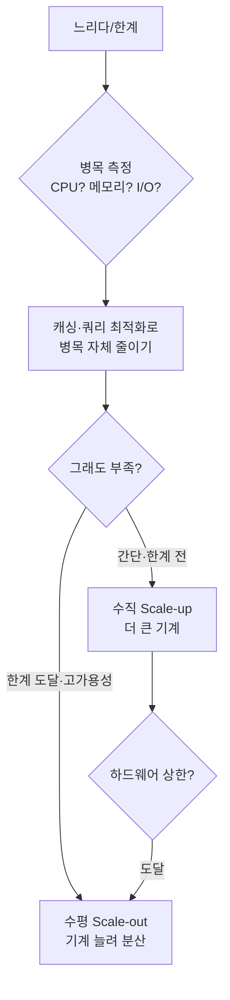
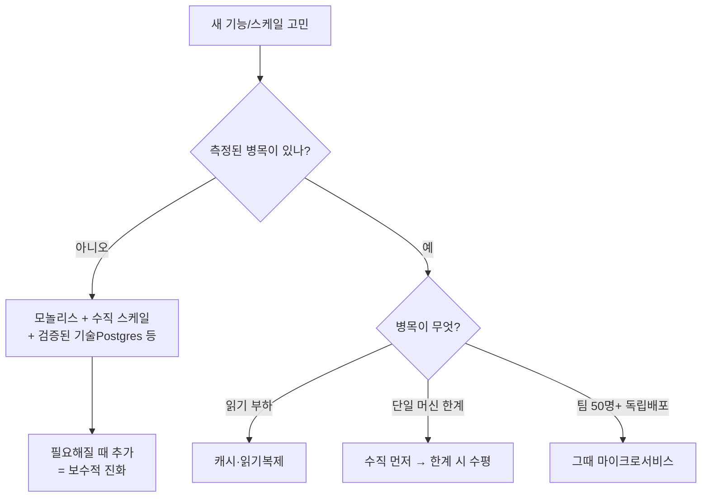

# 9장 성능과 스케일

> 2부 데이터와 일관성

## 들어가며

평균 응답시간은 거짓말을 한다. 이 장은 p99와 Little's Law, 부하 테스트로 성능을 제대로 재는 법을 본 뒤, 더 큰 기계(scale-up)냐 더 많은 기계(scale-out)냐의 선택, 그리고 'You are not Google' — 중소 규모 회사들의 실제 스케일을 다룬다.

---

## 딥다이브 — 성능 공학: 평균은 거짓말을 한다 (p99 · Little's Law · 부하 테스트)

> 기반: **Tene, *How NOT to Measure Latency* (2013~)** · **Little, *A Proof for the Queuing Formula L = λW* (1961)** · **Gregg, *The USE Method*** · **Wilkie, *The RED Method*** · **HikariCP, *About Pool Sizing***
> 형식: 30초 직관 → 왜 이 도구가 생겼나 → 원리 → 트레이드오프.
> 관련: 커넥션 점유는 [5장 트랜잭션과 락](ch05-transaction-and-lock.md) 2-4장, 캐시는 [6장 캐시와 분산 락](ch06-cache-and-distributed-lock.md). 학습 순서는 [E.1 역량 로드맵·코드 설명법](../appendix/e1-roadmap-and-explain.md).

---

### 0. 30초 직관 — "평균 200ms"가 숨기는 것

두 서비스가 있다. 둘 다 **평균 응답 200ms**다.

```
서비스 A: 모든 요청이 180~220ms          → 평균 200ms
서비스 B: 95%는 50ms, 5%는 3,050ms       → 평균 200ms
```

평균은 같지만 B의 사용자 20명 중 1명은 **3초를 기다린다.** 그리고 화면 하나를 그리는 데 API 요청이 30개 나간다면? **거의 모든 사용자가 매번 그 3초짜리를 최소 하나는 만난다** (5%를 30번 피할 확률 = 0.95³⁰ ≈ 21%).

> **평균은 "아무도 겪지 않는 경험"이다.** 성능을 말하려면 **분포의 꼬리** — p95, p99 — 를 봐야 한다.
> "API 응답을 5초에서 1초로 줄였다"고 말하는 순간, 다음 질문은 반드시 "**그거 평균인가요, p99인가요**?"다. 이 노트는 그 질문에 답할 수 있게 만드는 것이 목적이다.

---

### 1. 백분위(percentile) — 꼬리가 곧 사용자 경험

| 지표 | 뜻 | 쓰임 |
|---|---|---|
| **p50 (중앙값)** | 절반의 요청이 이보다 빠름 | "전형적" 경험. 평균보다 낫다 |
| **p95** | 95%가 이보다 빠름 | 느린 경험의 시작점 |
| **p99** | 99%가 이보다 빠름 | **SLO의 표준.** 헤비 유저가 매일 만나는 속도 |
| **p99.9** | 1000건 중 1건 | 대규모 서비스의 관심사 |

**왜 꼬리가 중요한가 — 두 가지 수학적 사실:**

1. **합성(fan-out)**: 페이지 하나 = 내부 호출 수십 개. 개별 호출의 p99가 나빠지면, **페이지 단위에서는 대부분의 사용자가 그걸 겪는다.** (위의 0.95³⁰ 계산)
2. **헤비 유저 편향**: 요청을 많이 보내는 사용자일수록 꼬리를 자주 만난다. **가장 가치 있는 고객이 가장 나쁜 경험을 한다.**

> ⚠️ **백분위는 평균 낼 수 없다.** 서버 10대의 p99를 산술평균한 값은 아무 의미가 없다(수학적으로 성립하지 않음). 전체 분포를 합쳐 다시 계산하거나 히스토그램(HdrHistogram)을 병합해야 한다. 모니터링 대시보드가 이걸 틀리게 하는 경우가 흔하다.

---

### 2. ⭐ 좌표 누락(Coordinated Omission) — 부하 테스트가 하는 거짓말

#### 2-1. Gil Tene의 발견

Azul Systems의 Gil Tene는 *How NOT to Measure Latency* 강연에서 업계 대부분의 부하 테스트가 **구조적으로 낙관적인 숫자**를 만든다는 걸 보였다. 그가 붙인 이름이 **coordinated omission(좌표 누락)** — 측정 도구가 측정 대상과 **"협조"해서 최악의 표본을 조용히 지우는** 현상이다.

#### 2-2. 어떻게 일어나나

대부분의 부하 도구는 **닫힌 모델**(closed model)로 동작한다 — 가상 사용자가 **응답을 받아야 다음 요청을 보낸다.**

```
서버가 500ms 멈춘 순간:

실제 세상 (열린 모델):        부하 도구 (닫힌 모델):
  사용자들은 계속 요청함          워커가 응답 대기 중 → 새 요청 0건
  → 수백 건이 500ms+ 경험        → "500ms 걸린 요청 1건"만 기록
                                → 나머지 수백 건은 표본에서 증발
```

**서버가 멈춘 동안 도구도 같이 멈춘다.** 최악의 순간에 표본 수집이 중단되므로, p99는 실제보다 훨씬 좋게 나온다.

**실화로 보고된 규모**: 테스트에서 p99 47ms → 같은 릴리스가 프로덕션에서 p99 **1.8초**. 38배 차이를 테스트는 "이상 없음"으로 보고했다.

#### 2-3. 해법

- **열린 모델 도구**: 응답과 무관하게 **일정 속도로 요청을 발사** — Tene가 만든 wrk2, Gatling의 open injection 등
- 닫힌 모델 도구(nGrinder·JMeter 기본 모드)를 쓸 때는: **결과가 낙관적일 수 있음을 알고 읽는다.** 특히 "p99가 깨끗한데 프로덕션은 아니다"면 이 현상을 의심한다
- 처리량을 고정하고 지연을 재라 — "최대 몇 TPS 나오나"가 아니라 "**목표 TPS에서 p99가 얼마인가**"가 올바른 질문

> **핵심 교훈**: 부하 테스트의 숫자는 도구의 **작동 모델**을 알아야 해석할 수 있다.
> "nGrinder로 쟀다"까지가 아니라 "닫힌 모델이라 히컵 구간이 과소 표집됐을 수 있다"까지 말할 수 있어야 한다.

---

### 3. Little's Law — 시나리오 설계의 수학

#### 3-1. 1961년의 한 줄 공식

MIT의 John Little이 1961년에 증명한 대기행렬 공식:

$$L = \lambda W$$

**시스템 안의 평균 개체 수(L) = 도착률(λ) × 평균 체류 시간(W).** 놀라운 점은 이게 도착 분포·처리 순서와 무관하게 **항상** 성립한다는 것이다. 그래서 "법칙"이다.

#### 3-2. 서버에 번역하면

$$\text{동시 처리 중 요청 수} = \text{TPS} \times \text{평균 응답시간(초)}$$

**즉시 쓸 수 있는 계산들:**

| 질문 | 계산 |
|---|---|
| TPS 500, 응답 0.2초 → 동시 요청은? | 500 × 0.2 = **100개** (스레드·커넥션이 그만큼 필요) |
| 스레드 200개, 응답 0.5초 → 최대 TPS는? | 200 ÷ 0.5 = **400 TPS** (그 이상은 물리적으로 불가) |
| 응답이 0.2→2초로 열화되면? | 같은 TPS에 동시 요청 **10배** → 풀 고갈 |

**세 번째 줄이 장애의 공식이다.** 외부 API가 느려지면(응답시간↑) 같은 트래픽에서도 점유 자원이 정비례로 늘어난다 — [Spring 트랜잭션 노트](ch05-transaction-and-lock.md) 2-4장의 "느린 벤더가 커넥션 풀을 말리는" 경로가 바로 이 수식이다.

> **부하 시나리오 설계에도 역으로 쓴다**: "동시 사용자 3,000명, 사용자당 10초에 1회 요청" → λ = 300 TPS. 이게 목표 부하다. "스레드 3,000개로 최대한 때려보자"는 시나리오가 아니라 공격이다.

---

### 4. 어디부터 보나 — USE와 RED

병목을 찾을 때 감으로 뒤지지 않기 위한 체크리스트 두 개.

#### USE (Brendan Gregg) — **자원** 관점

모든 자원(CPU·메모리·디스크·네트워크·커넥션 풀·스레드 풀)에 대해:

| 항목 | 질문 |
|---|---|
| **U**tilization | 얼마나 바쁜가 (사용률) |
| **S**aturation | 대기 줄이 있는가 (큐 길이·대기 시간) |
| **E**rrors | 에러가 나는가 |

> **Saturation이 핵심이다.** CPU 70%여도 런큐가 길면 병목이고, 100%여도 큐가 없으면 문제없을 수 있다. "사용률만 보는" 흔한 실수를 막는 항목.

#### RED (Tom Wilkie) — **서비스** 관점

모든 서비스/엔드포인트에 대해:

| 항목 | 질문 |
|---|---|
| **R**ate | 초당 요청 수 |
| **E**rrors | 실패율 |
| **D**uration | 응답시간 **분포** (평균 말고 p99) |

**실전 순서**: RED로 **어느 서비스가** 아픈지 좁히고 → USE로 **어느 자원이** 병목인지 찾는다. 겉에서 안으로.

---

### 5. 커넥션 풀 사이징 — "크게 잡으면 좋다"가 왜 틀렸나

#### 5-1. HikariCP의 유명한 공식

HikariCP 문서 *About Pool Sizing*의 출발점:

```
pool size ≈ (DB 서버 코어 수 × 2) + 유효 디스크 수
```

4코어 DB라면 **약 10개.** 100도 200도 아니다.

#### 5-2. 왜 작을수록 빠른가

DB가 실제로 **동시에** 일할 수 있는 수는 코어 수에 묶여 있다. 커넥션 400개를 열어도 4코어면 **4개만 실행되고 396개는 락과 컨텍스트 스위칭을 유발하며 대기**한다. 큰 풀은 처리량을 늘리는 게 아니라 **경합을 늘린다.** (같은 원리를 [Redis 노트](ch06-cache-and-distributed-lock.md) 2장에서 봤다 — 작업이 짧을수록 병렬화 비용이 이득을 이긴다.)

> ⚠️ **주의 두 가지**: ① 이 공식은 회전 디스크 시절 것이라 SSD 환경에선 **출발점**일 뿐, 정답은 부하 테스트로 찾는다. ② 풀을 줄이기 전에 **트랜잭션 안의 외부 호출부터 제거**해야 한다 — 느린 작업이 커넥션을 쥔 채면 작은 풀은 즉사한다(3-2의 Little's Law).

#### 5-3. 데드락 하한선

한 요청이 커넥션을 **2개 이상** 쓰는 구조(`REQUIRES_NEW` 등)라면 최소 크기가 따로 있다:

```
pool size ≥ 스레드 수 × (요청당 커넥션 수 - 1) + 1
```

이보다 작으면 **모두가 두 번째 커넥션을 기다리는 데드락**이 가능하다 — [Spring 트랜잭션 노트](ch05-transaction-and-lock.md) 3장의 `REQUIRES_NEW` 경고가 수식으로 나온 것.

---

### 6. 부하 테스트의 흔한 거짓말 — 체크리스트

- [ ] **워밍업 없이 측정 시작** — JIT 컴파일·캐시 적재 전 구간이 섞여 실제보다 나쁘게 (혹은 첫 측정만 좋게) 나온다
- [ ] **단일 데이터 반복** — 같은 ID만 조회하면 캐시 히트 100%. 실제 분포(Zipf)와 다르다
- [ ] **닫힌 모델의 좌표 누락** (2장) — 히컵 구간이 표본에서 증발
- [ ] **평균만 보고** — p99 없이는 결론 금지
- [ ] **최대 TPS 찾기만** — 목표 부하에서의 p99가 진짜 질문
- [ ] **테스트 DB가 프로덕션보다 작음** — 인덱스 깊이·버퍼 히트율이 다르면 다른 시스템이다
- [ ] **한 번만 측정** — 변동성을 모른 채 "5초→1초"라고 말하면 안 된다. 최소 반복 3회

> 이 체크리스트는 "남의 성능 주장 읽는 법"이기도 하다. 벤치마크 표를 볼 때 위 항목이 명시돼 있지 않으면 **그 숫자는 재현 불가능한 일화**다.

---

### 7. 3단 요약 (암기용)

#### Q1. 왜 평균 응답시간으로 말하면 안 되나?

- **① 결론 · WHAT** 평균은 **분포의 꼬리를 숨긴다.** 성능 주장은 **p95/p99 + 그때의 부하**(TPS)로 말해야 한다.
- **② 원리 · HOW** 화면 하나가 내부 호출 수십 개로 합성되므로, 개별 호출의 5% 꼬리를 **거의 모든 사용자가** 만난다(0.95³⁰ ≈ 21%만 무사). 게다가 요청이 많은 헤비 유저일수록 꼬리를 자주 겪는다. 백분위는 서버별 값을 **산술평균할 수 없어서** 분포/히스토그램 병합으로 계산해야 한다.
- **③ 확장 · TRADE-OFF** p99를 SLO로 잡으면 비용이 급증한다 — 마지막 1%를 줄이는 비용이 앞의 50%보다 크다. 그래서 SLO는 "p99 1초"처럼 **목표 백분위와 예산을 명시한 계약**이지, 무조건 낮추기가 아니다.

#### Q2. 부하 테스트는 통과했는데 프로덕션이 느리다. 왜?

- **① 결론 · WHAT** 유력 용의자는 **좌표 누락(coordinated omission)** — 닫힌 모델 부하 도구가 서버 히컵 동안 요청 발사를 멈춰 **최악의 표본이 증발**한 것.
- **② 원리 · HOW** 가상 사용자가 응답을 기다렸다 다음 요청을 보내는 닫힌 모델에서는, 서버가 500ms 멈추면 그 동안 보내졌어야 할 수백 건이 표본에서 빠진다. 실제 세상(열린 모델)의 사용자는 서버 사정과 무관하게 계속 도착하는데 말이다. 보고된 사례로 테스트 p99 47ms vs 프로덕션 1.8초가 있다.
- **③ 확장 · TRADE-OFF** 해법은 **일정 속도로 발사하는 열린 모델**(wrk2 등)이지만, 닫힌 모델이 항상 틀린 건 아니다 — 동시 사용자 수가 실제로 고정된 내부 시스템(콜센터 단말 등)은 닫힌 모델이 더 정확하다. **내 트래픽이 열린 시스템인지 닫힌 시스템인지**를 먼저 판단하는 게 도구 선택보다 앞선다. 그 외 용의자: 워밍업 생략, 단일 데이터 캐시 히트, 작은 테스트 DB.

#### Q3. 커넥션 풀·스레드 풀은 몇으로 잡나?

- **① 결론 · WHAT** **Little's Law로 필요량을 계산하고, 풀은 생각보다 작게.** HikariCP 기준 출발점은 `DB 코어 × 2` 수준이다.
- **② 원리 · HOW** `동시 점유 = TPS × 응답시간`이 필요한 커넥션 수의 하한이다. 그런데 DB가 동시에 실행할 수 있는 건 코어 수뿐이라, 그 이상의 커넥션은 **경합(락·컨텍스트 스위칭)만 추가**한다. 큰 풀이 처리량을 낮추는 이유다.
- **③ 확장 · TRADE-OFF** 응답시간이 열화되면 같은 TPS에서 점유가 정비례로 폭증한다 — **트랜잭션 안의 외부 호출 제거가 풀 튜닝보다 먼저**다. 또 한 요청이 커넥션 2개를 쓰는 구조(`REQUIRES_NEW`)면 데드락 방지 하한(`스레드 × (n-1) + 1`)을 별도로 지켜야 한다. 공식은 SSD 시대엔 출발점일 뿐, 최종값은 목표 부하에서의 실측으로 정한다.

---

### 용어 사전

| 용어 | 뜻 |
|------|-----|
| p99 | 요청의 99%가 이보다 빠른 응답시간. 꼬리 지연의 표준 지표 |
| 꼬리 지연(tail latency) | 분포의 느린 끝. fan-out으로 증폭됨 |
| 좌표 누락 | 부하 도구가 서버 정지 동안 표본 수집도 멈추는 왜곡 |
| 닫힌/열린 모델 | 응답 후 다음 요청 / 응답과 무관하게 일정 속도 도착 |
| Little's Law | L = λW. 점유 = 도착률 × 체류시간, 분포 무관하게 성립 |
| USE | 자원별 Utilization·Saturation·Errors 점검법 |
| RED | 서비스별 Rate·Errors·Duration 점검법 |
| SLO | 서비스 수준 목표. "p99 1초 이내" 같은 측정 가능한 약속 |
| HdrHistogram | 백분위를 정확히 병합·기록하기 위한 히스토그램 (Tene 작) |
| 워밍업 | JIT·캐시가 정상 상태에 도달할 때까지 버리는 측정 구간 |

### 연결 지도
- **트랜잭션이 커넥션을 쥐는 시간**: → [5장 트랜잭션과 락](ch05-transaction-and-lock.md)
- **캐시와 스탬피드 (부하의 완충)**: → [6장 캐시와 분산 락](ch06-cache-and-distributed-lock.md)
- **"작을수록 빠르다"의 원리**: → [6장 캐시와 분산 락](ch06-cache-and-distributed-lock.md) 2장
- **품질 속성 시나리오 (숫자를 요구로)**: → [10장 설계의 출발점](../part3/ch10-design-starting-point.md) 1-4장
- **학습 순서**: → [E.1 역량 로드맵·코드 설명법](../appendix/e1-roadmap-and-explain.md)

### 출처
- Tene, G. *How NOT to Measure Latency.* 강연 (Strange Loop 등, 2013~) — HdrHistogram·wrk2의 배경
- Little, J. D. C. *A Proof for the Queuing Formula: L = λW.* Operations Research 9(3), 1961
- Gregg, B. *The USE Method* — https://www.brendangregg.com/usemethod.html
- Wilkie, T. *The RED Method* (Weaveworks, 2015)
- HikariCP Wiki, *About Pool Sizing* — https://github.com/brettwooldridge/HikariCP/wiki/About-Pool-Sizing
- Dean, J. & Barroso, L. A. *The Tail at Scale.* CACM 2013 — 꼬리 지연과 fan-out

_짧은 인용은 출처 표기. 수치 예시는 원리 설명용이며 실측은 환경마다 다르다._

---

## Scale-up vs Scale-out — 더 큰 기계냐, 더 많은 기계냐

> 학습용 문서. 요약 → 상세 → 실무 연결 순.

### 요약 (3줄)

- **Scale-up(수직)**: 한 기계에 CPU·RAM을 더 붙인다. 단순·저지연, 한계가 빨리 옴.
- **Scale-out(수평)**: 기계 수를 늘려 일을 나눈다. 거의 무한 확장, 복잡함·지연 증가.
- 정답은 **병목이 어디인지** 먼저 찾는 것. 병목을 모르고 늘리면 돈만 쓴다.

### 상세

#### 1. 정의
- 수직(scale-up): 더 강한 단일 머신. 코드·구조 변경 거의 없음.
- 수평(scale-out): 인스턴스를 여러 개 두고 부하 분산(load balancer). 분산 시스템이 됨.
[IBM: Scale-up vs Scale-out](https://www.ibm.com/think/topics/scale-up-vs-scale-out)

#### 2. 트레이드오프
| 측면 | Scale-up (수직) | Scale-out (수평) |
|------|----------------|------------------|
| 지연(latency) | **낮음** (네트워크·동일 메모리/캐시) | 높아질 수 있음 (노드 간 통신) |
| 처리량(throughput) | 한계 있음 | **거의 무한** |
| 복잡도 | 단순 | 높음 (상태공유·일관성·장애처리) |
| 비용 | 초기 저렴, 곧 급증 | 점진적, 운영 복잡 |
| 한계 | 하드웨어 상한에 빨리 도달 | 설계만 맞으면 계속 |

- 왜 수직이 지연에 유리? 모든 처리가 **한 메모리/캐시 계층** 안에서 일어나 네트워크 왕복이 없음.
  (→ [메모리 계층](../part1/ch02-1-memory-hierarchy.md)과 직결)

#### 3. 병목은 옮겨 다닌다
자원을 늘리면 병목이 **다른 곳으로 이동**한다. 예: 메모리 100%·CPU 70% 상태에서
메모리를 2배로 → 이번엔 CPU 100%·메모리 80%. → **늘리기 전에 측정**(프로파일링)이 먼저.

#### 4. 실전 순서
```
1. 측정: 진짜 병목이 CPU? 메모리? I/O? 네트워크? (추측 금지)
2. 가까운 해법: 캐싱·쿼리 최적화로 병목 자체를 줄인다 (스케일링 전에)
3. 수직: 간단하면 일단 더 큰 기계 (한계 전까지 가성비 좋음)
4. 수평: 한계 도달/고가용성 필요 시 분산 (상태 분리 설계 필수)
```



### 실무 연결 — 이걸 알면 무엇이 달라지나

- **AI/Claude Code에 일 시킬 때**: "확장성 좋게 만들어줘"는 모호하다 →
  "**현재 병목은 DB I/O, 트래픽 1만 rps 목표, 우선 수직 스케일 가정**" 처럼
  병목·목표·전략을 명시해야 제대로 된 결과가 나온다. ([코드베이스 분석](../appendix/a3-tools-and-llm.md))
- **GitHub Actions runner**: 기본 runner(2코어/7GB)로 부족하면 → 큰 runner(수직) vs
  matrix 병렬(수평)을 병목 기준으로 선택. ([Reusable Workflows](../part5/ch17-2-ci-quality-automation.md))
- **MoE 모델 셀프호스팅**: 활성 파라미터는 작아도 전체를 적재해야 하므로,
  메모리가 병목 → 수직(큰 VRAM) 우선 판단. ([MoE](../appendix/c5-llm-alignment-and-papers.md))

### 관련 문서

- [메모리 계층과 지연시간](../part1/ch02-1-memory-hierarchy.md)
- [Reusable Workflows](../part5/ch17-2-ci-quality-automation.md)

---

## 스케일의 현실 — 중소 회사 기준 4개 회사 사례

> 학습용 문서. 구글·넷플릭스 사례는 **하이퍼스케일**이라 중소 회사엔 대개 안 맞는다.
> "그들이 쓰니까"가 가장 비싼 아키텍처 실수다. 중소~중견 규모에서 배울 검증된 사례 4개.

### 큰 그림 — "You are not Google"

> 아마존·넷플릭스·구글이 마이크로서비스를 쓰니 정답이라는 추론은, 지난 10년간 가장
> 많은 엔지니어링 비용을 낭비한 결정이다. 당신은 구글이 아니다(그만한 장애내성 불필요).
> ([출처](https://medium.com/@neerupujari5/youre-still-writing-microservices-google-moved-on-2-years-ago-2c46bcb33746))

- 흔한 실패: **조기 마이크로서비스가 ~1,000 동시 사용자에서 병목**으로 드러남.
- 임계치(검증): **마이크로서비스는 엔지니어 50명+ / 독립 배포가 필요할 때.**
  팀이 **5–15명이면 조직적 분리가 불필요** → 모놀리스가 맞다.

---

### 사례 1. Stack Overflow — 9대 서버 모놀리스 (수직 스케일)

- 월 **1억+ 방문**을, **온프렘 9대 서버 모놀리스**로 처리. 쿠버네티스·마이크로서비스 **안 씀**.
- 비결: **DB 쿼리 극한 최적화 + 캐싱**. Redis는 **캐시 용도로만**, 검색은 Elasticsearch.
- 교훈: **수직 스케일 + 최적화**가 생각보다 아주 멀리 간다. 단일 코드베이스가 유지보수도 쉬움.
- 출처: [9서버 온프렘 모놀리스(DCD)](https://www.datacenterdynamics.com/en/news/stack-overflow-still-on-prem-runs-qa-platform-off-just-nine-servers/),
  [HN 토론](https://news.ycombinator.com/item?id=34950843)

### 사례 2. 37signals (Basecamp/HEY) — Majestic Monolith + 클라우드 탈출

- **10명 운영팀**, Rails **모놀리스**. AWS **연 $3.2M → 베어메탈 ~$360K** (90%↓).
- 클라우드를 떠나도 인력 추가 불필요(colo 업체가 물리 설치, 원격 관리).
- 교훈: **중견 규모에선 모놀리스 + 자체 서버**가 비용·단순성에서 합리적일 수 있다.
- 출처: [Why we're leaving the cloud(DHH)](https://world.hey.com/dhh/why-we-re-leaving-the-cloud-654b47e0),
  [The Majestic Monolith](https://medium.com/@dhh/see-the-majestic-monolith-https-m-signalvnoise-com-the-majestic-monolith-29166d022228-159794d8da25)

### 사례 3. Instagram — 13명(엔지니어 3명)에 단순 스택으로 수백만 사용자

- $10억에 인수될 때 **직원 13명**, 핵심 엔지니어 **3명**. 스택: **Django + PostgreSQL + Memcached**,
  Redis는 **피드·세션 등 특정 용도**. AWS EC2.
- 원칙 3가지: **단순하게 / 바퀴 재발명 금지 / 검증된 견고한 기술 사용**.
- 교훈: 작은 팀도 **단순·검증된 스택**으로 대규모까지 간다. 복잡도는 필요할 때 추가.
- 출처: [3명이 1400만까지](https://read.engineerscodex.com/p/how-instagram-scaled-to-14-million),
  [What Powers Instagram](https://instagram-engineering.com/what-powers-instagram-hundreds-of-instances-dozens-of-technologies-adf2e22da2ad)

### 사례 4. Amazon Prime Video — 분산 되돌리기 (반례 보강)

- 하이퍼스케일러조차 마이크로서비스/서버리스 → **모놀리스로 통합, 비용 90%↓**.
- 교훈: **큰 회사도 과한 분산을 되돌린다.** "분산 = 진보"가 아니다. (앞 [tradeoffs 사례2](../part4/ch14-migration-case-studies.md) 참고)
- 출처: [thestack 정리](https://www.thestack.technology/amazon-prime-video-microservices-monolith/)

---

### 중소 회사 기준 — 종합 판단



**기본값(중소~중견):**
1. **모놀리스 + 수직 스케일 + 검증된 기술**(Postgres 한 개로 캐시·큐·검색까지도)
2. **Redis/Kafka/MSA/scale-out은 "측정된 병목"이 강제할 때만** 추가
3. 하이퍼스케일러 블로그는 **그들 규모의 문제 해결책** — 내 규모에 복붙 금지

### 우리 벤치마크와 연결

[lab-benchmarks](https://github.com/mgj96/lab-benchmarks)에서 본 것처럼, 동시성 제어도
**Redis가 "필요해서"가 아니라 측정된 병목일 때.** 단일 DB로 충분하면 `db-atomic` 같은
단순 해법이 더 빠르고 단순하다. 위 4개 회사의 "단순함 우선"과 같은 결.

### 관련 문서

- [Scale-up vs Scale-out](ch09-performance-and-scale.md)
- [정답은 없다 — 경험담](../part4/ch14-migration-case-studies.md)
- [트레이드오프 읽는 법](../preface/00-how-to-read.md)

---

## 다음으로

여기까지가 '무엇이 비싼가'였다. 3부에서는 그 비용을 보고 경계를 어디에 그을지 정하는 법, 즉 설계로 넘어간다.

👉 [10장 설계의 출발점](../part3/ch10-design-starting-point.md)
