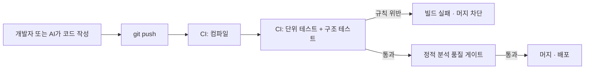
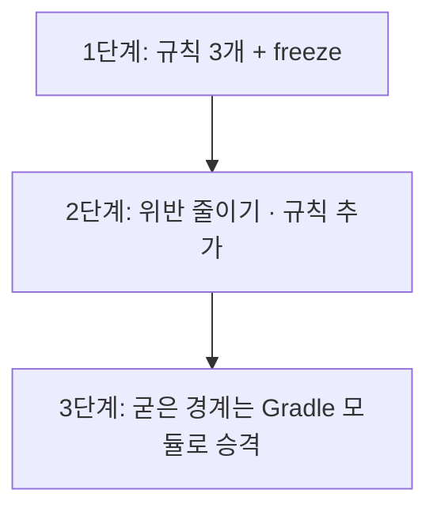

# 15장 구조를 CI로 지키기

> 4부 운영 중인 구조 바꾸기

## 들어가며

설계 문서에 적힌 규칙은 시간이 지나면 깨진다. 이 장은 ArchUnit과 아키텍처 피트니스 함수로 '레이어 규칙', '의존 방향'을 빌드 실패로 바꾸는 실전 방법을 다룬다. 사람의 리뷰 대신 기계가 구조를 지키게 하는 첫걸음이다.

---

## 구조를 CI로 지키기 — 아키텍처 피트니스 함수 실전

> 용도: **정한 구조(레이어·모듈 경계·상속 규칙)를 사람의 리뷰가 아니라 빌드가 지키게 만드는 방법.** 클래스·슈퍼클래스·메서드·필드·애노테이션 단위 규칙을 ArchUnit 코드로 익힌다.
> 기반: Ford·Parsons·Kua *Building Evolutionary Architectures*(2017, 2판 2022), ArchUnit 사용자 가이드, Spring Modulith 레퍼런스, Checkstyle ImportControl 문서.
> 관련: 경계를 왜 거기 긋는지는 [모듈성 이론](../part3/ch11-modularity.md), 첫 소개는 [개념 노트 3-4·3-5](../part3/ch10-design-starting-point.md), 팀 크기와 구조는 [콘웨이 법칙과 AI 에이전트](../part3/ch12-conway-and-ai-agents.md), AI가 만든 코드의 검증은 [AI 시대 검증·구조 유지](../part5/ch16-1-bottleneck-moved-to-verification.md).

---

### 0. 30초 직관 — 설계도는 경비원이 없으면 무너진다

아파트 설계도에 "주방 벽은 허물지 마시오"라고 써 두면 지켜질까? 급하게 리모델링하는 날 누군가 허문다. 그래서 진짜 건물은 **허물면 경보가 울리는 장치**를 단다.

코드도 같다. 문서에 "도메인은 DB 코드를 모른다"라고 적어 둬도, 급한 배포 날 누군가 `domain` 안에서 리포지토리를 부른다. 그 순간 **빌드가 실패하게** 만들면 규칙은 문서가 아니라 사실이 된다. 이렇게 **아키텍처 특성을 자동으로 검사하는 장치**를 **피트니스 함수**(fitness function)라고 부른다.



글로 풀면: 코드를 올리면 CI가 컴파일하고, 평소 단위 테스트와 함께 **구조 테스트**를 돌린다. 구조 테스트가 "이 클래스가 저 패키지를 부르면 안 된다" 같은 규칙 위반을 찾으면 빌드가 실패해서 머지가 막힌다. 통과하면 정적 분석 품질 게이트를 거쳐 배포된다. 사람이든 AI든 같은 문을 지난다.

**핵심 요약**: 리뷰어의 기억력에 맡긴 규칙은 사라진다. 테스트가 된 규칙만 남는다.

---

### 1. 도구 지도 — 어느 층에서 막을까

경계를 막는 방법은 "얼마나 일찍, 얼마나 세게" 막느냐로 나뉜다.

| 층 | 도구 | 막는 시점 | 세기 | 이럴 때 |
|---|---|---|---|---|
| 빌드 구조 | Gradle/Maven 멀티 모듈, `implementation` vs `api` | 컴파일 | 가장 셈 (아예 안 보임) | 경계가 확실히 굳었을 때 |
| 언어 | Java 모듈 시스템(`module-info.java`), package-private | 컴파일 | 셈 | 공개 API를 좁히고 싶을 때 |
| 테스트 | **ArchUnit**, Spring Modulith `verify()` | 테스트 단계 | 중간 (규칙을 코드로 자유롭게) | **대부분의 경우 출발점** |
| 정적 분석 | Checkstyle ImportControl, PMD 사용자 규칙, SonarQube 게이트 | 분석 단계 | 중간 | import 규칙·코드 스타일 |
| 런타임 측정 | 부하 테스트 임계값, 응답시간 p99 | 배포 전후 | 수치 | 성능·가용성 특성 |
| 다른 언어 | TS: dependency-cruiser, eslint-plugin-boundaries, Nx / Python: import-linter | 린트·테스트 | 중간 | 프론트·스크립트도 같은 원리 |

> **실무 순서**: 모듈러 모놀리스라면 **ArchUnit(또는 Spring Modulith)으로 시작** → 경계가 몇 달 동안 안정되면 그 경계를 **Gradle 모듈로 승격**(컴파일러가 막게) → 그다음에야 서비스 분리를 고민한다. 테스트로 막는 경계는 바꾸기 쉽고, 컴파일로 막는 경계는 바꾸기 어렵다. 그래서 **확신이 쌓일수록 아래(빌드)로 내린다.**

**핵심 요약**: 처음엔 테스트로 가볍게, 확신이 서면 컴파일러로 단단하게.

---

### 2. ArchUnit 기본기 — "누가 · 무엇을 해야 한다"

ArchUnit은 컴파일된 `.class` 파일을 읽어서 의존 관계를 그래프로 만들고, 그 위에서 규칙을 검사하는 **평범한 JUnit 테스트**다. 그래서 별도 서버 없이 `./gradlew test`만 돌면 CI에서 같이 돈다.

```java
// build.gradle
testImplementation 'com.tngtech.archunit:archunit-junit5:1.3.0'
```

```java
@AnalyzeClasses(packages = "com.example.parking", importOptions = ImportOption.DoNotIncludeTests.class)
class ArchitectureTest {

    @ArchTest
    static final ArchRule 도메인은_인프라를_모른다 =
        noClasses().that().resideInAPackage("..domain..")
            .should().dependOnClassesThat().resideInAPackage("..infra..");
}
```

규칙 문장은 영어 문장처럼 읽힌다: **"어떤 대상(that) 은 ~해야 한다(should)"**.

| 출발점 | 대상 |
|---|---|
| `classes()` / `noClasses()` | 클래스 |
| `methods()` / `noMethods()` | 메서드 |
| `fields()` / `noFields()` | 필드 |
| `constructors()`, `codeUnits()` | 생성자, 메서드+생성자 |
| `layeredArchitecture()` | 레이어 전체 |
| `slices()` | 패키지 묶음 (순환 검사) |

**`..domain..` 뜻**: 점 두 개는 "중간에 무엇이 와도 됨". `com.example.parking.domain.fee` 도 `..domain..` 에 걸린다.

---

### 3. 단위별 규칙 모음 — 클래스 · 슈퍼클래스 · 메서드 · 필드

여기가 이 노트의 본체다. 아래 예시는 실제로 자주 쓰는 형태를 주차 플랫폼 같은 업무 시스템 기준으로 옮긴 것이다.

#### 3-1. 패키지·레이어 의존 방향

```java
@ArchTest
static final ArchRule 레이어 = layeredArchitecture().consideringAllDependencies()
    .layer("Controller").definedBy("..controller..")
    .layer("Service").definedBy("..service..")
    .layer("Domain").definedBy("..domain..")
    .layer("Infra").definedBy("..infra..")
    .whereLayer("Controller").mayNotBeAccessedByAnyLayer()
    .whereLayer("Service").mayOnlyBeAccessedByLayers("Controller")
    .whereLayer("Infra").mayOnlyBeAccessedByLayers("Service");
```

컨트롤러는 아무도 부르면 안 되고, 서비스는 컨트롤러만, 인프라는 서비스만 부를 수 있다는 규칙이다. **누가 누구를 부를 수 있나**를 표 대신 코드로 적은 것이다.

#### 3-2. 슈퍼클래스·인터페이스 (상속 제어) ⭐

"이 종류의 클래스는 반드시 이 부모를 상속해라", 또는 "이 부모를 상속한 건 여기에만 있어라" 같은 규칙이다.

```java
// ① @Entity는 반드시 공통 감사(생성일·수정일) 부모를 상속
@ArchTest
static final ArchRule 엔티티는_BaseEntity_상속 =
    classes().that().areAnnotatedWith(Entity.class)
        .should().beAssignableTo(BaseEntity.class);

// ② 외부 업체 연계 구현체는 vendor 패키지에만 존재 (Factory 패턴 경계)
@ArchTest
static final ArchRule 업체_구현은_vendor_안에만 =
    classes().that().implement(VendorClient.class)
        .should().resideInAPackage("..vendor..");

// ③ 공통 코어는 개별 업체 구현을 직접 부르지 않는다 (인터페이스로만)
@ArchTest
static final ArchRule 코어는_업체_구현을_모른다 =
    noClasses().that().resideInAPackage("..core..")
        .should().dependOnClassesThat().implement(VendorClient.class);

// ④ JPA 리포지토리를 상속한 인터페이스는 infra에만
@ArchTest
static final ArchRule 리포지토리는_infra에 =
    classes().that().areAssignableTo(JpaRepository.class)
        .should().resideInAPackage("..infra..");

// ⑤ 예외는 우리 공통 예외 부모를 상속 (에러 코드 체계 통일)
@ArchTest
static final ArchRule 업무예외는_공통부모 =
    classes().that().resideInAPackage("..exception..")
        .and().areAssignableTo(RuntimeException.class)
        .should().beAssignableTo(BusinessException.class);
```

- `beAssignableTo(X)`: X를 상속하거나 구현했는가 (부모가 몇 단계 위여도 됨)
- `implement(X)`: X 인터페이스를 구현했는가
- ②③을 같이 걸면 "**업체가 늘어도 코어는 안 바뀐다**"는 Factory 표준화의 약속이 테스트로 굳는다. 새 업체를 붙이는 사람이 코어에 `if (vendor == ...)` 를 넣는 순간 ③이 빌드를 깬다.

#### 3-3. 메서드 규칙

```java
// 트랜잭션은 서비스 계층의 public 메서드에만
@ArchTest
static final ArchRule 트랜잭션은_서비스에서만 =
    methods().that().areAnnotatedWith(Transactional.class)
        .should().beDeclaredInClassesThat().resideInAPackage("..service..")
        .andShould().bePublic();

// 컨트롤러가 리포지토리 메서드를 직접 호출 금지
@ArchTest
static final ArchRule 컨트롤러는_리포지토리_직접호출_금지 =
    noClasses().that().resideInAPackage("..controller..")
        .should().callMethodWhere(
            JavaCall.Predicates.target(
                HasOwner.Predicates.With.owner(JavaClass.Predicates.assignableTo(JpaRepository.class))));
```

`@Transactional` 을 private 메서드에 붙이면 스프링 프록시가 적용되지 않아 조용히 무시된다. 이런 **"컴파일은 되는데 동작은 안 하는"** 실수를 막는 데 메서드 규칙이 특히 쓸모 있다.

#### 3-4. 필드·주입 방식

```java
// 서비스의 필드는 final (생성자 주입 강제)
@ArchTest
static final ArchRule 서비스_필드는_final =
    fields().that().areDeclaredInClassesThat().areAnnotatedWith(Service.class)
        .should().beFinal();

// ArchUnit이 제공하는 일반 규칙 묶음
@ArchTest
static final ArchRule 필드주입_금지 = GeneralCodingRules.NO_CLASSES_SHOULD_USE_FIELD_INJECTION;
@ArchTest
static final ArchRule 표준출력_금지 = GeneralCodingRules.NO_CLASSES_SHOULD_ACCESS_STANDARD_STREAMS;
@ArchTest
static final ArchRule 범용예외_던지기_금지 = GeneralCodingRules.NO_CLASSES_SHOULD_THROW_GENERIC_EXCEPTIONS;
```

`System.out.println` 대신 로거를 쓰라는 규칙(`ACCESS_STANDARD_STREAMS`)은 로깅을 일괄 정리할 때 재발을 막는 데 바로 쓸 수 있다.

#### 3-5. 이름·애노테이션 규칙

```java
@ArchTest
static final ArchRule 컨트롤러_이름 =
    classes().that().areAnnotatedWith(RestController.class)
        .should().haveSimpleNameEndingWith("Controller")
        .andShould().resideInAPackage("..controller..");
```

이름 규칙은 가볍지만, AI가 만든 파일이 엉뚱한 패키지에 생기는 걸 바로 잡아 준다.

#### 3-6. 순환 참조 금지

```java
@ArchTest
static final ArchRule 모듈간_순환_금지 =
    slices().matching("com.example.parking.(*)..").should().beFreeOfCycles();
```

`(*)` 자리에 오는 첫 번째 하위 패키지(예: `fee`, `pass`, `vendor`)를 하나의 덩어리로 보고, 덩어리끼리 **A→B→A**로 도는 의존이 있으면 실패한다. 순환이 생기면 둘은 사실상 한 모듈이라 나중에 떼어낼 수 없다.

#### 3-7. 기본 제공으로 안 되면 — 직접 조건 만들기

```java
static final ArchCondition<JavaClass> 메서드_20개_이하 =
    new ArchCondition<>("메서드가 20개 이하") {
        @Override
        public void check(JavaClass c, ConditionEvents events) {
            int n = c.getMethods().size();
            if (n > 20) {
                events.add(SimpleConditionEvent.violated(c, c.getName() + " 메서드 " + n + "개"));
            }
        }
    };

@ArchTest
static final ArchRule 서비스는_비대하지_않게 =
    classes().that().resideInAPackage("..service..").should(메서드_20개_이하);
```

**핵심 요약**: 클래스(어디에 있나·누구를 부르나), 슈퍼클래스(누구를 상속해야 하나·상속한 건 어디 있어야 하나), 메서드(어디서 선언·호출 가능한가), 필드(final인가·주입 방식) — 네 단위만 익히면 대부분의 설계 약속을 테스트로 옮길 수 있다.

---

### 4. 이미 돌아가는 레거시에 거는 법 — 얼리기(Freeze)와 래칫

새 규칙을 걸면 기존 코드에서 위반이 수백 개 나온다. 다 고칠 때까지 CI를 끌 수는 없다. 그래서 **"지금 있는 위반은 봐주고, 새 위반만 막는"** 방식을 쓴다.

```java
@ArchTest
static final ArchRule 도메인은_인프라를_모른다 = FreezingArchRule.freeze(
    noClasses().that().resideInAPackage("..domain..")
        .should().dependOnClassesThat().resideInAPackage("..infra.."));
```

```properties
# src/test/resources/archunit.properties
freeze.store.default.allowStoreCreation=true
```

첫 실행 때 현재 위반 목록을 파일(`archunit_store`)에 저장하고, 이후에는 **목록에 없는 새 위반만 실패**시킨다. 기존 위반을 고치면 목록에서 빠지고 다시 늘어날 수 없다. 톱니바퀴처럼 한 방향으로만 도는 **래칫**(ratchet)이다. 이 저장 파일은 git에 같이 커밋해야 CI에서도 같은 기준이 적용된다.


글로 풀면: 규칙을 처음 걸 때 위반 300개를 기록해 두고, 그 뒤로 새로 생긴 위반만 막는다. 누가 기존 위반을 고치면 기록에서 빠지므로, 위반 수는 늘 수 없고 줄기만 한다.

> 이 방식은 [운영 중인 구조 바꾸기](ch14-migration-case-studies.md)의 "구조는 유지하고 안쪽만 점진적으로 바꾼다" 전략과 같은 발상이다. 큰 리팩터링 없이 **오늘부터 더 나빠지지 않게** 만드는 게 출발점이다.

---

### 5. Spring Modulith — 모듈러 모놀리스 전용 검사기

Spring Boot 프로젝트라면 모듈 경계 검사를 규칙 없이 관례로 할 수도 있다.

```java
class ModularityTest {
    @Test
    void 모듈_경계_검증() {
        ApplicationModules.of(ParkingApplication.class).verify();
    }
}
```

- 메인 클래스가 있는 패키지의 **바로 아래 패키지 하나 = 모듈 하나**로 본다 (`parking.fee`, `parking.pass`, `parking.vendor` …).
- 모듈의 **최상위 패키지만 공개 API**, 그 아래 하위 패키지(`fee.internal` 등)는 다른 모듈이 부르면 실패.
- 모듈 사이 순환도 실패.
- 꼭 열어야 할 하위 패키지는 `@NamedInterface`, 허용할 의존은 `@ApplicationModule(allowedDependencies = …)` 로 명시.
- 같은 정보로 모듈 관계 문서(다이어그램)도 생성해 준다.

| | ArchUnit | Spring Modulith |
|---|---|---|
| 규칙 | 직접 하나하나 작성 | 패키지 관례로 자동 |
| 자유도 | 높음 (상속·메서드·필드까지) | 모듈 경계·순환 중심 |
| 적합 | 기존 레거시, 세밀한 규칙 | 새로 짜거나 패키지가 정리된 Spring 프로젝트 |

> 둘은 경쟁이 아니다. Spring Modulith 내부도 ArchUnit으로 의존을 분석한다. **모듈 경계는 Modulith, 클래스 단위 세부 규칙은 ArchUnit**으로 같이 쓰는 경우가 많다.

---

### 6. 테스트 말고 다른 층 — 짧게

#### 6-1. Checkstyle ImportControl (import 문 화이트리스트)

```xml
<!-- import-control.xml -->
<import-control pkg="com.example.parking">
  <allow pkg="java"/>
  <subpackage name="domain">
    <disallow pkg="org.springframework"/>
    <disallow pkg="com.example.parking.infra"/>
  </subpackage>
</import-control>
```

import 문만 보고 막으므로 가볍고 빠르다. 대신 상속·메서드 호출 같은 의미는 모른다.

#### 6-2. Gradle 멀티 모듈 (컴파일러가 막기)

```groovy
// fee 모듈의 build.gradle
dependencies {
    implementation project(':core')   // core를 쓰지만, fee를 쓰는 쪽에는 core가 안 보임
}
```

모듈로 나누면 의존 선언이 없는 코드는 **아예 import가 안 된다.** 테스트를 돌리기 전에 컴파일에서 끝난다. 다만 모듈을 나누고 합치는 비용이 커서 경계가 굳은 다음에 쓴다.

#### 6-3. SonarQube 품질 게이트

복잡도·중복·커버리지 같은 **수치**를 기준선으로 두고, 새 코드가 기준 아래면 머지를 막는다. 구조 테스트가 "모양"을 지킨다면 품질 게이트는 "상태"를 지킨다. 둘 다 CI의 같은 단계에 걸어 두면 된다.

---

### 7. CI에 거는 순서 — 작게 시작하는 3단계



글로 풀면: 처음엔 규칙 몇 개를 얼려서 걸고, 위반을 줄이며 규칙을 늘리고, 몇 달 동안 안 바뀐 경계는 빌드 모듈로 올려 컴파일러가 지키게 한다.

1. **1단계 (하루)**: 가장 아픈 규칙 3개만 고른다. 예: 도메인→인프라 금지, 모듈 순환 금지, 업체 구현은 vendor에만. `freeze` 로 감싸서 `test` 단계에 넣는다.
2. **2단계 (몇 주)**: 기존 위반을 고칠 때마다 freeze 기록이 줄어드는지 본다. 리뷰에서 같은 지적이 두 번 나오면 그걸 규칙으로 만든다. "**리뷰 코멘트 → 규칙**"이 핵심 습관이다.
3. **3단계 (몇 달)**: 한동안 위반이 없던 경계는 Gradle 모듈로 승격한다.

```yaml
# .gitlab-ci.yml (요지)
test:
  stage: test
  script:
    - ./gradlew test        # 단위 테스트 + ArchUnit + Modulith verify 가 같이 돈다
quality:
  stage: quality
  script:
    - ./gradlew sonar       # 품질 게이트 실패 시 파이프라인 실패
```

**AI 에이전트와의 관계**: AI는 규칙을 "알려 주면" 잊을 수 있지만, 빌드가 깨지면 고칠 수밖에 없다. 구조 테스트의 실패 메시지(어떤 클래스가 어떤 규칙을 어겼는지)는 그대로 AI에게 되돌려 줄 수 있는 좋은 피드백이다. 그래서 AI 코드가 늘수록 **규칙을 프롬프트가 아니라 테스트에 두는** 쪽이 오래 간다.

---

### 8. 함정과 트레이드오프

| 함정 | 왜 문제 | 대응 |
|---|---|---|
| 규칙을 처음부터 50개 | 위반 폭발 → 팀이 테스트를 끔 | 3개 + freeze 로 시작 |
| 테스트 클래스까지 검사 | 테스트는 경계를 넘는 게 정상인 경우가 많음 | `ImportOption.DoNotIncludeTests` |
| 리플렉션·동적 호출 | 바이트코드에 의존이 안 보여서 못 잡음 | 그런 곳은 리뷰로 보완 |
| freeze 파일을 커밋 안 함 | 로컬과 CI 기준이 달라짐 | `archunit_store` 를 git에 포함 |
| 규칙이 실제 설계와 어긋남 | 규칙을 피하려 이상한 코드 생김 | 규칙도 코드다 — 설계가 바뀌면 규칙도 바꾼다 |

**트레이드오프 한 줄**: 규칙은 **바꾸기 쉬운 방향으로 자유를 줄이는 것**이다. 너무 일찍 너무 단단히 막으면 설계를 바꿀 때 규칙이 발목을 잡는다. 그래서 테스트(부드러움) → 컴파일(단단함) 순서로 내려간다.

---

### 9. 3단 요약 (암기용)

#### Q1. 아키텍처 피트니스 함수란?
- **① 결론 · WHAT** 아키텍처 특성(의존 방향·모듈 경계·성능)을 자동으로 측정하고 위반 시 빌드를 실패시키는 검사.
- **② 원리 · HOW** 설계 규칙을 ArchUnit 같은 테스트나 수치 임계값으로 바꿔 CI에서 매번 돌린다.
- **③ 확장 · TRADE-OFF** 문서·리뷰는 기억에 의존해 침식된다. 대신 규칙 자체가 설계 변경의 비용이 되므로, 확신이 쌓인 만큼만 단단하게 건다.

#### Q2. 슈퍼클래스·인터페이스 규칙은 어디에 쓰나?
- **① 결론 · WHAT** "이 종류는 이 부모를 상속해야 한다" 또는 "이 부모를 상속한 건 이 패키지에만 있어야 한다"를 강제한다.
- **② 원리 · HOW** `classes().that().areAnnotatedWith(Entity.class).should().beAssignableTo(BaseEntity.class)`, `classes().that().implement(VendorClient.class).should().resideInAPackage("..vendor..")`.
- **③ 확장 · TRADE-OFF** Factory·전략 패턴의 "확장은 구현 추가로만, 코어는 불변" 약속을 테스트로 굳힌다. 상속 강제가 과하면 조합(composition)을 막을 수 있으니 공통 감사 필드·예외 체계처럼 꼭 필요한 곳에만.

#### Q3. 레거시에 규칙을 걸면 위반이 수백 개인데?
- **① 결론 · WHAT** `FreezingArchRule.freeze` 로 현재 위반을 기록하고 새 위반만 막는다.
- **② 원리 · HOW** 위반 목록을 파일로 저장해 커밋하고, 고친 위반은 목록에서 빠져 다시 늘 수 없다(래칫).
- **③ 확장 · TRADE-OFF** 큰 리팩터링 없이 "오늘부터 더 나빠지지 않게"가 가능하다. 다만 기록된 위반을 줄이는 계획이 없으면 영구 예외가 된다.

#### Q4. ArchUnit과 Spring Modulith는 무엇이 다른가?
- **① 결론 · WHAT** ArchUnit은 규칙을 직접 쓰는 범용 도구, Modulith는 패키지 관례로 모듈 경계를 자동 검사한다.
- **② 원리 · HOW** Modulith는 메인 패키지의 바로 아래 패키지를 모듈로 보고, 하위 패키지 접근과 순환을 막는다(`ApplicationModules.of(App.class).verify()`).
- **③ 확장 · TRADE-OFF** 모듈 경계는 Modulith, 상속·메서드·필드 세부 규칙은 ArchUnit으로 함께 쓴다.

#### Q5. MSA 대신 모듈러 모놀리스를 고른 팀에게 CI 구조 검사가 왜 핵심인가?
- **① 결론 · WHAT** MSA는 네트워크가 경계를 강제하지만, 모놀리스는 아무것도 강제하지 않아서 CI가 그 역할을 대신해야 한다.
- **② 원리 · HOW** 같은 프로세스 안에서는 어떤 클래스든 import 할 수 있다. 구조 테스트가 "import 할 수는 있지만 하면 빌드가 깨진다"로 만든다.
- **③ 확장 · TRADE-OFF** [콘웨이 법칙](../part3/ch12-conway-and-ai-agents.md)상 소규모 팀은 서비스 수를 감당하기 어렵다. 모놀리스 + CI 경계는 운영 부담 없이 경계만 얻는 선택이고, 나중에 떼어낼 때 그 경계가 그대로 분리선이 된다.

---

### 용어 사전

| 한 | 영 | 뜻 |
|---|---|---|
| 피트니스 함수 | fitness function | 아키텍처 특성을 자동으로 검사하는 장치 |
| 레이어 규칙 | layered architecture rule | 계층 간 호출 허용 범위 |
| 슬라이스 | slice | ArchUnit에서 패키지 묶음 하나 |
| 얼리기 | freeze | 현재 위반을 기록하고 새 위반만 막기 |
| 래칫 | ratchet | 한 방향으로만 개선되게 하는 장치 |
| 명명된 인터페이스 | named interface | Modulith에서 외부에 여는 하위 패키지 |
| 품질 게이트 | quality gate | 정적 분석 수치 기준 미달 시 머지 차단 |
| 모듈러 모놀리스 | modular monolith | 배포는 하나, 안은 경계가 있는 모듈들 |

### 연결 지도

- 왜 그 방향으로 의존해야 하나 → [모듈성 이론](../part3/ch11-modularity.md)
- 처음 짓는 구조 선택 → [개념 노트](../part3/ch10-design-starting-point.md)
- 팀 크기와 구조 → [콘웨이 법칙과 AI 에이전트](../part3/ch12-conway-and-ai-agents.md)
- AI 코드 검증 → [AI 시대 검증·구조 유지](../part5/ch16-1-bottleneck-moved-to-verification.md), [검증의 시대](../part5/ch16-2-pstack-and-merge-at-scale.md)
- 운영 중 점진 전환 → [운영 중인 구조 바꾸기](ch14-migration-case-studies.md)
- 코드 품질 게이트 → [Java 품질 게이트](../part5/ch17-1-testing-and-standards.md)

### 출처

- Neal Ford, Rebecca Parsons, Patrick Kua, *Building Evolutionary Architectures* (O'Reilly, 2017; 2판 2022) — 피트니스 함수 개념
- ArchUnit User Guide — https://www.archunit.org/userguide/html/000_Index.html
- Spring Modulith Reference — https://docs.spring.io/spring-modulith/reference/
- Checkstyle ImportControl — https://checkstyle.sourceforge.io/checks/imports/importcontrol.html
- Matthew Skelton, Manuel Pais, *Team Topologies* (2019) — 팀 인지 부하와 구조

---

## 다음으로

기계가 구조를 지키게 하는 흐름은 AI 시대에 더 중요해졌다. 코드를 쓰는 비용이 거의 0이 되면서, 병목이 검증으로 옮겨갔기 때문이다. 5부로 간다.

👉 [16장 검증의 시대 · 16.1 병목이 검증으로 옮겨갔다](../part5/ch16-1-bottleneck-moved-to-verification.md)
