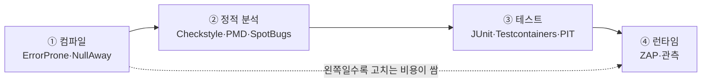

# 17장 테스트와 품질 게이트 · 17.1 테스트 전략과 팀 표준

> 5부 AI 시대의 검증

## 들어가며

통과하는 테스트가 아무것도 증명하지 못할 때가 있다. 이 절은 무엇을 어떤 단위로 테스트해야 하는지 정리하고, 팀의 코드 표준을 '문서'에서 '빌드 실패'로 승격시키는 품질 게이트를 무료 도구로 세우는 법을 다룬다.

### 한눈에 보기



> 버그를 잡는 사다리는 네 칸이다. 컴파일 → 정적 분석 → 테스트 → 런타임 순서이고, 왼쪽(이른 시점)에서 잡을수록 고치는 비용이 싸다(shift-left). 테스트는 네 칸 중 하나일 뿐이라, 팀 표준은 앞의 두 칸에서 빌드 실패로 강제하는 것이 핵심이다.

---

## 딥다이브 — 테스트 전략: 통과하는 테스트가 아무것도 증명하지 않을 때

> 기반: **Cohn, *Succeeding with Agile* (2009, 테스트 피라미드)** · **Dodds, *The Testing Trophy* (2018~)** · **Meszaros, *xUnit Test Patterns* (2007, 테스트 더블)** · **Fowler, *Mocks Aren't Stubs* (2004)**
> 형식: 30초 직관 → 역사(두 도형의 대립) → 원리 → 트레이드오프.
> 관련: `@Transactional`의 프록시 동작은 5장 트랜잭션과 락, 학습 순서는 E.1 역량 로드맵·코드 설명법.

---

### 0. 30초 직관 — 전부 초록불인데 배포하면 터진다

```java
@Test
void 출차_요금_계산() {
    when(feePolicy.calculate(any())).thenReturn(5000);   // mock
    when(repository.findById(42L)).thenReturn(parking);  // mock

    exitService.exit(42L);

    verify(feePolicy).calculate(any());                  // "호출했는지" 확인
    verify(repository).save(any());
}
```

이 테스트는 **항상 통과한다.** 요금 정책이 틀려도, 쿼리가 틀려도, 트랜잭션이 안 걸려도. 왜냐하면 —

> **모든 협력자를 mock으로 바꾼 테스트는 "내 코드가 내 상상대로 호출한다"만 검증한다.**
> 상상 자체가 틀렸는지는 영원히 모른다. **테스트가 구현의 복사본**이 된 것이다.

이 노트의 질문: **무엇을 어느 비율로, 진짜와 가짜 중 무엇으로 테스트할 것인가.** 답이 하나가 아니라서 15년째 논쟁 중이고, 그 논쟁의 지형을 아는 것이 곧 전략이다.

---

### 1. 역사 — 피라미드와 트로피, 두 도형의 대립

#### 1-1. 테스트 피라미드 (Mike Cohn, 2009)

```
        /  E2E  \        느리고 · 깨지기 쉽고 · 비싸다 → 조금만
       / 통합    \
      / 단위      \      빠르고 · 안정적이고 · 싸다 → 많이
```

*Succeeding with Agile*(2009)에서 나온 원칙: **아래(단위)를 두껍게, 위(E2E)를 얇게.** 근거는 당시의 비용 구조다 — 2009년의 "통합 테스트"는 느린 실제 서버·수동 환경을 의미했고, 단위 테스트만이 빨랐다.

#### 1-2. 테스팅 트로피 (Kent C. Dodds, 2018~)

> "Write tests. Not too many. **Mostly integration.**" — Guillermo Rauch를 인용하며 Dodds가 정식화

```
       🏆
      /E2E \
     /━━━━━━\
    /  통합   \      ← 제일 두껍게
    \  단위   /
     \정적분석/
```

**통합을 제일 두껍게** 하라는, 피라미드를 뒤집는 주장. 근거는 **비용 구조가 바뀌었다**는 것이다:

- Testcontainers·인메모리 서버·`@SpringBootTest` 슬라이스 — **통합 테스트가 싸고 빨라졌다**
- 반면 mock 범벅 단위 테스트는 **"통과하지만 아무것도 증명 못 하는"**(0장) 비용을 치른다는 게 드러났다

> **누가 맞나?** — 질문이 틀렸다. 두 도형은 **"신뢰(진짜에 가까움) vs 속도(피드백 주기)"의 거래에서 어디에 서느냐**다.
> 도메인 로직이 두꺼우면(요금 계산 엔진) 순수 단위 테스트가 값지고, 로직이 얇고 연결이 본체인 CRUD 서비스면 통합이 값지다.
> **"Integration-First"를 택했다면 그건 트로피 진영의 선택이고, 그 근거를 말할 수 있어야 한다** — "우리 코드의 버그는 대부분 계층 사이(쿼리·매핑·트랜잭션 경계)에서 나기 때문"이 그 답이다.

---

### 2. 테스트 더블 5종 — "mock"이라 부르는 것들의 정체

Meszaros(*xUnit Test Patterns*, 2007)가 정리한 분류. 실무에서 전부 "mock"이라 뭉뚱그리지만 **검증 방식이 다르다**:

| 종류 | 무엇 | 예 |
|---|---|---|
| **Dummy** | 자리만 채움, 사용 안 됨 | 시그니처 때문에 넘기는 `null` |
| **Stub** | **정해진 답만 반환** | `when(...).thenReturn(5000)` |
| **Spy** | 실제 동작 + **호출 기록** | 발송된 메일을 저장해두는 가짜 메일러 |
| **Mock** | **"어떻게 호출될지"를 미리 기대하고 검증** | `verify(feePolicy).calculate(...)` |
| **Fake** | **진짜로 동작하는 간이 구현** | 인메모리 Map으로 만든 Repository |

핵심 구분은 **상태 검증 vs 행위 검증**이다(Fowler, *Mocks Aren't Stubs*, 2004):

- **Stub/Fake → 상태 검증**: "실행 후 결과가 5000원인가" — **무엇이 나왔나**를 본다
- **Mock → 행위 검증**: "calculate가 1회 호출됐나" — **어떻게 했나**를 본다

> Fowler는 이 글에서 두 학파를 명명했다 — 가능한 한 진짜 객체를 쓰는 **고전파**(classicist)와, 협력자를 mock으로 격리하는 **mockist**. 트로피 vs 피라미드 논쟁의 원형이 이미 2004년에 있었던 셈이다.

---

### 3. Mock 과용의 비용 — 리팩터링을 막는 테스트

행위 검증(mock)은 필연적으로 **구현 세부에 결합**된다:

```java
verify(repository).findById(42L);       // "findById를 호출할 것"이라는 구현 명세
```

이제 성능 개선으로 `findById` 대신 `findWithFeePolicy`(fetch join)로 바꾸면 — **동작은 그대로인데 테스트가 깨진다.** 반대로 요금 계산 로직이 틀려도 호출 순서만 맞으면 — **동작이 틀렸는데 테스트는 통과한다.**

> **테스트의 존재 이유가 "안심하고 바꾸기 위해서"인데, mock 결합 테스트는 정확히 그걸 방해한다.**
> 리팩터링할 때마다 테스트를 고치고 있다면, 테스트가 동작이 아니라 **구현을 스냅샷** 찍고 있다는 신호다.

**mock이 정당한 자리** — 전부 "진짜를 쓸 수 없는 경계"다:

- 외부 결제사 API처럼 **테스트에서 실제 호출이 불가능/위험**한 것
- 메일·SMS처럼 **부수효과가 바깥으로 나가는** 것
- 오늘 날짜·난수처럼 **비결정적**인 것 (이건 mock보다 주입이 낫다 — `Clock`을 파라미터로)

**나머지는 Fake가 대개 낫다.** 인메모리 Repository는 상태 검증이 가능하고, 구현이 바뀌어도 테스트가 안 깨진다.

---

### 4. `@Transactional` 롤백 테스트의 함정

스프링 통합 테스트의 표준 관행 — 테스트에 `@Transactional`을 붙이면 끝나고 **자동 롤백**되어 DB가 깨끗해진다. 편리하지만, **실제와 다른 경로**를 탄다는 대가가 있다:

| 못 잡는 버그 | 왜 |
|---|---|
| **커밋 시점 오류** | 지연 제약(deferred constraint)·트리거·플러시 순서 문제는 **커밋할 때** 터지는데, 커밋을 안 하니 영영 안 터짐 |
| **JPA 플러시 누락** | 롤백 전 자동 플러시가 안 일어나 쿼리 자체가 안 나갔는데 통과할 수 있음 (`flush()` 강제 필요) |
| **`REQUIRES_NEW` 상호작용** | 테스트 트랜잭션과 별개 트랜잭션이 얽혀 실제와 다른 커밋/롤백 조합이 됨 |
| **트랜잭션 밖 동작** | 프로덕션에선 트랜잭션이 끝난 뒤 도는 코드(이벤트 리스너 `AFTER_COMMIT` 등)가 테스트에선 **아예 실행 안 됨** |

> 특히 마지막 줄 — Outbox 패턴의 릴레이나 `@TransactionalEventListener(AFTER_COMMIT)`는 **롤백 테스트에서 침묵**한다. "테스트는 통과하는데 이벤트가 안 나간다"의 정체다.

**대안**: 핵심 흐름 일부는 **진짜 커밋 + 명시적 정리**(`@Sql` cleanup, Testcontainers로 매번 새 DB)로 검증한다. 전부 그럴 필요는 없다 — **커밋 경로가 의심되는 곳만.**

---

### 5. 픽스처 — 테스트 데이터를 짓는 법

테스트가 늘수록 진짜 고통은 검증부가 아니라 **준비부**(given)다.

**Object Mother** — 자주 쓰는 완성품을 공장 메서드로:

```java
Parking p = ParkingMother.exitedCar();   // "출차된 차" 표준 픽스처
```
간단하지만, 변형이 늘면 `exitedCarWithUnpaidFeeAndSeasonTicket()` 같은 **메서드 폭발**이 온다.

**Fixture Builder** — 기본값 + 필요한 것만 바꾸기:

```java
Parking p = aParking()                 // 모든 필드에 유효한 기본값
    .withStatus(EXITED)
    .withUnpaidFee(3000)               // 이 테스트에 중요한 것만 명시
    .build();
```

> **빌더의 진짜 가치는 "이 테스트에서 중요한 것"만 드러난다는 것.** 나머지 필드가 소음으로 안 보이니, 테스트가 **문서**로 읽힌다 — "미납 요금이 있는 출차 차량이면 ~해야 한다"가 코드에서 그대로 보인다.
> A.1 Java의 Builder가 테스트에서 제일 값을 하는 자리가 여기다.

---

### 6. 3단 요약 (암기용)

#### Q1. 단위 테스트와 통합 테스트, 비율을 어떻게 잡나?

- **① 결론 · WHAT** 고정 비율은 없다 — **버그가 어디서 나는 코드베이스인가**로 정한다. 도메인 로직이 두꺼우면 단위 중심(피라미드), 로직이 얇고 계층 연결이 본체면 통합 중심(트로피).
- **② 원리 · HOW** 피라미드(Cohn, 2009)는 "통합이 느리고 비싸던" 시대의 비용 구조를 반영한 것이고, 트로피(Dodds)는 Testcontainers·슬라이스 테스트로 **통합이 싸진 뒤**의 재계산이다. CRUD·연동 중심 시스템의 버그는 대부분 쿼리·매핑·트랜잭션 경계, 즉 **계층 사이**에서 나므로 mock 단위 테스트가 그걸 못 잡는다.
- **③ 확장 · TRADE-OFF** 통합 중심의 대가는 **피드백 속도와 실패 원인의 모호함**(어느 층이 깨졌는지 바로 안 보임)이다. 그래서 순수 로직(요금 계산 등)은 여전히 빠른 단위 테스트로 분리해 두는 게 남는 장사다 — 헥사고날의 "도메인 격리"(10장 설계의 출발점)가 정확히 이걸 가능하게 하는 구조다.

#### Q2. Mockito를 언제 쓰고 언제 쓰지 말아야 하나?

- **① 결론 · WHAT** **진짜를 쓸 수 없는 경계**(외부 API·메일 발송·시간/난수)에만. 내 시스템 내부 협력자는 **Fake(인메모리 구현)나 진짜**가 낫다.
- **② 원리 · HOW** mock의 `verify`는 행위 검증이라 **구현 세부에 결합**된다 — 동작이 같아도 호출 방식이 바뀌면 깨지고(거짓 빨강), 동작이 틀려도 호출만 맞으면 통과한다(거짓 초록). 테스트가 구현의 복사본이 되어 **리팩터링을 벌주는** 구조다. Stub/Fake의 상태 검증은 "결과가 맞는가"만 보므로 구현 변경에 강하다.
- **③ 확장 · TRADE-OFF** Fake의 대가는 **Fake 자체의 유지보수**와 "Fake가 진짜와 다르게 동작할" 리스크다 — 그래서 Fake와 실물이 같은 계약 테스트(contract test)를 공유하게 하는 게 정석이다. 용어 정리도 무기가 된다: Dummy/Stub/Spy/Mock/Fake(Meszaros)를 구분해 말하면 "mock을 줄이자"는 논의가 정확해진다.

#### Q3. 테스트에 `@Transactional` 붙여 자동 롤백하는 건 안전한가?

- **① 결론 · WHAT** 편리하지만 **실제 커밋 경로를 타지 않는다**는 걸 알고 써야 한다. 커밋 시점 제약 위반, 플러시 누락, `AFTER_COMMIT` 리스너 미실행은 **롤백 테스트가 구조적으로 못 잡는다.**
- **② 원리 · HOW** 테스트 트랜잭션이 모든 걸 감싸고 마지막에 롤백하므로, 커밋할 때만 일어나는 일(지연 제약 검사, 커밋 후 이벤트, Outbox 릴레이)은 아예 실행되지 않는다. `REQUIRES_NEW`가 섞이면 프로덕션과 다른 트랜잭션 조합이 된다.
- **③ 확장 · TRADE-OFF** 전부 진짜 커밋으로 돌리면 격리·정리 비용(느림, 테스트 간 오염)이 커진다. 현실 균형: **대부분은 롤백 테스트로 빠르게, 커밋 경로가 의심되는 핵심 흐름만 Testcontainers + 진짜 커밋 + 명시적 정리**로. 자동 롤백 인프라를 직접 구축했다면, "그 인프라가 못 잡는 버그 목록"까지 말할 수 있어야 설계를 완성한 것이다.

---

### 용어 사전

| 용어 | 뜻 |
|------|-----|
| 테스트 피라미드 | 단위 두껍게, E2E 얇게 (Cohn 2009) |
| 테스팅 트로피 | 통합을 가장 두껍게 (Dodds) |
| 테스트 더블 | 진짜 대신 쓰는 대역 총칭 (Dummy·Stub·Spy·Mock·Fake) |
| 상태 검증 / 행위 검증 | 결과 값을 확인 / 호출 방식을 확인 |
| 고전파 / mockist | 진짜 객체 선호 / 협력자 격리 선호 (Fowler 2004) |
| 거짓 초록/빨강 | 버그인데 통과 / 정상인데 실패 |
| Fake | 진짜로 동작하는 간이 구현 (인메모리 Repository) |
| 계약 테스트 | Fake와 실물이 같은 스펙을 통과하는지 공유 검증 |
| Testcontainers | 테스트마다 진짜 DB를 도커로 띄우는 라이브러리 |
| Object Mother / Fixture Builder | 완성품 공장 / 기본값+변경점 빌더 |
| 자동 롤백 | 테스트 트랜잭션을 끝에 롤백해 DB를 되돌리는 관행 |

### 연결 지도
- **`@Transactional`의 프록시·전파 (함정의 뿌리)**: → 5장 트랜잭션과 락
- **AFTER_COMMIT과 Outbox (롤백 테스트의 사각지대)**: → 7.1 멱등성·Outbox·Saga
- **Builder 패턴**: → A.1 Java
- **도메인 격리가 단위 테스트를 가능케 함**: → 10장 설계의 출발점 2-2장
- **학습 순서**: → E.1 역량 로드맵·코드 설명법

### 출처
- Cohn, M. *Succeeding with Agile.* Addison-Wesley, 2009 — 테스트 피라미드
- Dodds, K. C. *The Testing Trophy and Testing Classifications* — https://kentcdodds.com/blog/the-testing-trophy-and-testing-classifications
- Meszaros, G. *xUnit Test Patterns: Refactoring Test Code.* Addison-Wesley, 2007 — 테스트 더블 분류
- Fowler, M. *Mocks Aren't Stubs.* 2004 — https://martinfowler.com/articles/mocksArentStubs.html
- Spring Framework Reference, *Testing / Transaction Management* — 자동 롤백의 공식 동작

_짧은 인용은 출처 표기. 프레임워크 버전에 따라 테스트 동작 세부는 달라질 수 있다._

---

## 품질 게이트와 팀 코드 표준 — 무료 도구로 "문서"를 "빌드 실패"로 승격하기

> 출발 질문 두 개: ① 자바에서 유닛테스트 말고 에러를 잡는 형식이 더 있나? ② SonarQube 말고 무료 도구로 소스 정규화·팀 표준을 맞추는 방법은?
> 핵심 주장: **스타일 가이드 문서는 아무도 안 지킨다. 지켜지는 표준은 "어기면 빌드가 깨지는" 표준뿐이다.**

---

### 0. 큰 그림 — 에러를 잡는 4단 사다리 (shift-left)

유닛테스트는 아래 사다리의 **3칸 중 하나**일 뿐이다. 왼쪽(이른 시점)으로 당길수록 수정 비용이 싸진다:

| 단계 | 시점 | 도구 (전부 무료) | 잡는 것 |
|---|---|---|---|
| ① 컴파일 | javac 도는 순간 | 언어 자체 · **ErrorProne**(구글) · **NullAway**(우버) | 타입 오류, 버그 패턴(`==` 문자열 비교), 널 접근 — Kotlin 없이 자바에서 널 안전 근사 |
| ② 정적 분석 | 실행 없이 소스·의존성 | **Checkstyle · PMD · SpotBugs** · SonarQube CE · **OWASP Dependency-Check** | 스타일·버그 패턴·보안(SAST)·의존성 CVE(SCA) |
| ③ 테스트 | 실행해서 | JUnit · Testcontainers · **jqwik**(property) · **PIT**(mutation) · Pact(계약) | 동작 오류. mutation은 "테스트를 테스트" |
| ④ 런타임 | 떠 있는 앱 | OWASP ZAP(DAST) · 관측(RED/USE → 성능 공학) | 마지막 그물 |

> 보안은 3종 세트로: **SAST**(내 소스) · **SCA**(의존성 — Log4Shell이 이 칸의 존재 이유) · **DAST**(외부 공격 시뮬). 여기에 **gitleaks**(커밋 속 비밀키 스캔)까지가 기본 배선.

이 노트의 본론은 이 중 **②의 왼쪽 절반 — 스타일·표준을 기계로 강제하는 법**이다.

---

### 1. 철학 — 논쟁을 회의실에서 도구로 옮긴다

팀 표준이 무너지는 경로는 늘 같다: 가이드 문서 작성 → 처음엔 지킴 → 바쁘면 안 지킴 → 리뷰마다 스타일 지적으로 감정 소모 → 포기. 구글의 해법이 업계 표준이 됐다:

> **스타일은 사람이 리뷰하지 않는다.** 포맷은 기계가 통일하고, 리뷰는 설계·로직에만 쓴다.
> 규칙의 가치는 내용이 아니라 **일관성**에 있다 — "탭이냐 스페이스냐"의 정답은 없지만, 섞이면 모든 diff가 오염된다.

따라서 도입 순서도 "좋은 규칙 만들기"가 아니라 "**기존 프리셋 채택 + 강제 지점 배선**"이다. 커스텀 규칙 하나 = 유지보수 부채 하나.

---

### 2. 계층별 무료 도구 — 무엇을 어느 도구로

| 역할 | 도구 | 한 줄 |
|---|---|---|
| **에디터 공통 기초** | **EditorConfig** (`.editorconfig`) | 인코딩·개행(LF)·인덴트를 IDE 불문 통일. IntelliJ·이클립스·VS Code 전부 내장 지원 — **가장 싼 첫 수** |
| **포매터 (정규화 본체)** | **Spotless** + google-java-format | 그레이들/메이븐 플러그인. `spotlessApply`(고침)/`spotlessCheck`(검사·CI용). 포맷 논쟁 자체를 소멸시킴 |
| **네이밍·스타일 린트** | **Checkstyle** | `google_checks.xml`로 시작해 명명 규칙(클래스 PascalCase, 상수 UPPER_SNAKE…)을 **빌드 실패로 강제** |
| 버그 패턴 (소스) | **PMD** | 빈 catch, 미사용 변수, 과도한 복잡도(cyclomatic) 임계치 |
| 버그 패턴 (바이트코드) | **SpotBugs** (+FindSecBugs) | 컴파일 결과를 분석 — NPE 경로, 리소스 누수, 보안 룰 |
| 컴파일 강화 | **ErrorProne**, **NullAway** | javac 플러그인 — 사다리 ①로 당기는 도구 |
| 의존성 취약점 | **OWASP Dependency-Check** | CVE DB 대조. CI 주 1회라도 |
| 종합 대시보드 | SonarQube **Community Edition** | 위 결과들의 추이·게이트 관리 (이미 사용 중이면 위 도구들이 그 밑을 채우는 재료) |

> **역할이 겹치지 않는다는 게 포인트**: EditorConfig(입력 기초) → Spotless(모양) → Checkstyle(이름·구조 규칙) → PMD/SpotBugs(버그) → SonarQube(집계). "소나큐브 있는데 왜 또?"의 답 — 소나큐브는 **보여주는** 쪽이고, 이 도구들은 빌드에서 **막는** 쪽이다.

---

### 3. 강제 지점 3단 배선 — 어디서 막을 것인가

같은 규칙이라도 **어디서 걸리느냐**가 체감을 결정한다. 세 겹으로 배선한다:

```
① IDE 저장 시     — 저장하면 자동 포맷 (개발자는 규칙을 "느끼지" 못함. 이게 이상적)
② git pre-commit  — 커밋 순간 spotlessCheck. 어기면 커밋 자체가 안 됨
③ CI 게이트       — 머지 요청에서 spotlessCheck + checkstyle. 어기면 머지 불가 ← 진짜 강제력
```

**② pre-commit 배선 (그레이들 예)** — 저장소에 훅을 넣고 팀원은 한 줄만 실행:

```bash
# 저장소에 커밋해두는 파일: .githooks/pre-commit
#!/bin/sh
./gradlew spotlessCheck checkstyleMain --daemon || {
  echo "포맷/스타일 위반 — ./gradlew spotlessApply 후 다시 커밋"; exit 1;
}
```

```bash
# 팀원 1회 설정 (README에 한 줄)
git config core.hooksPath .githooks
```

**③ CI 게이트** — Bamboo·GitLab CI 어느 쪽이든 검사 태스크 하나 추가가 전부:

```yaml
# GitLab CI 예 — 이 잡이 실패하면 MR 머지 버튼이 잠긴다
lint:
  stage: check
  script: ./gradlew spotlessCheck checkstyleMain pmdMain spotbugsMain
```

> **왜 3겹인가**: ①만 있으면 IDE 안 쓰는 사람·설정 안 한 사람이 뚫는다. ②는 로컬이라 우회 가능(`--no-verify`). **③이 유일하게 우회 불가**라 최종 보루이고, ①②는 ③에서 창피당하기 전에 미리 잡아주는 편의다. — 분산 정합성의 "최종 지점에서 검증"과 같은 사고: 앞단은 최적화, 보증은 마지막 게이트가 한다.

---

### 4. 기존 코드베이스 도입 — 진짜 어려운 부분

빈 프로젝트에 거는 건 쉽다. 수십만 줄 운영 코드(마더쉽 + 현장 fork)에 거는 게 문제다. 함정 두 개와 해법:

#### 함정 ① 전체 리포맷이 git blame을 오염시킨다

한 번에 전부 포맷하면 모든 줄의 "마지막 수정자"가 포맷 커밋이 된다 — 장애 추적 때 `git blame`이 무용지물. **해법**: 포맷 전용 커밋을 만들고 그 해시를 제외 목록에 등록:

```bash
# .git-blame-ignore-revs 파일에 포맷 커밋 해시 기록
git config blame.ignoreRevsFile .git-blame-ignore-revs
# → blame이 포맷 커밋을 건너뛰고 진짜 수정자를 보여줌 (GitHub/GitLab UI도 지원)
```

#### 함정 ② 기존 위반 수천 건이 첫날 빌드를 전멸시킨다

전 파일에 Checkstyle을 켜면 위반 8,000건 → 팀 반발 → 도구 제거 수순. **해법 = 래칫(ratchet), 한 방향 나사**:

- **Spotless `ratchetFrom 'origin/main'`** — **이번에 건드린 파일만** 검사. 새 코드부터 깨끗해지고, 손대는 파일이 점진적으로 정규화됨
- Checkstyle은 처음엔 위반을 **경고로 집계만**(baseline) → 신규 위반부터 실패 처리 → 분기마다 임계치 하향

> 래칫의 철학: **"어제보다 나빠지지만 않으면 된다."** 빅뱅 정리는 실패하고, 한 방향 나사는 조용히 이긴다 — 표준화를 1년 프로젝트가 아니라 **자동 진행되는 배경 프로세스**로 바꾸는 발상.

---

### 5. 합의 관리 — 도구 설정이 곧 표준 문서다

- **진실의 원천(SSOT)은 설정 파일**: `checkstyle.xml`·`.editorconfig`가 저장소에 커밋돼 있으면 그게 표준이다. 위키 가이드 문서는 "왜"만 짧게 — 문서와 도구가 어긋나면 **도구가 이긴다** (안 그러면 둘 다 죽는다)
- **규칙 변경은 ADR로**: "왜 이 규칙을 껐나"를 결정 기록으로 — 6개월 뒤 같은 논쟁의 재발 방지
- **화이트라벨/fork 구조에서는**: 표준 설정을 마더쉽에 두고 현장이 상속 — 설정 파일도 코드처럼 fork 전략을 태운다. 현장별 예외는 예외 파일로 명시(암묵 diff 금지)

---

### 3단 요약 (암기)

- **① 결론 · WHAT** — 무료 배선 공식: **EditorConfig(기초) + Spotless(포맷) + Checkstyle(명명·규칙) + PMD/SpotBugs(버그) + ErrorProne**(컴파일)을 **IDE 저장 → pre-commit → CI 게이트** 3겹에 건다. SonarQube는 이 결과의 대시보드지 대체재가 아니다.
- **② 원리 · HOW** — 지켜지는 표준은 "어기면 빌드가 깨지는" 표준뿐이다. 스타일 논쟁을 사람에서 기계로 옮기고(규칙의 가치는 내용이 아니라 일관성), 강제력의 보증은 우회 불가능한 **최종 게이트**(CI)가 맡는다 — 앞단(IDE·훅)은 최적화일 뿐.
- **③ 확장 · TRADE-OFF** — 비용은 셋: 빌드 시간(ErrorProne·SpotBugs), 오탐 관리(PMD 룰 튜닝), 그리고 **도입 충격**. 기존 코드베이스엔 빅뱅 대신 **래칫**(건드린 파일만 검사)과 **blame-ignore-revs**(이력 보존)로 점진 도입한다 — "어제보다 나빠지지 않게"가 1년 정리 프로젝트를 이긴다. 커스텀 규칙은 하나가 부채 하나: 기본 프리셋에서 시작해 빼는 쪽으로만.

---

### 용어 사전

| 용어 | 뜻 |
|---|---|
| shift-left | 검증을 개발 흐름의 이른(왼쪽) 시점으로 당기는 원칙 |
| SAST / SCA / DAST | 내 소스 정적 분석 / 의존성 취약점 검사 / 실행 중 앱 공격 시뮬 |
| 포매터 vs 린터 | 모양을 고쳐줌(Spotless) vs 규칙 위반을 지적함(Checkstyle) |
| pre-commit hook | 커밋 직전 자동 실행되는 검사 스크립트 |
| 래칫(ratchet) | 한 방향 나사 — 변경분만 검사해 "나빠지지 않음"을 보장하는 점진 도입 |
| baseline | 기존 위반을 동결하고 신규 위반만 실패 처리하는 기법 |
| .git-blame-ignore-revs | 대량 포맷 커밋을 blame에서 제외해 이력 추적을 보존 |
| SSOT | 단일 진실 원천 — 표준의 실체는 문서가 아니라 커밋된 설정 파일 |

### 연결 지도
- **도구 고르기·튜닝 트레이드오프 (기본값 탈출)**: → 17.2 CI 품질 도구와 자동화
- **테스트 계층의 심화 (③칸)**: → 17.1 테스트 전략과 팀 표준
- **아키텍처 규칙의 강제 (ArchUnit·피트니스 함수)**: → 15장 구조를 CI로 지키기
- **"최종 지점에서 검증" 사고의 원형**: → 7.1 멱등성·Outbox·Saga
- **관측이 담당하는 ④칸**: → 9장 성능과 스케일
- **컴파일 타임으로 당기기의 극단 (Kotlin)**: → A.2 다른 언어 (C++·C#·Kotlin)

---

## 함께 보기

- [5장 트랜잭션과 락](../part2/ch05-transaction-and-lock.md)
- [7.1 멱등성·Outbox·Saga](../part2/ch07-1-distributed-consistency.md)
- [9장 성능과 스케일](../part2/ch09-performance-and-scale.md)
- [10장 설계의 출발점](../part3/ch10-design-starting-point.md)
- [15장 구조를 CI로 지키기](../part4/ch15-architecture-fitness-ci.md)
- [A.1 Java](../appendix/a1-java.md)
- [A.2 다른 언어 (C++·C#·Kotlin)](../appendix/a2-other-languages.md)
- [E.1 역량 로드맵·코드 설명법](../appendix/e1-roadmap-and-explain.md)

---

## 다음으로

게이트를 세웠으면 도구를 우리 팀 기준으로 조정하고, CI 파이프라인에 자동으로 붙여야 한다. 17.2절이 이 책의 마지막 절이다.

👉 [17장 테스트와 품질 게이트 · 17.2 CI 품질 도구와 자동화](ch17-2-ci-quality-automation.md)
