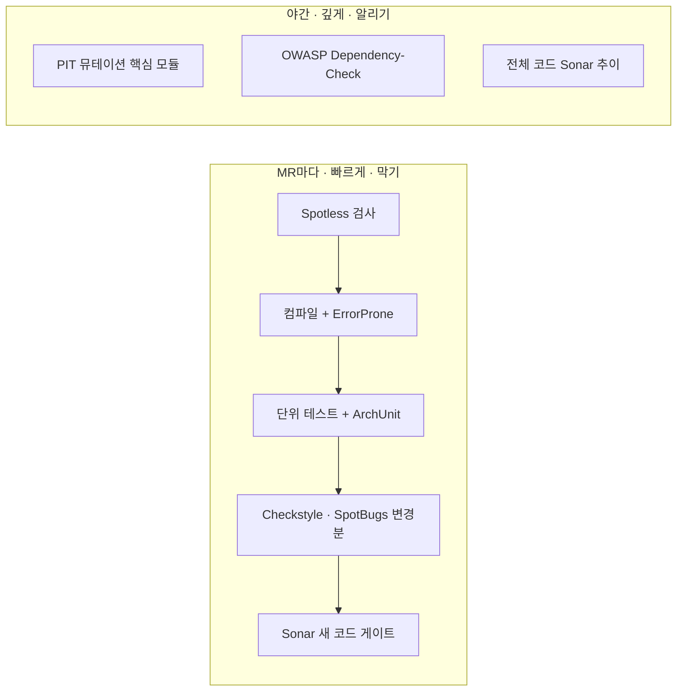
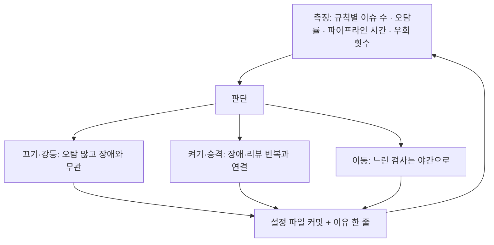

# CI 품질 도구 고르기와 튜닝 — "기본값 그대로"에서 "우리 팀 기준"으로

> 출발 질문: SonarQube·정적 분석·테스트를 CI에 걸어 두긴 했는데 **기본 설정 그대로** 쓰고 있다. 무엇을 보고 도구를 고르고, 무엇을 찾아서 튜닝해야 하나?
> 핵심 주장: **도구는 우리 장애·리뷰·배포 데이터에서 출발해서 고른다.** 기본값은 "아무 팀에나 무난한" 값이지 "우리 팀에 맞는" 값이 아니다.
> 관련: 도구 목록과 배선은 [품질 게이트·팀 코드 표준](quality-gates-and-standards.md), 구조 규칙은 [구조를 CI로 지키기](../../architecture/deep-architecture-fitness-ci.md), 테스트 층은 [테스트 전략](deep-testing-strategy.md).

---

## 0. 30초 직관 — 화재경보기 감도

화재경보기 감도를 최고로 올리면 토스트만 구워도 울린다. 사람들은 배터리를 뺀다. 감도를 최저로 내리면 진짜 불이 나도 조용하다. **좋은 경보기는 "우리 집에서 실제로 불이 나는 곳"에 맞춰 단다.** 주방엔 열 감지, 침실엔 연기 감지.

CI 품질 도구도 똑같다.
- 규칙이 너무 많으면(감도 최고) 경고가 수천 개 쌓이고, 팀은 결과를 안 본다. 사실상 배터리를 뺀 상태다.
- 기본값만 쓰면(감도 아무렇게나) 우리 팀이 실제로 겪는 장애 유형은 못 잡을 수 있다.
- 그래서 튜닝은 **"우리가 실제로 어디서 불이 났나"를 먼저 보고**, 그곳에 맞춰 규칙을 켜고 끄는 일이다.

**핵심 요약**: 튜닝의 목표는 "규칙 많이"가 아니라 **"울리면 진짜인 경보"** 다.

---

## 1. 지금 상태 진단 — 기본값으로 쓰면 생기는 일

| 증상 | 원인 | 이게 뜻하는 것 |
|---|---|---|
| SonarQube 이슈가 수천 개, 아무도 안 봄 | 기본 프로파일 전체 규칙 + 전체 코드 대상 | 신호가 소음에 묻힘 |
| 게이트가 항상 통과 | 게이트 조건이 느슨하거나 "새 코드" 기준이 잘못 잡힘 | 막는 힘이 없음 |
| 게이트가 자주 실패해서 우회(관리자 승인) | 조건이 레거시 전체에 걸림 | 신뢰를 잃는 중 |
| 파이프라인 20분+ | 무거운 검사를 매 커밋마다 | 개발자가 결과를 기다리지 않음 |
| 같은 리뷰 지적이 반복 | 그 문제를 잡는 규칙이 없음 | 기계로 옮길 후보 |
| 같은 유형의 장애가 재발 | 장애 원인과 규칙이 연결 안 됨 | **가장 가치 있는 튜닝 대상** |

> 하나라도 해당하면 "도구는 있는데 설계는 없는" 상태다. 이 노트의 나머지는 그걸 설계로 바꾸는 순서다.

---

## 2. 무엇을 보고 고르나 — 우리 쪽 입력 6가지 ⭐

도구와 규칙을 고르기 전에 **우리 데이터**를 먼저 모은다. 이게 튜닝의 재료다.

| 우리 쪽에서 볼 것 | 어디서 찾나 | 무엇을 고르게 해 주나 |
|---|---|---|
| **① 장애·버그 이력** | 장애 보고서, 이슈 트래커, 운영 로그 | 어떤 규칙이 진짜 사고를 막는지. 예: NPE가 잦음 → NullAway·SpotBugs NP 규칙. 커넥션 누수 → 리소스 누수 규칙. 이중 처리 → 멱등성 테스트 |
| **② 리뷰 반복 지적** | MR 코멘트 | 사람이 반복하는 지적 = 기계로 옮길 규칙. 같은 말이 두 번 나오면 후보 |
| **③ 코드베이스 성격** | 줄 수, 레거시 비중, 현장 fork 수, 생성 코드 | "새 코드만" 기준을 쓸지, 무엇을 분석에서 뺄지(생성 코드·외부 라이브러리) |
| **④ 보안·인증 요구** | 발주 조건, 인증(GS 등), 공공 보안약점 진단 기준 | 보안 규칙 세트의 범위. 공공이면 행안부 소프트웨어 개발보안 가이드의 보안약점 항목과 매핑 |
| **⑤ 팀 규모·숙련도·AI 비중** | 인원, 신규 입사자, AI 생성 코드 비율 | 규칙 개수·엄격도. 신규가 많거나 AI 코드가 많을수록 기계 검사의 가치가 커짐 |
| **⑥ CI 자원·배포 주기** | 러너 성능, 파이프라인 시간, 하루 배포 수 | 무엇을 MR마다, 무엇을 야간에 돌릴지 |

> **순서가 중요하다.** 도구 비교표부터 보면 "다 좋아 보여서 다 켜는" 결과가 된다. **① 장애 이력 → ② 리뷰 지적**에서 출발하면 켤 규칙이 수십 개로 줄어든다.

**핵심 요약**: 튜닝 = 우리 장애·리뷰 데이터와 규칙을 1:1로 연결하는 작업.

---

## 3. 도구별로 "왜 쓰나 · 무엇을 튜닝하나 · 무엇을 포기하나"

### 3-1. 한눈에

| 도구 | 왜 쓰나 (잡는 것) | 튜닝 손잡이 | 비용·포기하는 것 |
|---|---|---|---|
| **SonarQube** | 이슈 집계, 새 코드 기준 게이트, 추이 | 품질 프로파일(규칙 묶음), 품질 게이트(조건), 새 코드 정의, 제외 경로 | 서버 운영, 오탐 관리 시간 |
| **Checkstyle** | 이름·형식·import 규칙 | 규칙 파일(`checkstyle.xml`), 심각도, 억제 파일 | 규칙이 많으면 스타일 논쟁이 설정 파일로 옮겨옴 |
| **PMD** | 소스 버그 패턴, 복잡도 | 규칙 세트, 복잡도 임계값 | 오탐 비율이 상대적으로 높은 규칙이 있음 |
| **SpotBugs** | 바이트코드 버그(NPE 경로, 리소스 누수, 동시성) | `effort`·`reportLevel`, 제외 필터 | 분석 시간 |
| **ErrorProne / NullAway** | 컴파일 단계 버그·널 | 체크 on/off, 대상 패키지 | 컴파일 시간 증가, 도입 초기 수정량 |
| **JaCoCo (커버리지)** | 테스트가 닿은 줄 | 기준값, 대상(새 코드/변경분), 제외 클래스 | 숫자 맞추기용 테스트가 생길 위험 |
| **PIT (뮤테이션)** | 테스트가 진짜 검증하는지 | 대상 패키지, 실행 주기 | 매우 느림 → 야간·핵심 모듈만 |
| **OWASP Dependency-Check** | 라이브러리 CVE | CVSS 실패 기준, 억제 파일 | DB 갱신 시간, 오탐 억제 관리 |
| **ArchUnit / Modulith** | 구조 경계 | 규칙 수, freeze | 규칙이 설계 변경의 비용이 됨 |
| **gitleaks** | 커밋 속 비밀키 | 허용 목록 | 거의 없음 (싸고 효과 큼) |

### 3-2. SonarQube — 가장 많이 "기본값"으로 방치되는 도구

튜닝 손잡이는 4개다.

**① 새 코드(New Code) 정의 — 레거시 팀에게 제일 중요**
- 게이트 조건은 **새 코드에만** 적용된다. 그래서 "새 코드가 언제부터인가"가 게이트의 체감 난이도를 정한다.
- 선택지: 이전 버전 이후 / 최근 N일 / 기준 브랜치 대비 / 특정 분석 이후.
- 레거시가 큰 팀은 **"기준 브랜치 대비" 또는 "이전 버전 이후"** 로 잡아서 "이번에 바꾼 코드"만 깨끗하게 유지하는 게 출발점이다.

**② 품질 게이트 조건**
- 기본 게이트 "Sonar way" 조건(공식 문서 기준): 새 이슈 없음, 새 보안 핫스팟 전부 검토, **새 코드 커버리지 80% 이상**, **새 코드 중복 3% 이하**.
- 튜닝 포인트: 커버리지 80%가 지금 팀 현실과 멀면 **낮게 시작해서 분기마다 올리는** 래칫으로 간다. 처음부터 80%로 걸면 우회가 일상이 된다.
- 반대로 "새 이슈 0"은 유지할 가치가 크다. 새 코드만 대상이라 감당 가능하다.

**③ 품질 프로파일 (켜 둘 규칙 묶음)**
- 기본 "Sonar way" 프로파일을 **복사(extend)해서 우리 프로파일**을 만들고, 그 위에서 끄고 켠다. 기본 프로파일을 직접 고치면 업그레이드 때 꼬인다.
- 끄는 기준: 최근 몇 달 "오탐(false positive)"이나 "고치지 않음(won't fix)"으로 처리된 비율이 높은 규칙.
- 켜는 기준: 2장의 ①②에서 나온 장애·리뷰 유형과 연결되는 규칙.

**④ 제외 경로**
- 생성 코드(QueryDSL Q클래스, MapStruct 구현, 스웨거 생성물), 외부에서 복사해 온 라이브러리, 마이그레이션 SQL은 분석·커버리지 대상에서 뺀다.
- 안 빼면 고칠 수 없는 이슈가 쌓여서 신호를 덮는다.

> ⚠️ 에디션과 버전에 따라 브랜치·MR 단위 분석 지원이 다르다. 쓰는 서버의 에디션에서 MR별 게이트가 되는지 먼저 확인하고, 안 되면 main 머지 후 게이트 + 다른 도구(Checkstyle·SpotBugs)를 MR 단계에 두는 식으로 나눈다.

> CI가 게이트 결과를 기다렸다가 실패하게 하려면 스캐너 옵션 `sonar.qualitygate.wait=true` 를 쓴다. 이게 없으면 분석만 올리고 파이프라인은 통과해 버린다. **"걸어 놨는데 막지 않는" 가장 흔한 원인**이다.

### 3-3. 커버리지 — 숫자 목표의 함정

- **굿하트 법칙**: 숫자가 목표가 되면 좋은 측정이 아니게 된다. 커버리지 80%를 강제하면 검증 없는 테스트(호출만 하고 확인 안 하는)가 생긴다.
- 그래서 커버리지는 **"새 코드" 대상 + 너무 높지 않게**, 그리고 진짜 품질은 **뮤테이션 테스트(PIT)** 를 핵심 모듈(요금 계산, 결제)에만 야간에 돌려서 본다.
- 정리: 커버리지는 **바닥선**, 뮤테이션은 **품질 확인** 용도로 역할을 나눈다.

### 3-4. 같은 걸 두 번 잡지 않기

SonarQube 자바 규칙 안에는 PMD·Checkstyle과 비슷한 규칙이 많다. 둘 다 켜면 같은 문제가 두 군데서 보고돼서 소음이 두 배가 된다.

| 역할 | 맡길 곳 |
|---|---|
| 포맷 | Spotless (자동 수정) |
| 이름·import 규칙 | Checkstyle |
| 버그 패턴 | SpotBugs + (Sonar 또는 PMD 중 하나) |
| 집계·추이·새 코드 게이트 | SonarQube |
| 구조 | ArchUnit |

**핵심 요약**: Sonar는 손잡이 4개(새 코드 정의·게이트·프로파일·제외)만 만져도 체감이 완전히 달라진다. 특히 `sonar.qualitygate.wait=true` 와 "새 코드" 정의부터 확인한다.

---

## 4. 트레이드오프 축 5개 ⭐

모든 튜닝 결정은 아래 다섯 축 중 하나에서 어느 쪽을 고르는 일이다.

| 축 | 한쪽 | 다른 쪽 | 고르는 기준 (우리 데이터) |
|---|---|---|---|
| **속도 vs 깊이** | MR마다 빠른 검사 (5~10분) | 무거운 검사 (뮤테이션·전체 SpotBugs·CVE) | 파이프라인 시간 p90. 10분 넘으면 무거운 것은 야간으로 |
| **막기 vs 알리기** | 실패 (머지 차단) | 경고 (리포트만) | 그 규칙이 장애와 연결되나. 연결되면 막기, 아니면 알리기 |
| **새 코드 vs 전체** | 변경분만 검사 (래칫) | 전체 코드 검사 | 레거시 비중. 크면 새 코드만, 작으면 전체 |
| **엄격 vs 오탐** | 규칙 많이 | 규칙 적게 | 오탐 처리 비율. 높으면 그 규칙을 끄거나 강등 |
| **공통 vs 현장별** | 한 설정을 모든 현장에 | 현장마다 예외 | fork 수. 많을수록 공통 설정 + 명시적 예외 파일 |

글로 풀면: MR 단계에는 빠르고 장애와 연결된 검사만 두고 실패하면 머지를 막는다. 뮤테이션 테스트, 의존성 취약점 검사, 전체 추이처럼 느리거나 레거시 전체를 보는 검사는 야간에 돌려서 리포트로 알린다. 야간 결과 중 심각한 것(예: 높은 점수의 CVE)만 다음 날 이슈로 만든다.

**GitLab CI에서 쓰는 손잡이**

| 목적 | 설정 |
|---|---|
| 병렬로 빨리 | `needs:` 로 단계 대신 의존 관계(DAG) |
| 바뀐 곳만 | `rules: - changes:` |
| 경고 모드 | `allow_failure: true` (리포트는 남고 머지는 안 막음) |
| 야간 | `rules: - if: $CI_PIPELINE_SOURCE == "schedule"` |
| 중복 실행 정리 | `interruptible: true` |
| 빌드 캐시 | Gradle 캐시를 `cache:` 로 |

---

## 5. 튜닝 루프 — 한 번이 아니라 월 1회

글로 풀면: 한 달에 한 번 숫자를 보고, 소음만 내는 규칙은 끄거나 경고로 내리고, 실제 사고와 연결된 규칙은 켜거나 차단으로 올리고, 느린 검사는 야간으로 옮긴다. 바꾼 내용은 설정 파일로 커밋하고 이유를 한 줄 남긴다.

**월 1회 볼 숫자 5개**

1. 규칙별 이슈 수 상위 10개 — 소음의 주범 찾기
2. 오탐·고치지 않음 처리 비율 — 끌 규칙 찾기
3. 파이프라인 시간 p50·p90 — 야간으로 옮길 검사 찾기
4. 게이트 우회(관리자 강제 머지) 횟수 — 조건이 현실과 안 맞는 신호
5. 이번 달 장애 원인 중 규칙으로 잡을 수 있었던 것 — 켤 규칙 찾기

> 5번이 가장 중요하다. **장애 회고 템플릿에 "이걸 CI가 잡을 수 있었나?" 한 줄**을 넣으면 튜닝 재료가 자동으로 쌓인다.

---

## 6. 우리 팀 채우기 시트 (빈칸 채우며 쓰기)

| 질문 | 우리 답 | 결정 |
|---|---|---|
| 최근 1년 장애 원인 상위 3개는? | | 각각을 잡는 규칙·테스트 |
| 리뷰에서 가장 자주 하는 지적 3개는? | | Checkstyle·ArchUnit 규칙 후보 |
| 레거시 비중과 현장 fork 수는? | | 새 코드 정의, 공통 설정 범위 |
| 지금 파이프라인 시간 p90은? | | MR vs 야간 분리선 |
| 보안·인증 요구는? | | 보안 규칙 세트, CVE 실패 기준 |
| AI 생성 코드 비중은? | | 구조 규칙·커버리지 기준 강화 여부 |
| Sonar 에디션에서 MR 게이트가 되나? | | MR 단계에 둘 도구 |
| `sonar.qualitygate.wait` 가 켜져 있나? | | 안 켜져 있으면 지금 게이트는 장식 |

---

## 7. 3단 요약 (암기용)

### Q1. CI 품질 도구는 무엇을 기준으로 고르나?
- **① 결론 · WHAT** 도구 비교표가 아니라 우리 장애 이력과 리뷰 반복 지적에서 출발한다.
- **② 원리 · HOW** 장애 유형 하나마다 그걸 잡는 규칙·테스트를 연결하고, 리뷰에서 두 번 나온 지적은 규칙으로 옮긴다.
- **③ 확장 · TRADE-OFF** 규칙이 많을수록 소음이 늘어 팀이 결과를 안 보게 된다. "울리면 진짜"인 규칙만 막기로 둔다.

### Q2. 기본값 SonarQube에서 가장 먼저 만질 것은?
- **① 결론 · WHAT** `sonar.qualitygate.wait=true`, 새 코드 정의, 우리 품질 프로파일(기본 복사), 제외 경로.
- **② 원리 · HOW** 게이트는 새 코드에만 걸리므로 새 코드 정의가 체감 난이도를 정하고, wait가 없으면 CI는 게이트 실패를 모른다.
- **③ 확장 · TRADE-OFF** 기본 커버리지 80%는 레거시 팀에 높을 수 있다. 낮게 시작해 올리는 래칫이 우회 문화보다 낫다.

### Q3. 속도와 깊이는 어떻게 나누나?
- **① 결론 · WHAT** MR마다 빠르고 장애와 연결된 검사는 막기, 느리고 넓은 검사는 야간에 알리기.
- **② 원리 · HOW** 파이프라인이 10분을 넘으면 개발자가 결과를 기다리지 않는다. GitLab `needs`·`changes`·schedule로 나눈다.
- **③ 확장 · TRADE-OFF** 야간으로 미룬 검사는 피드백이 하루 늦다. 그래서 심각도 높은 결과만 다음 날 이슈로 승격한다.

### Q4. 커버리지 숫자를 올리면 품질이 오르나?
- **① 결론 · WHAT** 아니다. 커버리지는 바닥선이고, 테스트가 진짜 검증하는지는 뮤테이션 테스트로 본다.
- **② 원리 · HOW** 숫자가 목표가 되면 검증 없는 테스트가 생긴다(굿하트 법칙). PIT은 코드를 일부러 바꿔서 테스트가 실패하는지 본다.
- **③ 확장 · TRADE-OFF** PIT은 느리므로 요금·결제 같은 핵심 모듈에만, 야간에 돌린다.

---

## 용어 사전

| 한 | 영 | 뜻 |
|---|---|---|
| 품질 프로파일 | quality profile | SonarQube에서 켜 둔 규칙 묶음 |
| 품질 게이트 | quality gate | 통과 조건 묶음. 실패하면 머지·배포 차단 |
| 새 코드 정의 | new code definition | 게이트가 "새 코드"로 볼 범위 |
| 오탐 | false positive | 문제가 아닌데 문제라고 보고된 것 |
| 뮤테이션 테스트 | mutation testing | 코드를 일부러 바꿔 테스트가 잡는지 보는 검사 |
| 굿하트 법칙 | Goodhart's law | 지표가 목표가 되면 좋은 지표가 아니게 된다 |
| 래칫 | ratchet | 기준을 한 방향으로만 올리는 점진 도입 |
| DAG 파이프라인 | needs | 단계 순서 대신 의존 관계로 병렬 실행 |

## 연결 지도

- 도구 목록·3겹 배선·blame 보존 → [품질 게이트·팀 코드 표준](quality-gates-and-standards.md)
- 구조 경계 규칙 (ArchUnit·freeze) → [구조를 CI로 지키기](../../architecture/deep-architecture-fitness-ci.md)
- 테스트 층 설계 → [테스트 전략](deep-testing-strategy.md)
- AI 코드 검증 → [AI 시대 검증·구조 유지](../../architecture/deep-ai-era-verification.md)

## 출처

- SonarQube Server — Introduction to quality gates — https://docs.sonarsource.com/sonarqube-server/quality-standards-administration/managing-quality-gates/introduction-to-quality-gates
- GitLab CI/CD YAML reference (`needs`, `rules`, `allow_failure`, `interruptible`) — https://docs.gitlab.com/ci/yaml/
- PIT Mutation Testing — https://pitest.org/
- OWASP Dependency-Check — https://owasp.org/www-project-dependency-check/
- Neal Ford 외, *Building Evolutionary Architectures* (2017, 2판 2022)
